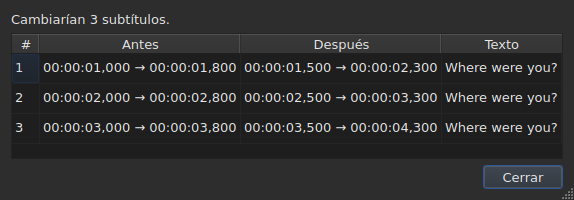
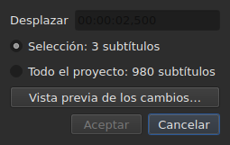
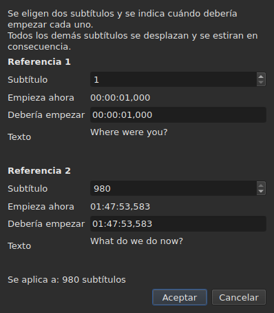
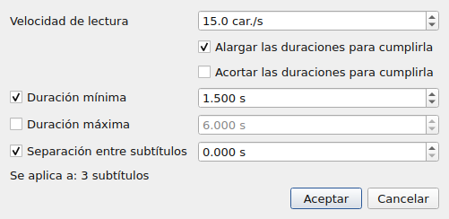
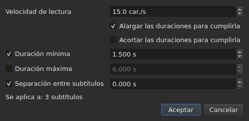
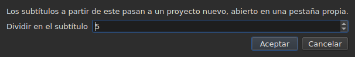

# Las operaciones

<!-- machine-translated -->
> Esta página es una traducción automática y todavía no la ha revisado ningún lector del idioma.

El menú **Herramientas** contiene dieciséis operaciones, un análisis y dos entradas de ortografía. Cada una de las
dieciséis se deshace con un `Ctrl+Z`; el análisis no modifica nada. `Check Spelling…` también se deshace, y `Spell-Check Settings…` no toca ningún texto.

| Entrada | Cuadro de diálogo | Qué hace |
| :---- | :----- | :----------- |
| `Shift Positions…` | sí | desplaza el alcance una duración |
| `Transform Positions…` | sí | corrige el alcance a partir de dos referencias |
| `Convert Frame Rate…` | sí | reajusta los tiempos del alcance de una velocidad de fotogramas a otra |
| `Adjust Durations…` | sí | mueve los fines para respetar una velocidad de lectura, unas duraciones y una separación |
| `Append File…` | un selector de archivos | añade un archivo al final del proyecto |
| `Split Project…` | sí | corta el proyecto en dos; el resto va a una pestaña nueva |
| `Italic` | **no** | pone el alcance en cursiva, o se la quita |
| `Dialogue` | **no** | pone una raya de diálogo al principio de cada línea, o la quita |
| `Capitalización ▸ Tipo título` | **no** | cada palabra lleva mayúscula |
| `Capitalización ▸ Tipo oración` | **no** | la primera letra del texto, y solo ella |
| `Capitalización ▸ MAYÚSCULAS` | **no** | todo en mayúsculas |
| `Capitalización ▸ minúsculas` | **no** | todo en minúsculas |
| `Remove Hearing-Impaired Mentions…` | sí, sin ajustes | elimina las anotaciones para sordos |
| `Correct Texts…` | sí, un asistente de varias páginas | propone correcciones — anotaciones, unir y separar palabras, errores comunes, mayúsculas, salto de línea — y las aplica una vez aceptadas, véase [Corregir textos…](correct-texts.md) |
| `Check Spelling…` | sí, un recorrido palabra por palabra | recorre las palabras que el diccionario no conoce y aplica lo que se ha corregido, véase [Comprobar ortografía…](check-spelling.md) |
| `Spell-Check Settings…` | sí | elige el idioma, el alcance y el documento de la comprobación, y el subrayado al escribir, véase [Comprobar ortografía…](check-spelling.md#configuración-ortográfica) |
| `Snap to Frame Rate…` | sí | vuelve a poner cada marca de tiempo en el fotograma más cercano |
| `Shift Whole File onto Grid (…)` | **no** | devuelve todo el archivo a su rejilla |
| `Frame Rate Analysis…` | sí, sin ajustes | **no modifica nada** — véase [La rejilla de fotogramas](frame-grid.md) |

**Lo que ha hecho una operación se dice en un cuadro de información que hay que
cerrar, salvo para `Italic`, `Case` y `Dialogue`**: esas tres no abren ningún
cuadro de diálogo, y su informe — «nada que cambiar» incluido — se muestra
en la barra de estado, sin nada que cerrar. `Split Project…` también da el suyo
en la barra de estado: su resultado ya está a la vista, en la pestaña nueva. Los mensajes se citan en la
sección de cada operación.

Insertar, eliminar, fusionar y dividir líneas no está aquí, sino en el
menú `Edit`, porque cambian el número de líneas. Véase
[Insertar, eliminar, fusionar y dividir líneas](lines.md).

## Sobre qué actúan

**Las líneas seleccionadas, o todo el archivo si no hay ninguna.** Es la misma
regla para todas, y los cuadros de diálogo, cuando los hay, la recuerdan con palabras
claras:

```
Applies to: 4 subtitles
```

Seleccionar todas las líneas equivale a no seleccionar ninguna.

**Cuando solo está seleccionada una parte de las líneas, el cuadro de diálogo pregunta
sobre qué actuar.** Se muestran dos opciones, con su cuenta, y **la selección
es la que está marcada**:

```
(•) Selected: 2 subtitles
( ) Whole project: 4 subtitles
```

Marcar `Whole project` amplía la operación a todo el archivo sin tener que
cambiar antes la selección. Cuando no hay nada que elegir — nada
seleccionado, o todo —, la línea `Applies to:` de arriba se queda sola.

Los cuadros de diálogo de `Shift Positions…`, `Transform Positions…`,
`Convert Frame Rate…`, `Adjust Durations…`, `Snap to Frame Rate…` y
`Remove Hearing-Impaired Mentions…` ofrecen esta elección.

### Ver antes de aplicar

`Shift Positions…`, `Transform Positions…`, `Convert Frame Rate…`,
`Adjust Durations…` y `Snap to Frame Rate…` llevan un botón **`Preview changes…`**.
Abre una pequeña ventana que dice cuántos subtítulos cambiaría la operación
**con lo que está tecleado en ese momento, sobre el alcance marcado**, y
enumera los doce primeros: su número, su posición antes, su posición
después, y la primera línea de su texto. **No se aplica nada**: cerrar la
ventana vuelve al cuadro de diálogo, donde se puede cambiar un valor y volver a
mirar.




Se abre con el tamaño suficiente para mostrar todas las columnas, y puede redimensionarse
a mano.

Si la operación no cambiara nada, la ventana lo dice (`Nothing would change.`).
Mientras lo tecleado no defina una operación — una duración ilegible, dos
referencias en el mismo subtítulo —, la vista previa está vacía por la misma razón por la que el
botón `OK` está en gris. `Remove Hearing-Impaired Mentions…` no tiene vista previa: lo que
cambia es texto, y el informe que da después
lo dice.

**Con una traducción, ¿qué texto?** Las operaciones de posición y de estructura
actúan sobre el subtítulo entero — sus dos textos lo siguen. Las que
reescriben un texto — `Italic`, `Case`, `Dialogue`,
`Remove Hearing-Impaired Mentions…` — se aplican al **texto de la columna de la celda actual**: la
traducción en su columna, el texto principal en las demás. El otro queda intacto, y
la barra de estado dice a cuál se aplica. Véase [La tabla](table.md#el-texto-al-que-se-aplican-las-operaciones).

**Una excepción, y su etiqueta lo dice**: `Shift Whole File onto Grid`
ignora la selección. Una rejilla es una propiedad del documento, y medio
documento no tiene rejilla propia; la entrada lo dice, por tanto, en su nombre en lugar de
decirlo solo en este manual.

**`Append File…` también ignora la selección**, por otro motivo: no
es un alcance lo que reescribe, es un final lo que hace retroceder. Véase su
[propia sección](#append-file). **Lo mismo `Split Project…`**: corta donde se le
indica. Véase [la suya](#split-project).

**`Correct Texts…` elige su alcance en su propia página**, en lugar de seguir
la selección actual: la selección, el proyecto actual o todos los proyectos
abiertos. Véase [Corregir textos…](correct-texts.md). **`Check Spelling…` lo elige en
`Spell-Check Settings…`**, y lo recuerda: véase [Comprobar ortografía…](check-spelling.md).

**Las dos operaciones de rejilla no hablan de lo mismo que la rejilla.**
Una operación actúa sobre la selección; el análisis y la barra de estado hablan del
**documento entero**. Alinear cinco líneas de ciento setenta y seis sí cambia esas
cinco — la tabla lo muestra — sin que ninguno de los dos se mueva, lo que
parece un refresco olvidado. No lo es: no tienen nada que
decir. Véase [`Snap to Frame Rate…`](#snap-to-frame-rate) y
[La rejilla de fotogramas](frame-grid.md).

### Lo que significa «nada seleccionado», entrada por entrada

La regla se aplica al menú `Tools` y a la búsqueda. Las entradas del
menú `Edit` que tocan las líneas o las vacían la interpretan de otro modo — si no, un
`Del` o un `Ctrl+X` desafortunado vaciaría el documento.

| Entrada | Sin selección | Lo que exige |
| :---- | :------------------ | :--------------- |
| las operaciones del menú `Tools` | todo el archivo | un documento no vacío |
| `Shift Whole File onto Grid` | todo el archivo, **siempre** | una rejilla encontrada |
| `Find and Replace…` | todo el archivo | un documento no vacío |
| `Cut Texts`, `Copy Texts`, `Paste Texts` | **desactivadas** | al menos una línea seleccionada |
| `Remove Subtitles` | **desactivada** | al menos una línea seleccionada |
| `Merge Subtitles` | **desactivada** | un bloque de al menos dos líneas vecinas |
| `Split Subtitle` | **desactivada** | exactamente una línea |
| `Insert Subtitles…` | desactivada, salvo en un documento vacío | una línea junto a la que colocarlos |

Cada página da el motivo: [el portapapeles](clipboard.md#sobre-qué-actúan),
[las líneas](lines.md), [la búsqueda](find-and-replace.md#lo-que-abarca-la-búsqueda).

Las entradas están **desactivadas en un archivo vacío**: no habría nada que
desplazar. `Italic` tiene una segunda condición, que describe su sección: el formato
abierto debe poder escribir un estilo. La capitalización y las rayas no tienen ninguna — un
texto es un texto en los nueve formatos.

## `Shift Positions…`

Mueve el alcance una duración, hacia delante o hacia atrás. Los dos límites de
cada subtítulo se mueven lo mismo: ninguno se queda en pantalla más ni menos tiempo
que antes.

La duración se escribe **como una marca de tiempo, signo incluido** — `00:00:02,500` adelanta,
`-0:01,250` atrasa. Las formas aceptadas son las de una celda de posición.




| Rechazo | Por qué |
| :------ | :-- |
| una duración ilegible | el botón sigue desactivado; no se desplaza nada al azar |
| un desplazamiento nulo | no hay ninguna operación que registrar |
| un subtítulo quedaría antes del inicio del vídeo | **ningún archivo puede llevar una posición así** |

El tercer caso nombra al culpable — «el subtítulo 1 empezaría antes del origen» —
y es el que hay que mirar para ver por cuánto se ha equivocado uno. No se
aplica nada.

## `Transform Positions…`

La corrección de un archivo temporizado sobre otro montaje. Se indica dónde empiezan realmente **dos**
subtítulos, y todo lo demás sigue, proporcionalmente.

El cuadro de diálogo pide dos veces lo mismo: un número de subtítulo, y la
posición en la que debe estar su inicio. Para cada referencia, muestra **lo que designa ese
número** — su texto (`Text`) y el tiempo en el que empieza
**ahora** (`Now starts`), como simples etiquetas — y estos siguen al número
a medida que se cambia. El texto conserva **tres líneas de espacio** diga lo que diga el
subtítulo: uno más largo, o una dirección larga, se desplaza dentro de él, y
el cuadro de diálogo conserva su tamaño cuando cambia la referencia. **Solo hay que teclear un campo por referencia:
`Should start`**, el tiempo en el que debe empezar ese subtítulo. No hace falta buscar en la tabla cuál es la línea `980`.

`Should start` **se propone con el valor actual**: mientras no se
toque, la referencia dice «este subtítulo ya está donde debe estar». Solo se
cambia lo que se quiere cambiar. La segunda referencia viene rellenada con el último
subtítulo del archivo — dos referencias alejadas dan una corrección más segura
que dos vecinas.




**Las dos referencias caen exactamente donde se pidió.** No es
una aproximación: el cálculo está hecho para que sea cierto.

| Rechazo | Por qué |
| :------ | :-- |
| dos referencias en el mismo subtítulo | no definen ninguna corrección |
| una posición ilegible | la misma razón que para el desplazamiento |

Un número fuera del archivo no puede teclearse: el campo está acotado por el
número de subtítulos.

## `Convert Frame Rate…`

Reajusta los tiempos del alcance cuando las posiciones se calcularon con una velocidad de
fotogramas y deben estarlo con otra.

Las dos listas ofrecen las ocho velocidades de fotogramas estándar.

> **Equivocarse de velocidad de fotogramas de entrada desplaza todo el archivo sin avisar
> de nada.** Es el peor modo de fallo de esta operación, y por eso
> el cuadro de diálogo dice de dónde vienen los valores que propone en lugar de
> ponerlos en silencio.

### Las dos fuentes, y a qué responden

El cuadro de diálogo lleva hasta dos líneas más, cada una de las cuales aparece cuando tiene
algo que decir:

| Línea | Lo que dice | Lo que rellena |
| :--- | :----------- | :---------------- |
| `The positions say` | la [rejilla de fotogramas](frame-grid.md) deducida de las posiciones del archivo | `Timed against` |
| `The video declares` | la velocidad de fotogramas que anuncia el contenedor, por ejemplo `24000/1001` | `Should play at` |
| `The file was read at` | la velocidad de fotogramas con la que se leyó un archivo **contado en fotogramas** | `Timed against` |

**Cada propuesta va al campo al que responde.** La rejilla dice con qué se
*escribió* el archivo — es la lista de arriba. Lo que anuncia el contenedor es
la velocidad de fotogramas a la que *va* la película, y por tanto aquella a la que deben llegar
los subtítulos — es la lista de abajo.

**Solo una rejilla limpia rellena la entrada.** Una rejilla parcial es un
indicio que la propia deducción califica de parcial, y este campo decide una
operación sobre todo el archivo. La [barra de estado](frame-grid.md) y el análisis
recogen ese caso; este campo no.

**Un archivo contado en fotogramas sustituye a la rejilla en lugar de añadirse a ella.**
MicroDVD lleva números de fotograma, y las posiciones del documento se
calcularon a partir de ellos con la velocidad de lectura: una rejilla deducida de esas posiciones
solo puede volver a encontrar ese número. `The positions say` desaparece, por tanto, y
`The file was read at` ocupa su lugar — es la misma elección que hace
[la barra de estado](frame-grid.md#un-documento-contado-en-fotogramas-no-tiene-rejilla-tiene-una-velocidad-de-fotogramas).

**Así es como se cambia la velocidad de fotogramas de un MicroDVD.** Poner la velocidad leída
como entrada y la verdadera como salida recalcula cada posición a partir de los
fotogramas del archivo — sin volver a leer nada, y la operación se deshace como las
demás.

### Un desacuerdo no es una contradicción

Las dos líneas pueden mostrarse juntas y anunciar números distintos.
**No es un error que arbitrar**: la película va a una velocidad de fotogramas, el
archivo se escribió sobre otra rejilla. Un archivo a 24 para una película a 25 es
exactamente el caso que la alineación — `snap` en la línea de comandos — existe para
tratar.

Por tanto, no se elige nada en lugar del usuario: las dos listas siguen siendo
editables, y es deliberado. Una fuente que se impone impide contrastar.

Las líneas no aparecen cuando no hay nada que decir: ningún vídeo
asociado, ningún `ffprobe`, o ninguna rejilla limpia. El cuadro de diálogo es entonces el
descrito más arriba, y **ninguna operación se niega por ello** — la
velocidad de fotogramas la aporta el usuario. Véase
[El vídeo asociado](video.md#ffmpeg-no-es-obligatorio).

Una velocidad de fotogramas que anuncia la película pero que no es una de las ocho estándar
se **muestra sin elegirse**: saber que la película va a una
velocidad inusual es la información, y aquí no hay nada a lo que convertirla.

Convertir una velocidad de fotogramas en ella misma no cambia nada: el botón sigue desactivado.

## `Adjust Durations…`

Alarga o acorta la duración de los subtítulos del alcance **moviendo su
fin, nunca su inicio**. Mover el inicio movería el subtítulo, que es
el trabajo de [`Shift Positions…`](#shift-positions).





### Las cuatro restricciones

| Campo | Lo que pide | Valores | Por defecto |
| :---- | :--------------- | :----- | :------ |
| `Reading speed` | el tiempo necesario para leer el texto | de 1 a 99 caracteres por segundo, a la décima | 15 car./s |
| `Lengthen durations to match it` | alargar lo que es demasiado corto para leerse | marcada o no | marcada |
| `Shorten durations to match it` | acortar lo que se queda en pantalla más de lo necesario | marcada o no | sin marcar |
| `Minimum duration` | una duración mínima | de 0 a 99 s, al milisegundo | marcada, 1,5 s |
| `Maximum duration` | una duración máxima | de 0 a 99 s, al milisegundo | sin marcar, 6 s |
| `Gap between subtitles` | la separación que dejar antes del subtítulo siguiente | de 0 a 99 s, al milisegundo | marcada, 0 s |

Son los valores por defecto de Gaupol.

**Una restricción sin marcar está ausente**: su campo está en gris y no se lee.
Una restricción marcada a cero vale cero — una separación de 0 s impide que un
subtítulo se solape con el siguiente. La velocidad de lectura solo se lee si
`Lengthen` o `Shorten` está marcada.

**Cuando todo está sin marcar, `OK` está desactivado**: no hay nada que pedir.

El cuadro de diálogo se vuelve a abrir con los valores del último ajuste, **y los conserva de una
sesión a la siguiente** — como las dos opciones de búsqueda. **Una casilla sin marcar
conserva su valor**: desmarcar `Minimum duration` después de poner 2 s no devuelve
1,5 s, y volver a marcarla encuentra 2 s. Los nueve ajustes están en el
[archivo de preferencias](preferences.md#el-archivo), bajo `duration-adjust.`.

**La línea de comandos los comparte.** [`subedit-cli adjust`](../subedit-cli/adjust.md) lee los
mismos nueve ajustes por defecto, así que una velocidad puesta aquí es la que usa, salvo que sus propias opciones
digan otra cosa; [`subedit-cli config`](../subedit-cli/config.md) los muestra y los cambia. Véase
[Dos bloques, uno compartido con la línea de comandos](preferences.md#dos-bloques-uno-compartido-con-la-línea-de-comandos).

### En qué orden, y cuál gana

Cada subtítulo del alcance pasa por las cuatro restricciones **en este orden**, y
cada una fija el fin a su vez:

| Rango | Restricción | Lo que fija |
| ---: | :--------- | :----------- |
| 1 | velocidad de lectura | `end = start + length ÷ speed`, si el subtítulo es demasiado corto (`Lengthen`) o demasiado largo (`Shorten`) |
| 2 | duración mínima | `end = start + minimum`, si la duración es más corta |
| 3 | duración máxima | `end = start + maximum`, si la duración es más larga |
| 4 | separación | `end = next start − gap`, si el fin está demasiado cerca de él — nunca antes del inicio |

**Gana la última que se aplica.** La separación va al final y puede hacer que una
duración vuelva a quedar por debajo del mínimo recién fijado: dos subtítulos en pantalla al mismo
tiempo son un defecto que ve el espectador; un subtítulo un poco corto
no lo es.

**La longitud del texto se cuenta sin etiquetas**, en caracteres, saltos de línea
incluidos: `<i>été</i>` cuenta tres caracteres. La velocidad de lectura habla de
lo que lee el espectador.

**El siguiente es el subtítulo siguiente del archivo**, esté o no en el
alcance. **El último subtítulo del archivo no tiene siguiente**: la separación no lo
restringe.

### Lo que ningún fin puede satisfacer se dice

Una vez hecho el ajuste, la ventana dice cuántos fines se han movido, y **lo que
no se ha podido respetar** — una restricción solo aparece si se ha
sacrificado en al menos un subtítulo:

```text
adjusted the durations of 12 subtitles; could not satisfy the reading speed in 9 subtitles, the minimum duration in 4 subtitles
```

Las tres menciones posibles son `the reading speed`, `the minimum duration` y
`the gap`. **La duración máxima se respeta siempre**: va después de la velocidad
y del mínimo, y solo la sigue la separación, que solo puede acortar. Un mínimo
mayor que el máximo cede ante él, y es el mínimo el que se cuenta. La separación
solo se sacrifica cuando el siguiente empieza antes del inicio del propio
subtítulo.

La cuenta abarca todo el alcance, **incluidos los subtítulos cuyo fin no
se ha movido**: un subtítulo ya pegado al siguiente y demasiado corto para el
mínimo se cuenta. Cuando no se mueve ningún fin, la ventana lo dice —
`no duration to adjust` — y no entra nada en el historial.

## `Append File…`

Añade un archivo al final del proyecto abierto. **No se inserta nada entre los
dos**: el archivo elegido se desplaza hasta el fin del último subtítulo del
proyecto, exactamente como hace Gaupol.

**Desactivado en un documento vacío**: no habría ningún fin a partir del cual desplazar. Se abre un
selector de archivos, sin codificación que elegir — como `Open…`.

**El archivo añadido pasa por la conversión**, con las palabras de `Save As…` y de
[pegar desde otro formato](clipboard.md#las-etiquetas-de-otro-formato-se-traducen):
sus etiquetas se traducen al formato del proyecto, y lo que ese formato no puede
escribir se dice:

```text
appended 12 subtitles; Advanced SSA into SubRip: 1 tag dropped
```

**Lo que llevaba el archivo añadido no sobrevive entero.** Sus posiciones
siguen, etiquetas incluidas; su cabecera, sus campos propios del formato — nombre
de estilo, márgenes — y lo que una etiqueta no puede llegar a ser en el formato del proyecto no
siguen, y se dice. **No tiene traducción**: una traducción sigue siendo
propia del documento que la recibió, y el archivo añadido llega solo.

**Seleccionado después**, como las líneas que un pegado escribió más allá
del final. Cuando no se pierde nada, la cuenta se muestra en la barra de estado en lugar
de en un cuadro que cerrar — la misma regla que al
[abrir una traducción](files.md#abrir-una-traducción).

**Una sola entrada del historial**, sea cual sea el número de subtítulos
añadidos: `Ctrl+Z` los elimina todos a la vez.

**Un archivo ya abierto puede añadirse a sí mismo**: nada lo impide, como
en Gaupol.

**En la línea de comandos**, [`append`](../subedit-cli/append.md) hace lo mismo con varios archivos a
la vez, en un solo resultado.

## `Split Project…`

Corta el proyecto en dos: **el inverso exacto de `Append File…`**. Un cuadro
pregunta a partir de qué subtítulo cortar — del segundo al último, numerados
como en la tabla — y se abre en la línea actual.

**La tabla muestra dónde se corta antes de cortar**: cada número que
toma el cuadro selecciona su línea. `Cancel` devuelve la selección anterior.




**Desactivado por debajo de dos subtítulos**: un corte necesita un subtítulo a cada
lado.

**El resto se copia en un proyecto nuevo, abierto en una pestaña nueva, y se
elimina del proyecto original.** El proyecto nuevo se **desplaza en menos el fin del
último subtítulo que se quedó**: dividir y luego añadir devuelve el proyecto de partida.
Sus dos textos, principal y traducción, siguen a sus subtítulos, y
conserva el formato y la codificación del original — **sin ruta**: todavía no lo contiene
ningún archivo. Su pestaña se escribe, por tanto, `untitled*` desde su nacimiento, y
cerrarla sin guardar plantea la pregunta que se plantea para todo lo que no está
escrito.

**La barra de estado dice cuántos subtítulos se han ido**, sin ningún cuadro que
cerrar — la pestaña nueva ya muestra el resultado:

```text
split 12 subtitles into a new project
```

**Una sola entrada del historial**, en el proyecto original:
`Undo: splitting the project` le devuelve su resto. El proyecto nuevo tiene un historial
propio, vacío; deshacer no lo toca, y sigue abierto.

**Se rechaza cuando ningún archivo podría escribir el resultado.** Si las dos
mitades se solapan en el corte, el desplazamiento llevaría un subtítulo antes
del inicio del vídeo — una posición negativa, que ningún formato escribe. El cuadro
que lo rechaza **nombra el subtítulo** y sugiere cortar en otro sitio:

```text
Cannot split at subtitle 3: subtitle 3 would fall before the start of the video. Cut somewhere else.
```

Llegar exactamente al inicio está permitido: cero es una posición.

**En la línea de comandos**, [`split-file`](../subedit-cli/split-file.md) corta un archivo de la misma manera, en dos
archivos con nombre.

## `Snap to Frame Rate…`

Pone **cada marca de tiempo** — inicio y fin — en el fotograma más cercano de la
velocidad de fotogramas elegida. Una sola lista, y esa es toda la diferencia con la
conversión: una conversión necesita dos velocidades de fotogramas porque escala el
archivo de una a otra; una alineación solo necesita la
rejilla sobre la que caer.

| | `Convert Frame Rate…` | `Snap to Frame Rate…` |
| :--- | :-------------------- | :-------------------- |
| movimiento | proporcional al tiempo — **varios segundos** en un largometraje | medio fotograma como mucho, **en todas partes** |
| para qué archivo | un archivo cuya **temporización es errónea** | un archivo cuya temporización es **correcta** y cuya rejilla es errónea |

**El caso de uso**, explicado: una película a 25 fotogramas por segundo,
unos subtítulos escritos sobre una rejilla a 24, líneas ya más o menos en su
sitio con unos pocos milisegundos de diferencia. No hay nada que reajustar — solo
devolver las marcas de tiempo a los fotogramas correctos.

La lista **se abre en lo que declara el vídeo**, y no en lo que dicen las
posiciones: la intención es unirse a la rejilla de la película, y la
deducción nombra la que se abandona. Sin vídeo o sin `ffprobe`, se abre
en la velocidad de fotogramas del proyecto.

Alinear un archivo sobre la rejilla que ya ocupa no lo cambia, y no es
un error: la operación se aplica, no mueve nada, y se deshace como
cualquier otra.

**Alinear una parte del archivo lo dice, una vez hecho.** Se muestra un aviso
cuando la selección no lo abarca todo y el documento se sigue leyendo sobre otra
rejilla:

```
5 of 176 subtitles aligned to 25 fps; the document is still read on a 24 fps grid
```

Relaciona el gesto con su efecto, y explica por qué la barra de estado y
el análisis no se han movido: hablan del documento, la operación ha actuado sobre
cinco líneas. No se impide nada — alinear una parte de un archivo puede ser
intencionado.

**Casi siempre es involuntario, y eso está medido.** En los ocho archivos de rejilla
del repositorio, alinear todo el archivo lleva la velocidad de fotogramas deducida al
objetivo y su concentración al 100 %; alinear cinco líneas nunca mueve la
velocidad deducida y **reduce** la concentración en siete casos de ocho — las
líneas alineadas han abandonado la rejilla en la que vive el resto del archivo. El octavo es
50 a 25, donde la rejilla de destino divide la del archivo y donde las posiciones ya
estaban sobre ella.

El aviso no se muestra cuando la selección abarca todo el archivo, cuando
no se deduce ninguna rejilla, o cuando el documento se lee ya con la
velocidad de fotogramas pedida — es entonces cuando la alineación ha hecho lo que se le pedía.

## `Shift Whole File onto Grid`

Desplaza **todo el archivo** la cantidad que devuelve sus posiciones a la rejilla
que abandonaron. Un archivo cuyas posiciones están en una rejilla salvo una
constante ha sido desplazado, y esa constante puede medirse.

**La entrada del menú lleva la cantidad y el alcance** —
`Shift Whole File onto Grid (+0.001 s)`. No hay cuadro de diálogo:
la operación no admite ninguna opción, y una entrada que va a mover todo un
archivo debe decir cuánto, y que lo hará por completo, antes de elegirse.
Es la única operación del menú que ignora la selección.

**Está desactivada cuando no se ha encontrado ninguna rejilla.** No hay entonces nada a lo que
unirse, y una fase medida sobre ruido movería el archivo al azar.
«Nada a lo que unirse» y «unirse con cero» no dicen lo mismo: lo
segundo se sigue ofreciendo, porque un archivo que ya está en su rejilla es un
caso normal de ello.

**Esto no es `Snap to Frame Rate…`.** Esta entrada lo desplaza todo la misma cantidad
y conserva la temporización relativa **exactamente**; la alineación mueve cada
posición por separado y absorbe de paso las que se habían corregido a
mano. En un archivo limpio, las dos dan el mismo resultado; en un
archivo parcial, no — y el [detalle del análisis](frame-grid.md) dice cuál de los
dos se tiene delante.

## `Italic`

Pone el alcance en cursiva escribiendo las etiquetas del **formato abierto**, o
las quita si ya está en cursiva. Sin cuadro de diálogo: la operación no tiene ajustes, y
se deshace con un `Ctrl+Z` como las demás.

| Acción | Atajo | Dónde |
| :----- | :------- | :---- |
| Cursiva | `Ctrl+I` | menú **Herramientas**, barra de herramientas |

Es la única operación del menú `Tools` que tiene un botón en la
[barra de herramientas](index.md#la-barra-de-herramientas).

### Lo que escribe, formato por formato

El texto de un subtítulo es el de su archivo, etiquetas incluidas — véase
[Editar una celda](editing.md). Cada formato tiene las suyas, y eso es lo que
esta entrada ahorra tener que saber:

| Formato | Lo que se escribe |
| :----- | :-------------- |
| SubRip, WebVTT, SubViewer 2 | `<i>text</i>` |
| Sub Station Alpha, Advanced SSA | `{\i1}text{\i0}` |
| MicroDVD | `{Y:i}text` — la etiqueta llega hasta el final del subtítulo, no hay nada que cerrar |
| MPL2 | `/` al principio de **cada** línea, ya que la marca solo se aplica a la suya |
| TMPlayer, LRC | nada: estos dos formatos no escriben ningún estilo |

**La entrada está desactivada para un TMPlayer y un LRC, no oculta.** Una entrada
ausente no enseña nada; una entrada en gris responde a «¿por qué no
puedo?».

**El formato leído es el del texto al que se aplica.** Con una traducción, el texto principal
puede estar en SubRip y la traducción en Advanced SSA: `Italic` escribe `<i>` en
el primero y `{\i1}` en la segunda. La entrada está igualmente desactivada cuando el
texto al que se aplica está en un formato que no escribe ningún estilo, aunque el otro sí lo haga.

### En qué sentido va

Una sola entrada para los dos sentidos, y es el alcance el que decide:

- **basta con un solo subtítulo sin cursiva** para que todo el alcance pase a cursiva;
- el alcance solo sale de ella cuando está **enteramente** en cursiva.

Es la regla de Gaupol, y es la única que hace utilizable un solo botón:
una selección mixta va en bloque en lugar de invertirse
línea por línea, y pulsar dos veces la devuelve como estaba.

El informe dice lo que se ha hecho, en el sentido en que se ha hecho:

```
2 subtitles put in italics
2 subtitles taken out of italics
```

**Una línea vacía nunca gana etiquetas** — un `<i></i>` alrededor de nada se
vería en la tabla. Un alcance que solo contiene líneas así no cambia nada, por tanto, y
lo dice: «nada que cambiar». No entra entonces ninguna entrada en el historial.

### Lo que no toca

**Las demás etiquetas se quedan exactamente donde están**: un color, una
fuente, un `{\pos(x,y)}` de Advanced SSA atraviesan la operación sin moverse.
Solo se ponen y se quitan las etiquetas de cursiva.

Una etiqueta que dice varias cosas a la vez no se quita entera:
`{\b1\i1}` se convierte en `{\b1}`, y `{Y:bi}` se convierte en `{Y:b}`. La negrita se queda, y el
texto sale realmente de la cursiva.

## `Case` y `Dialogue`

Dos transformaciones del **texto visible**, y las etiquetas no se tocan: un
subtítulo puesto en minúsculas conserva su `<I>` tal cual, y una raya se pone
antes del texto, no antes de una etiqueta de apertura. **Ninguna etiqueta cambia de
sitio**: `<i>bon</i>jour` en mayúsculas da `<i>BON</i>JOUR`, donde
[un reemplazo](find-and-replace.md#el-texto-buscado-es-el-texto-visible) habría
extendido la cursiva a toda la palabra.

| Entrada | Atajo | Qué hace |
| :---- | :------- | :----------- |
| Capitalización ▸ Tipo título | — | `bonjour marie` se convierte en `Bonjour Marie` |
| Capitalización ▸ Tipo oración | — | `BONJOUR MARIE` se convierte en `Bonjour marie` |
| Capitalización ▸ MAYÚSCULAS | — | todo en mayúsculas |
| Capitalización ▸ minúsculas | — | todo en minúsculas |
| Diálogo | — | añade o quita las rayas |

### Lo que la capitalización no toca

**Lo que precede a la primera letra o a la primera cifra se deja como está.**
Una raya de diálogo, unas comillas de apertura, un paréntesis sobreviven:
`- bonjour` puesto en tipo oración da `- Bonjour`, y no `- bonjour` con una
raya en mayúscula, lo que no tendría sentido.

**El tipo oración vuelve a poner el resto en minúsculas.** `BONJOUR MARIE` se convierte en
`Bonjour marie`: es lo que hace Gaupol, y es lo que permite suavizar un
subtítulo tecleado en mayúsculas.

**Los acentos y los alfabetos no latinos se tratan correctamente.** `éléonore`
da `ÉLÉONORE`, y un apóstrofo no corta una palabra: `l'été` puesto en tipo
título da `L'été` y no `L'Été`. Una letra que cambia de longitud conserva sus
etiquetas alrededor: `fi <i>x</i>` en mayúsculas da `FI <i>X</i>`.

**La capitalización no depende del idioma del sistema.** Sigue las reglas comunes
a todos los idiomas: `istanbul` en mayúsculas da `ISTANBUL`, tanto si la máquina
está configurada en francés como en turco.

### En qué sentido va `Dialogue`

Una sola entrada para los dos sentidos, y es el alcance el que decide:

- **basta con una sola línea sin raya** para que todo el alcance gane una;
- el alcance solo las pierde cuando **todas** sus líneas tienen una.

Pulsar dos veces devuelve el alcance como estaba. Es la regla de
[`Italic`](#italic), y la única que hace utilizable un solo botón.

**Se reconocen tres rayas** — el guion del teclado y las dos rayas
tipográficas, `–` y `—` — y es el guion el que se escribe.
Los espacios de más tras la raya desaparecen. Una línea vacía no gana
ninguna.

### Lo que dicen

```
2 subtitles recased
2 subtitles dashed
2 subtitles undashed
```

Y cuando no cambia nada — un alcance que ya está en la capitalización pedida —, «nada que
cambiar», sin poner nada en el historial.

## `Remove Hearing-Impaired Mentions…`

Elimina las anotaciones destinadas a los espectadores sordos o con dificultades auditivas — las
descripciones de sonidos entre corchetes. **Los paréntesis se quedan**: sirven también para
las réplicas susurradas, y es `Correct Texts…` quien los elimina, mediante su casilla `Sound in parentheses`.
**Nada más**: la letra de las canciones
entre almohadillas y el nombre del hablante antes de dos puntos solo se eliminan mediante
[`Correct Texts…`](correct-texts.md), página `Mentions`.

El cuadro de diálogo no pide nada: la operación no tiene ajustes, y el cuadro solo sirve para
confirmar y para recordar sobre qué actúa.

**Es la única del menú `Tools` que hace desaparecer líneas**, y la única
de todo el programa que las hace desaparecer sin que se le pida. Un
subtítulo que *solo* era una anotación ya no tiene texto una vez limpiado, y un
subtítulo sin texto no tiene razón de ser: se elimina del archivo. Los demás
se reescriben sin su anotación.

**Las etiquetas del formato no cuentan como texto**: `<i>[SOUPIR]</i>` de un
SubRip y `{\i1}[SOUPIR]{\i0}` de un Advanced SSA se eliminan por igual.
Un `<i>` en un TMPlayer o un LRC, que no escriben ninguna etiqueta, es texto.

**Aplicada a la traducción, no elimina ninguna línea.** Una traducción que la
regla vacía — un texto que solo era una anotación — se **vacía** y el subtítulo
se queda: tiene un texto principal, al que la operación no se aplicaba, y eliminarlo lo
destruiría. El informe la cuenta como limpiada:

```text
1 subtitle cleaned, 0 removed
```

Las etiquetas leídas son las del formato de la traducción, que puede no ser el
del archivo principal.

El informe dice las dos cosas:

```
1 subtitle cleaned, 1 removed
```

**Cuando no hay nada que eliminar, no ocurre nada** — y el cuadro de diálogo lo dice: «ninguna anotación
que eliminar». No entra ninguna entrada en el historial, porque una operación que
no cambia nada no es una operación que deshacer.

**Deshacer lo devuelve todo**, tanto los subtítulos eliminados como los textos
reescritos, cada uno con el texto que tenía. Un subtítulo que la regla vació
nunca se reescribe antes de eliminarse, precisamente para que vuelva
entero.

> **La selección se pierde en esta ocasión**: eliminar líneas cambia la
> estructura de la tabla, que se reconstruye. Todas las demás operaciones del
> menú `Tools` la conservan, `Italic`, `Case` y `Dialogue` incluidas. Las cuatro
> entradas de estructura del menú `Edit` — insertar, eliminar, fusionar, dividir —
> también cambian la estructura, y devuelven una selección en lugar de la que
> quitaron — véase
> [Insertar, eliminar, fusionar y dividir líneas](lines.md).

Una referencia puramente numérica — «Véase [1] la nota» — no es una anotación
y se queda como está.

## Más allá del final de la película

Cuando hay un vídeo abierto, una operación que **lleva subtítulos más allá del
final de la película** lo indica, una vez hecha:

```
shifting leaves 3 subtitles past the end of the video, by 4.200 s at most
```

La frase nombra la operación — `shifting`, `transforming`,
`converting the frame rate`, `adjusting durations`,
`aligning on the frame rate` —, cuántos subtítulos se pasan, y cuánto
se pasa el más alejado. `Shift Whole File onto Grid` es un desplazamiento, y se nombra
`shifting`.

| Lo que se cuenta | Lo que no |
| :-------------- | :---------- |
| lo que la operación acaba de tocar, es decir, el alcance | un subtítulo que nadie ha movido |
| un subtítulo que termina **después** del final | un subtítulo que termina exactamente con él |

**Es una advertencia, y nada más.** No se rechaza nada, no se
corrige nada: un subtítulo que cae después de los créditos finales puede ser
exactamente lo que se quería, y un rechazo que se equivoca cuesta más que una
advertencia que se ignora. La operación está en el historial, y `Undo`
la deshace como cualquier otra.

**Un solo cuadro por operación.** `Adjust Durations…` y `Align` ya tienen
algo que decir — lo que un ajuste no ha podido respetar, lo que una alineación
parcial ha dejado de lado. Cuando además llevan un subtítulo más allá del final,
el cuadro lleva las dos frases, una debajo de otra, primero la de la
operación:

```
adjusted the durations of 2 subtitles
adjusting durations leaves 1 subtitle past the end of the video, by 1.000 s at most
```

El mensaje no aparece si no hay ningún vídeo abierto: la duración la da el
reproductor, y sin película no hay ningún final que sobrepasar. Solo están afectadas las cinco operaciones
nombradas más arriba — `Adjust Durations…` incluida, que puede
alargar un fin más allá de la película. Ninguna de las demás lo está: las del
menú `Tools` que reescriben un texto, y en el menú `Edit` la inserción,
la fusión, la división, el pegado, el reemplazo y las celdas editadas — un
fin tecleado a mano más allá de la película no se indica.
