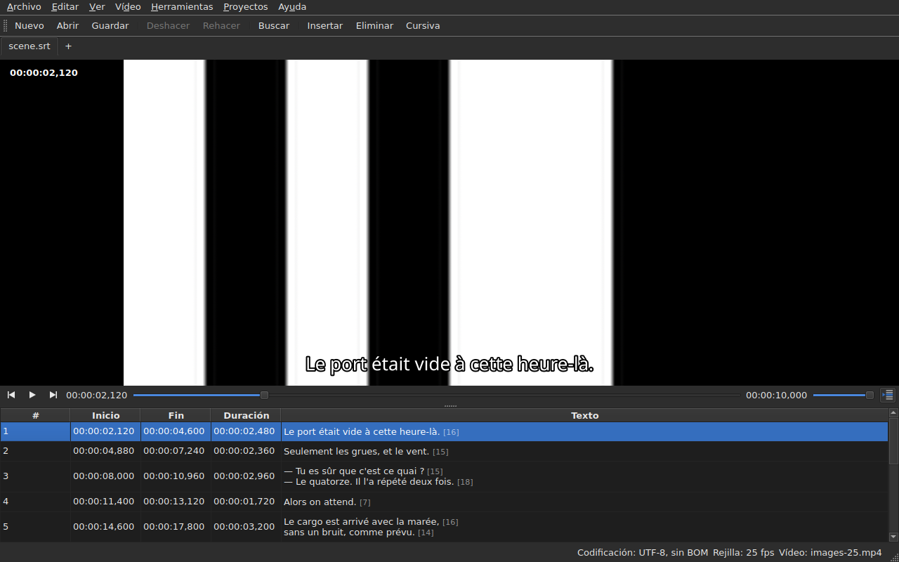

# El reproductor

<!-- machine-translated -->
> Esta página es una traducción automática y todavía no la ha revisado ningún lector del idioma.

El vídeo asociado se ve **en la ventana**, con la línea actual
dibujada encima. Es lo que permite comprobar sobre la película el resultado
de un desplazamiento, una transformación o una conversión de velocidad de fotogramas.

Véase [El vídeo asociado](video.md) para saber cómo asociar una película; esta
página describe lo que ocurre una vez asociada.

## La vista del vídeo

| Situación | Lo que muestra la ventana |
| :-------- | :------------------------ |
| hay un vídeo asociado y se abre | la imagen ocupa la parte superior, la tabla debajo |
| ningún vídeo asociado | ninguna imagen, la tabla ocupa toda la ventana |
| el vídeo no se abre | ninguna imagen, un mensaje, y la ventana sigue utilizable |

La separación entre la imagen y la tabla **se mueve con el ratón**. La imagen no
baja de 180 píxeles de alto. Agrandar la ventana da el espacio ganado
a la tabla, no a la imagen: lo que falta al editar son líneas.

Bajo la imagen, **una barra de reproducción**: dónde está la película, cuánto dura,
reproducir y pausar, y el volumen. Véase [La barra de reproducción](#la-barra-de-reproducción).

## Reproducir y detener

| Comando | Atajo | Qué hace |
| :------ | :---- | :------- |
| Vídeo ▸ Reproducir / Pausa | `Ctrl+P` | reproduce si la reproducción está detenida, y si no la detiene |

El comando está **desactivado mientras no haya ningún vídeo abierto**. Un vídeo que
se acaba de asociar se abre **detenido**: abrir una película no es
verla.

`Ctrl+P` donde Gaupol tiene una simple `P`: un atajo de una sola letra en el
ámbito de la ventana se captura antes de que lo vea el widget que tiene el foco,
de modo que una `P` se perdería por el camino hacia un editor de celda. Aquí no se imprime
nada, la combinación está libre.

## La barra de reproducción

Bajo la imagen, de izquierda a derecha — los tres botones son **iconos**, los del tema del escritorio cuando los tiene, y si no los del estilo de Qt:

| Elemento | Qué hace |
| :------- | :------- |
| los dos botones de paso | retroceden o avanzan la película **un paso de fotograma** — véase [Fotograma a fotograma](timing.md#fotograma-a-fotograma) |
| reproducir / pausa | reproduce o detiene, como `Ctrl+P` — el botón muestra **lo que hará**: un triángulo cuando está detenido, dos barras durante la reproducción; la información sobre herramientas lo dice con palabras |
| la posición | `HH:MM:SS,mmm`, escrita como la tabla escribe una posición — **como número de fotograma** cuando [`Ver ▸ Posiciones en fotogramas`](table.md#posiciones-en-fotogramas) está marcado |
| el control deslizante | **lee y mueve**: se arrastra el tirador, se hace clic en la ranura, se usan las flechas |
| la duración | la que declara el vídeo, escrita como la posición |
| el volumen | de 0 a 100, véase [El volumen](#el-volumen) |
| seguimiento de la tabla | pulsado mientras la tabla sigue la reproducción, y la devuelve a la línea en reproducción cuando se pulsa — véase [La tabla sigue la reproducción](#la-tabla-sigue-la-reproducción) |

**El control deslizante no transmite cada píxel.** Arrastrar el tirador pide decenas de
posiciones por segundo, y cada una cuesta un fotograma decodificado: la primera posición sale de
inmediato, las siguientes esperan una vigésima de segundo, y **la última posición pedida es
siempre la alcanzada** — a más tardar cuando se suelta el tirador. La imagen no se queda por tanto
rezagada respecto a la mano, y no se pone a dibujar un recorrido que nadie mira.

**El control deslizante se mueve solo durante la reproducción**, y eso no cuenta como un gesto:
solo lo que se hace mueve la película. Mientras se sujeta el tirador, la reproducción no lo recupera.

## El código de tiempo

**La posición se escribe sobre la imagen**, arriba a la izquierda, sobre un fondo translúcido que la hace
legible en cualquier escena. La dibuja la ventana, con su fuente, y no pide
al reproductor más que la posición que ya da; se actualiza con cada gesto,
sin esperar a la siguiente vuelta del seguimiento.

## Desplazarse por la película

En el menú **Vídeo**, **los gestos de Gaupol**, con sus nombres. Todos están **desactivados sin vídeo**, como
la reproducción; los tres que actúan sobre la selección también están desactivados mientras no haya nada seleccionado.

| Comando | Atajo | Qué hace |
| :------ | :---- | :------- |
| Vídeo ▸ Reproducir selección | `Ctrl+Shift+P` | reproduce desde **un poco antes del inicio** de la selección **hasta el fin de su último subtítulo**, y se detiene en la imagen |
| Vídeo ▸ Saltar al anterior | `Ctrl+Left` | pone la reproducción en el inicio del último subtítulo **terminado** antes de la posición |
| Vídeo ▸ Saltar al siguiente | `Ctrl+Right` | pone la reproducción en el inicio del primer subtítulo que **empieza** después de la posición |
| Vídeo ▸ Saltar hacia atrás | `Ctrl+Shift+Left` | retrocede un salto — treinta segundos por defecto |
| Vídeo ▸ Saltar hacia adelante | `Ctrl+Shift+Right` | avanza un salto |
| Vídeo ▸ Saltar al inicio de la selección | `Ctrl+Up` | pone la reproducción en el inicio de la selección, **con el margen previo delante** |
| Vídeo ▸ Saltar al fin de la selección | `Ctrl+Down` | pone la reproducción en el fin de la selección, **con el margen previo delante** |

**Los atajos son los de Gaupol**, salvo uno: `Play Selection` es `O` allí, y una
letra sola la captura la ventana antes de que la vea la celda en edición — escribir una
`o` en un texto iniciaría la película. `Ctrl+P` es la respuesta de la reproducción, `Ctrl+Shift+P` la de
la selección. Las flechas del teclado se quedan en el editor de celda cuando está
abierto: `Ctrl+Left` mueve allí el cursor una palabra, no la reproducción.

- **El salto** es de 30 segundos, y se puede ajustar de 1 segundo a una hora — véase
  [Las preferencias](preferences.md#el-reproductor). No va más allá ni del inicio de la película ni de su final.
- **El margen previo** es de un segundo: se mira un poco **antes** del subtítulo, para verlo llegar.
  Se puede ajustar de 0 a 60 segundos, y la reproducción no baja de cero.
- **Un vecino que no existe** — nada antes del primer subtítulo, nada después del último — no hace
  nada, y no dice nada: la reproducción se queda donde está.
- **Cada gesto se ve de inmediato**: la barra, el código de tiempo y la línea dibujada están
  al día cuando termina, sin esperar a la siguiente vuelta.

## El volumen

El volumen es el del **reproductor**, de 0 a 100, y no el del sistema. Se ajusta con el control deslizante de
la barra, o con dos gestos, en el submenú `Vídeo ▸ Audio`, de cinco en cinco:

| Comando | Atajo | Qué hace |
| :------ | :---- | :------- |
| Vídeo ▸ Audio ▸ Bajar volumen | `Ctrl+-` | baja el volumen cinco puntos |
| Vídeo ▸ Audio ▸ Subir volumen | `Ctrl++` o `Ctrl+=` | lo sube cinco puntos — el segundo, para los teclados en los que el más necesita la tecla de mayúsculas |

**Se recuerda de una sesión a la siguiente**, y se aplica a cada vídeo que se abre. Un valor fuera
de 0 a 100 en el archivo de configuración no impide la apertura: se ignora, y la ventana lo indica.
**La pista de audio, en cambio, no se recuerda** — un número de pista es el de su archivo; véase
[La pista de audio](video.md#la-pista-de-audio).

## Selección y reproducción

Ambas funcionan en los dos sentidos.

| Lo que se hace | Qué ocurre |
| :------------- | :--------- |
| seleccionar una línea | la reproducción se desplaza **al inicio de ese subtítulo** |
| ampliar la selección hacia abajo | nada más: cuenta la primera línea de la selección |
| la reproducción avanza | la **línea actual** sigue al subtítulo en pantalla, **teñida**, y la tabla la **centra** — véase [La tabla sigue la reproducción](#la-tabla-sigue-la-reproducción) |

La línea actual y la selección son dos cosas distintas. La reproducción
mueve la primera y **nunca toca la segunda**: la selección es aquello a lo que
se aplica una operación, y una película que se reproduce en un rincón no tiene por qué
reescribir el objetivo del usuario línea tras línea.

El tinte sigue esta misma regla: es un indicador, no una selección. **Una
anomalía tiene prioridad sobre él** — una línea que lleva ambos conserva el color de
su defecto, ya que un defecto está ahí para repararse, mientras que una línea solo se muestra
durante lo que dura una réplica. Véase [La tabla](table.md).

### La tabla sigue la reproducción

**La tabla centra la línea en reproducción** — en mitad de lo que muestra, no en el borde, donde bastaría para
hacerla visible. Lo hace **cuando cambia la línea**, no en cada tic del seguimiento: una réplica dura
segundos, y volver a centrar cada décima de segundo sería desplazar la tabla sin motivo.

**Un desplazamiento manual suspende el seguimiento.** La rueda, la barra de desplazamiento y un clic en la tabla
lo suspenden: la tabla se queda donde se ha puesto, mientras la línea actual, la línea dibujada y la barra
siguen la película. El botón de seguimiento — **el icono de las líneas de una tabla, una marcada con una flecha**, a la derecha de la barra
de reproducción; su información sobre herramientas dice «Seguir la reproducción» — **está pulsado mientras la tabla sigue** y luego se levanta.

**El seguimiento se reanuda con un gesto del reproductor**: reproducción iniciada, un salto, un paso, una marca puesta, una
inserción en la posición, o un movimiento de la barra — la tabla se centra entonces de inmediato en la
línea en reproducción, aunque ya fuera la misma. **O a petición**: pulsar el botón lo restablece, y
soltarlo lo suspende. No hay temporizador: lo que reanuda el seguimiento es siempre un gesto.

Pasar a otra pestaña reanuda el seguimiento en la película de esa pestaña.

**Una edición en curso no se interrumpe.** Mientras haya un editor de celda
abierto, la línea actual se queda donde está; la línea dibujada sobre
la imagen, por su parte, sigue avanzando, ya que no molesta a nadie.

## La línea dibujada

Lo que se muestra sobre la imagen procede del **documento abierto**, nunca de un archivo:
**lo que se ve sobre la imagen es lo que se acaba de escribir**, sin pasar por el
disco. El texto aparece centrado, en la parte inferior de la imagen, y desaparece entre dos
subtítulos.

**Con una traducción, la línea es la del texto al que se apunta**: la traducción cuando
la celda actual está en la columna `Translation`, el texto principal
en cualquier otro caso. Es la regla de todas las operaciones de texto — véase [El
texto al que se aplican las operaciones](table.md#el-texto-al-que-se-aplican-las-operaciones) —
y **no hay ningún ajuste**: pasar de una columna a la otra cambia lo que
muestra la imagen, como mucho una décima de segundo después. Sin traducción, o
con la columna quitada, nada cambia: es el texto principal.

Un subtítulo al que la traducción todavía no ha llegado no muestra **nada** mientras
la columna actual sea la traducción: no es el texto principal el que
ocupa su lugar.

**Las etiquetas del formato se interpretan, nunca se dibujan tal cual.** El modelo lleva el
texto tal como lo escribe el archivo, y es el pivote de etiquetas — el de la conversión
de formato — el que lo lee antes de dárselo a la imagen:

| En el archivo | Sobre la imagen |
| :------------ | :-------------- |
| negrita, cursiva, subrayado | aplicados: `<i>no</i>` se muestra como *no*, sin sus etiquetas |
| color | aplicado |
| fuente, tamaño | quitados, el texto se queda |
| posición, alineación, hablante, todo lo que no tiene equivalente en pantalla | quitados, el texto se queda |
| `{` y `}` en el texto | dibujados: «{laughs}» se muestra como «{laughs}» |

Un archivo Advanced SSA se lee del mismo modo: sus `{\i1}` se aplican, y su
`{\an8}` se quita — la línea se queda en la parte inferior de la imagen. Cada texto se lee **en el formato
de su propio archivo**, tanto la traducción como el texto principal.

**El archivo de subtítulos vecino no lo carga** el reproductor, aunque lleve el nombre de la
película. Sería el que se está editando, y la imagen mostraría entonces el estado del disco
mientras la tabla muestra otra cosa.

## Previsualizar un cambio

No hay **nada especial que hacer**: se aplica la operación, se mira
la película, y se elige `Undo: shifting` — o la operación de que se trate — si el
resultado no convence. Véase [Deshacer y rehacer](undo.md).

No existe ningún modo de vista previa aparte, y es deliberado: lo que se
mira es el documento tal como está, no un estado provisional invisible.

## Cuando la imagen no aparece

Dos mensajes posibles, ambos precedidos de la ruta del archivo:

| Mensaje | Qué ha ocurrido |
| :------ | :-------------- |
| `<file>: <reason>` | el reproductor ha rechazado el archivo — formato desconocido, archivo inexistente, directorio |
| `<file>: no video player is available` | no se ha podido construir ningún reproductor |

En ambos casos, **el vídeo sigue asociado** — hace falta ver de qué
archivo se trata para elegir otro — y **la ventana sigue utilizable**:
el documento está abierto, las operaciones funcionan, y el guardado también.

**La imagen se dibuja en la propia ventana**: `libmpv` llena un búfer del
tamaño de la vista, en píxeles reales, y la ventana lo pinta. Nada de ello depende de la
plataforma gráfica — la misma imagen con X11, con Wayland y sin pantalla — y
sigue los cambios de tamaño: se conserva la relación de aspecto de la película, y el resto de la
vista queda en negro.

El segundo mensaje solo aparece por tanto si la biblioteca `libmpv` se niega a arrancar,
aunque es obligatoria en la compilación.

El renderizado pasa por el procesador, pero **la decodificación puede hacerse en la tarjeta gráfica**: esta
decodifica, la imagen se copia de vuelta a la memoria y luego se dibuja como antes. Una máquina sin
tarjeta utilizable decodifica en el procesador, sin mensaje. Con una película 1080p en H.264, la reproducción sigue
el tiempo real con holgura. **Una película 4K en HEVC pesado puede no seguirlo**: medido en dos
núcleos, decodifica a 0,6 veces el tiempo real sin la tarjeta, y avanzar un fotograma ahí tarda varios
segundos cuando el fotograma clave está lejos. La tarjeta reduce ese tiempo — entre un tercio y dos tercios según la película
— sin eliminarlo. **No cambia la imagen mostrada**: un paso o un salto llegan al
mismo fotograma con ella y sin ella. Para desactivarla, desmarcar `Decode on the graphics card` en
[`Preferences…`](preferences.md#el-reproductor).

## Lo que no hay

**Poner una marca, avanzar fotograma a fotograma y desplazar un borde un fotograma** están en
[Temporizar a partir del vídeo](timing.md), no aquí. Lo que no existe, y es inútil buscar:

- una forma de onda;
- la reproducción automática al abrir una película;
- el estilo de la línea dibujada (fuente, color, posición, fondo): conserva el de la ventana;
- la decodificación por hardware sin copia: véase «Cuando la imagen no aparece» más arriba.

Este manual describe lo que existe: lo que vendrá, y en qué orden, está en la
[hoja de ruta](../../../../feuille-de-route.md).
