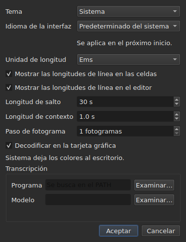

# Las preferencias

<!-- machine-translated -->
> Esta página es una traducción automática y todavía no la ha revisado ningún lector del idioma.

La ventana recuerda lo que se ajusta con el ratón — **dónde estaba**, **si
estaba maximizada**, **la anchura de sus columnas**, **la posición del
separador** entre la película y la tabla — y **dónde se trabaja**, para que
`Open…` se abra en el lugar adecuado. Nada de esto se ajusta en un cuadro de diálogo:
se mueve, se arrastra, y queda recordado.

**Seis preferencias tienen un cuadro de diálogo propio**, `Editar ▸ Preferencias…`, y ese es el
criterio: una preferencia que ya tiene un gesto no necesita un campo. El
tema no tiene ninguno, ni la unidad de las longitudes de línea, ni las dos casillas que
las muestran, ni el salto y el margen previo del reproductor. Véanse [El tema](#el-tema),
[Las longitudes de línea](#las-longitudes-de-línea) y [El reproductor](#el-reproductor).

**El idioma de la interfaz está en el mismo cuadro de diálogo, y es el que espera**: se aplica en el
próximo inicio, no de inmediato. Véase [El idioma de la interfaz](#el-idioma-de-la-interfaz).

**El volumen no tiene ninguno**: lo ajustan la barra bajo la imagen y dos gestos, y queda recordado.

**Otra se ajusta allí donde se usa**: el lado donde `Insert Subtitles…` coloca sus
líneas es un campo de ese cuadro de diálogo, y la última elección queda recordada. Véase
[Insertar, eliminar, fusionar y dividir líneas](lines.md#el-lado-se-recuerda).

**Lo mismo ocurre con las dos opciones de búsqueda**: `Regular expression` e
`Ignore case` siguen marcadas o desmarcadas de una apertura del cuadro de diálogo a la
siguiente, y de una sesión a la siguiente. Véase
[Buscar y reemplazar](find-and-replace.md#las-dos-opciones).

**Lo mismo con la configuración de `Adjust Durations…`**: la velocidad de lectura, sus dos
sentidos y las tres duraciones con sus casillas — cada una conserva su valor, marcada
o no. Véase [`Adjust Durations…`](operations.md#adjust-durations).

**Y la última codificación elegida en `Save As…`**, con su marca de orden
de bytes. Véase [el archivo](#el-archivo).

**Y lo que ajustan el asistente `Correct Texts…` y `Spell-Check Settings…`**: las
tareas marcadas y su código, las casillas de los patrones, la configuración del salto de línea, el idioma,
el alcance de la comprobación y el subrayado al escribir. Véanse [Corregir textos…](correct-texts.md) y
[Comprobar ortografía…](check-spelling.md#configuración-ortográfica). **El alcance y el
documento de `Correct Texts…` no se recuerdan.**

**Lo que no se recuerda:** el último archivo abierto — véase
[El directorio recordado](#el-directorio-recordado).

## El reproductor

Cuatro campos. **Seek length** y **Context length** son de Gaupol y tienen sus valores; **Frame step** y **Decode on the graphics card** son propios de subedit:

| Campo | Lo que ajusta | Por defecto | Límites |
| :---- | :------------ | ----------: | :------ |
| `Seek length` | el salto de `Seek Backward` y `Seek Forward` | 30 s | de 1 s a una hora |
| `Context length` | el margen previo antes de la selección, para `Seek Selection Start`, `Seek Selection End` y `Play Selection` | 1 s | de 0 a 60 s, a la décima |
| `Frame step` | el paso, **en fotogramas**, de `Step Backward` y `Step Forward`, y del desplazamiento de un borde | 1 fotograma | de 1 a 1000 fotogramas |
| `Decode on the graphics card` | deja que la tarjeta gráfica decodifique la película cuando la máquina tiene una; sin tarjeta, nada cambia | marcada | marcada o no |

Se aplican **de inmediato**, sin esperar a un reinicio, y se recuerdan de una sesión a la siguiente
bajo `video.seek-length` (en segundos), `video.context-length-ms` (en milisegundos) `video.step-frames` (en fotogramas) y `video.hardware-decoding` (`true` o `false`).
**Un valor fuera de los límites, o que no es un número**, no impide que la ventana se abra:
se ignora, se mantiene el valor por defecto, y la ventana lo indica al abrirse. **El paso de fotograma nunca está en milisegundos**: un paso de N fotogramas son siempre N fotogramas, sea cual sea la velocidad de fotogramas de la película — véase [Temporizar a partir del vídeo](timing.md#fotograma-a-fotograma). El volumen se recuerda en `video.volume`,
de 0 a 100, con la misma tolerancia.

## El archivo

```
~/.config/subedit/settings.conf
```

Más exactamente `$XDG_CONFIG_HOME/subedit/settings.conf` cuando esa variable
está definida. Se escribe **cuando la ventana se cierra**, y se lee cuando se abre.
Un programa interrumpido — terminado a la fuerza, o detenido por un fallo — no escribe nada, y la
sesión siguiente encuentra lo que la anterior había dejado.

El archivo es de texto, y se puede editar a mano. Es una propiedad y no
un efecto secundario: es lo que permite corregir un ajuste cuando la interfaz
que lo ajusta es precisamente la que está rota.

### Dos bloques, uno compartido con la línea de comandos

El archivo se escribe en **dos bloques**, cada uno bajo un comentario de cabecera:

| Bloque | Claves | Lo leen |
| :----- | :----- | :------ |
| `# Operation settings: shared by the window and the command line` | las claves `duration-adjust.*` y `correction.*` | la ventana **y** `subedit-cli` |
| `# Display preferences: the window's own` | todas las demás claves — geometría, columnas, tema, idioma de la interfaz, búsqueda, ortografía, editor, vídeo, último directorio, codificación de escritura | solo la ventana |

**`subedit-cli` lee el bloque de operaciones por defecto**: lo que `Adjust Durations…` y
`Correct Texts…` recuerdan aquí es también el punto de partida de [`subedit-cli adjust`](../subedit-cli/adjust.md)
y de parte de [`subedit-cli correct`](../subedit-cli/correct.md), salvo que una opción de
la línea de comandos diga lo contrario. **Nunca lee las preferencias de visualización.** Su
comando [`config`](../subedit-cli/config.md) enumera las claves de operación, muestra sus valores y
los cambia — `subedit-cli config set duration-adjust.speed 12` — y la ventana ve el cambio
en su siguiente apertura. **Un cambio hecho mientras la ventana está abierta no sobrevive a su cierre**: la
ventana reescribe el archivo entero con lo que contiene. `--no-config` hace que una línea de comandos ignore el
archivo. Véase
[El archivo de configuración](../subedit-cli/invocation.md#el-archivo-de-configuración).

El lector acepta las claves en cualquier orden, con o sin los comentarios de cabecera: un archivo escrito antes de que
existieran los dos bloques se lee sin cambios, y se reescribe en dos bloques en el siguiente cierre.

| Opción | Lo que contiene | Por defecto |
| :----- | :-------------- | :---------- |
| `window.geometry` | `x,y,width,height`, en píxeles; anchura y altura distintas de cero | la ventana elige su tamaño |
| `window.maximised` | `true` o `false` | `false` |
| `table.columns` | cuatro anchuras en píxeles, separadas por comas — `#`, `Start`, `End`, `Duration`, aunque estén ocultas | la tabla elige sus tamaños |
| `table.order` | las seis columnas, **cada una una sola vez**, en el orden en que la tabla las muestra: `number`, `start`, `end`, `duration`, `text`, `translation` | `number,start,end,duration,text,translation` |
| `table.hidden` | las columnas quitadas, entre `number`, `start`, `end` y `duration`; vacío, ninguna | ninguna |
| `window.table-share` | la parte de la altura dada a la tabla, en porcentaje, de 1 a 99 | la ventana reparte como siempre lo ha hecho |
| `file.directory` | una ruta de directorio **absoluta** | ninguno: `Open…` se abre donde se lanzó el programa |
| `general.theme` | `system`, `light` o `dark` | `system` |
| `interface.language` | `system`, o el nombre de un idioma tal como se llama su catálogo: dos o tres letras minúsculas, luego opcionalmente `_` y dos mayúsculas — `fr`, `pt_BR`; `en` para el inglés | `system` |
| `edit.insert-placement` | `above` o `below` | `below` |
| `file.write-encoding` | el nombre de una codificación que ICU sabe escribir, y cuyo conversor no escribe su propia marca | ninguna |
| `file.write-bom` | `true` o `false` | `false` |
| `search.regex` | `true` o `false` — el patrón es una expresión regular | `false` |
| `search.ignore-case` | `true` o `false` — se ignoran mayúsculas y minúsculas | `true` |
| `duration-adjust.speed` | la velocidad de lectura, en caracteres por segundo, estrictamente positiva; un número decimal se escribe de la forma más corta posible (`15`, `12.5`) | `15` |
| `duration-adjust.lengthen` | `true` o `false` — alargar lo que es demasiado corto para leerse | `true` |
| `duration-adjust.shorten` | `true` o `false` — acortar lo que permanece en pantalla más de lo necesario | `false` |
| `duration-adjust.minimum-enabled` | `true` o `false` — se pide la duración mínima | `true` |
| `duration-adjust.minimum-ms` | la duración mínima, en milisegundos, entera y no negativa | `1500` |
| `duration-adjust.maximum-enabled` | `true` o `false` — se pide la duración máxima | `false` |
| `duration-adjust.maximum-ms` | la duración máxima, en milisegundos, entera y no negativa | `6000` |
| `duration-adjust.gap-enabled` | `true` o `false` — se pide la separación con el subtítulo siguiente | `true` |
| `duration-adjust.gap-ms` | la separación, en milisegundos, entera y no negativa | `0` |
| `correction.mentions.enabled`, `correction.common-errors.enabled`, `correction.capitalization.enabled`, `correction.line-break.enabled` | `true` o `false` — la tarea está marcada en la primera página de `Correct Texts…` | `false`, `true`, `true`, `false` |
| `correction.mentions.code`, `correction.common-errors.code`, `correction.capitalization.code`, `correction.line-break.code` | el código de los patrones de la tarea: `Zyyy`, o `Script[-language[-COUNTRY]]` — `Latn-en-US`; no vacío | `Zyyy` |
| `correction.human`, `correction.ocr` | `true` o `false` — las clases de errores comunes | `true`, `true` |
| `correction.sound-in-brackets`, `correction.sound-in-parentheses` | `true` o `false` — las dos casillas de la página `Mentions` | `false`, `false` |
| `correction.line-break.max-length` | la longitud máxima de una línea, decimal; el cuadro de diálogo la limita de 1 a 1000 | `24` |
| `correction.line-break.max-lines` | el número máximo de líneas, entero; el cuadro de diálogo lo limita de 1 a 100 | `3` |
| `correction.line-break.in-ems` | `true`: la longitud se mide en *ems*; `false`: en caracteres | `true` |
| `correction.line-break.skip-on-length`, `correction.line-break.skip-on-lines` | `true` o `false` — se piden las dos condiciones de omisión | `true`, `true` |
| `correction.line-break.skip-max-length`, `correction.line-break.skip-max-lines` | los dos umbrales de omisión, en la unidad elegida | `24`, `3` |
| `correction.join-split.enabled` | `true` o `false` — la tarea `Join or Split Words` está marcada | `false` |
| `correction.join-split.join`, `correction.join-split.split` | `true` o `false` — unir, separar | `true`, `false` |
| `correction.join-split.language` | un código de configuración regional — `fr`, `en_US`, `sr@Latn` —; vacío: el idioma del sistema | vacío |
| `correction.remove-blank` | `true` o `false` — `Remove all blank subtitles` | `true` |
| `transcription.engine` | el nombre del motor: letras minúsculas, cifras, `.`, `-` y `_` | `whisper.cpp` |
| `transcription.executable`, `transcription.model` | una ruta absoluta; vacío: el motor se busca en el `PATH` y no hay ningún modelo definido | vacío |
| `transcription.language` | dos letras minúsculas, un código ISO 639-1; vacío: el idioma se detecta | vacío |
| `transcription.merge-gap-ms` | los fragmentos de una misma frase más próximos que esto se unen, en milisegundos, entero y no negativo | `400` |
| `transcription.max-duration-ms` | la duración máxima de un subtítulo transcrito en pantalla, en milisegundos, de 1 a 3600000 | `7000` |
| `transcription.max-characters` | el máximo de caracteres de un subtítulo transcrito, de 1 a 1000 | `84` |
| `correction.activations` | las casillas de patrones que el usuario ha cambiado, `<type>:<code>:<name>:<0\|1>`, separadas por comas; **una coma o una barra invertida en un nombre se escribe precedida de una barra invertida** (`\,` y `\\`), y una entrada ilegible solo pierde su propio ajuste — se señala, las demás se conservan | vacío |
| `spell-check.language` | un código de configuración regional, como `fr_FR`; vacío: el idioma del sistema | vacío |
| `spell-check.target` | `selection`, `current-project` o `all-projects` | `current-project` |
| `spell-check.document` | `main` o `translation` | `main` |
| `spell-check.inline` | `true` o `false` — subrayar las palabras desconocidas al escribir en el editor de una celda | `false` |
| `editor.length-unit` | `em` o `characters` — la unidad de las longitudes de línea que muestran la tabla y el editor | `em` |
| `editor.show-lengths-cell` | `true` o `false` — cada línea de una celda de texto va seguida de su longitud | `true` |
| `editor.show-lengths-edit` | `true` o `false` — el editor de una celda muestra la longitud de cada línea en un margen | `true` |

**El archivo acepta más que el cuadro de diálogo.** El lector acepta cualquier velocidad
estrictamente positiva y cualquier duración no negativa; el cuadro de diálogo `Adjust
Durations…`, por su parte, limita la velocidad de 1 a 99 caracteres por segundo y cada
duración de 0 a 99 s. Un valor del archivo fuera de esos límites se lleva al
límite cuando se abre el cuadro de diálogo, y el archivo lo conserva así una vez que el
cuadro de diálogo se acepta y la ventana se cierra. Un cuadro de diálogo cancelado no cambia nada de lo
que se recuerda.

**`file.write-encoding` recuerda la última codificación elegida en `Save As…`, y
nunca se impone a un archivo.** Un documento abierto lleva su propia codificación,
y es la que el cuadro propone: reescribirlo en otra porque un
ajuste de hace tres semanas lo dice perdería lo que la lectura conservó.
Lo que este ajuste recuerda sirve al documento que no tiene archivo — el que
se acaba de crear.

**Es un «no» deliberado y no un olvido.** Quien entrega siempre en
la misma codificación y abre archivos heredados en otra la vuelve a elegir para
cada archivo; el cuadro se la propone, y la garantía de ida y vuelta se mantiene
para todos.

**`file.write-bom` lleva la marca de la misma codificación**, y hacen falta
de verdad dos líneas: el nombre de una codificación no dice si va precedida de su marca, como tampoco
`--encoding` dice lo que dice `--bom`. Ambas se leen juntas, en
cualquier orden, y un `file.write-bom` sin codificación recordada no ajusta nada.

**Una proporción y no alturas para el separador**, y eso es lo que lo hace
útil: tres alturas en píxeles dejan de significar nada en cuanto la ventana
se abre con otro tamaño, y una ventana se abre a menudo con otro tamaño.
La proporción se reproduce en cualquier parte. Se **lleva a lo que la ventana acepta** si
es demasiado pequeña — la franja de la película tiene una altura mínima.

**Cuatro anchuras para seis columnas**, y no es un olvido: son las
de `#`, `Start`, `End` y `Duration`, en ese orden sea cual sea el de la
tabla, y **una columna oculta conserva la suya** — la recupera cuando se
vuelve a mostrar. La última columna mostrada toma lo que dejan las demás, y darle
una anchura no serviría de nada; las del texto y la traducción no se
recuerdan, por tanto.

## Qué ocurre cuando el archivo no dice lo esperado

Una configuración es una comodidad. **Su fallo cuesta la comodidad y nada
más**: la ventana se abre en todos los casos.

| Caso | Qué ocurre |
| :--- | :--------- |
| el archivo no existe | todos los valores por defecto, y no se dice nada — es el primer inicio |
| el archivo existe y no se puede leer | todos los valores por defecto, y el motivo se escribe en la salida de error |
| falta una opción | su valor por defecto |
| una clave es desconocida | se ignora, sin una palabra, y no aparece en el archivo reescrito |
| un valor no se puede leer | se mantiene su valor por defecto, y la opción se nombra en la salida de error |

```console
$ subedit-gui film.srt
subedit-gui: /home/vous/.config/subedit/settings.conf: window.geometry: "plus tard" cannot be read, keeping the default
```

**El mensaje va a la salida de error y a ninguna otra parte.** Una ventana
modal al arrancar por una preferencia ilegible detendría al usuario por
un fallo que no le impide nada, y antes de que haya pedido nada.

## Las opciones comentadas

El archivo reescrito contiene **todas** las opciones conocidas, y las que siguen en
su valor por defecto se escriben como comentarios:

```
#window.geometry = 0,0,1280,800
#window.maximised = false
#table.columns = 60,110,110,110
#table.order = number,start,end,duration,text,translation
#table.hidden = start,end
```

No es una afectación. Sin ello, una opción nunca tocada quedaría
congelada en el valor del día en que se escribió, y **un valor por defecto mejorado
no llegaría nunca a nadie**. Con ello, cambiar un valor por defecto cambia el
comportamiento de todos los que no lo han sobrescrito — que es exactamente
lo que debe hacer un valor por defecto.

Para sobrescribir una opción: quitar el `#` y cambiar el valor. Para volver
al valor por defecto: borrar la línea, o volver a comentarla.

La geometría, las anchuras y las columnas quitadas muestran una **forma** y
no un valor en vigor: el valor por defecto de la geometría y el de las anchuras son
«lo que la ventana elige», que no se escribe con números, y el de
`table.hidden` es «ninguna», que no se puede leer. La cabecera del archivo también lo
dice. `table.order`, por su parte, sí muestra el orden por defecto.

## El directorio recordado

`Open…` se abre en el directorio del **último archivo abierto o guardado**,
y no en el de un cuadro que se canceló: lo que cuenta es dónde se
trabaja, no dónde se ha mirado.

**El último archivo, por su parte, no se recuerda.** Recordarlo significaría
reabrir al inicio un documento que nadie ha pedido. Recordar un directorio
*orienta* un cuadro de diálogo; recordar un archivo abriría uno.

## El tema

`Editar ▸ Preferencias…` se abre con el tema, una preferencia sin gesto, encima de las
[longitudes de línea](#las-longitudes-de-línea).

| Valor | Qué hace |
| :---- | :------- |
| `System` | **nada** — los colores siguen siendo los del escritorio |
| `Light` | aplica una paleta clara |
| `Dark` | aplica una paleta oscura |

El tema elegido se aplica **inmediatamente**, sin reiniciar.

**«Sistema» no hace nada, y no es una carencia.** La versión de Qt sobre
la que está construido subedit no tiene forma de preguntar al escritorio si quiere ser
claro u oscuro, ni de recibir aviso cuando cambia de opinión. En lugar de
inventar una lectura que no se sabe hacer, la herramienta ofrece los dos temas
que se pueden pedir y deja que el toolkit decida el tercero —
que es lo que hace Gaupol en las mismas condiciones.

Con un escritorio cuyo tema ya es oscuro, `System` da por tanto una ventana
oscura; con un escritorio claro, una ventana clara. `Light` y `Dark` lo
sustituyen, sea cual sea el escritorio.

**Los tintes de las anomalías siguen siendo legibles en ambas paletas** — véase
[La tabla](table.md#las-anomalías). No es una suposición: el contraste
del texto sobre cada uno de los tintes lo comprueba una prueba, sobre ambos fondos.

## Transcripción

El grupo **`Transcription`** del cuadro de diálogo contiene los dos datos sobre la máquina que necesita
[`Transcribe Audio…`](video.md#transcribir-el-audio): **el programa** del motor (whisper.cpp,
`whisper-cli`) y **el modelo** que lee. Cada uno tiene un botón `Browse…`. Si se deja vacío, el programa se busca
en el `PATH`; el modelo no tiene valor por defecto.

Bajo los campos, **el cuadro dice lo que hay**: si el motor se encuentra y dónde, si `ffmpeg`
se encuentra, y el modelo — no definido, no encontrado, no es un modelo, solo para inglés o multilingüe. Cuando falta
algo, añade la referencia a
[Instalar las herramientas de transcripción](../subedit-cli/install-transcription.md), que dice dónde encontrar
cada uno. Los dos campos son los ajustes `transcription.executable` y `transcription.model`.

## El idioma de la interfaz

`Editar ▸ Preferencias…` elige el idioma de la ventana, bajo el tema.

| Campo | Valores | Por defecto |
| :---- | :------ | :---------- |
| `Interface language` | `System default`; `English`; luego cada idioma instalado con el programa, por su propio nombre — `Français` | `System default` |

**Se aplica en el próximo inicio**, y el cuadro de diálogo lo dice bajo el campo: la ventana se
traduce a medida que se construye, y una ventana en marcha conserva el idioma con el que arrancó. La elección
se guarda en el archivo de configuración, bajo `interface.language`, y se lee la próxima vez que se abre la ventana.

| Elección | La ventana arranca en |
| :------- | :-------------------- |
| `System default` | el idioma del entorno, como antes de cualquier elección — `LANGUAGE`, `LC_ALL`, `LC_MESSAGES`, `LANG`; véase [Idioma](invocation.md#idioma) |
| `English` | inglés, diga lo que diga el entorno |
| un idioma instalado | ese idioma, **diga lo que diga el entorno**, `LC_ALL=C` incluido: una elección hecha aquí es explícita |

La lista contiene los idiomas cuyo catálogo está instalado en `<prefix>/share/subedit/locale`;
el inglés siempre está, ya que es el idioma en que está escrito el programa. Un idioma se muestra
por su propio nombre, que ningún catálogo traduce, para que cada lector encuentre el que lee.

**Un valor que el programa no puede respetar solo cuesta la elección:**

| Lo que dice el archivo | Qué ocurre |
| :--------------------- | :--------- |
| el nombre de un idioma sin catálogo instalado — un archivo traído de otra máquina | la ventana sigue al entorno, sin una palabra; `Preferences…` muestra ese idioma, por su nombre o su código, y lo conserva salvo que se elija otro |
| algo que no es el nombre de un idioma — `French`, `fr_FR.UTF-8` | `system`, el valor por defecto, y la opción se nombra en la salida de error, como cualquier valor ilegible |

```console
$ subedit-gui film.srt
subedit-gui: /home/vous/.config/subedit/settings.conf: interface.language: "French" cannot be read, keeping the default
```

**La línea de comandos nunca lo lee**: `subedit-cli` elige su idioma solo a partir del
entorno, y `subedit-cli config set interface.language fr` se rechaza por ser una preferencia de visualización.

## Las longitudes de línea




`Editar ▸ Preferencias…` ajusta también **lo que la tabla y el editor muestran de la
longitud de las líneas** — la regla y el margen de Gaupol.

| Campo | Qué hace | Por defecto |
| :---- | :------- | :---------- |
| `Length unit` | la unidad de las longitudes: `Ems` o `Characters` | `Ems` |
| `Show line lengths in cells` | cada línea de una celda de texto va seguida de su longitud | marcada |
| `Show line lengths in the editor` | el editor de una celda muestra la longitud de cada línea en un margen a la derecha | marcada |

**`Length unit` aparece en gris cuando ninguna casilla está marcada**: sin
longitud que mostrar, la unidad no ajusta nada. La elección se aplica **de inmediato** a la
tabla, y los editores que se abren después la siguen. Los tres valores se
recuerdan de una sesión a la siguiente: `editor.length-unit`, `editor.show-lengths-cell`
y `editor.show-lengths-edit`, en la tabla [del archivo](#el-archivo). Véanse
[La longitud de las líneas](table.md#la-longitud-de-las-líneas) y
[en el editor](editing.md#la-longitud-de-las-líneas).

**No es el límite del asistente.** La unidad de `Correct Texts…` — la
longitud a la que divide las líneas — es un ajuste aparte, en su
asistente: se pueden leer ems en la tabla y dividir en caracteres.

## Lo que no se puede ajustar

**Nueve ajustes recordados se eligen en un cuadro de diálogo** — sin contar los
del asistente de corrección y de la comprobación ortográfica, que tienen cada uno
el suyo —, y cada uno en aquel donde se usa: el tema y los tres ajustes de longitud de línea, aquí; el lado de una inserción, en el cuadro de diálogo de inserción;
las dos opciones de búsqueda, en el cuadro de búsqueda; la codificación y
la marca de orden de bytes, en `Save As…`; la velocidad de lectura, las duraciones
y la separación del ajuste de duraciones, en su propio cuadro de diálogo. No hay
ningún otro: no se puede ajustar nada para los diagnósticos, el volumen del reproductor,
ni el formato de guardado por defecto — ese viene del archivo abierto.

Y **ningún número que pertenezca a un documento se conserva de una sesión a
la siguiente**: un desplazamiento, dos marcadores de transformación valen para un
archivo y no para el siguiente. Los cuadros de diálogo los vuelven a pedir en cada inicio,
a propósito. La configuración de `Adjust Durations…` es una excepción, igual que
las dos opciones de búsqueda: una velocidad de lectura, una duración mínima o
una separación son elecciones de método más que medidas de un archivo, y
persisten de una sesión a la siguiente por ese motivo.

Este manual describe lo que existe: lo que vendrá está en la
[hoja de ruta](../../../../feuille-de-route.md).
