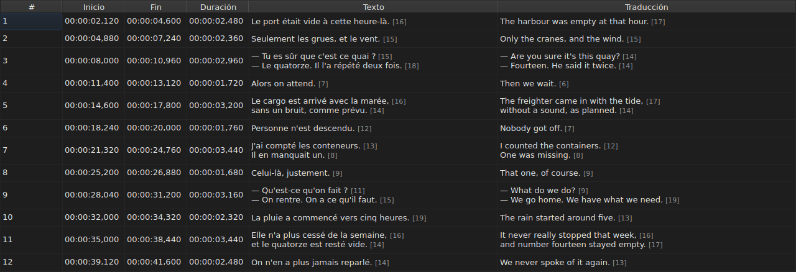
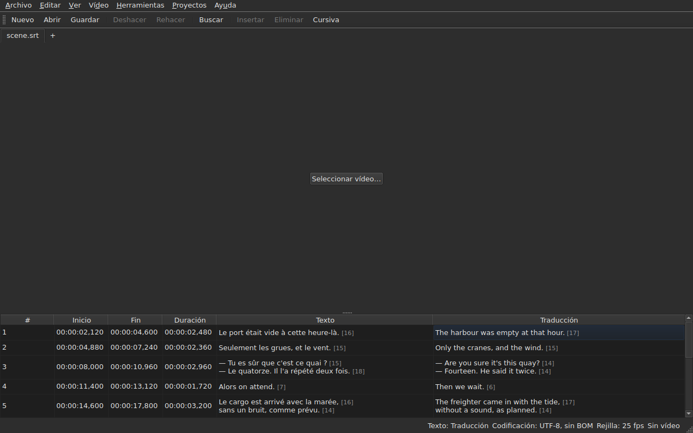

# La tabla

<!-- machine-translated -->
> Esta página es una traducción automática y todavía no la ha revisado ningún lector del idioma.

La ventana muestra los subtítulos del archivo abierto, uno por línea, en cinco
columnas — seis cuando el proyecto lleva una traducción.

**Este manual cita las cabeceras de la ventana tal como las muestra la ventana
en inglés**, como hace con la línea de comandos; la ventana en español y sus capturas de pantalla
las muestran en español.

| Columna | Lo que muestra |
| :------ | :------------- |
| `#` | el rango del subtítulo, a partir de 1 |
| `Start` | la posición en la que aparece, `HH:MM:SS,mmm` |
| `End` | la posición en la que desaparece |
| `Duration` | `End − Start` |
| `Text` | el texto del subtítulo |
| `Translation` | la traducción del subtítulo — **ausente mientras el proyecto no tenga ninguna** |


## La longitud de las líneas


**Cada línea de una celda de texto va seguida de su longitud**, `[N]`, más pequeña
y más pálida — en la columna `Text` como en la columna `Translation`.
Es lo que hace Gaupol.

| Lo que cuenta | Lo que hace la tabla |
| :------------ | :------------------- |
| **las etiquetas** | no cuentan: `<i>Bonjour</i>` da `[7]`, como `Bonjour` |
| **el redondeo** | hacia abajo: una línea de 12,9 ems se muestra `[12]` |
| **una línea vacía** | no tiene longitud; un texto vacío tampoco |
| **la unidad** | *ems* por defecto, o caracteres — `Editar ▸ Preferencias…` |
| **una línea demasiado larga para la columna** | se corta con `…` **antes** del número, que sigue visible |

**El *em* es el de Gaupol, no el de la tipografía**: el alfabeto en minúsculas
vale 0,55 em por letra, con la fuente de la tabla. Una longitud en *ems* depende
por tanto de la fuente; una longitud en caracteres cuenta puntos de código, y un
acento cuenta como uno.

**La tabla no marca una línea demasiado larga.** Muestra el número, y le toca
al ojo compararlo con el límite que uno mismo se ha fijado — como en Gaupol. No es
el límite del asistente `Correct Texts…`, que tiene su propio ajuste.

**Para no verlas:** desmarcar `Show line lengths in cells` en
`Editar ▸ Preferencias…`. Véase [Las longitudes de línea](preferences.md#las-longitudes-de-línea).

## Ocultar y mover columnas

**`Ver ▸ Columnas`** lleva una entrada marcable por columna, **salvo `Text`**:
sin el texto principal, no quedaría nada que editar.

| Entrada | Columna |
| :------ | :------ |
| `Ver ▸ Columnas ▸ Nº` | `#` |
| `Ver ▸ Columnas ▸ Inicio` | `Start` |
| `Ver ▸ Columnas ▸ Fin` | `End` |
| `Ver ▸ Columnas ▸ Duración` | `Duration` |
| `Ver ▸ Columnas ▸ Traducción` | `Translation` — véase [La columna de la traducción](#la-columna-de-la-traducción) |

Desmarcar una entrada quita su columna, volver a marcarla la vuelve a poner, con la anchura
que tenía. **El ajuste se aplica a toda la ventana**, todas las pestañas
incluidas: hay una sola tabla, cuyo proyecto cambia con la pestaña.

**La celda actual sale de la columna que se quita**: pasa a `Text`,
en la misma línea, y la selección no se mueve. Una celda actual en una
columna que nadie ve sería una celda que una pulsación de tecla editaría
a ciegas.

**Las columnas se mueven arrastrando su cabecera**, cualquiera de ellas, `Text`
incluida. La última columna mostrada ocupa el espacio que dejan las demás.

**El orden y las columnas quitadas se recuerdan de una sesión a la siguiente**, con
las anchuras, en el [archivo de preferencias](preferences.md) — `table.order`
y `table.hidden`. La columna de la traducción no está ahí: sigue su propia
regla, y vuelve con cada traducción abierta.

**El número no es un dato del archivo** sino el rango de la línea. Una
inserción o una eliminación renumera por tanto todo lo que sigue, sin que se
reescriba nada.

**El separador decimal sigue el formato del archivo**: una coma para SubRip,
un punto para los otros ocho. SubRip es el único de los nueve que escribe una coma.

**Es el separador lo que sigue, no toda la grafía.** La tabla escribe siempre
las horas y siempre tres decimales; un archivo WebVTT omite las
horas por debajo de una hora, SubViewer 2 y los dos Sub Station Alpha cuentan en
centésimas, MPL2 en décimas, TMPlayer en segundos, MicroDVD en fotogramas. Una
columna cuya anchura siguiera el formato sería más pesada de leer que una
columna que simplemente no es la grafía exacta del archivo.

Lo que la tabla garantiza es por tanto **el valor y el separador**, no el número
de decimales. Lo que un formato de destino redondearía se dice en el momento de
guardar — véase
[Lo que un formato no conservará](files.md#lo-que-un-formato-no-conservará-dicho-antes-de-escribir).

**La duración (`Duration`) se calcula**, nunca se almacena: escribirla mueve el
fin. Un subtítulo cuyo fin precede a su
inicio muestra una duración negativa en lugar de cero: es una anomalía del
archivo, y ocultarla haría imposible encontrarla.

**El inicio, el fin, la duración, el texto y la traducción se editan in situ**; el
número no. Véase [Editar una celda](editing.md).

**La selección designa aquello sobre lo que actúa una operación** — véase
[Las operaciones](operations.md).

**La altura de una línea sigue al subtítulo que lleva**: un subtítulo de
dos líneas ocupa dos, uno de tres ocupa tres. El texto se muestra
entero, tal como se escribirá.

**Lo que sigue cortado es una línea demasiado larga para su columna**, que entonces
termina con puntos suspensivos. Ensanchar la columna `Text`, o la ventana, la muestra
entera; abrir la celda también. Las líneas del texto nunca se
ajustan: solo un salto de línea real forma una línea, para que la altura
de una fila de la tabla no cambie cuando se arrastra el borde de una columna.

## Posiciones en fotogramas

**`Ver ▸ Posiciones en fotogramas`** — una entrada marcable, un solo ajuste para la ventana — muestra las
columnas `Start` y `End` **como números de fotograma** en lugar de marcas de tiempo, y **acepta un número de fotograma como entrada**. Las
cabeceras lo dicen: `Start (frames)` y `End (frames)`.

| Lo que cambia | Lo que no cambia |
| :------------ | :--------------- |
| lo que escriben `Start` y `End`, y lo que aceptan | la columna `Duration`, que sigue siendo un tiempo |
| las cabeceras de esas dos columnas | el documento: no se modifica nada, el historial no tiene ninguna entrada nueva, y **lo que el archivo escribe es lo que escribía** |

**La velocidad de fotogramas que cuenta los fotogramas** es, en este orden:

1. **la del archivo**, cuando está contado en fotogramas — MicroDVD, que lleva números y ninguna
   velocidad de fotogramas: **la ventana muestra entonces las cifras de su archivo**, sea cual sea el vídeo;
2. **la que declara el vídeo asociado**;
3. **la rejilla que dibujan las posiciones**, cuando dibujan una.

La información sobre herramientas de la entrada dice cuál se ha retenido: *Positions are frame numbers, counted at 25 fps, the rate the
video declares*. **Sin ninguna de las tres, la entrada está desactivada, y su información sobre herramientas dice por qué**: el archivo no
está contado en fotogramas, el vídeo no declara ninguna velocidad de fotogramas, y las posiciones no caen en ninguna rejilla.

- **Un número es el número del fotograma en el que cae la posición**, redondeado al fotograma más cercano. **Escrito,
  da el instante en que empieza ese fotograma**, redondeado **una sola vez** a partir de la razón exacta
  ([ADR 0013](../../../../adr/0013-mise-a-l-echelle-exacte-des-positions.md)): el fotograma 37 a 23,976 fotogramas por segundo
  empieza a 1543,04 ms, es decir, `00:00:01,543`.
- **Solo se aceptan números enteros** — con el signo menos, ya que un inicio puede preceder a la película. Una
  marca de tiempo escrita en modo fotograma, o un número que no lo es, deja la celda como estaba.
- **La barra de reproducción sigue el mismo ajuste**: la posición y la duración a ambos lados del control deslizante
  se escriben como números de fotograma igual que `Start` y `End`, en el mismo instante — véase
  [La barra de reproducción](player.md#la-barra-de-reproducción). El reloj dibujado en la parte superior de la imagen sigue siendo una
  marca de tiempo.
- **Este ajuste no se recuerda** de una sesión a la siguiente: es un ajuste de la ventana, no de un
  documento, y se vuelve a activar con un solo gesto.

## Las anomalías

Un subtítulo cuyas posiciones no son coherentes se **tiñe en sus
columnas de tiempo**, y al pasar el ratón por encima se dice qué falla.

| Tinte | Lo que señala | Qué hacer |
| :---- | :------------ | :-------- |
| rojo | `ends before it starts` | corregir su fin, o su inicio |
| azul | `starts before the previous one starts` | devolverlo a su lugar en el orden |
| ámbar | `starts before the previous one ends` | ajustar su temporización |


Solo se tiñen las columnas `Start`, `End` y `Duration`: una anomalía
solo habla del tiempo, y teñir el texto sugeriría que tiene algo
que ver con él.

**Un subtítulo puede llevar varias**, y la información sobre herramientas las nombra todas. El
tinte es el de la primera que hay que reparar: un subtítulo roto en sí mismo
está roto hagan lo que hagan sus vecinos; un subtítulo mal colocado se vuelve a poner en su sitio,
y su solapamiento desaparece con ello.

> No es casualidad que el desorden casi siempre se imponga al
> solapamiento: empezar antes de que empiece el anterior es empezar
> antes de que termine — salvo que el anterior esté roto él mismo.

**La marca se vuelve a calcular tras cada cambio de posición**, venga
de una celda editada, de una operación o de una acción de deshacer. Dice lo que el
archivo es ahora, no lo que era al abrirse.

No se apoya en ninguna rejilla de fotogramas: en cuanto una posición se corrige a
mano, sale de ella, y una marca basada en ella señalaría el
trabajo del usuario.

## La columna de la traducción

Un subtítulo lleva **dos textos y un solo par de posiciones**: la
traducción no tiene temporización propia, está ligada a la del subtítulo.
La tabla la muestra en una sexta columna, `Translation`, a la derecha de `Text`.




**La columna solo está si el proyecto tiene una traducción.** Sin ella, la tabla
conserva sus cinco columnas, y la ventana se comporta como si la traducción
no existiera — no se pone nada en gris ni se añade nada. `Archivo ▸ Abrir traducción…` abre
una: véase [Abrir una traducción](files.md#abrir-una-traducción).

**Una entrada del menú `View` la muestra o la quita**:

| Entrada | Qué hace |
| :------ | :------- |
| `Ver ▸ Columnas ▸ Traducción` | marcada: la columna se muestra; desmarcada: se quita |

La entrada está **desactivada cuando el proyecto no tiene traducción** — no hay nada que
mostrar — y marcada al arrancar. **La elección de quitarla es del
usuario**: se mantiene de un archivo al siguiente, hasta que se vuelve a
marcar. Quitar la columna no elimina la traducción: sigue en el
proyecto, y vuelve con la entrada. Abrir un archivo que no lleva ninguna quita la
columna.

**En las celdas de la traducción se escribe como en las del texto** — véase
[Editar una celda](editing.md).

### El texto al que se aplican las operaciones

Con dos textos en una línea, las operaciones de texto tienen que saber cuál
reescriben. **Es el de la columna de la celda actual**: la
traducción si la celda actual está en la columna `Translation`, el texto
principal en cualquier otro caso — en una columna de tiempo como en `Text`.

| Operación | A qué se aplica |
| :-------- | :-------------- |
| `Italic`, `Case`, `Dialogue`, `Remove Hearing-Impaired Mentions…` | el texto de la columna actual |
| `Cut Texts`, `Copy Texts`, `Paste Texts` | el texto de la columna actual |
| `Find and Replace…` | el texto de la columna actual — véase [Buscar y reemplazar](find-and-replace.md#en-qué-texto) |
| las operaciones de posición, la inserción, la eliminación, la fusión, la división | **ambos textos**: un subtítulo es un todo |

**La barra de estado lo dice cuando hay dos textos**, a la izquierda de las demás
indicaciones:

```text
Text: Translation
```

o `Text: Main` para el texto principal. Se calla cuando la columna no se
muestra: entonces solo hay un texto, y no tiene sentido decirlo.




**La línea dibujada sobre la imagen sigue la misma regla**: es el texto de la
columna actual. Véase [El reproductor](player.md#la-línea-dibujada).

**No se pone nada en gris.** Las operaciones de texto siguen disponibles sea cual sea
la columna actual, y sin columna de traducción se aplican al texto
principal, como antes.

## Añadir y eliminar líneas

`Editar ▸ Insertar subtítulos…` y `Editar ▸ Eliminar subtítulos` añaden y eliminan
líneas, `Editar ▸ Fusionar subtítulos` y `Editar ▸ Dividir subtítulo` las fusionan y las
dividen; la tabla se renumera sola. Véase
[Insertar, eliminar, fusionar y dividir líneas](lines.md).

## Lo que la tabla no hace

**La ordenación por columna no existe.** El orden mostrado es el del archivo, y
es el único que tiene sentido para unos subtítulos: el rango de una línea *es*
su lugar en el tiempo.
