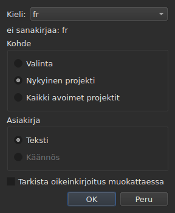
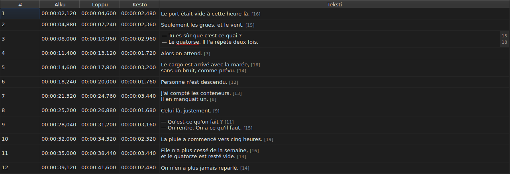
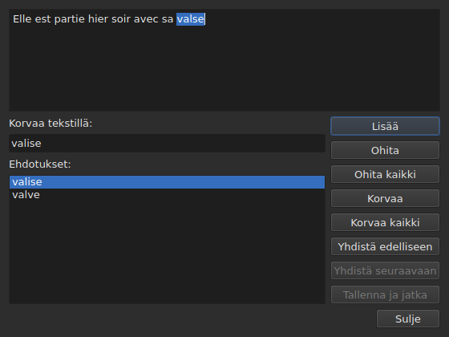

# Tarkista oikeinkirjoitus…

<!-- machine-translated -->
> Tämä sivu on konekäännös, eikä kukaan tämän kielen lukija ole vielä tarkistanut sitä.

`Työkalut ▸ Tarkista oikeinkirjoitus…` käy läpi sanat, joita sanakirja ei tunne,
yksi kerrallaan, Gaupolin oikoluvun mallin mukaan. Sillä on rinnakkaiskomento,
`Työkalut ▸ Oikoluvun asetukset…`, jolla asetetaan kieli, kohde ja asiakirja sekä alleviivaus kirjoitettaessa.
Molemmat käyttävät järjestelmän sanakirjoja Enchantin kautta.

Englanninkielisessä ikkunassa ensimmäisen nimi kirjoitetaan `Chec&k Spelling…`: `C` on jo
komennon `Correct Texts…` pikavalintakirjain, ja `k` on vapaana valikossa `Tools`.
Kummallakaan ei ole pikanäppäintä.

**Kumpikaan ei ole käytettävissä asiakirjassa, jossa ei ole yhtään kappaletta**, kuten
ei myöskään [`Correct Texts…`](correct-texts.md): tarkistettavaa ei ole. `Check Spelling…`
ei ole käytettävissä myöskään silloin, kun asetetulle kielelle ei ole sanakirjaa, katso
[Ilman sanakirjaa](#ilman-sanakirjaa).

## Oikoluvun asetukset…




| Ryhmä | Vaihtoehdot | Oletus |
| :---- | :------ | :------ |
| `Language` | järjestelmän tarjoamat kielikoodit ja jo valittu koodi | järjestelmän kieli, jos se on niiden joukossa |
| `Target` | `Selection`, `Current Project`, `All Open Projects` | `Current Project` |
| `Document` | `Text`, `Translation` | `Text` |
| `Check spelling while editing` | valintaruutu, katso [Alleviivaus kirjoitettaessa](#alleviivaus-kirjoitettaessa) | ei valittuna |

`Selection` ei ole käytettävissä, kun näkyvällä välilehdellä ei ole valittu yhtään riviä; `Translation`
ei ole käytettävissä niin kauan kuin missään avoimessa projektissa ei ole käännöstä. Muistettu
asetus, joka ei ole enää käytettävissä — tyhjä valinta, puuttuva käännös —,
avautuu arvoon `Current Project` tai `Text`. `OK` säilyttää asetukset, `Cancel` ei muuta
mitään.

**Tämä ikkuna ei riipu sanakirjasta**: se on käytettävissä niin kauan kuin
asiakirjassa on kappaleita, myös silloin, kun asetetulle kielelle ei ole sanakirjaa, ja juuri
sen avulla voi vaihtaa pois kielestä, jolle sanakirjaa ei ole. Kieli, jolle
sanakirjaa ei ole, on yhä muokattavissa ja näkyy luettelossa, ja sen
alla on lause `no dictionary for` ja kielen koodi.

**Neljä asetusta muistetaan** istunnosta toiseen ohjelman `subedit`
asetustiedostossa — sen sijainti kerrotaan sivulla [Asetukset](preferences.md):

| Avain | Arvot | Oletus |
| :-- | :----- | :------ |
| `spell-check.language` | kielikoodi, kuten `fr_FR`; tyhjä: järjestelmän kieli | tyhjä |
| `spell-check.target` | `selection`, `current-project`, `all-projects` | `current-project` |
| `spell-check.document` | `main`, `translation` | `main` |
| `spell-check.inline` | `true` tai `false` — tuntemattomien sanojen alleviivaus solun muokkaimessa | `false` |

Arvo, jota avain ei hyväksy, ohitetaan, oletus on voimassa, ja asetuksen
nimi kirjoitetaan virhetulosteeseen ikkunan avautuessa — katso
[Asetukset](preferences.md#mitä-tapahtuu-kun-tiedostossa-ei-ole-odotettua).

## Alleviivaus kirjoitettaessa




Ikkunan `Spell-Check Settings…` valintaruutu `Check spelling while editing` alleviivaa
**punaisella aaltoviivalla ja kirjoittaessasi** jokaisen tuntemattoman sanan
tekstisolun muokkaimessa — niin sarakkeen `Text` kuin sarakkeen
`Translation` muokkaimessa. Alleviivaus seuraa kirjoittamista: se ilmestyy, siirtyy ja
katoaa sanan mukana. **Se ei ole oletuksena valittuna**, kuten Gaupolissa: ilman
sitä muokkaimessa ei muutu mitään.

**Kieli on kentän `Language:` kieli** samassa ikkunassa, ja tuntemattomat sanat
ovat samat, jotka `Check Spelling…` löytäisi: samat puhekielisen englannin tapaukset
(`goin'`, `we'd`, `1st`), sama jako sanoiksi. Alleviivattua sanaa ei korjata
valikosta: valintaruutu vain näyttää sen.

**Kun asetetulle kielelle ei ole sanakirjaa, muokkain pysyy hiljaa**: mitään ei
alleviivata eikä mikään epäonnistu, ja ikkunan lause `no dictionary for` kertoo
syyn. Valintaruutu koskee sen jälkeen avattuja muokkaimia; jo auki oleva
muokkain säilyttää entisen tilansa.

## Läpikäynti




Ikkuna näyttää sen kappaleen tekstin, johon se pysähtyi, ja tuntematon sana
on valittuna siinä. **Jokaisen tuntemattoman sanan kohdalla projektin välilehti tulee esiin, ja
kappaleen rivi valitaan taulukossa.** Läpikäynti etenee kappale
kappaleelta ja sitten projekti projektilta, kun kohde kattaa useita.

Tekstin alla: kenttä `Replace with:`, johon on täytetty ensimmäinen ehdotus, ja
luettelo `Suggestions:`. Ehdotuksen valitseminen kopioi sen kenttään; kenttään
kirjoittaminen päivittää luettelon.

| Painike | Mitä se tekee |
| :----- | :----------- |
| `Add` | lisää sanan käyttäjän omaan sanakirjaan ja siirtyy seuraavaan |
| `Ignore` | jättää tämän sanan ja siirtyy seuraavaan |
| `Ignore All` | jättää tämän sanan ja kaikki sen muut esiintymät tämän läpikäynnin ajaksi |
| `Replace` | korvaa sanan kentän `Replace with:` sisällöllä; ei käytettävissä niin kauan kuin kenttä on tyhjä |
| `Replace All` | tekee saman sen muille esiintymille; ei käytettävissä niin kauan kuin kenttä on tyhjä |
| `Join with Previous` | yhdistää sanan sitä edeltävään sanaan; ei käytettävissä, jos sellaista ei ole tai jos niitä ei erota välilyönti |
| `Join with Next` | yhdistää sanan sitä seuraavaan sanaan samoin ehdoin |
| `Save and Resume` | säilyttää tekstin sellaisena kuin se on tekstialueella ja jatkaa **tämän tekstin lukemista alusta** |
| `Close` | sulkee ikkunan |

**Tekstialue on muokattavissa.** Heti kun kirjoitat siihen, vain `Save and Resume`
pysyy käytettävissä: muut toiminnot kohdistuvat valittuun sanaan, joka ei ole enää
tekstin sana.

**Läpikäynti päättyy itsestään**, kun tuntemattomia sanoja ei ole jäljellä:
painikkeet eivät ole käytettävissä ja teksti tyhjenee. Kohde, jossa ei ole yhtään tuntematonta sanaa,
ei näytä ikkunaa lainkaan.

### Sulkeminen kesken

`Close` tai ikkunan rasti **soveltaa sen, mitä on tehty**, kuten läpikäynnin
loppu: jo jätetyt tekstit **ja** nykyiseen tekstiin jo tehdyt toiminnot — korvaa,
korvaa kaikki, yhdistä. Tämä poikkeaa
Gaupolista, joka menettää nykyisen tekstin. Ei lasketa sitä, mitä läpikäynnistä on jäljellä, eikä
tekstialueelle kirjoitettuja korjauksia, joita `Save and Resume` ei ole
vahvistanut.

**Yksi ainoa historiamerkintä kutakin muuttunutta projektia kohden**, korvausten
määrästä riippumatta: `Undo` kumoaa kaikki kyseisen projektin korjaukset kerralla.
Valikko nimeää sen `Undo: correcting texts`. Tilarivi näyttää sitten
lukumäärät:

```text
Edited 2 and removed 0 subtitles
```

**Korvausluettelo** — mitä käyttäjä korvasi ja millä —
kirjoitetaan sulkemisen yhteydessä tiedostoon `spell-check/<language>.repl` ohjelman `subedit`
asetushakemistoon eikä Gaupolin hakemistoon, jota ei koskaan lueta.
Sen jälkeen se lasketaan oikoluvun ehdotuksiin, niin täällä kuin komennossa
[`Correct Texts…`](correct-texts.md#yhdistä-tai-jaa-sanoja--sanojen-yhdistäminen-ja-jakaminen-oikoluvun-avulla).
Jos sitä ei voida kirjoittaa, virheikkuna kertoo sen: `Could not save the
replacements for`, kieli ja syy, korjauksia perumatta.

## Ilman sanakirjaa

Kun asetetulle kielelle — järjestelmän kielelle, jos mitään ei ole valittu — ei ole
sanakirjaa, **`Check Spelling…` ei ole käytettävissä**, ja sen työkaluvihje sekä
tilarivi kertovat syyn, kun osoitin on kohdan päällä:

```text
no dictionary for fr
```

`Spell-Check Settings…` on yhä käytettävissä, jotta voit valita kielen, jolle sanakirja on. Ikkuna,
jonka ohjelma on käännetty ilman yhtään sanakirjan tarjoajaa, kertoo saman eikä tarkista
mitään.

## Viestit

| Viesti | Missä | Mikä sen aiheuttaa |
| :------ | :---- | :--------------- |
| `no dictionary for fr` | työkaluvihje ja tilarivi | asetetulle kielelle ei ole sanakirjaa |
| `Nothing to check.` | tilarivi | kohde ei kata yhtään tekstiä — esimerkiksi tyhjä valinta |
| `Edited N and removed M subtitles` | tilarivi | lopussa tai suljettaessa; `M` on aina `0` |
| `Could not save the replacements for fr: …` | virheikkuna | korvausluetteloa ei kirjoitettu |

## Esimerkki

Avoimessa tiedostossa on rivi `Elle est partie hier soir avec sa valse`. Ranskan
sanakirja on asennettu: `Työkalut ▸ Tarkista oikeinkirjoitus…` pysähtyy sanaan `valse`, valitsee
rivin taulukossa ja ehdottaa sanaa `valise`, joka on jo kentässä `Replace with:`. `Replace`
ja sitten `Close`: rivistä tulee `Elle est partie hier soir avec sa valise`, ja
tilarivillä lukee:

```text
Edited 1 and removed 0 subtitles
```
