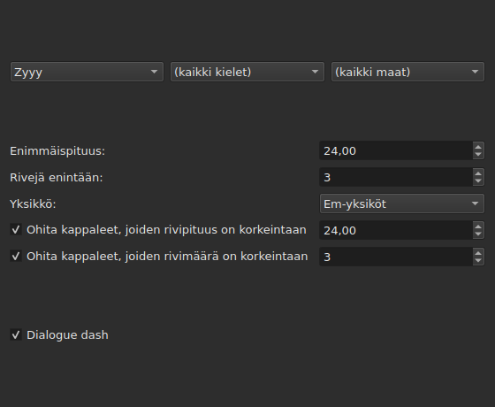
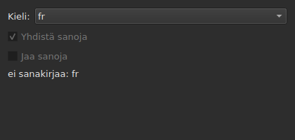
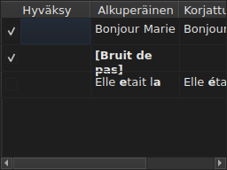

# Korjaa tekstejä…

<!-- machine-translated -->
> Tämä sivu on konekäännös, eikä kukaan tämän kielen lukija ole vielä tarkistanut sitä.

`Työkalut ▸ Korjaa tekstejä…` avaa monisivuisen avustajan Gaupolin mallin
mukaan: kohteen ja tehtävien sivu, yksi sivu kutakin valittua tehtävää kohti,
edistymissivu ja vahvistussivu, joka ehdottaa muutoksia pakottamatta niitä
koskaan.

**Ei käytettävissä tyhjässä asiakirjassa**: korjattavaa ei ole.

**Komentorivi tekee saman** kaikille tehtäville: [`subedit-cli correct`](../subedit-cli/correct.md)
samoin lausekkein ja samoin laskurein — ja merkkeinä siellä, missä ikkuna mittaa
em-yksiköinä. **Se lukee oletuksena neljä tämän avustajan muistamaa asetusta** —
yleisten virheiden kaksi luokkaa (`Human`, `OCR`), asetuksen
`Remove all blank subtitles` ja tehtävän `Line Break` rivien enimmäismäärän —
ja ottaa kaiken muun (tehtävät, niiden koodin, rivipituuden, kielen,
lausekkeiden ruudut) omalta komentoriviltään. Katso
[Kaksi lohkoa, joista yksi on yhteinen komentorivin kanssa](preferences.md#kaksi-lohkoa-joista-yksi-on-yhteinen-komentorivin-kanssa)
ja [`subedit-cli config`](../subedit-cli/config.md).

## Tehtävät ja kohde — ensimmäinen sivu

| Ryhmä | Vaihtoehdot | Oletus |
| :---- | :------ | :------ |
| `Target` | `Selection`, `Current Project`, `All Open Projects` | `Current Project` |
| `Document` | `Text`, `Translation` | `Text` |
| `Tasks` | `Mentions`, `Join or Split Words`, `Common Errors`, `Capitalization`, `Line Break` — valitaan yksi tai useampi | `Common Errors` ja `Capitalization` valittuina, kolme muuta ei |

`Selection` ei ole käytettävissä, kun näytetyssä välilehdessä ei ole valittu
yhtään riviä; `Translation` ei ole käytettävissä niin kauan kuin missään
avoimessa projektissa ei ole käännöstä.

**Kohdetta ja asiakirjaa ei muisteta**: avustaja avautuu aina uudelleen
valinnoilla `Current Project` ja `Text`. Valitut tehtävät sen sijaan muistetaan.

**Mitä kukin kohde tarkoittaa**:

| Kohde | Kohdistuu |
| :----- | :------ |
| `Selection` | näytetyn välilehden valittuihin riveihin |
| `Current Project` | näytetyn välilehden koko tiedostoon |
| `All Open Projects` | jokaisen avoimen välilehden koko tiedostoon |

**`All Open Projects` yhdessä valinnan `Translation` kanssa ohittaa projektit,
joissa ei ole käännöstä**: projektilla, jossa käännöstä ei ole, ei ole tyhjässä
sarakkeessa mitään ehdotettavaa, eikä avustaja laske sitä.

**Tehtäväsivut seuraavat Gaupolin järjestyksessä — `Mentions`,
`Join or Split Words`, `Common Errors`, `Capitalization`, `Line Break` — eivät
koskaan siinä järjestyksessä, jossa ruudut valittiin.** Valitsemattomalla
tehtävällä ei ole sivua; sen muistetut asetukset eivät silti muutu.
**Millään tehtäväsivulla ei ole omaa ”käytössä”-ruutua**: tehtävän
suorittamisesta päättää tämän ensimmäisen sivun ruutu, ja vain se.

## Tehtäväsivut

Kullakin neljästä lausekesivusta — kaikilla paitsi tehtävällä
`Join or Split Words`, jolla lausekkeita ei ole — on sama perusta: kolme
porrastettua pudotusvalikkoa — kirjoitusjärjestelmä, kieli, maa — käytettävien
lausekkeiden koodin valitsemiseksi, sitten tuon koodin lausekkeiden luettelo,
yksi valittava nimeä kohti. **Kolme valikkoa tarjoavat vain sitä, mitä
lausekeluettelossa todella on** — ohjelman mukana toimitettuja ja käyttäjän
sinne lisäämiä (katso [Käyttäjän lisäämät lausekkeet](#käyttäjän-lisäämät-lausekkeet)) —
eivät koskaan muualta luettua kielten tai maiden luetteloa. `Zyyy` (”mikä
tahansa kirjoitusjärjestelmä”) on tehtävän `Common Errors` aloituskoodi, ja se
antaa kaikkialla kelpaavat lausekkeet. **Kolmella muulla tyypillä on lausekkeita
vain kirjoitusjärjestelmän alla**: niiden sivu avautuu ensimmäiselle, jonka
luettelo tarjoaa, toimitetuilla lausekkeilla `Latn`, eikä koodille `Zyyy`.

**Kunkin lausekkeen kuvaus on sen ruudun työkaluvihje.** Nimet ja kuvaukset
noudattavat ikkunan kieltä ohjelman mukana toimitetuissa lausekkeissa; oma
lauseke näytetään sellaisena kuin sen tiedosto sen kirjoittaa
([Kieli](invocation.md#kieli)).

**Valitsematon lauseke pysyy valitsemattomana, kunnes se valitaan uudelleen**,
myös kun koodia vaihdetaan ja siihen palataan, ja tuo valinta muistetaan
avustajan avauskerrasta toiseen. Uudelleen valittuna se yksinkertaisesti saa
alkuperäisen asetuksensa takaisin, ja muistettu valinta katoaa.

| Sivu | Mitä se lisää perustaan |
| :--- | :----------------------- |
| `Mentions` | kaksi valintaruutua, `Sound in brackets` ja `Sound in parentheses`, oletuksena valitsematta |
| `Common Errors` | kaksi valintaruutua, `Human` ja `OCR`, oletuksena valittuina |
| `Capitalization` | ei mitään muuta |
| `Line Break` | enimmäispituus (oletuksena `24`), rivien enimmäismäärä (`3`), yksikkö — `Characters` tai `Ems`, oletuksena `Ems` — ja kaksi ohitusehtoa, jotka kuvataan alla |

**Sivun `Mentions` kaksi ruutua eivät nimeä mitään käännettyä lauseketta**:
ne ohjaavat ytimessä tekstin läpikäyntiä, samaa, jonka
[`Remove Hearing-Impaired Mentions…`](operations.md#remove-hearing-impaired-mentions)
jo tekee suorana eleenä. Riittää, että toinen **tai** toinen on valittuna, jotta
se käynnistyy. **Sivun lausekeluettelo ei toista niitä**: nuo kaksi nimeä
näkyvät siellä vain kerran, valintaruutuina.

**`Common Errors` suodattaa luokan mukaan**: lauseke, jolla on molemmat
luokat, on käytössä heti, kun jompikumpi ruuduista on valittuna; kolme muuta
sivua eivät tunne tätä erottelua.

### Rivinvaihto — yksikkö ja ohitus




| Asetus | Mitä se tekee | Oletus |
| :------ | :----------- | :------ |
| `Maximum length` | rivin pituus valitussa yksikössä; `1`–`1000` | `24` |
| `Maximum lines` | tavoiteltu rivien määrä; `1`–`100` | `3` |
| `Unit` | `Characters` laskee merkit; `Ems` mittaa leveyden ikkunan fontilla, jossa keskimääräinen pieni kirjain on `0.55` — Gaupolin yksikkö | `Ems` |
| `Skip subtitles with maximum line length of` | jättää ennalleen kappaleen, jonka pisin rivi mahtuu tähän pituuteen valitussa yksikössä | valittu, `24` |
| `Skip subtitles with maximum line amount of` | jättää ennalleen kappaleen, jonka rivien määrä mahtuu tähän lukuun | valittu, `3` |

**Ohituksella on omat kynnyksensä**, erilliset tavoitelluista rajoista: se on
Gaupolin sääntö. Kappale jätetään ennalleen, jos se mahtuu **kaikkiin
kynnyksiin, joiden ruutu on valittuna**; muuten se katkaistaan, ja katkaisu
säilytetään vain, jos se tuo kappaleen lähemmäs kynnystä, jonka se ylitti —
lyhyemmäksi tai vähemmille riveille. Jos mitään ruutua ei ole valittu,
jokainen kappale katkaistaan, mahtui se jo tai ei.

**Yksikön vaihtaminen muuttaa ehdotusta**: kunkin rivin pituus mitataan
jokaisella laskentakerralla sivun sen hetkisessä yksikössä, eikä aiemmasta
mittauksesta jää mitään. Kahdenkymmenenyhdeksän merkin teksti, josta puolet on
kapeita kirjaimia, ylittää arvon `24` yksikössä `Characters` ja mahtuu siihen
helposti yksikössä `Ems`.

**Seitsemän asetusta muistetaan** istunnosta toiseen, yksikkö mukaan lukien.

### Yhdistä tai jaa sanoja — sanojen yhdistäminen ja jakaminen oikoluvun avulla




Erillinen sivu tehtävien `Mentions` ja `Common Errors` välissä sen
korjaamiseen, mitä tekstintunnistusohjelmat tekevät välilyönneille. Sillä ei
ole lausekeluetteloa: se nojaa järjestelmän sanakirjoihin Enchantin kautta.

| Asetus | Mitä se tekee | Oletus |
| :------ | :----------- | :------ |
| `Language` | sanakirjan kieli; järjestelmän tarjoamat koodit sekä jo valittu | järjestelmän kieli, jos se on niiden joukossa |
| `Join words` | yhdistää väärin kirjoitetun sanan viereiseen sanaan | valittu |
| `Split words` | leikkaa väärin kirjoitetun sanan kahtia | ei valittu |

**Yhdistäminen**: väärin kirjoitettu sana yhdistetään sitä edeltävään tai
seuraavaan sanaan **jos ja vain jos vain toinen suunnista antaa oikein
kirjoitetun sanan**. Kun molemmat antavat sellaisen tai kumpikaan ei anna,
mitään ei tehdä. Tekstistä `bon jour` tulee `bonjour`; kaksi peräkkäistä
välilyöntiä muutetaan ensin yhdeksi, mutta teksti, jossa mitään ei yhdistetä,
palautetaan sellaisenaan välilyönteineen.

**Jakaminen**: väärin kirjoitettu sana leikataan, jos oikoluvun ehdotuksista
**vain yksi** on tuo sana välilyönnin kanssa — samat kirjaimet samassa
järjestyksessä. Kaksi tällaista ehdotusta tai ei yhtään: mitään ei tehdä.
Sanaa, jonka alkukirjain yksin on iso (`Bonjourtous`), ei koskaan jaeta: se on
usein nimi, eikä sanakirjoissa ole niitä.

**Käyttäjän korvausluettelo** (`spell-check/<language>.repl` ohjelman
asetushakemistossa) lasketaan oikoluvun ehdotuksiin; avustaja lukee sitä
eikä kirjoita sitä.

**Kun valitulle kielelle ei ole sanakirjaa, sivu pysyy ja on harmaana**: kaksi
ruutua eivät ole käytettävissä, ja sivulla lukee `no dictionary for` ja sen
perässä kielen koodi. Kieltä voi yhä muokata — toiselle kielelle voi olla
sanakirja — ja tehtävä, valittuna tai ei ensimmäisellä sivulla, ei silloin
tee mitään eikä ilmoita virheestä.

**Kieli, kaksi ruutua ja ensimmäisen sivun ruutu muistetaan** avustajan
avauskerrasta toiseen.

### Käyttäjän lisäämät lausekkeet

Lauseke, jonka käyttäjä on lisännyt omaan lausekehakemistoonsa, lisätään
ohjelman mukana toimitettujen joukkoon samaan luetteloon ja samojen valikkojen
alle — mikään ei erota niitä toisistaan, kun ne on ladattu.

| Lausekkeet | Missä |
| :------- | :---- |
| toimitetut | `<prefix>/share/subedit/patterns`, hakemiston `<prefix>/bin` vieressä |
| käyttäjän | `$XDG_DATA_HOME/subedit/patterns` tai `~/.local/share/subedit/patterns`, jos muuttujaa ei ole asetettu tai se ei ole absoluuttinen polku |

**Muoto on Gaupolin, ja se luetaan sellaisenaan**: yksi tiedosto
`<Code>.<type>` kirjoitusjärjestelmää, kieltä ja maata kohti —
`Latn-en.common-error` —, sen aktivointitiedosto `.conf` vieressään. Tyypit ovat
`common-error`, `capitalization`, `hearing-impaired` ja `line-break`.
Toimitetut tiedostot toimivat mallina. **Lausekkeet luetaan kerran,
käynnistettäessä**: tiedosto, joka lisätään ikkunan ollessa auki, näkyy vasta
seuraavalla käynnistyskerralla.

## Edistyminen

Kun painiketta `Next` painetaan viimeisellä valitulla tehtäväsivulla (tai
ensimmäisellä sivulla, jos mitään tehtävää ei ole valittu), avustaja laskee
ehdotetut korjaukset taustasäikeessä, ja ruudulla on määrittelemätön
edistymispalkki. Kun laskenta on valmis, vahvistussivu avautuu itsestään.

**`Cancel` tässä vaiheessa hylkää laskennan keskeyttämättä sitä**: mitään ei
toteuteta, mutta avustaja odottaa ennen sulkeutumistaan, että käynnissä oleva
laskenta päättyy — odotusta rajaa aikaraja, jonka lausekemoottori asettaa
jokaiselle haulle.

**`Back` tässä vaiheessa palaa edelliselle sivulle odottamatta**: laskenta
päättyy taustalla, ja sen tulos hylätään — avustaja ei hyppää itsestään
vahvistukseen. `Next` aloittaa uuden laskennan.

## Vahvistus — viimeinen sivu




Yksi rivi kutakin tekstiä kohti, jota avustaja muuttaisi — ei koskaan riviä
tekstille, jonka tehtävä jätti ennalleen.

| Sarake | Mitä se näyttää |
| :----- | :------------ |
| `Accept` | valintaruutu, oletuksena valittuna: korjaus toteutetaan tai ei |
| `Original` | teksti sellaisenaan, muuttuva osa **lihavoituna** |
| `Corrected Text` | ehdotettu teksti, muuttunut osa lihavoituna, **muokattavissa** — sen viimeistely muuttaa sitä, mitä kirjoitetaan, muuttamatta ruutua `Accept` |

**Muutos merkitään lihavoinnilla, ei koskaan värillä**: sama ero luetaan
molemmilla paleteilla riippumatta mistään sävystä.

**Rivi, jonka ehdotus on poisto** — kappaleeseen ei jäisi tekstiä — näyttää
sarakkeen `Corrected Text` tyhjänä ja koko sarakkeen `Original` sisällön
lihavoituna.

| Painike | Mitä se tekee |
| :----- | :----------- |
| `Mark All` | valitsee ruudun `Accept` kaikilla riveillä |
| `Unmark All` | poistaa ruudun `Accept` valinnan kaikilla riveillä |
| `Preview` | vie sisäänrakennetun soittimen valitun rivin kappaleeseen, jos projektilla on elokuva — ei mitään, jos ei ole |
| `Finish` | toteuttaa valitut rivit ja sulkee avustajan |

`Remove all blank subtitles`, oletuksena valittuna, poistaa kappaleet, joihin
korjaus ei jättäisi lainkaan tekstiä, sen sijaan että ne säilytettäisiin
tyhjinä.

**Lauseke, jota laskenta ei voinut toteuttaa, nimetään taulukon alla** syyn
kera:

```text
Not applied: some pattern (will not compile)
```

Näin nimetty lauseke nimetään **kerran syytä kohti**, riippumatta siitä,
monessako tekstissä tai projektissa se epäonnistui: näyttö ei kerro, missä.

| Syy | Mikä sen aiheuttaa |
| :----- | :--------------- |
| `cannot be translated` | lauseke käyttää jotain, minkä Pythonin syntaksin muunnos hylkää |
| `will not compile` | moottori hylkää lausekkeen |
| `has an invalid replacement` | korvausta ei voi lukea niin kuin Python sen lukee |
| `timed out` | haku ylitti ajan, jonka moottori sille myöntää yhdessä tekstissä |
| `never settled` | `Repeat` muutti yhä tekstiä sadan ajokerran jälkeen |
| `grew the text too long` | teksti ylitti 16 384 tavua lausekkeen käsitellessä sitä |

**Lauseke, joka epäonnistuu tekstissä, jättää sen sellaiseksi kuin se oli
ennen sitä**: puoliksi tehty korvaus on vähemmän arvoinen kuin ei korvausta
lainkaan. Muut lausekkeet toteutetaan.

**Lauseketiedoston rivi, jota ei voi lukea, nimetään samassa paikassa**
tiedostonsa, rivinsä ja syyn mukaan — jokaisella avustajan avauskerralla,
koska lausekkeet luetaan vain kerran, käynnistettäessä:

```text
Could not be read: Zyyy.common-error, line 8 (malformed line)
```

| Syy | Mikä sen aiheuttaa |
| :----- | :--------------- |
| `directory cannot be read` | toimitettujen lausekkeiden hakemistoa ei voitu käydä läpi |
| `file cannot be read` | lauseketiedostoa ei voitu lukea |
| `malformed line` | rivi, joka ei ole otsake, kommentti eikä `Key=Value` |
| `field outside any pattern` | `Key=Value` ennen ensimmäistä lausekkeen otsaketta |
| `unknown field` | avain, jolle tämäntyyppinen lauseke ei löydä käyttöä — lauseke säilytetään |
| `missing field` | avain, jota ilman tämäntyyppinen lauseke ei voi tehdä mitään — lauseke hylätään |
| `invalid value` | arvo, jota avain ei hyväksy — lauseke hylätään |
| `malformed activation` | tiedoston `.conf` elementti `<pattern>`, joka ei nimeä mitään |

Muut lausekkeet, jotka luettiin ja toteutettiin oikein, eivät ole tämän
asian piirissä.

## Mitä kumoaminen kertoo ja mitä `Cancel` ei koskaan tee

**`Finish` tekee yhden historiamerkinnän kutakin käsiteltyä projektia kohti**,
ei koskaan yhtä korjausta kohti: `Undo` kumoaa kerralla kaikki tuossa
projektissa hyväksytyt korjaukset, kunkin tekstinsä kanssa. Valikko nimeää sen
`Undo: correcting texts`.

Tilarivi antaa lukumäärän, ensin muutetut tekstit ja sitten poistetut
kappaleet:

```text
Edited 3 and removed 1 subtitles
```

**`Cancel` millä tahansa sivulla ei toteuta mitään eikä muista mitään** —
ei tämän avauskerran aikana valittuja asetuksia eikä pienintäkään korjausta.
Avustajan seuraava avauskerta alkaa jälleen aiemmista asetuksista.

## Esimerkki

Avoimen tiedoston yhdellä rivillä on kaksi välilyöntiä kahden sanan välissä,
ja siinä on hakasulkeissa oleva maininta ilman muuta tekstiä.
`Työkalut ▸ Korjaa tekstejä…`, `Common Errors` jo valittuna, `Next`
vahvistukseen asti: rivillä, jossa on kaksi välilyöntiä, näkyy vasemmalla
`Bonjour  Marie` ja oikealla `Bonjour Marie`, korjaus lihavoituna ja jo
hyväksyttynä. `Finish` toteuttaa sen, ja tilarivillä lukee:

```text
Edited 1 and removed 0 subtitles
```
