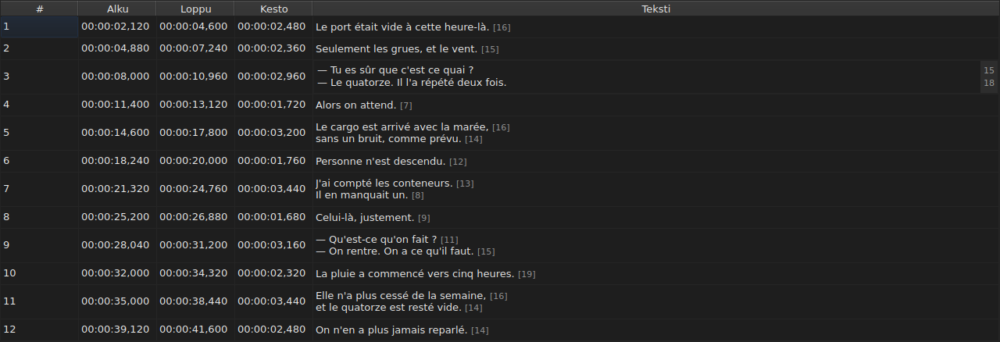

# Solun muokkaaminen

<!-- machine-translated -->
> Tämä sivu on konekäännös, eikä kukaan tämän kielen lukija ole vielä tarkistanut sitä.

Neljää saraketta muokataan paikallaan: `Start`, `End`, `Duration` ja `Text` — viittä,
kun mukana on sarake `Translation` eli projektissa on käännös. Saraketta `#` ei voi
muokata — numero on rivin järjestysnumero eikä tiedoston tietoa.

**Solun muokkaimen avaaminen:** kaksoisnapsauta solua tai valitse se
ja paina `F2`.

## Teksti

**Käännöstä muokataan kuten tekstiä**, samassa monirivisessä kentässä ja samoin
säännöin; vain solu muuttuu, ja pääasiakirjan teksti pysyy
ennallaan. Vahvistus, joka ei muuta mitään, ei tee mitään, niin toisessa kuin
toisessakin — katso [alempaa](#vahvistus-joka-ei-muuta-mitään-ei-tee-mitään).

Muokkain on **monirivinen** kenttä, ja se avautuu kappaleen korkuisena:
kaksirivinen kappale kirjoitetaan siihen sellaisena kuin se kirjoitetaan tiedostoon, sen kaksi riviä
luettavina ja ilman vierityspalkkia. Rivin lisäävä `Shift+Enter` suurentaa
muokkainta; taulukon rivi mukautuu vahvistettaessa.

| Näppäin | Vaikutus |
| :-- | :----- |
| `Enter` | vahvistaa ja sulkee muokkaimen |
| `Shift+Enter` | lisää tekstiin rivinvaihdon |
| `Esc` | sulkee muokkaimen; solu säilyttää entisen sisältönsä |
| `Tab` | vahvistaa ja siirtyy seuraavaan soluun |

Myös muualle napsauttaminen vahvistaa: kohdistuksen menettäminen vastaa näppäintä `Enter`.

**Yksitoista toimintoa, joissa ei ole valintaikkunaa, vahvistavat samoin** ennen kohteensa laskemista:
`Italic`, `Case ▸ …`, `Dialogue`, `Merge Subtitles`, `Split Subtitle`,
`Cut Texts`, `Paste Texts`, `Copy Texts`, `Remove Subtitles`, `Undo` ja `Redo`.
Kun ne käynnistetään valikosta, työkaluriviltä tai ikkunan pikanäppäimellä, ne
ottavat tekstin sellaisena kuin muokkain on sen juuri vahvistanut, kuten muualle
napsauttamisen jälkeen. `Ctrl+X`, `Ctrl+C` ja `Ctrl+V` jäävät kuitenkin muokkaimelle niin kauan kuin
se on auki — katso [Leikkaaminen, kopioiminen ja liittäminen](clipboard.md): silloin
komennot `Cut Texts`, `Copy Texts` ja `Paste Texts` käynnistetään valikosta.

`Undo` ja `Redo` lukevat historiaa eivätkä asiakirjaa: katso
[Kumoa ja tee uudelleen](undo.md). Valintaikkunan avaava toiminto ei
tarvitse tätä sääntöä, koska valintaikkuna ottaa kohdistuksen avautuessaan, mikä
jo vahvistaa syötteen.

### Tagit ovat tiedoston tageja

Näytetty ja kirjoitettu teksti on **tiedoston tekstiä tageineen**:
SubRip-tiedoston `<i>…</i>` kirjoitetaan sellaisenaan, samoin Advanced SSA -tiedoston
`{\i1}…{\i0}`. Mitään ei muunneta näyttämistä varten — toiminnon
[`Italic`](operations.md#italic) taulukko kertoo, mitä kukin muoto kirjoittaa.

Kursiivista ei siis tarvitse tietää mitään: `Ctrl+I` asettaa avoimelle asiakirjalle oikean
tagin, ja muodossa, joka ei tue tageja — TMPlayer, LRC —,
komento ei ole käytettävissä sen sijaan, että joutuisit etsimään. Lihavointi ja alleviivaus
kirjoitetaan käsin, kuten Gaupolissa.

**Tagit eivät myöskään seuraa tekstitoimintoja**: kun kappale muutetaan
pieniksi kirjaimiksi, sen `<I>` ei muutu muotoon `<i>`, ja vuoropuheluviiva
asetetaan tekstin eteen eikä avaavan tagin eteen. Katso
[`Case` ja `Dialogue`](operations.md#case-ja-dialogue).

## Rivien pituus

**Tekstin muokkain näyttää oikeanpuoleisessa marginaalissa kunkin
rivin pituuden** kyseisen rivin ensimmäisen näyttörivin kohdalla. Marginaali on yhtä leveä
kuin suurin luku, päivittyy **kirjoittaessasi** ja seuraa vieritystä.
Tyhjä teksti ei näytä mitään. Pituudet ovat samat kuin taulukossa — ilman
tageja, alaspäin pyöristettyinä, asetetussa yksikössä —, ja ne poistetaan
asetusikkunan `Muokkaa ▸ Asetukset…` valintaruudulla `Show line lengths in the editor`. Katso
[Rivipituudet](preferences.md#rivipituudet).

## Alku ja loppu

Muokkain on yksirivinen kenttä, **joka on rajattu aikaleiman muotoon**:
se hylkää jo kirjoitettaessa sen, mikä ei voisi koskaan olla aikaleima.

Hyväksytyt muodot ovat samat, jotka tiedoston lukeminen jo hyväksyy:

| Osa | Mikä kelpaa |
| :------ | :---------- |
| kentät | `MM:SS` tai `HH:MM:SS`, kussakin yksi tai kaksi numeroa |
| desimaalit | yhdestä kolmeen pilkun tai pisteen jälkeen, tai ei yhtään |
| etumerkki | alussa oleva `-` kohdalle, joka on ennen videon alkua |
| rajat | minuutit ja sekunnit alle 60 |

`00:01:02,500`, `1:02.5` ja `-0:01,000` ovat siis kolme kelvollista syötettä.

**Syöte, jonka lukeminen hylkää, jättää solun ennalleen.** Näin käy
syötteelle `00:70:00,000`, jonka muoto on oikea mutta jonka minuutit ovat
rajojen ulkopuolella: muokkain sulkeutuu, eikä mikään ole siirtynyt. Mitään kohtaa ei keksitä
— väärä kohta on hiljainen virhe, eikä mikään näytöllä erota
huonosti ajoitettua kappaletta hyvin ajoitetusta.

Alun tai lopun muuttaminen päivittää sarakkeen `Duration` heti.

## Kesto

**Keston kirjoittaminen siirtää loppua eikä koskaan alkua**: lopuksi tulee
`Start + Duration`. Alun siirtäminen siirtäisi koko kappaletta, mikä
on komennon [`Shift Positions…`](operations.md) tehtävä, ja sarakkeeseen `Start` voi
jo kirjoittaa.

Kesto kirjoitetaan **aikaleiman muodossa**, siinä, jota sarake
näyttää, ja yllä olevan taulukon muodot ovat voimassa — yhtä eroa lukuun ottamatta:

| Osa | Alku, loppu | Kesto |
| :------ | :--------- | :------- |
| muoto | aikaleiman muoto | sama |
| alussa oleva etumerkki `-` | hyväksytään | **hylätään jo kirjoitettaessa** |

`0:02.5` ja `00:00:02,500` ovat siis kaksi kelvollista syötettä kahden ja puolen
sekunnin kestolle; syötettä `-0:01,000` ei voi kirjoittaa. Nollakesto hyväksytään:
kappale katoaa silloin samalla hetkellä kuin ilmestyy.

**Loppu, joka menee seuraavan kappaleen päälle, on sallittu.**
Päällekkäisyys sävytetään taulukossa työkaluvihjeineen — katso
[Taulukko](table.md#poikkeamat) — huomautus eikä hylkäys: se voi olla juuri sitä, mitä
halusit. [Huomautusten luettelo](files.md#lukemisen-huomautukset)
sisältää sen myös ja poistaa sen, kun olet korjannut sen.

**Elokuvan lopun jälkeen kirjoitettua loppua ei ilmoiteta**, toisin kuin
valikon `Tools` toimintoa, joka siirtäisi sen sinne — katso
[Toiminnot](operations.md#elokuvan-lopun-jälkeen). Solu näyttää jo
juuri kirjoittamasi arvon.

Lukukelvoton syöte jättää solun ennalleen, samoin kuin kohdan syötteessä, eikä
näytettyä kestoa vastaava kesto tule historiaan.

## Vahvistus, joka ei muuta mitään, ei tee mitään

Avaa solu, älä kirjoita mitään, paina `Enter`: mitään ei tapahdu.
Mitään muutosta ei tallenneta, ja tiedostoa pidetään yhä samana kuin
levyllä olevaa.

Vertailu tehdään **kohdasta** eikä merkkijonosta: kun `0:01.0` kirjoitetaan
soluun, joka näyttää arvon `00:00:01,000`, se tarkoittaa samaa hetkeä, eikä
siis myöskään muuta mitään.

## Mitä muokatulle solulle tapahtuu

Sen **voi kumota** — yksi solu, yksi merkintä. Katso
[Kumoa ja tee uudelleen](undo.md).

Se **tallennetaan**, ja jos ikkuna suljetaan tallentamatta, siitä pyydetään
vahvistus. Katso [Avaaminen ja tallentaminen](files.md).
