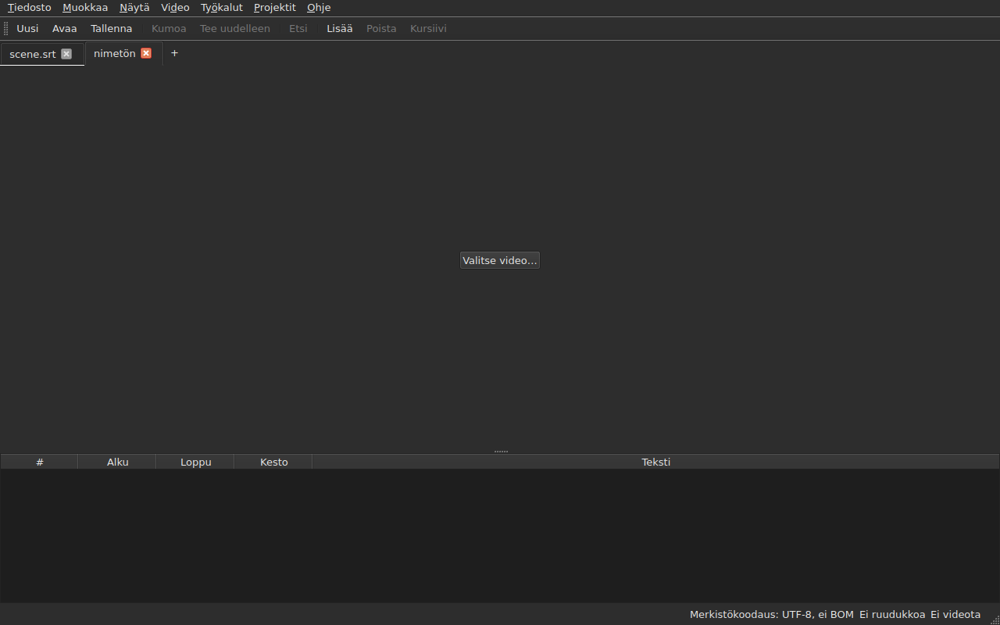
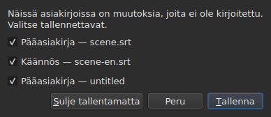
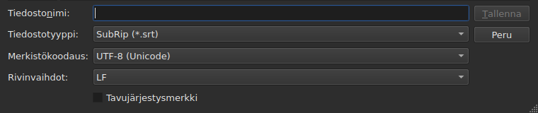
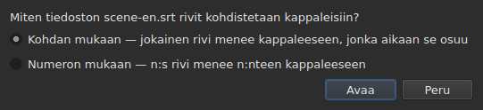
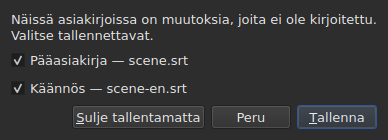

# Avaaminen ja tallentaminen

<!-- machine-translated -->
> Tämä sivu on konekäännös, eikä kukaan tämän kielen lukija ole vielä tarkistanut sitä.

Valikossa **Tiedosto** on kolme komentoa, kaksi välilehtiä varten ja kolme
muuta käännöstä varten; valikko **Projektit** vaikuttaa kaikkiin välilehtiin kerralla.

| Komento | Pikanäppäin | Mitä se tekee |
| :------ | :------- | :----------- |
| Uusi projekti | `Ctrl+N` | tyhjä projekti uudessa välilehdessä — myös painike `+` viimeisen välilehden jälkeen |
| Avaa… | `Ctrl+O` | valitsee tiedoston ja avaa sen uuteen välilehteen — tai koskemattoman projektin tilalle |
| Avaa käännös… | — | valitsee käännöstiedoston ja kohdistaa sen nykyisen välilehden päätiedostoon |
| Tallenna | `Ctrl+S` | kirjoittaa avoimen tiedoston uudelleen |
| Tallenna nimellä… | `Ctrl+Shift+S` | valitsee polun ja muodon ja kirjoittaa sitten |
| Tallenna käännös | — | kirjoittaa käännöksen tiedoston uudelleen |
| Tallenna käännös nimellä… | — | valitsee käännökselle polun ja muodon ja kirjoittaa sitten |
| Sulje | `Ctrl+W` | sulkee nykyisen välilehden — ei käytettävissä, jos välilehtiä on vain yksi |

Kohdat `New Project`, `Open…` ja `Save` ovat myös
[työkalurivillä](index.md#työkalurivi) sanojen `New`, `Open` ja
`Save` alla. **Käännöksen kolme kohtaa
eivät ole palkissa**: ne palvelevat vain niitä, joilla on
käännös, ja palkki on kaikkien.

## Useita projekteja välilehdillä

**Kullakin avoimella projektilla on oma välilehtensä** kuvan ja taulukon yläpuolella:
sen nimiö on tiedoston nimi tai `untitled` projektille, jolla sellaista ei vielä
ole. Välilehden napsauttaminen siirtyy siihen; `Ctrl+PageDown` ja `Ctrl+PageUp` tekevät
saman ilman hiirtä ja palaavat viimeisen välilehden jälkeen ensimmäiseen.
**Painike `+` heti viimeisen välilehden jälkeen** avaa tyhjän projektin
uuteen välilehteen, kuten `New Project`.




**`Open…` ei koskaan koske niihin.** Tiedoston avaaminen ei enää korvaa sitä, mitä
ikkuna näytti: tiedosto tulee uuteen välilehteen sen viereen, ja välilehti, jota
katsoit aiemmin, säilyttää kaiken, mitä sillä oli — historiansa, valintansa,
liitetyn videonsa. Siksi avaaminen ei myöskään enää kysy mitään: menetettävää ei
ole, koska korvattavaa ei ole.

**Yksi poikkeus: koskematon projekti luovuttaa paikkansa.** Kun ikkuna käynnistetään ilman tiedostoa tai
kohdan `New Project` jälkeen, se näyttää projektin `untitled`, jossa ei ole mitään.
Avattu tiedosto — komennolla `Open…` tai pudottamalla — **ottaa silloin sen välilehden,
samalta paikalta palkissa**, sen sijaan että avaisi uuden hyödyttömän
projektin viereen. Projekti on koskematon, kun sillä **ei ole tiedostoa, ei kappaletta,
ei mitään kumottavaa tai uudelleen tehtävää, ei elokuvaa, eikä sitä ole koskaan muutettu**: mikä
tahansa näistä riittää siihen, että se säilyttää välilehtensä. Koskemattomaan projektiin, joka ei ole
nykyinen välilehti, ei kosketa.

**Jo avoinna olevaa tiedostoa ei avata toista kertaa.** `Open…`
tiedostolle, joka on jo toisessa välilehdessä, palauttaa kohdistuksen tuohon välilehteen ja kertoo sen
tilarivillä:

```text
premier.srt: already open
```

**Kukin välilehti on kokonainen projekti, muista riippumaton**: sen
historia, valinta, liitetty video ja se, mitä sen viimeisin lukeminen
kohtasi, näytetään vain, kun tuo välilehti on nykyinen, eivätkä ne
muutu sillä aikaa, kun jokin toinen on. **Yksi poikkeus, ja se on kirjattu ADR:ään
0033**: videosoitin on koko ikkunalle yksi ainoa — yksi mpv-prosessi
— ja sen elokuva vaihtuu välilehden mukana; **kukin välilehti muistaa, missä kohdassa sen elokuva
oli**, ja jatkaa siitä keskeytettynä, kun palaat siihen. Leikepöytä taas kuuluu ikkunalle: kopioiminen
yhdessä välilehdessä ja liittäminen toiseen on juuri se, minkä vuoksi kaksi avataan.

**`Close` sulkee nykyisen välilehden** ja esittää tarvittaessa
[tallentamattomia muutoksia koskevan kysymyksen](#tallentamattomia-muutoksia) —
vain tämän välilehden osalta, muut eivät ole mukana. **Ei käytettävissä, kun
välilehtiä on vain yksi**: ikkunassa on aina vähintään yksi, ja sen sulkeminen
olisi ikkunan sulkemista — minkä järjestelmän painike jo tekee.

**Kussakin välilehdessä on myös risti**, joka sulkee **sen** projektin samalla
kysymyksellä. Muun kuin nykyisen välilehden risti sulkee tuon välilehden, ja
välilehti, jota katsot, pysyy näkyvissä; jos tuossa projektissa on muutoksia, sen
välilehti tulee etualalle kysymyksen ajaksi. **Ristiä ei ole, kun jäljellä on vain
yksi välilehti**, samasta syystä kuin `Close` ei ole käytettävissä.

**Välilehti kertoo, että sitä on muutettu**: sen nimen perässä on tähti, `premier.srt*`,
niin kauan kuin jokin sen asiakirjoista poikkeaa tiedostostaan — kuten ikkunan otsikko
kertoo katsomastasi projektista. Tähti häviää tallennettaessa.

## Projektit-valikko

Kaksi komentoa vaikuttaa kaikkiin projekteihin kerralla.

| Komento | Pikanäppäin | Mitä se tekee |
| :------ | :------- | :----------- |
| Tallenna kaikki | `Ctrl+Shift+L` | kirjoittaa jokaisen muuttuneen asiakirjan välilehti kerrallaan |
| Sulje kaikki | `Ctrl+Shift+W` | sulkee kaikki projektit — eli ikkunan |

**`Save All` etenee välilehtien järjestyksessä**, pääasiakirja ennen käännöstä.
Asiakirja, jolla on tiedosto, kirjoitetaan siihen uudelleen **tuomatta sen välilehteä etualalle**;
**asiakirja, jolla tiedostoa ei ole, avaa ikkunan `Save As…`, yksi kerrallaan**, omalla välilehdellään —
ainoa tapaus, jossa `Save All` vaihtaa välilehteä, jotta ikkuna näyttää, mistä
projektista on kyse. **Komennon `Save As…` peruminen tai
epäonnistunut tallennus pysäyttää loput**: seuraaviin projekteihin ei
kosketa, ja ikkuna kertoo, mitä kirjoitettiin.

```text
Save All stopped: 1 of 3 documents saved
```

Kun kaikki on kirjoitettu, tilarivi kertoo sen — `2 documents saved` tai
`Nothing to save`, kun mitään ei ollut muutettu. Jos `Save As…` toi
välilehden etualalle, ikkuna palaa sen jälkeen siihen välilehteen, jossa komento
käynnistettiin.

**`Close All` ja ikkunan risti ovat yksi ja sama asia**: ikkunassa on
aina projekti, ja kaikkien sulkeminen on ikkunan sulkemista. Siksi ne esittävät
**yhden ainoan kysymyksen kaikista projekteista**, saman kuin
[kahden muuttuneen asiakirjan](#sulkeminen-kun-kaksi-asiakirjaa-on-muuttunut) tapauksessa, ja kysymyksessä on yksi valintaruutu
kutakin kunkin välilehden muuttunutta asiakirjaa kohden:




**`Cancel` ei sulje mitään** eikä jätä mitään kirjoitetuksi. `Save` kirjoittaa
valitut asiakirjat kuten `Save All`: niiden välilehden takana, paitsi nimettömän
asiakirjan, jonka välilehti tulee etualalle sen `Save As…` -ikkunaa varten. Kun koko
projektijoukossa on vain yksi muuttunut asiakirja, kysymys on sama yksinkertainen kysymys kuin
aina ennenkin, ja se esitetään asiakirjan välilehdellä. `Save All As…` ei ole olemassa: se olisi sarja
komentoja `Save As…`, jotka `Save All` jo kysyy yksi kerrallaan nimettömille asiakirjoille.

## Avaaminen

Valintaikkuna suodattaa **luettavat yhdeksän muotoa**, kullekin oma kohta, ja ensimmäinen
kohta näyttää ne kaikki. Muoto tunnistetaan sitten **sisällöstä, ei
tiedostopäätteestä**: `.txt`, joka sisältää SubRip-tekstitystä, avautuu, eikä suodatin ratkaise
mitään — se vain piilottaa tiedostoja.

| Suodattimen kohta | Tiedostopääte |
| :----------- | :-------- |
| `SubRip` | `.srt` |
| `WebVTT` | `.vtt` |
| `SubViewer 2` | `.sub` |
| `Sub Station Alpha` | `.ssa` |
| `Advanced SSA` | `.ass` |
| `MicroDVD` | `.sub` |
| `MPL2` | `.txt` |
| `TMPlayer` | `.txt` |
| `LRC` | `.lrc` |

**Kaksi tiedostopäätettä tarkoittaa kumpikin kahta muotoa** — `.sub` on SubViewer 2 ja
MicroDVD, `.txt` on MPL2 ja TMPlayer. Avattaessa tällä ei ole merkitystä,
koska sisältö ratkaisee; tallennettaessa muodon antaa valitun kohdan
**nimi**, ei koskaan sen hakulauseke.

**Lukukelvoton tiedosto ei avaa mitään.** Puuttuva, järjestelmän torjuma, kirjoitettu
merkistökoodauksella, jolla sen tavut eivät pura, tai tuntematonta
muotoa: modaalinen ikkuna **nimeää syyn**, välilehteä ei avata, eivätkä jo
avoinna olevat liiku.

| Viesti | Mitä tapahtui |
| :------ | :------------ |
| `does not exist` | polku ei osoita mihinkään tiedostoon |
| `cannot be opened: permission denied` | järjestelmä kieltäytyy avaamasta sitä |
| `cannot be read` | järjestelmä kieltäytyi jostain muusta syystä |
| `cannot be decoded in the chosen encoding` | tavuja ei voi lukea valitulla merkistökoodauksella |
| `is in no format this tool knows` | mikään muoto ei tunnista sisältöä |
| `holds nothing recognisable as a subtitle` | muoto tunnistetaan, mutta mikään siinä ei ole kappale |

Viestin edellä on polku: `notes.txt: is in no format this tool knows`.
Nämä ovat komentorivin sanat, eikä se ole sattumaa — molemmat
käyttöliittymät lukevat tiedoston samalla reseptillä.

### Tiedostojen pudottaminen ikkunaan

**Tiedostojen pudottaminen mihin tahansa ikkunan kohtaan avaa ne**
tiedostonhallinnasta: taulukkoon, välilehtipalkkiin,
painikkeeseen `Select Video…` ja **itse elokuvan kuvaan**, toiston aikana kuten pysäytettynäkin.
Kuva on soittimen piirtämä erillinen ikkuna, jonka ei ollut taattua
välittävän pudotusta eteenpäin; tämä tarkistettiin käsin todellisella työpöydällä
Wayland-istunnossa. `subedit-gui` käynnistetään siellä X11:n alla, jotta se voi näyttää
elokuvan, joten pudotus kulkee X11-protokollan kautta — saman kuin
X11-istunnossa, jossa sitä ei ole kokeiltu erikseen.

- **Kukin tekstitystiedosto avaa oman välilehtensä** siinä järjestyksessä, jossa ne
  pudotettiin — täsmälleen kuten `Open…`. **Jo avoinna olevaa** tiedostoa ei
  lueta uudelleen: sen välilehti tulee etualalle, ja tilarivi kertoo sen
  (`premier.srt: already open`).
- **Pudotettu video liitetään nykyiseen välilehteen**, kuten painikkeella
  `Select Video…`. Jos se pudotetaan tekstitysten kanssa, se menee viimeiseen välilehteen,
  jonka ne avasivat, pudotuksen järjestyksestä riippumatta. Video tunnistetaan
  tiedostopäätteestään — luettelo on sama kuin se, jonka perusteella elokuvaa ehdotetaan
  tiedoston rinnalta.
- **Kahta tai useampaa videota kerralla ei avata**: projekti katsoo
  yhtä ainoaa elokuvaa. Saman pudotuksen tekstitykset sen sijaan avautuvat.
- **Tiedosto, joka ei avaudu, ei pysäytä muita.** Yksi ainoa ikkuna kertoo silloin,
  mitä ei voitu tehdä, rivi tiedostoa kohden, komennon
  `Open…` sanoin:

  ```text
  /films/notes.txt: is in no format this tool knows
  /films/absent.srt: does not exist
  ```

Vain paikalliset tiedostot hyväksytään: selaimesta vedetty linkki
ei osoita mihinkään, mitä ikkuna voisi lukea.

Avaaminen komentoriviltä toimii edelleen: `subedit-gui film.srt`.
Silloin sama syy kirjoitetaan virhetulosteeseen, ja ikkuna avautuu
tyhjänä — katso [Käynnistys](invocation.md#kun-avaaminen-epäonnistuu).

## Lukemisen huomautukset

Todellinen tiedosto on harvoin täydellinen, ja lukeminen korjaa luovuttamisen
sijaan: puuttuva numero, rivi, joka ei kuulu mihinkään, sekalaiset
rivinvaihdot. **Se, mitä lukeminen kohtasi, mahtuu tilarivin painikkeeseen**
— `2 diagnostics`, sen vasemmalla puolella, mitä palkki jo kertoo asiakirjasta —, ja **luettelo avautuu napsautuksella
kelluvaan ikkunaan** painikkeen yläpuolelle. Siihen ei kulu yhtään ikkunan riviä:
taulukko säilyttää koko korkeutensa, oli lukemisella sanottavaa tai ei. Luettelo
sulkeutuu napsauttamalla muualle tai näppäimellä `Esc`.

```
a SubRip block without its number, settled by the reader: 5
```

**Kukin rivi laskee**: mitä kohdattiin, mitä asialle tehtiin ja
kuinka monta kertaa. Huonosti tehty tiedosto kohtaa satoja, ja tieto siitä,
kuinka monta kutakin lajia on, on se, mikä mahdollistaa toimimisen; kunkin esiintymän rivinumero
tiedostossa luetaan taas komentoriviltä, kerronnan tasolla `-vvv`.
Painike laskee nämä rivit — yhden kutakin lajia kohden —, ei esiintymiä.

**Arvattu merkistökoodaus näkyy siellä myös**, kerran: sitä ehdotettiin punnitsemalla
tavuja, ennen kuin tiedostosta oli olemassa ainuttakaan riviä.

```
an encoding nothing declared, settled by the reader: 1
```

Se näytetään vain, kun merkistökoodaus **arvattiin eikä se ole
UTF-8** — UTF-8-tiedosto, joka luetaan sellaisena, ei ole tapahtuma, ja sen kertominen
joka avaamisella toisi painikkeen jokaisen tavallisen asiakirjan
tilariville. Tiedosto, jossa on tavujärjestysmerkki, ei myöskään laukaise
sitä: se ilmoitti merkistökoodauksensa, mitään ei arvattu.

**Sama luettelo laskee myös sen, mikä on vialla itse kappaleissa**:
kappale, joka alkaa ennen kuin edellinen on päättynyt, loppu ennen
alkua, alku ennen yllä olevan kappaleen alkua. Taulukko sävyttää ne, mutta
sävytyksen löytää vierittämällä, ja kahdentuhannen rivin tiedostossa
sellaisen ohittaa helposti; täällä lajit ovat kaikki yhdessä, **yksi
rivillään ja lukumäärineen**, raportin `inspect` sanoin:

```
subtitle starts before the previous one ends: 12
subtitle starts before the previous one starts: 3
```

**Rivin napsauttaminen vie ensimmäiseen asianomaiseen kappaleeseen**, valittuna
taulukossa. Nämä rivit **seuraavat korjauksia** — järjestäminen tai keston korjaaminen
poistaa joitakin tai pienentää niiden lukumäärää — sulkematta luetteloa, jota
luet. Kappale voidaan laskea kahdesti: alkaminen ennen edellisen
loppua ja ennen sen alkua ovat kaksi havaintoa, jotka korjataan kahdella
tavalla. Niiden nimeämiseen yksitellen: `subedit-cli inspect --detail`.

Painike **ei näy**, kun raportoitavaa ei ole, ei lukemisessa eikä
kappaleissa, ja **se seuraa välilehteä**: kukin projekti säilyttää
oman lukemisensa huomautukset, ja painike näyttää näytettävän projektin huomautukset.

## Merkistökoodaus tilarivillä

**Tilarivi kertoo aina avoimen asiakirjan merkistökoodauksen** sen vasemmalla puolella, mitä
se kertoo [ruuturuudukosta](frame-grid.md) ja
[liitetystä videosta](video.md):

| Tilanne | Mitä kirjoitetaan |
| :-------- | :-------------- |
| tiedosto luettiin UTF-8:na ilman merkkiä | `Encoding: UTF-8, no BOM` |
| … merkin kanssa | `Encoding: UTF-8, BOM` |
| Latin-1-tiedosto | `Encoding: ISO-8859-1, no BOM` |

**Huomautus ja tämä rivi eivät vastaa samaan kysymykseen**, ja siksi
molemmat ovat olemassa. Huomautus kertoo, mitä lukeminen **teki** — se
arvasi, ja saatat haluta tarkistaa; siksi se näytetään vain, kun
jotain arvattiin. Tilarivi kertoo, mitä asiakirja **on**,
pysyvästi, myös tiedostolle, joka ilmoittaa merkistökoodauksensa itse ja josta
lukemisella ei ole mitään kerrottavaa.

**Vastauksen alkuperä ei näy siellä.** `inspect` kertoo sen — `detected`,
`from its byte order mark`, `as asked for` — koska raportissa on tilaa
sanoa se; tilarivillä ei ole, ja huomautusten luettelo kertoo sen jo silloin, kun sillä
on merkitystä.

## Tallentaminen

`Save` kirjoittaa avoimen tiedoston uudelleen **alkuperäisessä muodossaan**: sen muoto,
merkistökoodaus, rivinvaihdot, tavujärjestysmerkki ja otsake säilyvät.
Tiedosto, joka avataan ja tallennetaan ilman muutoksia, ei muutu tavuakaan — katso
täsmällinen takuu jäljempänä.

Kirjoittaminen on **atominen**: se tapahtuu väliaikaisen tiedoston kautta, joka nimetään
vanhan päälle. Missä tahansa vaiheessa keskeytetty tallennus jättää edellisen version
ennalleen.

Asiakirjan, joka ei ole koskaan ollut levyllä, tallentaminen vastaa komentoa `Save As…`.

**Epäonnistuva kirjoitus kertoo sen eikä menetä mitään**: täysi levy,
vain luku -tiedosto, puuttuva hakemisto — tai **merkki, jota tiedoston merkistökoodaus
ei voi kirjoittaa**, `ł` Latin-1-tiedostossa. Viesti on
silloin `holds a character the chosen encoding cannot write`, eikä mitään
kirjoiteta: merkin korvaaminen merkillä `?` hävittäisi tekstiä sen silmien edessä, joka
on juuri kirjoittanut sen. Viesti nimeää tiedoston ja syyn, ikkuna säilyttää
muutoksensa, ja otsikon merkki säilyy.

## Tallenna nimellä

`Save As…` kysyy polkua, muotoa **ja kirjoitettavien tavujen muotoa**:
merkistökoodausta, rivinvaihtoja, tavujärjestysmerkkiä. Asiakirja **elää sen jälkeen
siellä**: otsikko muuttuu, `Save` kohdistuu uuteen tiedostoon ja kirjoittaa
valitussa muodossa, ja alkuperäinen tiedosto pysyy ennallaan.

**Kaikki yhdeksän muotoa ovat tarjolla**, ja ikkunan avautuessa valittuna
oleva kohta on **asiakirjan oma**. Tallentaminen toisella nimellä koskematta
suodattimeen ei siis muuta muotoa.




**Kuvat näyttävät vain ikkunan alaosan**, eivät sen yläpuolella olevaa
tiedostoluetteloa: se riippuu koneesta — sen hakemistoista, päivämääristä,
sivupaneelin pikakuvakkeista —, joten sen valokuva ei olisi koskaan kahdesti sama.
Tämä kaistale on, ja siinä kaikki tapahtuu.

| Kenttä | Mitä se tarjoaa | Oletus |
| :---- | :------------- | :------ |
| `Encoding` | neljätoista merkistökoodausta, joita tekstitystiedostoissa käytännössä on, sekä `Other…` | **luetun tiedoston koodaus** |
| `Other…` | kenttä, johon voi kirjoittaa minkä tahansa ICU:n kirjoittaman merkistökoodauksen, **täydennyksen kera** — `cp1257`, `EUC-KR` | — |
| `Line endings` | `LF`, `CRLF` tai `CR` | luetun tiedoston rivinvaihdot |
| `Byte order mark` | merkki, **ei käytettävissä merkistökoodaukselle, jossa sitä ei ole** | luetun tiedoston merkki |

**Oletukset ovat luetun tiedoston arvot, ja se on pikemminkin takuu kuin
mukavuus**: tiedosto, joka avataan ja tallennetaan uudelleen koskematta näihin kolmeen
kenttään, antaa samat tavut.

**Luettelo on lyhyt, eikä se ole yläraja.** ICU tuntee niitä
kaksisataakaksikymmentäyksi; valikko tarjoaa sen, mitä tekstitystiedostoissa käytännössä
on, koska kahdensadan kohdan valikko ei auta ketään. `Other…`
avaa loput.

**Kenttä täydentää kaikista kahdestasadastakahdestakymmenestäyhdestä**, joten tarkkaa nimeä ei tarvitse
tietää: kun kirjoitat `1252`, ehdotetaan `windows-1252`, kun kirjoitat `koi`,
ehdotetaan `KOI8-R` ja `KOI8-U`. Täydennys perustuu siihen, mitä nimi **sisältää**,
eikä siihen, millä se alkaa — Windowsin länsieurooppalaisen koodauksen kanoninen nimi on
`windows-1252`, ja `cp1252` on se, joka ihmisillä on mielessä. Molemmat voi
myös kirjoittaa kokonaan ilman täydennystä: ICU hyväksyy omat aliaksensa.

**Nimi, jota kukaan ei tunne, ei kirjoita mitään.** Nimen `klingon-1` kirjoittaminen ei
palaa UTF-8:aan: mitään ei kirjoiteta, ja viesti kertoo sen.

**Ei myöskään nimi, joka ei ilmoita tavujärjestystään.** `UTF-16` ja `UTF-32` ovat
nimiä, jotka ICU tuntee ja joiden muunnin kirjoittaa **oman merkkinsä**:
valintaruutu `Byte order mark` ei silloin enää ratkaisisi mitään. Molemmat
hylätään, ja viesti ohjaa nimiin `UTF-16LE` tai `UTF-16BE`, jotka kirjoittavat
samat tavut valintaruudun hallinnassa. Se on sama hylkäys samoin
sanoin kuin komentorivillä.

**Merkki, jota valittu merkistökoodaus ei voi kirjoittaa, pysäyttää tallennuksen**
— `ł` Latin-1-koodauksessa. Viesti on
`holds a character the chosen encoding cannot write`, ikkuna säilyttää
muutoksensa, eikä kohdetiedostoon kosketa.

**Asiakirjakaan ei liiku**: se pysyy tiedostossaan, muodossaan
ja merkistökoodauksessaan, ja seuraava `Save` kirjoittaa uudelleen sen tiedoston, joka avattiin.
Tallennus, jota ei tapahtunut, ei muuta mitään — ei levyllä
eikä ikkunassa.

Muodon vaihtaminen muuttaa sitä, mitä taulukko näyttää — desimaalierotin seuraa
muotoa, pilkku SubRip-muodossa, piste WebVTT-muodossa, ja **tagit kirjoitetaan uudelleen
kohdemuodon sanastolla**: `<i>` muuttuu Sub Station Alpha -muodossa
merkinnäksi `{\i1}`, MicroDVD-muodossa merkinnäksi `{Y:i}` ja MPL2-muodossa rivin alun merkiksi `/`. Asiakirjasta
**on tullut** tuo tiedosto, joten taulukko näyttää sen, mitä tiedostossa on.

**Se ei ole komento, eikä `Ctrl+Z` kumoa sitä.** Asiakirja, jonka
muoto sanoi LRC ja jonka tekstit sanoivat yhä `<i>`, olisi
epäjohdonmukainen asiakirja; kumottavaa puolikasta ei ole.

## Mitä muoto ei säilytä, kerrotaan ennen kirjoittamista

**Modaalinen ikkuna varoittaa, ja voit vielä vastata kieltävästi.** Se luettelee, mitä
kohdemuoto ei säilytä, kohta kohdalta, samoin sanoin, jotka komentorivi
kirjoittaa jälkikäteen:

```
ends are not carried by LRC, line breaks were joined in 2 subtitles, 1 tag dropped
```

| Painike | Vaikutus |
| :----- | :----- |
| `Save` | kirjoittaa silti, menetys hyväksyttynä |
| `Cancel` | ei kirjoita mitään; asiakirja ei liiku, ei tiedosto eikä muoto |

`Cancel` on oletuspainike: lukematta painettu Enter-näppäin säilyttää
tiedoston ennallaan.

**Mitään ei kysytä, kun mitään ei menetetä.** Ikkuna, joka ilmoittaisi ”mitään
ei menetetä”, opettaisi ohittamaan sen ikkunan, jolla on merkitystä.

Mitä voidaan ilmoittaa:

| Kohta | Milloin |
| :--- | :--- |
| loput | kohdemuoto ei säilytä niitä — TMPlayer, LRC |
| rivinvaihdot | kohdemuoto ei säilytä niitä — LRC |
| tagit | lähteen tagilla ei ole vastinetta kohteessa, tai välimuoto ei tunne sitä |
| otsake | luetussa tiedostossa oli otsake, eikä se siirry |
| ilmoitetut kentät | SSA-sarakkeiden järjestys, TMPlayer-ajan muoto |
| tarkkuus | kohdemuoto laskee karkeammin — MPL2:n kymmenesosasekunti, TMPlayerin sekunti |

**Se, mikä kuuluu toiseen muotoon, jätetään sivuun.** WebVTT-tiedostossa
on vihjetunnisteita ja sijoitusasetuksia; SubRip-tiedostossa on näytön
koordinaatteja. Kirjoittaminen toiseen muotoon ohittaa ne sen sijaan, että
kääntäisi ne umpimähkään — ne eivät silti katoa, niitä ei yksinkertaisesti
kirjoiteta.

## Edestakaisen muunnoksen takuu

Siinä on kaksi puoliskoa, ja molempia tarvitaan:

- **tavu tavulta uskollinen** tiedostolle, joka on jo siinä asettelussa, jonka
  `subedit` kirjoittaa — Gaupolin asettelussa, viimeinen tyhjä rivi mukaan lukien —, ja **sen
  merkistökoodauksesta riippumatta**: CP1252- tai UTF-16-koodattu tiedosto kirjoitetaan uudelleen
  omalla koodauksellaan, merkki mukaan lukien;
- **idempotentti** muuten: ensimmäinen tallennus normalisoi asettelun,
  eikä mikään myöhempi enää muuta mitään.

Käytännössä tiedosto, jonka viimeistä lohkoa ei seuraa tyhjä rivi,
saa sellaisen, kerran. Se on ainoa muutos, jonka tallennus ilman
muutoksia voi tuottaa.

## Käännöksen avaaminen

`Tiedosto ▸ Avaa käännös…` asettaa **toisen tiedoston** päätiedoston rinnalle.
Kohta ei ole käytettävissä niin kauan kuin ei ole kappaletta, jolle käännöksen
rivit voisi antaa.

**Kaksi kysymystä peräkkäin.** Tiedostonvalitsin, sama kuin komennossa
`Open…` — sama suodatin, sama aloituskansio, merkistökoodaus tunnistettuna kuten
päätiedostossa — ja sitten **kohdistustapa**:




| Tapa | Mitä se tekee |
| :----- | :----------- |
| `By position` (oletus) | kukin rivi menee kappaleeseen, johon sen keskikohta osuu |
| `By number` | n:s rivi menee n:nteen kappaleeseen kohdista välittämättä |

**Kohta on oletus**, koska yksikin puuttuva rivi keskellä saa numeron mukaan
*kaikki* seuraavat liukumaan, kun taas kohdan mukaan vain yksi
kappale jää ilman käännöstä.

**Mitä tehdään, mitä kirjoitetaan:**

- liitettyjen rivien tekstit menevät sarakkeeseen `Translation`, joka
  ilmestyy näkyviin;
- **rivi, joka ei löydä kappaletta, synnyttää sellaisen**, jolla on **tuon
  rivin kohdat** — kummalla tahansa tavalla;
- **mitään ei järjestetä**, ei tiedostoa eikä asiakirjaa: rivit käydään läpi
  aikajärjestyksessä, ja järjestyksen ulkopuolella olleiden lukumäärä kerrotaan;
- **jo avoinna oleva käännös korvataan**, ja kaikki sen tekstit poistetaan ensin.

**Tapahtunut kerrotaan.** Kun jokainen rivi on löytänyt kappaleensa eikä
yksikään jää yksin, tilarivi kirjoittaa sen; muuten **ikkuna, joka suljetaan**,
kuten kaikissa toiminnoissa, joilla on sanottavaa:

```text
translation: 3 lines attached
translation: 2 lines attached; 1 subtitle left without a translation
translation: 3 lines attached; 1 subtitle born of a line; 2 lines out of order
```

Kohdat kirjoitetaan vain, jos ne eivät ole nollia: liitetyt rivit,
riveistä syntyneet kappaleet, kappaleet, joihin mikään rivi ei ylettynyt, ja järjestyksen
ulkopuoliset rivit. Tiedosto, jossa ei ole yhtään riviä, kertoo sen
(`translation: the file holds no line`) sen sijaan, että syyttäisi siitä
kappaleita.

**Siirretty käännös tunnistetaan ja avataan uudelleen siirrettynä.** Käännös, joka on ajoitettu kaksi
sekuntia liian myöhään, kohdistuu vääriin kappaleisiin ilman, että mikään erottaisi sitä
oikeasta liittämisestä. Kun avaaminen **kohdan mukaan** ei ole puhdas, ikkuna etsii
**vakiosiirtoa**: kunkin rivin alun ja sitä ympäröivien kappaleiden alkujen
väliset erot antavat ehdokkaita, jotka ryhmitellään kymmenen millisekunnin tarkkuudella, ja **kukin
arvioidaan juuri avaamisen liittämisellä**. Jos yksi ainoa siirto tekee avaamisesta
puhtaan, ikkuna kertoo sen lukumääriensä jälkeen ja **tarjoutuu avaamaan uudelleen siirrettynä**:

```text
translation: 4 subtitles born of a line; 4 subtitles left without a translation
the lines sit 2.000 s later than the subtitles; moved back, 4 lines would attach instead of 0
```

`Yes` kumoaa avaamisen ja tekee sen uudelleen niin, että rivejä on siirretty takaisin tuon siirron verran; `No`,
oletusvastaus, jättää avaamisen ennalleen. **Tulos on yksi ainoa historian
merkintä**: sen kumoaminen palauttaa kaiken, kuten minkä tahansa avaamisen kohdalla.

**Mitään ei ehdoteta, kun siirto ei ole vakio** — ajautuminen, siirto, joka
koskee vain osaa tiedostosta —, kun kaksi siirtoa tekisi avaamisesta yhtä
puhtaan, tai kun mikään ei tee siitä puhdasta: lause ei silloin väitä, että siirto on olemassa. Ei myöskään
numeron mukaan, jolloin kohtia ei katsota. Tähän ei ole **komentoriviä**.

**Käännöksen avaaminen on yksi ainoa historian merkintä**, `Undo: opening a translation`,
ja sen kumoaminen palauttaa kaiken: tekstit, syntyneet kappaleet poistettuina,
käännöksen tiedosto irrotettuna — sarake häviää sen mukana. Avataksesi sen
toisella tavalla kumoa ensin.

**Juuri avattua käännöstä ei ole muutettu**: mitään ei ole kirjoitettu, eikä
sen sulkeminen tarjoa tallentamista. Jos kappaleita syntyi, muuttunut on
pääasiakirja.

**Muutettua käännöstä tarjotaan tallennettavaksi ennen kuin se
korvataan**, ja vaihtoehtoja on kolme, kuten osiossa
[tallentamattomat muutokset](#tallentamattomia-muutoksia).

| Viesti | Mitä tapahtui |
| :------ | :------------ |
| `the file is already open as the main document` | valittu tiedosto on itse pääasiakirja, kirjoitettiinpa sen polku miten tahansa |
| `does not exist`, `cannot be decoded in the chosen encoding`, … | samat syyt kuin komennolla `Open…` |

Viestin edellä on polku, eikä **mikään muutu**: ikkuna säilyttää
historiansa ja muutoksensa.

**Ongelmat, jotka lukeminen kohtasi**, jos niitä on — korjattu rivi,
ohitettu kenttä —, menevät huomautusten luetteloon,
[viimeisimmän lukemisen](#lukemisen-huomautukset) luetteloon.

**Mitä käännös ei säilytä**: tiedostonsa **kappalekohtaiset** asetukset
— SSA-tyylin, WebVTT-kappaleen sijainnin. Kappaleella
on vain yksi joukko asetuksia, pääasiakirjan; niitä ei lueta takaisin eikä kirjoiteta uudelleen.

## Käännöksen tallentaminen

**Kukin asiakirja tallennetaan erikseen** omaan tiedostoonsa, omassa muodossaan,
merkistökoodauksessaan ja rivinvaihdoissaan: `.ass`-käännös `.srt`-päätiedoston
alla tai Windows-1252-käännös UTF-8-päätiedoston alla palaa sellaisenaan.

| Kohta | Mitä se tekee |
| :---- | :----------- |
| `Save Translation` | kirjoittaa käännöksen tiedoston uudelleen — sen, josta käännös on peräisin |
| `Save Translation As…` | komennon `Save As…` valitsin avattuna **käännöksen** tiedostoon, sen muodon ja merkistökoodauksen kera |

Molemmat ovat **poissa käytöstä niin kauan kuin projektissa ei ole käännöstä**.
`Save Translation As…` on `Save As…` toiselle asiakirjalle: samat kentät, sama
[menetysvaroitus](#mitä-muoto-ei-säilytä-kerrotaan-ennen-kirjoittamista), joka
laskee, **mitä kirjoitettava tiedosto menettäisi** — päätekstin tagit
eivät ole käännöksen tageja, ja muoto, joka ei kirjoita kursiivia,
valittaa siitä vain, jos käännöksessä on kursiivia.

**Kullakin asiakirjalla on oma muutostilansa.** Pääasiakirjan tallentaminen jättää
käännöksen muuttuneeksi ja päinvastoin; **ikkunan otsikko on muuttunut, jos jompikumpi
on**, ja siinä on vain yksi tähti.

**Kumpikaan ei koske toiseen**: käännöksen tallentaminen ei kirjoita
pääasiakirjaa eikä muuta sen tiedostoa, muotoa tai tekstejä.

## Sulkeminen, kun kaksi asiakirjaa on muuttunut

Nykyisen välilehden tai ikkunan sulkeminen, kun **kaksi asiakirjaa** tai useampi
poikkeaa tiedostoistaan, esittää **yhden ainoan kysymyksen**, jossa on yksi valintaruutu kutakin
asiakirjaa kohden:




| Painike | Mitä tapahtuu |
| :----- | :----------- |
| `Save` | kirjoittaa asiakirjat, joiden valintaruutu on valittuna, ja jatkaa sitten — ei käytettävissä, kun yhtäkään ei ole valittu |
| `Close Without Saving` | menettää molemmat valintaruuduista riippumatta |
| `Cancel` | mitään ei tapahdu; ikkuna pysyy ennallaan |

**Asiakirjan valinnan poistaminen tarkoittaa sen menettämistä**: `Save` kirjoittaa muut ja
jatkaa. **Jos tallennus epäonnistuu, toiminto ei jatku.** Ikkunan
sulkeminen vastaamatta vastaa painiketta `Cancel`.

**Kun muuttunut asiakirja on vain yksi, kysymys on sama kuin aina ennenkin**,
alla kuvattu, ja lause kertoo, kumpi asiakirja on kyseessä: `The translation has changes that were never written.`
tai `The document has …`.

**Levyltä kadonnut tiedosto lasketaan muuttuneeksi**, ja luettelo kertoo sen —
`(file is gone from the disk)`: se, mitä ikkunassa on, on silloin **ainoa
kopio**, ja sulkeminen kirjoittamatta tuhoaisi sen. Kun tällaisia asiakirjoja on vain yksi,
lause on `The document is no longer where it was read from.`

## Tallentamattomia muutoksia

Ikkunan tai nykyisen välilehden sulkeminen tai sellaisen käännöksen avaaminen, joka korvaisi
jo olemassa olevan, kun asiakirja poikkeaa levyllä olevasta, **pyytää
vahvistusta**, ja vaihtoehtoja on kolme:

| Vastaus | Mitä tapahtuu |
| :----- | :----------- |
| `Save` | asiakirja kirjoitetaan, ja sitten toiminto jatkuu |
| `Discard` | muutokset menetetään, ja toiminto jatkuu |
| `Cancel` | mitään ei tapahdu; ikkuna pysyy ennallaan |

Ikkunan sulkeminen vastaamatta vastaa painiketta `Cancel`.

**Jos tallennus epäonnistuu**, toiminto ei jatku: työtä ei ole
kirjoitettu eikä menetetty.
