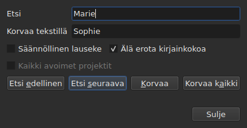
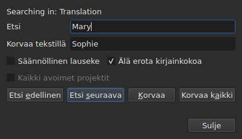

# Etsi ja korvaa

<!-- machine-translated -->
> Tämä sivu on konekäännös, eikä kukaan tämän kielen lukija ole vielä tarkistanut sitä.

`Muokkaa ▸ Etsi ja korvaa…` tai `Ctrl+F` avaa hakuikkunan.




**Ikkuna ei ole modaalinen**: se pysyy auki, kun katsot taulukkoa,
muokkaat solua tai haet uudelleen. `Close` sulkee sen; kun se avataan uudelleen,
se on sellaisena kuin sen jätit, haettava teksti ja korvaava teksti mukaan lukien.

| Kenttä | Mitä se sisältää |
| :---- | :-------------- |
| `Find` | haettava lauseke |
| `Replace with` | se, mikä korvaa sen |
| `Regular expression` | lauseke on säännöllinen lauseke eikä tavallista tekstiä |
| `Ignore case` | ”marie” löytää myös ”Marie” |
| `All open projects` | haku käy läpi kaikki välilehdet — [katso alempaa](#kaikissa-avoimissa-projekteissa) |

Komento ei ole käytettävissä tyhjässä asiakirjassa: siinä ei ole mitään haettavaa.

## Neljä toimintoa

| Painike | Mitä se tekee |
| :----- | :----------- |
| `Find Previous` | etsii edellisen osuman, ja taulukko siirtyy siihen |
| `Find Next` | etsii seuraavan — tätä painiketta `Enter` painaa |
| `Replace` | korvaa löydetyn osuman ja etsii sitten seuraavan |
| `Replace All` | korvaa kaikki kohteen osumat |

Mikään neljästä ei ole käytettävissä niin kauan kuin `Find` on tyhjä.

**Taulukko siirtyy osumaan** valitsemalla sen rivin. Kun viimeinen osuma on
saavutettu, `Find Next` aloittaa taas ensimmäisestä; `Find Previous` tekee saman
toiseen suuntaan.

**`Replace` hakee ensin, jos osumaa ei ole vielä löydetty**: ensimmäinen painallus
näyttää, mitä korvataan, ja seuraava korvaa sen. Näin toimii myös
Gaupol.

## Mitä haku kattaa

**Valinnan tai koko asiakirjan, jos mitään ei ole valittu** — valikon
`Tools` sääntö. Katso [Toiminnot](operations.md#mihin-ne-kohdistuvat).

**Kohde määräytyy ensimmäisellä toiminnolla ja säilyy** niin kauan kuin haku
jatkuu: `Find Next` valitsee osuman rivin, eikä tämä
valinta kavenna kohdetta. **Jos valitset itse muita rivejä,
kohde muuttuu** seuraavaa toimintoa varten.

Haku kattaa kappaleiden tekstin; kohtia ja numeroa ei
haeta.

### Kaikissa avoimissa projekteissa

Valintaruutu **`All open projects`** laajentaa haun kaikkiin välilehtiin. **Se ei ole käytettävissä,
kun vain yksi projekti on auki** — laajennettavaa ei ole —, se tulee käyttöön heti, kun
toinen välilehti avataan, ja sen valinta poistuu itsestään, kun jäljellä on vain yksi.

**Kun se on valittuna, valinnalla ei ole enää merkitystä**: jokaisesta projektista haetaan kokonaan,
**kohdeasiakirjasta** — nykyisen sarakkeen asiakirjasta, pääasiakirjasta tai
käännöksestä, kuten yksittäisessä projektissa.

- **`Find Next` ja `Find Previous` etenevät välilehdeltä toiselle välilehtien
  järjestyksessä.** Ensin näkyvä projekti; kun siinä ei ole enää osumia,
  seuraava, jonka välilehden ikkuna näyttää ja jonka rivin se valitsee.
- **Kierros päättyy siihen, mistä se alkoi**: kun haku menee viimeisen
  välilehden ohi palatakseen ensimmäiseen — tai päinvastoin ylöspäin haettaessa —, ikkunan
  rivi kertoo sen sen sijaan, että aloittaisi alusta sanaakaan sanomatta:

  ```text
  Search wrapped around
  ```

  Seuraava askel on tavallinen askel, ja rivi tyhjenee.
- **`Replace` korvaa siinä, missä haku on**, ja siirtyy sitten seuraavaan
  osumaan, joka voi olla toisella välilehdellä.
- **`Replace All` käy läpi kaikki projektit** ja **tekee historiaan yhden merkinnän
  kutakin muuttunutta projektia kohden**: kumoaminen välilehdellä kumoaa vain sen, minkä tämä välilehti
  sai. Lukumäärä kertoo, kuinka moni projekti muuttui, eikä vain sitä, kuinka monta
  korvausta tehtiin:

  ```text
  replaced 4 matches in 3 projects
  ```

  Projektiin, jossa lauseketta ei ole, ei kosketa, eikä siinä ole mitään kumottavaa.
  **Mikään välilehti ei tule esiin**: kukin projekti saa korvauksensa
  välilehtensä takana, ja välilehti saa tähtimerkkinsä; välilehti, josta toiminto
  aloitettiin, pysyy näkyvissä elokuvineen.

### Missä tekstissä

**Kun projektissa on käännös, haku kattaa vain toisen kahdesta tekstistä:
nykyisen solun sarakkeen tekstin** — käännöksen, jos nykyinen solu on
sarakkeessa `Translation`, ja kaikkialla muualla pääasiakirjan tekstin. Tämä on
kaikkien tekstitoimintojen sääntö, eikä sille ole erillistä asetusta:
katso [Teksti, johon toiminnot kohdistuvat](table.md#teksti-johon-toiminnot-kohdistuvat).

**Ikkuna kertoo, mistä tekstistä se hakee**, kentän
`Find` yläpuolella olevalla rivillä, ja muuttaa sitä, kun nykyinen sarake vaihtuu — myös ikkunan ollessa auki:




| Nykyinen solu on | Rivillä lukee |
| :--------------------- | :------------ |
| sarakkeessa `Translation` | `Searching in: Translation` |
| missä tahansa muussa sarakkeessa | `Searching in: Main` |
| — projektissa ei ole käännöstä, tai sarake on poistettu | ei mitään: riviä ei ole |

**Korvaaminen kirjoittaa tähän tekstiin, ja vain siihen.** `Replace` ja `Replace
All` käännöksessä jättävät pääasiakirjan tekstin ennalleen, ja
päinvastoin; `Undo` palauttaa sen, mitä ne kirjoittivat. **Tagit ovat tämän tekstin
tiedoston muodon tageja**: Advanced SSA -muotoinen käännös luetaan
tageineen, kuten `{\i1}`, vaikka pääasiakirjan teksti olisi SubRip-muotoa. Kenttä `Replace with` kirjoitetaan siihen
samoin tagein.

**Taulukko pysyy siinä sarakkeessa, jossa se oli.** `Find Next` valitsee osuman
rivin siirtämättä nykyistä solua sarakkeesta toiseen:
käännöksestä aloitettu haku jatkuu käännöksessä.

**Molemmista teksteistä ei voi hakea yhtä aikaa**: jokainen osuma
olisi pari (kappale, teksti), eikä taulukolla olisi
selvää paikkaa, johon siirtyä. Hae toisesta, ja vaihda sitten saraketta.

**Mikä alkaa alusta**:

| Toiminto | Mikä unohdetaan |
| :------ | :---------------- |
| kentän `Find`, kentän `Replace with` tai asetuksen muuttaminen | nykyinen osuma ja tilarivi |
| muiden rivien valitseminen itse | kohde ja osuma |
| nykyisen solun siirtäminen tekstistä toiseen — sarakkeesta `Text` sarakkeeseen `Translation` tai päinvastoin | osuma: se on paikka tekstissä |
| toisen tiedoston avaaminen | kohde ja osuma; ikkuna pysyy auki, haettava teksti mukaan lukien |

## Haettava teksti on näkyvä teksti

**Tagit eivät ole tekstiä.** Haku `<i>` ei löydä mitään, ja haku
`Bonjour` löytää myös tagin katkaiseman tekstin `<i>Bon</i>jour`.

**Korvaus tehdään tiedoston tekstiin rikkomatta tageja**:

| Teksti | Haettu → tilalle pantu | Mitä kirjoitetaan |
| :--- | :-------------------------- | :-------------- |
| `<i>Bonjour</i>` | `Bonjour` → `Salut` | `<i>Salut</i>` |
| `<i>Bon</i>jour` | `Bonjour` → `Salut` | `<i>Salut</i>` |
| `<i>Bonjour</i> Marie` | `Bonjour Marie` → `Salut Sophie` | `<i>Salut Sophie</i>` |

Sanan katkaiseva tagi kattaa koko sanan, ja jokainen tyyli, joka koskettaa
osumaa, kattaa korvauksen. **Tagit, joihin osuma ei
koske, pysyvät paikallaan**, myös tagi, joka katkaisee saman kappaleen
toisen sanan: kun `Marie` korvataan tekstissä `<i>Bon</i>jour Marie`, tulos on
`<i>Bon</i>jour Sophie`. Sana koostuu kirjaimista ja numeroista — sitova
välilyönti tai lainausmerkki ei kuulu siihen. **Kenttä `Replace with` luetaan kohdetekstin
tagein**: jos kirjoitat siihen SubRip-tiedostossa `<b>Salut</b>`, sana lihavoidaan.

## Kaksi asetusta

| Asetus | Oletus | Mitä se muuttaa |
| :----- | :------ | :-------------- |
| `Regular expression` | ei valittuna | `.` ei enää hae pistettä vaan mitä tahansa merkkiä |
| `Ignore case` | valittuna | kirjainkoolla ei ole merkitystä, tarkkeelliset kirjaimet mukaan lukien: `élise` löytää myös `Élise` |

Nämä ovat Gaupolin oletukset. **Molemmat muistetaan** avauskerrasta
toiseen ja istunnosta toiseen, [asetustiedoston](preferences.md#tiedosto) asetuksissa
`search.regex` ja `search.ignore-case`.

### Säännöllinen lauseke

Lausekkeen lukee ICU. Kuten Gaupolissa, `.` ylittää rivinvaihdon, ja `^`
ja `$` koskevat kappaleen **jokaisen rivin** alkua ja loppua:
kun `^` korvataan merkkijonolla `- `, jokaisen rivin eteen tulee viiva.

Kentässä `Replace with`, ja vain säännöllisen lausekkeen kanssa:

| Kirjoitettu | Mitä se lisää |
| :------ | :----------- |
| `$1`–`$9` | tämännumeroisen ryhmän; puuttuva ryhmä ei lisää mitään |
| `$0` | koko osuman |
| `\n` | rivinvaihdon |
| `\$`, `\\` | merkin `$`, kenoviivan |
| `\` ja mikä tahansa muu merkki | tämän merkin: `\t` lisää merkin `t` |

**`\1` ei ole ryhmä**, vaan se lisää merkin `1`. Tämä on Gaupolin syntaksi, sillä Gaupol lukee
lausekkeensa Pythonilla; tässä käytetään ICU:n syntaksia, sillä ICU lukee lausekkeen.

## Mitä ikkuna kertoo

Painikkeiden alla oleva rivi kertoo, mitä haku ei pystynyt tekemään, tai mitä
`Replace All` teki:

| Tilanne | Mitä näytetään |
| :-------- | :------------ |
| kohteessa ei ole osumaa | `"Sophie" not found` |
| säännöllinen lauseke, jota ei voi lukea | `not a regular expression (U_REGEX_MISMATCHED_PAREN)` |
| `Replace All` korvasi | `replaced 3 matches` |
| `Replace All` löysi lausekkeen, mutta korvaus ei muuta mitään tekstiä | `nothing to change` |

**Haku, joka ei löydä mitään, ei koske mihinkään**: valinta pysyy
paikallaan, eikä historiaan tule mitään.

**`not found` ja `nothing to change` eivät tarkoita samaa.** `not found`
kertoo, ettei lauseketta ole missään kohteessa. `nothing to change` kertoo, että se
on olemassa, mutta korvaus jättää jokaisen tekstin ennalleen — esimerkiksi kun
`Marie` korvataan tekstillä `Marie`. Kummassakaan tapauksessa historiaan ei
tule mitään. Viestin `replaced N matches` luku laskee niiden
kappaleiden osumat, joiden teksti muuttui.

## Mitä kumoamistoiminto siitä kertoo

| Toiminto | Mitä `Undo` näyttää |
| :------ | :---------------- |
| `Replace` | `Undo: replacing` — yksi kutakin korvausta kohden |
| `Replace All` | `Undo: replacing all` — **yksi ainoa merkintä**, osumien määrästä riippumatta |

Katso [Kumoa ja tee uudelleen](undo.md).
