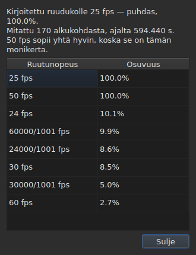

# Ruuturuudukko

<!-- machine-translated -->
> Tämä sivu on konekäännös, eikä kukaan tämän kielen lukija ole vielä tarkistanut sitä.

Tekstitystiedosto **ei ilmoita** ruutunopeutta, jonka mukaan
sen kohdat on laskettu: SubRip-muodossa ei ole otsaketta, ja
WebVTT-muodon otsake on vapaata tekstiä. Ikkuna **päättelee** ruutunopeuden itse kohdista
avattaessa ja näyttää sen kahdessa paikassa, jotka eivät vastaa samaan
kysymykseen.

| Paikka | Mitä se antaa |
| :------ | :------------ |
| tilarivi | **vastauksen**, jatkuvasti ja pyytämättä |
| `Työkalut ▸ Ruutunopeuden analyysi…` | **päättelyn**, kun haluat nähdä sen |

## Mitä tilarivi näyttää

Oikealla, sen välissä, mitä se kertoo luetun tiedoston
[merkistökoodauksesta](files.md#merkistökoodaus-tilarivillä), ja sen, mitä
se kertoo [liitetystä videosta](video.md#mitä-tilarivi-näyttää):

| Tilanne | Mitä kirjoitetaan |
| :-------- | :-------------- |
| kohdat ovat ruudukolla | `Grid: 24 fps` |
| vain osa niistä | `Grid: 29.97 fps (partial)` |
| mikään tunnettu ruudukko ei sovi | `No grid` |

**`No grid` ei nimeä mitään ruutunopeutta, ja se on tarkoituksellista.** Ehdokkaiden
joukko on suljettu — ne kahdeksan, joita muunnosikkuna tarjoaa —, ja
niistä vähiten väärän ilmoittaminen olisi väärä vastaus tilanteessa, jossa
”en tiedä” on oikea vastaus.

**`No grid` johtuu kahdesta syystä, eivätkä ne ole sama vastaus.** Joko mikään
ruudukko ei sovi, tai tiedostossa on liian vähän kappaleita, jotta siitä voisi sanoa
mitään — kaksi alkukohtaa näyttää aina täydellisesti kohdistetulta, eikä se todista
mitään. Tilarivi kertoo molemmista saman;
**analyysi erottaa ne toisistaan** ja kertoo ensimmäisessä tapauksessa, kuinka paljon
paras ehdokas jää vajaaksi.

Rivi **päivittyy jokaisen toiminnon jälkeen**. Tiedoston kohdistaminen toiseen
ruutunopeuteen muuttaa ruudukkoa, eikä tilarivi saa jatkaa
vanhan ilmoittamista.

### Ruutuina laskettulla asiakirjalla ei ole ruudukkoa vaan ruutunopeus

**MicroDVD on yhdeksästä muodosta ainoa, joka laskee ruutuina.** Sen jokaisella rivillä
on kaksi ruudun numeroa eikä mitään muuta, eikä tiedosto **kerro**, millä
ruutunopeudella ne pitää lukea. Tilarivin samassa kohdassa lukee silloin:

| Tilanne | Mitä kirjoitetaan |
| :-------- | :-------------- |
| asiakirja lasketaan ruutuina | `Frames: 24000/1001 fps` |

**Tämä ei ole ruudukko, ja ruudukko olisi tässä kehäpäätelmä.** MicroDVD-asiakirjan
kohdat on laskettu sen ruuduista *juuri tällä*
ruutunopeudella; ruudukon päätteleminen niistä antaisi takaisin saman luvun eli annetun tiedon
mittaukseksi naamioituna.

**Mistä luku tulee, kerrotaan kerran**, lukemisen yhteydessä,
[huomautusten luettelossa](files.md#lukemisen-huomautukset):
`counts in frames and states no rate; it was read at ("24000/1001")`. Tilarivin
rivi puolestaan kertoo jatkuvasti, mikä on voimassa.

**Väärä ruutunopeus siirtää koko tiedostoa**, ja
valintaikkuna [`Convert Frame Rate…`](operations.md#convert-frame-rate) on paikka, jossa sen voi korjata:
se avautuu lukemisessa käytettyyn ruutunopeuteen ja kertoo, että se on juuri tämä.

## Mitä analyysi näyttää

`Työkalut ▸ Ruutunopeuden analyysi…` **ei muuta mitään.** Se avautuu yhteenvetoon ja
kahdeksan ehdokkaan järjestykseen pisteineen.




Yhteenveto antaa vastauksen ja sitten sen, mikä sitä tarkentaa — kukin lause näkyy
vain, jos sillä on jotain sanottavaa:

| Mitä siitä voi lukea | Milloin |
| :--------------------- | :--- |
| kuinka monen alkukohdan ja kuinka pitkän ajanjakson perusteella | aina |
| kuinka paljon tiedosto on siirtynyt ruudukostaan | sen kohdat ovat ruudukolla vakiosiirtymää lukuun ottamatta |
| että toinen ruutunopeus sopii yhtä hyvin | se on valitun ruutunopeuden kokonaislukumonikerta |
| ettei ajanjakso riitä erottamaan kahta ruutunopeutta toisistaan | tiedosto on liian lyhyt niiden erottamiseen |
| kuinka moni alkukohta poikkeaa ruudukosta **ja kuinka monena jaksona** | tiedosto on osittain ruudukolla |

**Jaksojen määrä erottaa kaksi tarinaa**, jotka
pelkkä prosenttiluku sekoittaa. Monta yhden alkukohdan jaksoa tarkoittaa käsin
yksitellen korjattuja kohtia. Muutama pitkä jakso tarkoittaa uudelleen ajoitettua
osuutta tai kahdesta muusta tiedostosta koottua tiedostoa.

**Koko järjestys näytetään yksittäisen vastauksen sijaan.** Tiedosto, joka
sopii sataprosenttisesti nopeudelle 25 ja sataprosenttisesti nopeudelle 50, kertoo jotain, minkä
pelkkä tulos kätkisi.

## Kun muunnos oli väärä

Tiedosto, joka ei osu millekään ruudukolle, on joskus tiedosto, joka on **muunnettu väärällä
ruutunopeudella**: se on silloin aivan todellisella ruudukolla, mutta siirtyneenä suhteella, joka ei ole
minkään kahdeksasta ruutunopeudesta. Kun päättely palauttaa arvon `none` tai `partial`, analyysi etsii **kahdeksan
vakioruutunopeuden viidestäkymmenestäkuudesta järjestetystä parista** — se on joukko, suljettu — sen, jonka
muunnos palauttaa kohdat ruudukolle. Kutakin suhdetta sovelletaan kohtiin, ja
**tuloksen arvioi päättely itse**: varmuus on se, minkä päättely sanoisi, ei koskaan
keksitty luku. Kaksi paria, jotka antavat saman suhteen, kuten nopeudesta 30 nopeuteen 25 ja nopeudesta 60 nopeuteen 50, ovat yksi ja sama
muunnos.

Yhteenvetoon lisätään lause:

```text
converting from 24 to 25 fps puts the positions on a 24 fps grid: 99.9%, against 11.8% as they are and 14.9% for the next best conversion
```

Se kertoo muunnoksen, ruudukon, jolle kohdat osuisivat, ja kuinka hyvin ne osuvat siihen,
**sitten eron kohtiin sellaisinaan ja muista
muunnoksista parhaaseen.** Painike `Convert Frame Rate…` sulkee analyysin ja avaa [ruutunopeuden
muunnosikkunan](operations.md#convert-frame-rate)
**löydetyllä parilla täytettynä** — mitään ei sovelleta
ennen kuin ikkuna hyväksytään, ja peruminen riittää palaamaan. Viereen avattu video
antaa arvioida kuvasta, onko vastaus oikea.

**Kun kaksi paria on yhtä hyviä, kumpaakaan ei ehdoteta, ja lause kertoo sen:**

```text
converting from 30 to 25 fps and converting from 25 to 24 fps fit equally well (99.7% and 99.6%), so none is proposed
```

Tämä on tavallinen tapaus eikä poikkeus: ruudukko, jonka nopeus on 28,8 ruutua sekunnissa, palautuu
yhtä hyvin nopeudelle 24 kuin nopeudelle 30, ja tiedosto, jonka kaikki ajat on kaksinkertaistettu, pysyy nopeuden 25 ruudukolla.
Toiminto, jolla on yksi ainoa korjaus, on tiedoston muuntaminen, kun se on **jo** kohderuutunopeudessa. Kun
tulos on tasan, video ratkaisee: avaat itse komennon `Convert Frame Rate…` jommallakummalla parilla.

**Mitään ei sanota** tiedostosta, joka on jo ruudukolla, tiedostosta, joka on liian lyhyt, jotta tulos
olisi minkään arvoinen, eikä tiedostosta, jota mikään joukon muunnos ei palauta ruudukolle — ajautuminen,
suhde kahdeksan ruutunopeuden ulkopuolelta, kohdat ilman rakennetta.

## Mitä taulukko ei näytä

**Mitään taulukon riviä ei merkitä ruudukon vuoksi**, koskaan.

Heti kun korjaat kohdan käsin, se ei ole enää kohdistettu. Automaattinen
merkintä ilmoittaisi siis käyttäjän työn
poikkeamana tiedostossa, jota hän juuri korjaa. Päättely
koskee **asiakirjaa**, ja analyysi on ainoa poikkeus — koska
avasit sen juuri sitä varten.

Taulukon merkinnät puolestaan koskevat sitä, mikä ei ole johdonmukaista: loppu
ennen alkua, päällekkäisyys, rikkoutunut järjestys. Katso [Taulukko](table.md).
