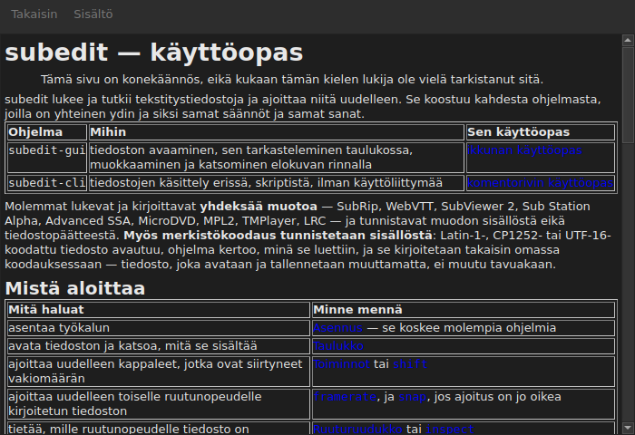

# Käyttöopas ikkunassa

<!-- machine-translated -->
> Tämä sivu on konekäännös, eikä kukaan tämän kielen lukija ole vielä tarkistanut sitä.

`Ohje ▸ Käyttöopas` tai `F1` avaa **juuri tämän käyttöoppaan** omaan ikkunaansa.




## Mitä se avaa, ja miksi ei verkko-osoitetta

**Ohjelman rinnalle asennetun käyttöoppaan**, ei Internetissä olevaa sivua.

Verkko-osoite kuvaisi kehitteillä olevaa versiota, ei käytössä olevaa.
Käyttäjä, joka lukee sellaisen version käyttöopasta, jota hänellä ei ole, on huonommassa asemassa kuin
käyttäjä, jolla ei ole käyttöopasta lainkaan — siksi ikkuna lukee tiedostot, jotka
asennus on sijoittanut hakemistoon `<prefix>/share/subedit/manual`. Katso
[Asennus](../subedit-cli/installation.md).

Se avautuu [aloitussivulle](../index.md), sille, joka kertoo, mistä aloittaa.

## Millä kielellä

**Ikkunan kielellä.** Käyttöopas avautuu sillä kielellä, jota
käyttöliittymä puhuu: kohdassa `Muokkaa ▸ Asetukset…` valitulla kielellä tai muuten
ympäristön kielellä — katso
[Käyttöliittymän kieli](preferences.md#käyttöliittymän-kieli).

| Ikkunan kieli | Käyttöoppaan kieli |
| :---------------- | :------------------ |
| englanti | englanti |
| kieli, jonka käyttöopas on asennettu — katalaani, tšekki, saksa, espanja, suomi, ranska, galicia, heprea, unkari, interlingue, islanti, italia, hollanti, puola, portugali, brasilianportugali, venäjä, serbia, turkki, yksinkertaistettu kiina | sama kieli |
| kieli, jonka käyttöopasta ei ole asennettu | englanti |

**Sivu kerrallaan, ei kaikki tai ei mitään**: sivu, jota käännöksessä ei ole,
avautuu englanniksi, ja kaikki muut sivut pysyvät ikkunan kielellä.
Linkki johtaa samalla tavalla yhdestä toiseen.

Käännökset asennetaan englanninkielisen käyttöoppaan rinnalle, kukin omaan hakemistoonsa,
joka on nimetty sen kielen mukaan: `<prefix>/share/subedit/manual/fr` ranskalle.
Kieli on se, jolla ikkuna käynnistyi, joten asetuksissa valittu kieli
koskee myös käyttöopasta seuraavasta käynnistyskerrasta alkaen.

## Liikkuminen

| Mitä teet | Mitä tapahtuu |
| :---------- | :----------- |
| napsautat käyttöoppaan linkkiä | sivu avautuu samaan ikkunaan |
| napsautat linkkiä, joka osoittaa osioon | sivu avautuu, ja ikkuna vierittää alas osioon |
| napsautat linkkiä, joka osoittaa pelkkään osioon | ikkuna vierittää alas osioon vaihtamatta sivua |
| `Back` | palaa edelliseen sivuun; ei käytettävissä ensimmäisellä sivulla |
| `Contents` | palaa aloitussivulle; ei käytettävissä, kun olet siellä |

Ikkuna **ei ole modaalinen**: se pysyy auki työskentelyn ajan, mikä on koko
käyttöoppaan käden ulottuvilla pitämisen tarkoitus. Kohdan valitseminen uudelleen ei luo
toista ikkunaa, vaan tuo tämän etualalle.

## Mitä se ei voi avata, ja se kertoo sen

Käyttöopas viittaa joskus **tiekarttaan** tai **arkkitehtuuripäätökseen**.
Ne ovat tietovaraston asiakirjoja, eivät paketin: niitä ei
asenneta, ja ikkuna kertoo sen selvin sanoin sen sijaan, että jättäisi
napsautuksen vaikutuksettomaksi.

```
../../feuille-de-route.md is not part of the installed manual;
it lives in the project's repository.
```

Niitä voi lukea tietovarastosta, jonka osoite on kohdassa `Ohje ▸ Tietoja subeditistä`.

## Kun kohta ei ole käytettävissä

**`Ohje ▸ Käyttöopas` ei ole käytettävissä, kun ohjelman rinnalla ei ole käyttöopasta.** Kaksi
tapausta, eikä kumpikaan ole vika:

| Tapaus | Miksi |
| :--- | :-- |
| ohjelmaa ajetaan sen käännöshakemistosta | sinne ei asennettu mitään, joten luettavaa ei ole |
| asennus on osittainen | käyttöopas on poistettu tai sitä ei koskaan kopioitu |

Kun osoitin viedään kohdan päälle, kerrotaan, kumpi näistä on kyseessä: ”Tämän ohjelman rinnalle ei ole
asennettu käyttöopasta”.

Puuttuva sivu käyttöoppaan ollessa paikallaan — käsin poistettu tiedosto — ei
sulje ikkunaa: se nimeää tiedoston, jota se ei voinut lukea, ja pitää näytöllä sen, mitä
se oli näyttämässä.

## Mistä käyttöopasta etsitään

**Suoritettavan tiedoston rinnalta**, hakemistosta `../share/subedit/manual` — rakenteesta, jonka jokainen
asennus tuottaa etuliitteestä riippumatta. Sen ansiosta hakemistoon
`~/.local` tehty asennus löytää käyttöoppaansa yhtä hyvin kuin hakemistoon `/usr` asennettu paketti.
