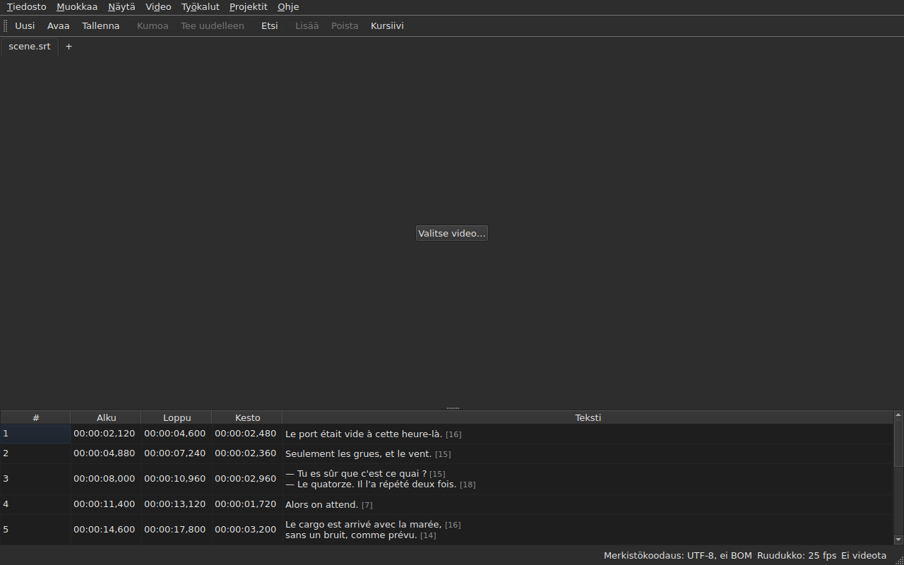

# subedit-gui — käyttöopas

<!-- machine-translated -->
> Tämä sivu on konekäännös, eikä kukaan tämän kielen lukija ole vielä tarkistanut sitä.

Ohjelman subedit ikkuna: avaa tekstitystiedosto ja näe se taulukossa. Toisesta
ohjelmasta ja siitä, mistä aloittaa, kerrotaan [käyttöoppaassa](../index.md).

> **Nykytila.** Ikkuna **avaa useita tiedostoja, kunkin omaan välilehteensä**, niiden
> merkistökoodauksesta riippumatta — komennolla `Open…` tai pudottamalla ne ikkunaan —, **näyttää ne**,
> **muokkaa soluja**, **lisää ja poistaa rivejä**,
> **kumoaa**, **tallentaa — merkistökoodauksen, rivinvaihtojen ja
> tavujärjestysmerkin valinnan kera** — ja **merkitsee kappaleet, joiden kohdat
> eivät ole keskenään johdonmukaisia**. Se **yhdistää ja jakaa** rivejä, **leikkaa,
> kopioi ja liittää** tekstejä sekä **etsii ja korvaa** näkyvässä tekstissä
> rikkomatta tageja, yhdessä projektissa tai kaikissa. Se **avaa käännöksen
> päätiedoston rinnalle**, kohdistettuna kohdan tai numeron mukaan, yhteen lisäsarakkeeseen,
> ja tallentaa sen erikseen. Valikossa `Tools` on kuusitoista toimintoa ja kaksi oikeinkirjoituksen kohtaa —
> siirto, muunto, ruutunopeuden muunto, kestojen säätö,
> **tiedoston lisääminen perään, projektin jakaminen kahtia**, kursivointi,
> vuoropuheluviivojen lisääminen, kirjainkoon muuttaminen neljällä tavalla,
> kuulovammaisille tarkoitettujen mainintojen poistaminen, **tekstien korjaaminen
> monisivuisella ohjatulla toiminnolla**, **oikeinkirjoituksen tarkistus sana sanalta**, kohdistus ruutunopeuteen, palautus
> ruudukolle — sekä ruudukon analyysi, joka ei muuta mitään. Valikko `Projects`
> **tallentaa ja sulkee kaiken** yhdellä eleellä. Se **liittää videon
> asiakirjaan**, valittuna tai arvattuna, ja **toistaa sen ikkunassa**, nykyinen
> rivi piirrettynä kuvaan; se **asettaa alun, lopun tai
> kappaleen elokuvan kohdasta**, **etenee ruutu ruudulta** ja **siirtää reunaa yhden ruudun verran**. Toistopalkki **kelaa, säätää
> äänenvoimakkuutta ja kohtaa**, taulukko **seuraa toistoa** kumoamatta käsin tehtyä vieritystä, kohdat
> voidaan näyttää **ruutuina**, ja valikko `Video` **valitsee ääniraidan**. Kaksi tunnistusta
> **ehdottaa soveltamatta koskaan**: vakiomäärällä siirretty käännös, joka voidaan **avata uudelleen
> siirrettynä**, ja ruutunopeuden muunto, joka palauttaa tiedoston ruudukolle. Se **muistaa geometriansa, sarakkeidensa järjestyksen, leveyden ja näkyvyyden
> sekä asetuksensa** istunnosta
> toiseen, ja se on **vaalea tai tumma** valintasi mukaan. `Ohje ▸ Käyttöopas`
> avaa **tämän käyttöoppaan** ikkunaan. Tämä käyttöopas kuvaa sen, mikä on olemassa, ei koskaan
> sitä, mikä on suunnitteilla; tulevat asiat ovat
> [tiekartassa](../../../../feuille-de-route.md).

> **Tämän käyttöoppaan kuvat on tuotettu, teksti ei.** Ohjelman
> `subedit-cli` esimerkit tuotetaan ajamalla komento; kuvakaappaukset
> tuotetaan rakentamalla todellinen ikkuna ja kuvaamalla se — `make
> manual` tekee molemmat. Kuva ei siksi voi kuvata käyttöliittymää, jota
> ei enää ole, ja muuttuva käyttöliittymä näkyy tietovaraston
> diffissä. Ilman turvaverkkoa jää niiden ympärillä oleva teksti, jonka
> paikkansapitävyys perustuu tarkistukseen.

**Jokainen näkymä näytetään kahdesti, kummallakin sovelluksen
asettamalla paletilla** — `Light` ja `Dark`, ne, joita
[asetukset](preferences.md#teema) tarjoavat. Työpöydällä, jonka
teema ratkaisee, `System` antaa toisen niistä sen mukaan, mitä työpöytä on valinnut.

## Valikot

`File`, `Edit`, `View`, `Video`, `Tools`, `Projects`, `Help` — siinä järjestyksessä,
jossa niitä käytetään: asiakirja, mitä sille tehdään, miten sitä katsotaan, mitä
siihen liittyy, mikä sitä tutkii, mikä koskee kaikkia avoimia projekteja, mikä
sitä selittää.

Valikossa `View` on alivalikko `Columns`, jossa on yksi valittava kohta kutakin saraketta kohden paitsi saraketta `Text`
— katso [Taulukko](table.md#sarakkeiden-piilottaminen-ja-siirtäminen) — sekä asetus `Positions in Frames`, joka näyttää
sarakkeet `Start` ja `End` ruutujen numeroina — katso [Kohdat ruutuina](table.md#kohdat-ruutuina).

Valikossa `Projects` on kaksi kohtaa, `Save All` ja `Close All` — katso
[Projektit-valikko](files.md#projektit-valikko).

Valikossa `Edit` on viisi lohkoa, kukin erottimen alla: kumoaminen;
leikepöytä — tekstien leikkaaminen, kopioiminen ja liittäminen; `Find and Replace…`;
rivien lisääminen, poistaminen, yhdistäminen ja jakaminen; lopuksi
`Preferences…`. Kumoaminen on jotain, mitä tehdään muokkaukselle *itselleen*, tekstin siirtäminen
ei lisää eikä poista riviä, seuraavan lohkon neljä kohtaa muuttavat rivien
määrää, eikä teeman asettaminen ole lainkaan muokkaus.

**Näppäimet nimetään niin kuin valikko ne näyttää**, englanniksi kuten muukin
käyttöliittymä: `Ins`, `Del`, `Ctrl+Shift+Z`. Näppäin, jota painetaan ja
jota mikään valikko ei nimeä, säilyttää englanninkielisen nimensä: `Enter`, `Esc`, `Shift`.

Valikossa `Help` on kaksi kohtaa siinä järjestyksessä, jossa valikko ne näyttää. `Manual` tai
`F1` avaa tämän käyttöoppaan ikkunaan — katso
[Käyttöopas ikkunassa](help.md). `About subedit` kertoo version,
lisenssin ja kirjastot, joiden varassa ikkuna toimii, versioineen — katso
[`--version`](invocation.md#--version).

## Työkalurivi

Valikoiden alla oleva palkki sisältää **yleisimmät toiminnot** ryhmiteltyinä.
Kussakin painikkeessa on lyhyt sana; valikko säilyttää koko kohdan, ja
pikanäppäin on sama.

| Painike | Valikon kohta | Pikanäppäin |
| :----- | :--------- | :------- |
| Uusi | Tiedosto ▸ Uusi projekti | `Ctrl+N` |
| Avaa | Tiedosto ▸ Avaa… | `Ctrl+O` |
| Tallenna | Tiedosto ▸ Tallenna | `Ctrl+S` |
| Kumoa | Muokkaa ▸ Kumoa | `Ctrl+Z` |
| Tee uudelleen | Muokkaa ▸ Tee uudelleen | `Ctrl+Shift+Z` |
| Etsi | Muokkaa ▸ Etsi ja korvaa… | `Ctrl+F` |
| Lisää | Muokkaa ▸ Lisää kappaleita… | `Ins` |
| Poista | Muokkaa ▸ Poista kappaleet | `Del` |
| Kursiivi | Työkalut ▸ Kursiivi | `Ctrl+I` |

**Painike on poissa käytöstä samasta syystä kuin sen valikon kohta**: `Undo`, kun
mitään ei ole kumottavana, `Remove`, kun riviä ei ole valittu. Käännöksen kohdat
ja valikon `Tools` toiminnot, paitsi `Italic`, pysyvät
valikoissaan: niitä käytetään harvemmin, tai kaikki eivät käytä niitä.

## Osiot

| Osio | Sisältö |
| :------ | :------- |
| [Asennus](../subedit-cli/installation.md) | kääntäminen ja asentaminen — sivu koskee kumpaakin ohjelmaa |
| [Käynnistys](invocation.md) | ikkunan käynnistäminen, argumentit, paluuarvot |
| [Avaaminen ja tallentaminen](files.md) | komennot, välilehdet, valikko `Projects`, tiedostojen pudottaminen, käännös ja sen avaaminen uudelleen siirrettynä, huomautukset, merkistökoodaus tilarivillä, edestakainen muunnos, sulkeminen |
| [Taulukko](table.md) | mitä kukin sarake näyttää, niiden piilottaminen ja siirtäminen, kohdat ruutuina, käännössarake ja teksti, johon toiminnot kohdistuvat |
| [Solun muokkaaminen](editing.md) | mitä soluja voi muokata ja miten |
| [Tekstien leikkaaminen, kopioiminen ja liittäminen](clipboard.md) | kolme kohtaa, mitä siirtyy, lisätyt rivit, muunnetut tagit |
| [Etsi ja korvaa](find-and-replace.md) | valintaikkuna, neljä toimintoa, kaksi asetusta, mitä haku kattaa, kaikissa avoimissa projekteissa |
| [Rivien lisääminen, poistaminen, yhdistäminen ja jakaminen](lines.md) | neljä kohtaa, niiden pikanäppäimet, minne uudet rivit tulevat |
| [Kumoa ja tee uudelleen](undo.md) | historia, kaksi toimintoa, muutosmerkki |
| [Ruuturuudukko](frame-grid.md) | kohdista päätelty ruutunopeus, analyysi ja muunto, joka palauttaa tiedoston ruudukolle |
| [Toiminnot](operations.md) | siirto, muunto, ruutunopeuden muunto, kestojen säätö, tiedoston lisääminen perään, projektin jakaminen, kursivointi, kirjainkoko, viivat, mainintojen poistaminen, kohdistus, palautus ruudukolle ja se, mikä menee elokuvan lopun yli |
| [Korjaa tekstejä…](correct-texts.md) | korjauksen ohjattu toiminto: kohde ja tehtävät, kunkin tehtävän sivu, eteneminen, vahvistus |
| [Tarkista oikeinkirjoitus…](check-spelling.md) | oikoluku: sen asetukset, läpikäynti, sulkeminen kesken, sanakirjan puuttuminen |
| [Liitetty video](video.md) | videon valitseminen, automaattinen ehdotus, ääniraita, tilarivi, `ffmpeg` |
| [Soitin](player.md) | videonäkymä, toistopalkki, toistaminen, liikkuminen, äänenvoimakkuus, seuraava taulukko, piirretty rivi |
| [Ajoitus videon avulla](timing.md) | kappaleen alun tai lopun asettaminen, lisääminen, valitseminen elokuvan kohdasta, eteneminen ruutu ruudulta, reunan siirtäminen |
| [Asetukset](preferences.md) | teema, asetustiedosto, sen valinnat ja se, mitä lukukelvottomalle arvolle tapahtuu |
| [Käyttöopas ikkunassa](help.md) | `Ohje ▸ Käyttöopas`, mitä se avaa ja miten siinä liikutaan |
