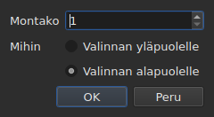

# Rivien lisääminen, poistaminen, yhdistäminen, jakaminen, järjestäminen ja päällekkäisyyksien poistaminen

<!-- machine-translated -->
> Tämä sivu on konekäännös, eikä kukaan tämän kielen lukija ole vielä tarkistanut sitä.

Kahdeksan valikon `Edit` kohtaa erottimen alla, joka erottaa ne kohdasta
`Find and Replace…`. Neljälle niistä on yhteistä, että ne muuttavat rivien
määrää, kun taas edellä kuvatut leikkaaminen, kopioiminen ja liittäminen
siirtävät tekstejä; `Sort Subtitles` muuttaa vain rivien **järjestystä**,
`Join Repeated Subtitles` tekee saman tekstin peräkkäisistä paloista jälleen
yhden kappaleen, ja `Make Ranges Disjoint…` leikkaa ne uudelleen siellä, missä
ne ovat päällekkäin.

| Kohta | Pikanäppäin | Mitä se tekee |
| :---- | :------- | :----------- |
| Lisää kappaleita… | `Ins` | avaa valintaikkunan ja lisää sitten tyhjiä rivejä |
| Poista kappaleet | `Del` | poistaa valinnan kysymättä mitään |
| Yhdistä kappaleet | ei ole | tekee vierekkäisten rivien lohkosta yhden rivin |
| Jaa kappale | ei ole | leikkaa rivin kahtia keston puolivälistä |
| Yhdistä toistuvat kappaleet | ei ole | tekee saman tekstin peräkkäisistä paloista yhden kappaleen |
| Järjestä kappaleet | ei ole | palauttaa rivit alkukohtiensa järjestykseen koko projektissa |
| Poista aikavälien päällekkäisyydet… | ei ole | leikkaa päällekkäiset rivit niin, ettei mikään aikaväli enää ole toisen päällä |
| Korjaa kappaleet… | ei ole | ketjuttaa kolme edellistä kohtaa — toistojen yhdistämisen, järjestämisen ja aikavälien leikkaamisen — yhdellä kertaa |

Kaikki kahdeksan menevät historiaan: `Ctrl+Z` kumoaa ne kuten kaiken muunkin.

## Lisääminen

| Kenttä | Mitä se sisältää | Oletus |
| :---- | :------------ | :------ |
| `How many` | kokonaisluku 1–99 999 | `1` |
| `Where` | `Above the selection` tai `Below the selection` | viimeisin valinta, ensimmäisellä käynnistyskerralla `Below` |

`OK` lisää rivit, `Cancel` ei lisää mitään.

### Mihin ne tulevat

**Viimeisen valitun kohdalle**, ei ensimmäisen. Kun valitaan rivit 1 ja 3
ja lisätään alapuolelle, uusi rivi tulee sijaan 4 — ei sijaan 2. Niin Gaupol
on tehnyt kaksikymmentä vuotta, ja sitä käsi odottaa pyyhkäistyään ylhäältä
alas.

`Above the selection` sijoittaa sen juuri saman rivin eteen.

### Kuinka kauan ne kestävät

Tyhjällä rivillä ei ole tekstiä, mutta sillä on kohdat. Ne päätellään
käytettävissä olevasta tilasta:

| Tilanne | Alku | Kesto |
| :-------- | :---- | :------- |
| kahden kappaleen välissä | edellisen loppu | tila seuraavaan asti tasan jaettuna |
| viimeisen jälkeen | viimeisen loppu | kolme sekuntia kullekin |
| tiedoston alussa | alkupiste | tila ensimmäiseen asti jaettuna |
| tyhjässä tiedostossa | alkupiste | kolme sekuntia kullekin |

Kun tiedosto on valitussa kohdassa päällekkäinen, **jaettavaa tilaa ei ole**:
rivit saavat nollakeston, jonka taulukko näyttää, eikä keksittyä kestoa, joka
menisi naapurin päälle.

### Tyhjä asiakirja

**Valintaa ei tarvita**, ja se on ainoa tapa aloittaa uusi tiedosto: rivit
tulevat indeksiin nolla. Puolen valinta on silloin poissa käytöstä
valintaikkunassa — ei ole valintaa, jonka suhteen ne sijoitettaisiin.

Heti kun asiakirjassa on rivi, kohta `Insert Subtitles…` **ei ole
käytettävissä niin kauan kuin mitään ei ole valittu**: ilman valintaa indeksi
arvattaisiin.

### Sen jälkeen

Lisätyt rivit **valitaan**, ja taulukko siirtyy niihin. Kun painat
näppäintä `Ins` toisen kerran, lisäys tulee siis niiden jälkeen ilman, että
kahden väliin tarvitsee napsauttaa.

### Puoli muistetaan

`Above` tai `Below` muistetaan **lisäyksestä toiseen ja istunnosta toiseen**:
se on [asetustiedoston](preferences.md#tiedosto) asetus
`edit.insert-placement`. Rivejä ei lisätä kerran, vaan kymmenen peräkkäin,
aina samalle puolelle.

## Poistaminen

`Remove Subtitles` tai `Del` poistaa valitut rivit — myös epäyhtenäisen
valinnan, ja kumottaessa kukin rivi palaa paikalleen.

**Vahvistusta ei kysytä**, eikä se ole unohdus: toiminto kumotaan
näppäimillä `Ctrl+Z`. Modaalinen ikkuna ennen kumottavissa olevaa elettä
maksaisi napsautuksen joka kerta säästääkseen silloin tällöin yhden
painalluksen `Ctrl+Z`.

**Kohta ei ole käytettävissä, kun mitään ei ole valittu.** Muualla ikkunassa
”mitään ei ole valittu” tarkoittaa ”koko tiedostoa” — juuri se tekee siirrosta
käyttökelpoisen ilman neljäntuhannen rivin valitsemista. Tässä tuo tulkinta
tyhjentäisi asiakirjan yhdellä huonoon aikaan osuneella näppäimellä `Del`,
joten sitä ei tarjota.

Poiston jälkeen **valitaan rivi, joka tuli ensimmäisen poistetun paikalle** —
tai viimeinen jäljellä oleva, jos poisto vei tiedoston lopun. Kun painat
näppäintä `Del` useita kertoja peräkkäin, rivit poistuvat siis yksi
kerrallaan.

Kokonaan tyhjennetty tiedosto jättää ikkunan käyttökelpoiseksi:
`Insert Subtitles…` tulee jälleen käytettäväksi, koska tyhjään asiakirjaan
lisätään ilman valintaa.

## Yhdistäminen

`Merge Subtitles` tekee valituista riveistä **yhden rivin**:

| Mitä yhdistetty rivi saa | Mistä se tulee |
| :---------------------------- | :------------------ |
| alkunsa | ensimmäisen alku |
| loppunsa | viimeisen loppu |
| tekstinsä | kaikkien tekstit järjestyksessä, rivinvaihto kahden välissä |
| käännöksensä | käännökset samalla tavalla yhdistettyinä |
| sen, mitä muoto kantaa lisäksi — tyylin, tason, koordinaatit | ensimmäinen |

**Tyhjä teksti ei jätä tyhjää riviä**: kun yhdistetään teksti `Un.`, rivi
ilman tekstiä ja teksti `Trois.`, tuloksena on kaksi tekstiriviä, ei kolmea.

Yhdistetyt rivit katoavat, ja niiden tilalle tuleva rivi ottaa ensimmäisen
paikan.

**Kohta ei ole käytettävissä**, niin kauan kuin valinta ei ole **vähintään
kahden vierekkäisen rivin lohko**. Yksittäisellä rivillä ei ole mitään, mihin
yhdistyä; ei myöskään riveillä 1 ja 3 ilman riviä 2, koska tulos menisi rivin
2 päälle ja peittäisi sen.

Yhdistämisen jälkeen **yhdistetty rivi on valittuna**: `Split Subtitle` on
valmis leikkaamaan sen uudelleen.

## Jakaminen

`Split Subtitle` leikkaa valitun rivin **keston puolivälistä** millisekunnin
tarkkuudella:

| Puolisko | Alku | Loppu | Teksti |
| :--- | :---- | :-- | :--- |
| ensimmäinen | alkuperäinen alku | puoliväli | **koko** teksti ja käännös |
| toinen | puoliväli | alkuperäinen loppu | tyhjä |

**Tekstiä ei leikata sen rivinvaihdosta.** Se olisi oikein kaksiriviselle
kappaleelle ja väärin yksi- tai kolmiriviselle; koko teksti jää ensimmäiseen
puoliskoon, ja siirrät itse sen, minkä pitää mennä toiseen.

Ensimmäinen puolisko säilyttää sen, mitä muoto kantoi tekstin lisäksi; toinen
syntyy kuten lisätty rivi, ilman mitään.

**Kohta ei ole käytettävissä**, niin kauan kuin valinnassa ei ole **täsmälleen
yhtä riviä**. Tässä se, ettei mitään ole valittu, ei tarkoita ”koko
tiedostoa”.

Jakamisen jälkeen **molemmat puoliskot ovat valittuina** — niin Gaupol tekee
minkä tahansa lisäyksen jälkeen, ja `Merge Subtitles` on silloin valmis
kumoamaan eleen.

## Järjestäminen

`Sort Subtitles` palauttaa **koko projektin** alkukohtien järjestykseen. Ei
koskaan valintaa: järjestys on asiakirjan ominaisuus, eikä puolen tiedoston
järjestäminen tarkoita mitään. Järjestäminen on **vakaa**: kaksi kappaletta,
jotka alkavat yhtä aikaa, säilyttävät tiedoston niille antaman järjestyksen.

**Tilarivillä kulkee palkki järjestämisen aikana, ja osoitin muuttuu
tiimalasiksi**: pitkässä tiedostossa ikkuna ei hetkeen vastaa — taulukko
rakennetaan uudelleen rivi riviltä —, eikä ilman niitä tietäisi, onko jotain
käynnissä. Palkki ei näytä osuutta, koska järjestäminen ei ilmoita sitä, ja
palkki katoaa järjestämisen päättyessä.

Tilarivi kertoo, kuinka moni rivi vaihtoi paikkaa — `3 subtitles moved`
— tai, kun kaikki oli järjestyksessä, `already in order`. **Valmiiksi
järjestyksessä oleva projekti ei mene historiaan**: toiminto, joka ei muuta
mitään, ei ole kumottava toiminto. Kohta ei ole käytettävissä projektissa,
jossa on yksi kappale.

Tiedosto, **jossa on avattaessa jotain korjattavaa**, tarjoaa sitä itse,
[yhdessä ainoassa ikkunassa](#avattaessa-yksi-ainoa-ikkuna): katso alempaa.
Väärässä paikassa olevat kappaleet myös
[lasketaan huomautusten yhteydessä](files.md#lukemisen-huomautukset), jotta
ne löytää vierittämättä taulukkoa.

Komentorivillä [`sort`](../subedit-cli/sort.md) tekee saman tiedostoille, ja
`--sort` tekee sen ohimennen alikomennoille
[`convert`](../subedit-cli/convert.md#järjestäminen-kirjoitettaessa),
[`append`](../subedit-cli/append.md#tuloksen-järjestäminen) ja
[`split-file`](../subedit-cli/split-file.md#leikkaaminen-aikajärjestyksessä).

## Toistuvien kappaleiden yhdistäminen

`Join Repeated Subtitles` tekee **yhden kappaleen** kappaleista, jotka näyttävät
peräkkäin saman asian: peräkkäisiin paloihin leikatun tekstin, sellaisena kuin
jotkin segmentointityökalut sen jättävät. Se kohdistuu **koko projektiin**.

**Toisto** on kappale, jolla on sama teksti, sama käännös ja samat muodon
asetukset (tyyli, sijainti, vihjeasetukset) kuin toisella, **ja joka alkaa
viimeistään silloin, kun tuo toinen päättyy**. Toistojen jono muuttuu siksi
kappaleeksi, joka alkaa ensimmäisenä, ja saa jonon suurimman loppukohdan;
muut katoavat. Kappaleista `Alpha [1, 2]`, `Alpha [2, 4]` ja `Alpha [4, 6]`
tulee `Alpha [1, 6]`.

- **Tiedoston järjestys ei vaikuta siihen, eikä se muuta järjestystä**:
  säilytettävä kappale on se, joka alkaa ensimmäisenä, missä muut sitten ovatkin.
- **Mitään ei yhdistetä vahingossa**: toinen teksti, muut asetukset, väli
  kahden palan välissä, kappale ilman tekstiä tai kappale, jonka loppu edeltää
  sen alkua, pysyvät erillään.
- Tilarivi kertoo, mitä tehtiin — `2 repeated subtitles joined` tai
  `no repeated subtitles`.

**Tehdään ennen järjestämistä ja leikkaamista**, jotka lukevat puhtaan jonon
paremmin: kolmeen palaan jaettu teksti sekä toinen teksti koko aikavälin
yli epäjärjestyksessä annettuina järjestyy ja leikkautuu riveiksi, jotka
vaihtavat palasta toiseen; jos se yhdistetään ensin, se asettuu järjestykseen
ja yhdistyy siististi. Alla kuvattu avattaessa näytettävä ikkuna tekee kaikki
kolme tässä järjestyksessä.

## Aikavälien päällekkäisyyksien poistaminen

`Make Ranges Disjoint…` leikkaa päällekkäiset kappaleet niin, että **mikään
aikaväli `[start, end]` ei enää ole toisen päällä**. Se kohdistuu **koko
projektiin**, ei koskaan valintaan: päällekkäisten kappaleiden ryhmä
leikataan siellä, missä ne ovat päällekkäin, eikä puolikas ryhmä tarkoita
mitään.

**Mitään ei lyhennetä eikä pidennetä.** Joka hetkellä ikkuna näyttää samat
tekstit kuin ennenkin. Muuttuu se, miten aikajana leikataan: se leikataan
ryhmän jokaisesta alusta ja jokaisesta lopusta; väli, jonka kattaa yksi
kappale, pysyy tuona kappaleena; väli, jonka kattaa useampi, muuttuu **yhdeksi**
kappaleeksi, jonka rivit ovat niiden rivit, **aikaisin rivillä 1**.
Kappaleista `A [0, 5]` ja `B [3, 8]` tulee `[0, 3] A`, `[3, 5] A / B`, `[5, 8] B`.

Valintaikkuna kysyy kolme asetusta, jotka muistetaan kerrasta toiseen:

| Kenttä | Mitä se sisältää | Oletus |
| :---- | :------------ | :------ |
| `Shortest interval kept` | 0–10 000 ms: lyhyemmän välin ottaa haltuunsa naapuri | `80 ms` (noin kaksi ruutua) |
| `Most lines in a subtitle` | 0–10; arvolla 0 `No limit` | `2` |
| `Put a dash before each subtitle's text` | viiva ennen sitä, minkä kukin kappale tuo yhdistettyyn kappaleeseen | ei valittu |

`OK` leikkaa, `Cancel` ei tee mitään. **Kirjoitetut rivit valitaan**
sen jälkeen, ja tilarivi kertoo, mitä tehtiin: `2 subtitles split, 1 merged`.
Toinen ajokerta ei muuta mitään ja kertoo sen: `already disjoint`.

- **Riviä ei koskaan monisteta.** Kaksi kappaletta, joilla on sama teksti,
  antavat päällekkäisessä kohdassa yhden rivin, ja kaksi vierekkäistä palaa,
  jotka näyttävät saman asian, muodostavat vain yhden kappaleen. Useaan palaan
  leikatun kappaleen teksti toistuu muuten jokaisessa: se on se, mitä ruudulla
  sillä hetkellä on.
- **Hyvin lyhyen välin ottaa haltuunsa naapuri**: se, jonka rivit jo sisältävät
  välin rivit, muuten pisin, laajentaa aikaväliään kattamaan sen.
  Kokonaista kappaletta, joka on kynnystä lyhyempi, ei koskaan oteta haltuun.
- **Enemmän rivejä kuin raja: ikkunat.** Kolme riviä kolmen sekunnin aikana
  muuttuu kahdeksi puolikkaaksi, ensin kaksi ensimmäistä riviä ja sitten kaksi
  viimeistä; neljä riviä kolmeksi kolmannekseksi ja niin edelleen. Mitään ei
  katkaista.
- Käännös noudattaa samoja leikkauksia; ensimmäisen kattavan kappaleen tyyli ja
  sijainti säilytetään.

**Se, mitä ei voitu tehdä kokonaan, kerrotaan suljettavassa ikkunassa**, ei
tilarivillä: ikkunat, haltuun otetut välit, liian lyhyet kokonaisina jätetyt
kappaleet, eroavat tyylit, kappaleet, joiden loppu edeltää alkua (jätetään
paikalleen).

**Kohta hylätään syyn kera, kun kappaleet eivät ole alkukohtiensa
järjestyksessä**: ryhmät ovat naapurien jonoja, eikä ydin koskaan järjestä
itsestään. Ensin `Sort Subtitles` — tai avattaessa näytettävä ikkuna, joka
tekee molemmat tässä järjestyksessä.

### Kaikki kerralla: `Repair Subtitles…`

`Repair Subtitles…` tekee kolme edellistä kohtaa **peräkkäin**, ainoassa
toimivassa järjestyksessä: toistot yhdistetään, kappaleet asetetaan
alkukohtiensa järjestykseen ja sitten aikavälien päällekkäisyydet poistetaan.
Se on kohta tiedostolle, joka on huonosti segmentoitu, huonossa järjestyksessä
ja päällekkäinen, kun tiedät haluavasi kaikki kolme. Valintaikkuna kysyy
leikkauksen asetukset (samat kuin kohdassa `Make Ranges Disjoint…`, muistetaan
kerrasta toiseen) ja kertoo, että se yhdistää ja järjestää ensin. Tilarivi —
tai suljettava ikkuna, kun jotain ei voitu tehdä kokonaan — antaa kaikista
kolmesta **yhden selostuksen**:
`2 repeated subtitles joined; already in order; 2 subtitles split, 1 merged`.
Jokainen korjaus on oma historiamerkintänsä: `Ctrl+Z` kumoaa ne yksi
kerrallaan. Komentorivillä: [`repair`](../subedit-cli/repair.md).

### Avattaessa yksi ainoa ikkuna

Tiedosto, joka avautuu jonkin korjattavissa olevan kanssa, **tarjoaa sitä
yhdessä ainoassa ikkunassa**, `Problems found in this file`, sen sijaan että
avaisi yhden ikkunan ongelmaa kohti. Jokainen löydetty ongelma on rivi
valintaruutuineen, valittuna:

- `Join the repeated subtitles` — kappaleet toistavat toista kappaletta, jota
  ne koskettavat, lukumäärineen;
- `Sort the subtitles` — kappaleet eivät ole alkukohtiensa järjestyksessä,
  lukumäärineen;
- `Make the ranges disjoint` — kappaleet alkavat ennen edellisen loppua,
  laskettuina **vasta kun tiedosto on järjestyksessä**, koska ne korjataan
  siinä vaiheessa.

**Jokainen ongelma lasketaan siellä, missä se korjataan**, kopiolle, johon
sitä edeltävät korjaukset on jo tehty: paloihin leikattu teksti on osasyy
epäjärjestykseen, ja sen yhdistäminen ensin voi poistaa epäjärjestyksen
kokonaan — ikkuna ei silloin tarjoa järjestämistä.

Ongelmalla, jota ei löydetty, ei ole riviä. Järjestämisen valinnan
poistaminen **muuttaa toisen ruudun harmaaksi ja poistaa sen valinnan**:
aikavälien päällekkäisyydet poistetaan vain järjestyksessä olevista.
`Fix` tekee sen, mikä on valittuna — yhdistämisen, sitten järjestämisen, sitten
leikkaamisen viimeisimmän kohdan `Make Ranges Disjoint…` asetuksin — ja antaa
siitä **yhden selostuksen**; `Keep as is` ei koske mihinkään. **Mitään ei
tehdä ilman myöntävää vastausta**, jokainen korjaus on historiamerkintä, eikä
tiedostosta, jossa ei ole korjattavaa, kysytä mitään.

Komentorivillä [`disjoint`](../subedit-cli/disjoint.md) tekee saman
tiedostoille, ja `--disjoint` tekee sen ohimennen alikomennoille
[`convert`](../subedit-cli/convert.md#aikavälien-päällekkäisyyksien-poistaminen),
[`append`](../subedit-cli/append.md#aikavälien-päällekkäisyyksien-poistaminen) ja
[`split-file`](../subedit-cli/split-file.md#aikavälien-päällekkäisyyksien-poistaminen).

### Miksi ei Gaupolin pikanäppäimiä

Gaupol yhdistää näppäimellä `M` ja jakaa näppäimellä `S`. Pelkän kirjaimen
ottaisi taulukko ennen kuin se ehtisi muokattavana olevaan soluun, ja `Ctrl+S`
tallentaa jo: kumpaankin kohtaan päästään valikon kautta.

## Mitä kumoamistoiminto siitä kertoo

**Yksi historiamerkintä elettä kohti.** Viiden rivin yhdistäminen kumotaan
yhdellä painalluksella `Ctrl+Z`, ja se palauttaa viisi riviä sellaisina kuin
ne olivat — kohdat, tekstit ja kaiken, mitä muoto kantoi.

| Toiminto | Mitä `Undo` näyttää |
| :-------- | :---------------- |
| lisäys | `Undo: inserting` |
| poisto | `Undo: removing` |
| yhdistäminen | `Undo: merging` |
| jakaminen | `Undo: splitting` |
| toistojen yhdistäminen | `Undo: joining repeated subtitles` |
| aikavälien leikkaaminen | `Undo: making the ranges disjoint` |

Avattaessa tarjottu korjaus on yksi historiamerkintä korjausta kohti:
yhdistäminen, järjestäminen ja sitten leikkaaminen kumotaan yksi toisensa
jälkeen.

Katso [Kumoa ja tee uudelleen](undo.md).

## Pikanäppäimet solun ollessa auki

`Ins` ja `Del` kuuluvat syöttökenttään niin kauan kuin solun muokkain on
auki: poistonäppäin pyyhkii siellä merkin, ei kappaletta. Muokkaimen
sulkeminen — `Enter` tai `Esc` — palauttaa niille niiden merkityksen.
Valikosta käynnistettynä `Remove Subtitles` vahvistaa ensin syötteen, kuten
muutkin sivun [Solun muokkaaminen](editing.md) eleet.

Tämä käyttöopas nimeää näppäimet sellaisina kuin valikko ne näyttää — katso
[Valikot](index.md#valikot).
