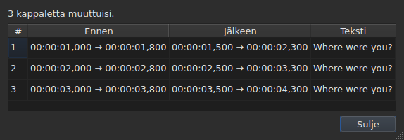
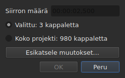
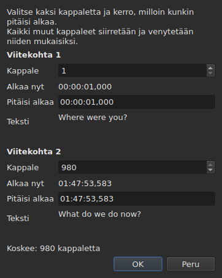
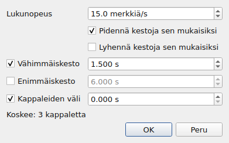
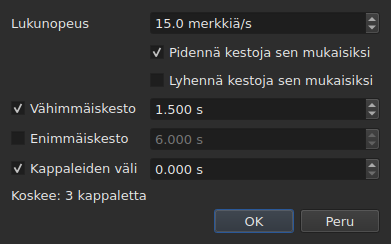
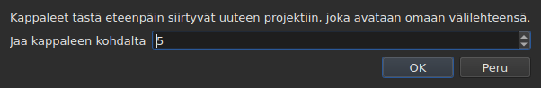

# Toiminnot

<!-- machine-translated -->
> Tämä sivu on konekäännös, eikä kukaan tämän kielen lukija ole vielä tarkistanut sitä.

Valikossa **Työkalut** on kuusitoista toimintoa, yksi analyysi ja kaksi oikeinkirjoituksen kohtaa. Kukin
kuudestatoista kumotaan näppäimillä `Ctrl+Z`; analyysi ei muuta mitään. Myös `Check Spelling…` kumotaan, eikä `Spell-Check Settings…` koske mihinkään tekstiin.

| Kohta | Valintaikkuna | Mitä se tekee |
| :---- | :----- | :----------- |
| `Shift Positions…` | kyllä | siirtää kohdetta keston verran |
| `Transform Positions…` | kyllä | korjaa kohteen kahden viitekohdan perusteella |
| `Convert Frame Rate…` | kyllä | ajoittaa kohteen uudelleen ruutunopeudesta toiseen |
| `Adjust Durations…` | kyllä | siirtää loppukohtia lukunopeuden, kestojen ja välin noudattamiseksi |
| `Append File…` | tiedostonvalitsin | lisää tiedoston projektin loppuun |
| `Split Project…` | kyllä | jakaa projektin kahtia, loppuosa menee uuteen välilehteen |
| `Italic` | **ei** | kursivoi kohteen tai poistaa kursiivin |
| `Dialogue` | **ei** | lisää vuoropuheluviivan kunkin rivin alkuun tai poistaa sen |
| `Case ▸ Title Case` | **ei** | jokainen sana saa ison alkukirjaimen |
| `Case ▸ Sentence case` | **ei** | tekstin ensimmäinen kirjain, ja vain se |
| `Case ▸ UPPER CASE` | **ei** | kaikki isoilla kirjaimilla |
| `Case ▸ lower case` | **ei** | kaikki pienillä kirjaimilla |
| `Remove Hearing-Impaired Mentions…` | kyllä, ilman asetuksia | poistaa kuulovammaisille tarkoitetut maininnat |
| `Correct Texts…` | kyllä, monisivuinen avustaja | ehdottaa korjauksia — maininnat, sanojen yhdistäminen ja jakaminen, yleiset virheet, isot alkukirjaimet, rivinvaihto — ja soveltaa ne hyväksymisen jälkeen, katso [Korjaa tekstejä…](correct-texts.md) |
| `Check Spelling…` | kyllä, läpikäynti sana sanalta | käy läpi sanakirjalle tuntemattomat sanat ja soveltaa tehdyt korjaukset, katso [Tarkista oikeinkirjoitus…](check-spelling.md) |
| `Spell-Check Settings…` | kyllä | valitsee tarkistuksen kielen, kohteen ja asiakirjan sekä alleviivauksen kirjoitettaessa, katso [Tarkista oikeinkirjoitus…](check-spelling.md#oikoluvun-asetukset) |
| `Snap to Frame Rate…` | kyllä | siirtää kunkin aikaleiman lähimpään ruutuun |
| `Shift Whole File onto Grid (…)` | **ei** | palauttaa koko tiedoston ruudukolleen |
| `Frame Rate Analysis…` | kyllä, ilman asetuksia | **ei muuta mitään** — katso [Ruuturuudukko](frame-grid.md) |

**Se, mitä toiminto teki, kerrotaan tietoikkunassa, joka on
suljettava, paitsi toiminnoissa `Italic`, `Case` ja `Dialogue`**: nämä kolme eivät avaa
valintaikkunaa, ja niiden raportti — myös ”ei mitään muutettavaa” — näytetään
tilarivillä, eikä mitään tarvitse sulkea. Myös `Split Project…` antaa raporttinsa
tilarivillä: sen tulos on jo edessäsi uudessa välilehdessä. Viestit lainataan kunkin
toiminnon osiossa.

Rivien lisääminen, poistaminen, yhdistäminen ja jakaminen eivät ole täällä vaan
valikossa `Edit`, koska ne muuttavat rivien määrää. Katso
[Rivien lisääminen, poistaminen, yhdistäminen ja jakaminen](lines.md).

## Mihin ne kohdistuvat

**Valittuihin riveihin tai koko tiedostoon, jos mitään ei ole valittu.** Sääntö on sama
kaikille, ja valintaikkunat, kun sellainen on, muistuttavat siitä selvin
sanoin:

```
Applies to: 4 subtitles
```

Kaikkien rivien valitseminen on sama kuin ettei valitse mitään.

**Kun vain osa riveistä on valittu, valintaikkuna kysyy,
mihin toiminto kohdistuu.** Näytetään kaksi vaihtoehtoa lukumäärineen, ja **valinta
on se, joka on valittuna**:

```
(•) Selected: 2 subtitles
( ) Whole project: 4 subtitles
```

Vaihtoehdon `Whole project` valitseminen laajentaa toiminnon koko tiedostoon ilman, että
valintaa tarvitsee ensin muuttaa. Kun valittavaa ei ole — mitään ei ole
valittu, tai kaikki on —, yllä oleva rivi `Applies to:` jää yksin.

Tämän valinnan tarjoavat toimintojen `Shift Positions…`, `Transform Positions…`,
`Convert Frame Rate…`, `Adjust Durations…`, `Snap to Frame Rate…` ja
`Remove Hearing-Impaired Mentions…` valintaikkunat.

### Esikatselu ennen soveltamista

Toiminnoissa `Shift Positions…`, `Transform Positions…`, `Convert Frame Rate…`,
`Adjust Durations…` ja `Snap to Frame Rate…` on painike **`Preview changes…`**.
Se avaa pienen ikkunan, joka kertoo, kuinka monta kappaletta toiminto
muuttaisi **sillä hetkellä kirjoitetuilla arvoilla valittuun kohteeseen**, ja
luettelee niistä kaksitoista ensimmäistä: numeron, kohdan ennen, kohdan
jälkeen ja tekstin ensimmäisen rivin. **Mitään ei sovelleta**: ikkunan sulkeminen
palaa valintaikkunaan, jossa voi muuttaa arvoa ja katsoa
uudelleen.




Se avautuu niin suurena, että kaikki sarakkeet näkyvät, ja sen kokoa voi muuttaa
käsin.

Jos toiminto ei muuttaisi mitään, ikkuna kertoo sen (`Nothing would change.`).
Niin kauan kuin kirjoitetut arvot eivät määritä toimintoa — lukukelvoton kesto, kaksi
viitekohtaa samassa kappaleessa —, esikatselu on tyhjä samasta syystä kuin
painike `OK` on harmaana. Toiminnolla `Remove Hearing-Impaired Mentions…` ei ole esikatselua: se
muuttaa tekstiä, ja jälkikäteen annettava raportti
kertoo sen.

**Käännöksen kanssa: mikä teksti?** Kohta- ja rakennetoiminnot
kohdistuvat koko kappaleeseen — sen kaksi tekstiä seuraavat mukana. Ne, jotka
kirjoittavat tekstin uudelleen — `Italic`, `Case`, `Dialogue`,
`Remove Hearing-Impaired Mentions…` — kohdistuvat **nykyisen solun sarakkeen tekstiin**:
käännökseen sen sarakkeessa, päätekstiin muualla. Toinen pysyy koskemattomana, ja
tilarivi kertoo, kumpaan kohdistetaan. Katso [Taulukko](table.md#teksti-johon-toiminnot-kohdistuvat).

**Yksi poikkeus, ja sen nimiö kertoo sen**: `Shift Whole File onto Grid`
ohittaa valinnan. Ruudukko on asiakirjan ominaisuus, eikä puolella
asiakirjalla ole omaa ruudukkoa; kohta sanoo sen siksi nimessään eikä
pelkästään tässä käyttöoppaassa.

**Myös `Append File…` ohittaa valinnan**, toisesta syystä: se ei
kirjoita kohdetta uudelleen, vaan siirtää loppua kauemmas. Katso sen
[oma osio](#append-file). **Samoin `Split Project…`**: se leikkaa siitä, mistä
käsketään. Katso [sen oma osio](#split-project).

**`Correct Texts…` valitsee kohteensa omalla sivullaan** nykyisen valinnan
seuraamisen sijaan: valinnan, nykyisen projektin tai kaikki avoimet
projektit. Katso [Korjaa tekstejä…](correct-texts.md). **`Check Spelling…` valitsee sen
kohdassa `Spell-Check Settings…`** ja muistaa sen: katso [Tarkista oikeinkirjoitus…](check-spelling.md).

**Kaksi ruudukkotoimintoa eivät puhu samasta asiasta kuin ruudukko.**
Toiminto kohdistuu valintaan; analyysi ja tilarivi puhuvat
**koko asiakirjasta**. Viiden rivin kohdistaminen sadastaseitsemästäkymmenestäkuudesta kyllä muuttaa
nuo viisi — taulukko näyttää sen — ilman, että kumpikaan niistä liikkuu, mikä
näyttää unohtuneelta päivitykseltä. Sitä se ei ole: niillä ei ole mitään
sanottavaa. Katso [`Snap to Frame Rate…`](#snap-to-frame-rate) ja
[Ruuturuudukko](frame-grid.md).

### Mitä ”ei valintaa” tarkoittaa, kohta kohdalta

Sääntö koskee valikkoa `Tools` ja hakua. Valikon `Edit` kohdat,
jotka koskevat riveihin tai tyhjentävät niitä, tulkitsevat sen toisin — muuten
huono-onninen `Del` tai `Ctrl+X` tyhjentäisi asiakirjan.

| Kohta | Ilman valintaa | Mitä se vaatii |
| :---- | :------------------ | :--------------- |
| valikon `Tools` toiminnot | koko tiedosto | asiakirja, joka ei ole tyhjä |
| `Shift Whole File onto Grid` | koko tiedosto, **aina** | löydetty ruudukko |
| `Find and Replace…` | koko tiedosto | asiakirja, joka ei ole tyhjä |
| `Cut Texts`, `Copy Texts`, `Paste Texts` | **ei käytettävissä** | vähintään yksi valittu rivi |
| `Remove Subtitles` | **ei käytettävissä** | vähintään yksi valittu rivi |
| `Merge Subtitles` | **ei käytettävissä** | vähintään kahden vierekkäisen rivin lohko |
| `Split Subtitle` | **ei käytettävissä** | täsmälleen yksi rivi |
| `Insert Subtitles…` | ei käytettävissä, paitsi tyhjässä asiakirjassa | rivi, jonka viereen ne sijoitetaan |

Kukin sivu kertoo syyn: [leikepöytä](clipboard.md#mihin-ne-kohdistuvat),
[rivit](lines.md), [haku](find-and-replace.md#mitä-haku-kattaa).

Kohdat ovat **poissa käytöstä tyhjässä tiedostossa**: siirrettävää ei
olisi. Toiminnolla `Italic` on toinen ehto, jonka sen osio kuvaa: avoimen
muodon on voitava kirjoittaa tyyli. Kirjainkoolla ja viivoilla ei ole ehtoja —
teksti on tekstiä kaikissa yhdeksässä muodossa.

## `Shift Positions…`

Siirtää kohdetta keston verran eteen- tai taaksepäin. Kunkin kappaleen
molemmat rajat liikkuvat saman verran: mikään ei pysy ruudulla kauemmin tai lyhyemmin
kuin ennen.

Kesto kirjoitetaan **aikaleiman tapaan, etumerkki mukaan lukien** — `00:00:02,500` siirtää eteenpäin,
`-0:01,250` siirtää taaksepäin. Hyväksytyt muodot ovat samat kuin kohtasolussa.




| Hylkäys | Miksi |
| :------ | :-- |
| lukukelvoton kesto | painike pysyy poissa käytöstä; mitään ei siirretä umpimähkään |
| nollan suuruinen siirto | tallennettavaa toimintoa ei ole |
| kappale joutuisi ennen videon alkua | **mikään tiedosto ei voi sisältää tällaista kohtaa** |

Kolmas tapaus nimeää syyllisen — ”kappale 1 alkaisi ennen nollakohtaa” —
ja juuri sitä kannattaa katsoa nähdäkseen, kuinka paljon meni vikaan. Mitään
ei sovelleta.

## `Transform Positions…`

Tiedoston korjaus, kun se on ajoitettu toista leikkausta vasten. Kerrot, missä **kaksi**
kappaletta todellisuudessa alkaa, ja kaikki muu seuraa suhteessa.

Valintaikkuna kysyy kahdesti samaa: kappaleen numeroa ja
kohtaa, johon sen alku kuuluu. Kunkin viitekohdan kohdalla se näyttää, **mitä tuo
numero tarkoittaa** — sen tekstin (`Text`) ja ajan, jolloin se alkaa
**nyt** (`Now starts`), pelkkinä nimiöinä — ja ne seuraavat numeroa,
kun muutat sitä. Tekstille varataan **kolmen rivin tila**, sanoipa
kappale mitä tahansa: pidempi teksti tai pitkä osoite vierii sen sisällä, ja
valintaikkuna säilyttää kokonsa viitekohdan vaihtuessa. **Kullekin viitekohdalle kirjoitetaan vain yksi kenttä:
`Should start`**, aika, jolloin tämän kappaleen on alettava. Taulukosta ei tarvitse etsiä, mikä rivi on `980`.

`Should start` **ehdotetaan nykyisellä arvolla**: niin kauan kuin et
koske siihen, viitekohta sanoo ”tämä kappale on jo siellä, missä sen pitää olla”. Muutat
vain sen, mitä haluat muuttaa. Toinen viitekohta on esitäytetty tiedoston viimeiseen
kappaleeseen — kaksi kaukana toisistaan olevaa viitekohtaa antaa varmemman korjauksen
kuin kaksi vierekkäistä.




**Molemmat viitekohdat osuvat täsmälleen sinne, minne pyydettiin.** Se ei ole
likiarvo: laskenta tehdään niin, että se pitää paikkansa.

| Hylkäys | Miksi |
| :------ | :-- |
| kaksi viitekohtaa samassa kappaleessa | ne eivät määritä korjausta |
| lukukelvoton kohta | sama syy kuin siirrossa |

Tiedoston ulkopuolista numeroa ei voi kirjoittaa: kentän rajana on
kappaleiden määrä.

## `Convert Frame Rate…`

Ajoittaa kohteen uudelleen, kun kohdat on laskettu yhtä ruutunopeutta
vasten ja niiden pitää olla toista vasten.

Molemmat luettelot tarjoavat kahdeksan vakioruutunopeutta.

> **Väärin valittu lähtöruutunopeus siirtää koko tiedostoa ilmoittamatta
> mitään.** Se on tämän toiminnon pahin virhetilanne, ja siksi
> valintaikkuna kertoo, mistä sen ehdottamat arvot tulevat, sen sijaan että
> asettaisi ne hiljaa.

### Kaksi lähdettä ja mihin ne vastaavat

Valintaikkunassa on enintään kaksi lisäriviä, ja kukin ilmestyy, kun sillä on
sanottavaa:

| Rivi | Mitä se kertoo | Mitä se esitäyttää |
| :--- | :----------- | :---------------- |
| `The positions say` | tiedoston kohdista päätelty [ruuturuudukko](frame-grid.md) | `Timed against` |
| `The video declares` | säiliön ilmoittama ruutunopeus, esimerkiksi `24000/1001` | `Should play at` |
| `The file was read at` | ruutunopeus, jolla **ruutuina laskettu** tiedosto luettiin | `Timed against` |

**Kukin ehdotus menee kenttään, johon se vastaa.** Ruudukko kertoo, mitä vasten
tiedosto on *kirjoitettu* — se on ylempi luettelo. Säiliön ilmoittama arvo on
ruutunopeus, jolla elokuva *toistetaan*, ja siis se, jolla kappaleiden
on saavuttava — se on alempi luettelo.

**Vain puhdas ruudukko esitäyttää lähtöarvon.** Osittainen ruudukko on
vihje, jonka päättely itse luokittelee osittaiseksi, ja tämä kenttä ratkaisee
toiminnon koko tiedostolle. [Tilarivi](frame-grid.md) ja analyysi
kertovat tästä tapauksesta; tämä kenttä ei.

**Ruutuina laskettu tiedosto korvaa ruudukon sen sijaan, että lisäisi siihen.**
MicroDVD sisältää ruutujen numeroita, ja asiakirjan kohdat on
laskettu niistä lukemisen ruutunopeudella: noista kohdista päätelty ruudukko
voi vain löytää saman luvun uudelleen. Siksi `The positions say` häviää, ja
`The file was read at` tulee sen tilalle — se on sama valinta, jonka
[tilarivi](frame-grid.md#ruutuina-laskettulla-asiakirjalla-ei-ole-ruudukkoa-vaan-ruutunopeus) tekee.

**Näin MicroDVD-tiedoston ruutunopeus muutetaan.** Kun luettu ruutunopeus asetetaan
lähtöarvoksi ja todellinen tulosarvoksi, kukin kohta lasketaan uudelleen tiedoston
ruuduista — lukematta mitään uudelleen — ja toiminto kumotaan kuten
muutkin.

### Erimielisyys ei ole ristiriita

Molemmat rivit voidaan näyttää yhdessä, ja ne voivat ilmoittaa eri luvut.
**Se ei ole ratkaistava virhe**: elokuva toistetaan yhdellä ruutunopeudella,
tiedosto on kirjoitettu toiselle ruudukolle. Tiedosto nopeudella 24 elokuvalle nopeudella 25 on
juuri se tapaus, jota varten kohdistus — komentorivillä `snap` — on
olemassa.

Mitään ei siis valita käyttäjän puolesta: molemmat luettelot pysyvät
muokattavina, ja se on tarkoituksellista. Itsensä pakottava lähde estää ristiintarkistuksen.

Rivit eivät näy, kun sanottavaa ei ole: videota ei ole
liitetty, ohjelmaa `ffprobe` ei ole tai puhdasta ruudukkoa ei ole. Valintaikkuna on silloin
yllä kuvattu, eikä **mikään toiminto silti kieltäydy** —
ruutunopeuden antaa käyttäjä. Katso
[Liitetty video](video.md#ffmpeg-ei-ole-pakollinen).

Ruutunopeus, jonka elokuva ilmoittaa mutta joka ei ole yksi kahdeksasta vakioarvosta,
**näytetään valitsematta sitä**: tieto siitä, että elokuva toistetaan
epätavallisella ruutunopeudella, on itse tieto, eikä täällä ole mitään, mihin sen voisi muuntaa.

Ruutunopeuden muuntaminen itsekseen ei muuta mitään: painike pysyy poissa käytöstä.

## `Adjust Durations…`

Pidentää tai lyhentää kohteen kappaleiden kestoa **siirtämällä niiden
loppua, ei koskaan alkua**. Alun siirtäminen siirtäisi kappaletta, mikä on
toiminnon [`Shift Positions…`](#shift-positions) tehtävä.





### Neljä ehtoa

| Kenttä | Mitä se pyytää | Arvot | Oletus |
| :---- | :--------------- | :----- | :------ |
| `Reading speed` | tekstin lukemiseen tarvittava aika | 1–99 merkkiä sekunnissa, kymmenyksen tarkkuudella | 15 merkkiä/s |
| `Lengthen durations to match it` | pidentää sitä, mikä on liian lyhyt luettavaksi | valittu tai ei | valittu |
| `Shorten durations to match it` | lyhentää sitä, mikä pysyy näkyvissä tarpeettoman kauan | valittu tai ei | ei valittu |
| `Minimum duration` | alaraja kestolle | 0–99 s, millisekunnin tarkkuudella | valittu, 1,5 s |
| `Maximum duration` | yläraja kestolle | 0–99 s, millisekunnin tarkkuudella | ei valittu, 6 s |
| `Gap between subtitles` | ennen seuraavaa kappaletta jätettävä väli | 0–99 s, millisekunnin tarkkuudella | valittu, 0 s |

Nämä ovat Gaupolin oletusarvot.

**Valitsematon ehto puuttuu**: sen kenttä on harmaana eikä sitä lueta.
Nollaan asetettu valittu ehto on nolla — 0 s:n väli estää
kappaletta menemästä seuraavan päälle. Lukunopeus luetaan vain, jos
`Lengthen` tai `Shorten` on valittuna.

**Kun mitään ei ole valittu, `OK` ei ole käytettävissä**: pyydettävää ei ole.

Valintaikkuna avautuu uudelleen viimeisimmän säädön arvoilla **ja säilyttää ne istunnosta
toiseen** — kuten haun kaksi asetusta. **Valitsematon ruutu
säilyttää arvonsa**: kohdan `Minimum duration` valinnan poistaminen 2 s:n asettamisen jälkeen ei palauta
arvoa 1,5 s, ja uudelleen valittaessa arvo on 2 s. Yhdeksän asetusta ovat
[asetustiedostossa](preferences.md#tiedosto) avaimen `duration-adjust.` alla.

**Komentorivi jakaa ne.** [`subedit-cli adjust`](../subedit-cli/adjust.md) lukee
oletuksena samat yhdeksän asetusta, joten täällä asetettu nopeus on se, jota se käyttää, elleivät sen omat valitsimet
muuta sano; [`subedit-cli config`](../subedit-cli/config.md) näyttää ja muuttaa ne. Katso
[Kaksi lohkoa, joista yksi on yhteinen komentorivin kanssa](preferences.md#kaksi-lohkoa-joista-yksi-on-yhteinen-komentorivin-kanssa).

### Missä järjestyksessä, ja mikä voittaa

Kukin kohteen kappale käy läpi neljä ehtoa **tässä järjestyksessä**, ja
kukin asettaa loppukohdan vuorollaan:

| Järjestys | Ehto | Mitä se asettaa |
| ---: | :--------- | :----------- |
| 1 | lukunopeus | `end = start + length ÷ speed`, jos kappale on liian lyhyt (`Lengthen`) tai liian pitkä (`Shorten`) |
| 2 | vähimmäiskesto | `end = start + minimum`, jos kesto on lyhyempi |
| 3 | enimmäiskesto | `end = start + maximum`, jos kesto on pidempi |
| 4 | väli | `end = next start − gap`, jos loppu on liian lähellä sitä — ei koskaan ennen alkua |

**Viimeksi sovellettu voittaa.** Väli tulee viimeisenä ja voi tuoda
keston takaisin juuri asetetun vähimmäisarvon alle: kaksi yhtä aikaa ruudulla olevaa
kappaletta on katsojan näkemä virhe, hieman liian lyhyt kappale
ei ole.

**Tekstin pituus lasketaan ilman tageja**, merkkeinä, rivinvaihdot
mukaan lukien: `<i>été</i>` on kolme merkkiä. Lukunopeus koskee
sitä, mitä katsoja lukee.

**Seuraava on tiedoston seuraava kappale**, oli se kohteessa tai
ei. **Tiedoston viimeisellä kappaleella ei ole seuraavaa**: väli ei
rajoita sitä.

### Se, mitä mikään loppukohta ei voi täyttää, kerrotaan

Kun säätö on tehty, ikkuna kertoo, kuinka monta loppukohtaa siirtyi, ja **mitä
ei voitu noudattaa** — ehto näkyy vain, jos se jouduttiin
uhraamaan vähintään yhden kappaleen kohdalla:

```text
adjusted the durations of 12 subtitles; could not satisfy the reading speed in 9 subtitles, the minimum duration in 4 subtitles
```

Kolme mahdollista mainintaa ovat `the reading speed`, `the minimum duration` ja
`the gap`. **Enimmäiskestoa noudatetaan aina**: se tulee nopeuden
ja vähimmäiskeston jälkeen, ja sitä seuraa vain väli, joka voi vain lyhentää. Vähimmäiskesto,
joka on enimmäiskestoa suurempi, väistyy sen tieltä, ja vähimmäiskesto lasketaan. Väli
uhrataan vain, kun seuraava alkaa ennen itse kappaleen
alkua.

Laskenta kattaa koko kohteen, **myös kappaleet, joiden loppu ei
siirtynyt**: kappale, joka on jo asetettu seuraavaansa vasten ja on liian lyhyt
vähimmäiskestolle, lasketaan mukaan. Kun mikään loppukohta ei siirry, ikkuna kertoo sen —
`no duration to adjust` — eikä historiaan tule mitään.

## `Append File…`

Lisää tiedoston avoimen projektin loppuun. **Väliin ei lisätä
mitään**: valittua tiedostoa siirretään projektin viimeisen kappaleen lopun
verran, täsmälleen kuten Gaupol tekee.

**Ei käytettävissä tyhjässä asiakirjassa**: ei olisi loppua, josta siirtää. Avautuu
tiedostonvalitsin ilman merkistökoodauksen valintaa — kuten komennossa `Open…`.

**Lisätty tiedosto käy läpi muunnoksen**, samoin sanoin kuin `Save As…` ja
[liittäminen toisesta muodosta](clipboard.md#toisen-muodon-tagit-muunnetaan):
sen tagit muunnetaan projektin muotoon, ja se, mitä tuo muoto ei voi
kirjoittaa, kerrotaan:

```text
appended 12 subtitles; Advanced SSA into SubRip: 1 tag dropped
```

**Se, mitä lisätyssä tiedostossa oli, ei säily kokonaan.** Sen kohdat
seuraavat mukana, tagit mukaan lukien; sen otsake, muotokohtaiset kentät — tyylin
nimi, marginaalit — ja se, mitä tagista ei voi tulla projektin muodossa, eivät
seuraa, ja se kerrotaan. **Sillä ei ole käännöstä**: käännös pysyy
sen asiakirjan omana, joka sen sai, ja lisätty tiedosto tulee yksin.

**Valittuna jälkikäteen**, kuten rivit, jotka liittäminen kirjoitti
lopun jälkeen. Kun mitään ei menetetä, lukumäärä näytetään tilarivillä eikä
suljettavassa ikkunassa — sama sääntö kuin
[käännöksen avaamisessa](files.md#käännöksen-avaaminen).

**Yksi ainoa historian merkintä**, lisättyjen kappaleiden määrästä
riippumatta: `Ctrl+Z` poistaa ne kaikki kerralla.

**Jo avoinna oleva tiedosto voidaan lisätä itsensä perään**: mikään ei estä sitä, kuten
ei Gaupolissakaan.

**Komentorivillä** [`append`](../subedit-cli/append.md) tekee saman usealle tiedostolle
kerralla, yhdeksi tulokseksi.

## `Split Project…`

Jakaa projektin kahtia: **täsmälleen toiminnon `Append File…` käänteinen**. Ikkuna
kysyy, mistä kappaleesta leikataan — toisesta viimeiseen, numeroituna
kuten taulukossa — ja avautuu nykyiseen riviin.

**Taulukko näyttää, mistä leikkaat, ennen kuin leikkaat**: jokainen numero, jonka
ikkuna saa, valitsee rivinsä. `Cancel` palauttaa aiemman valinnan.




**Ei käytettävissä, kun kappaleita on alle kaksi**: leikkaus vaatii kappaleen kummallekin
puolelle.

**Loppuosa kopioidaan uuteen projektiin, joka avataan uuteen välilehteen, ja
poistetaan alkuperäisestä projektista.** Uutta projektia **siirretään miinus viimeisen
jäljelle jääneen kappaleen lopun verran**: jakaminen ja sitten lisääminen perään palauttaa lähtöprojektin.
Sen kaksi tekstiä, pääteksti ja käännös, seuraavat kappaleitaan, ja se
säilyttää alkuperäisen muodon ja merkistökoodauksen — **ilman polkua**: mikään tiedosto
ei vielä sisällä sitä. Sen välilehdessä lukee siksi `untitled*` syntymästä lähtien, ja
sen sulkeminen tallentamatta esittää saman kysymyksen kuin kaikesta, mitä ei ole
kirjoitettu.

**Tilarivi kertoo, kuinka monta kappaletta lähti**, ilman suljettavaa
ikkunaa — uusi välilehti näyttää jo tuloksen:

```text
split 12 subtitles into a new project
```

**Yksi ainoa historian merkintä** alkuperäisessä projektissa:
`Undo: splitting the project` palauttaa sille sen loppuosan. Uudella projektilla on
oma, tyhjä historiansa; kumoaminen ei koske siihen, ja se pysyy auki.

**Hylätään, kun mikään tiedosto ei voisi kirjoittaa tulosta.** Jos kaksi
puoliskoa menevät leikkauskohdassa päällekkäin, siirto toisi kappaleen ennen
videon alkua — negatiivinen kohta, jota mikään muoto ei kirjoita. Hylkäävä
ikkuna **nimeää kappaleen** ja ehdottaa leikkaamista muualta:

```text
Cannot split at subtitle 3: subtitle 3 would fall before the start of the video. Cut somewhere else.
```

Saapuminen täsmälleen alkuun on sallittua: nolla on kohta.

**Komentorivillä** [`split-file`](../subedit-cli/split-file.md) leikkaa tiedoston samalla tavalla kahdeksi
nimetyksi tiedostoksi.

## `Snap to Frame Rate…`

Siirtää **kunkin aikaleiman** — alun ja lopun — valitun
ruutunopeuden lähimpään ruutuun. Yksi ainoa luettelo, ja siinä on koko ero
muuntoon: muunto tarvitsee kaksi ruutunopeutta, koska se skaalaa
tiedoston yhdestä toiseen; kohdistus tarvitsee vain
ruudukon, jolle osua.

| | `Convert Frame Rate…` | `Snap to Frame Rate…` |
| :--- | :-------------------- | :-------------------- |
| liike | verrannollinen aikaan — **useita sekunteja** pitkän elokuvan aikana | enintään puoli ruutua, **kaikkialla** |
| millaiselle tiedostolle | tiedostolle, jonka **ajoitus on väärä** | tiedostolle, jonka ajoitus on **oikea** ja ruudukko väärä |

**Käyttötapaus** auki kirjoitettuna: elokuva nopeudella 25 ruutua sekunnissa,
kappaleet kirjoitettu ruudukolle nopeudella 24, rivit jo suunnilleen
paikoillaan muutaman millisekunnin tarkkuudella. Uudelleen ajoitettavaa ei ole — vain
aikaleimojen palauttaminen oikeisiin ruutuihin.

Luettelo **avautuu videon ilmoittamaan arvoon** eikä siihen, mitä
kohdat kertovat: tarkoitus on liittyä elokuvan ruudukkoon, ja
päättely nimeää sen, josta lähdetään. Ilman videota tai ilman ohjelmaa `ffprobe` se avautuu
projektin ruutunopeuteen.

Tiedoston kohdistaminen ruudukkoon, jolla se jo on, ei muuta sitä, eikä se ole
virhe: toiminto sovelletaan, mitään ei siirry, ja se kumotaan kuten
mikä tahansa muu.

**Tiedoston osan kohdistaminen kerrotaan, kun se on tehty.** Ilmoitus näytetään,
kun valinta ei kata kaikkea ja asiakirja luetaan yhä toisella
ruudukolla:

```
5 of 176 subtitles aligned to 25 fps; the document is still read on a 24 fps grid
```

Se yhdistää toimenpiteen sen vaikutukseen ja selittää, miksi tilarivi ja
analyysi eivät muuttuneet: ne puhuvat asiakirjasta, toiminto kohdistui
viiteen riviin. Mitään ei estetä — tiedoston osan kohdistaminen voi olla
tarkoituksellista.

**Se on lähes aina tahatonta, ja se on mitattu.** Tietovaraston kahdeksassa ruudukkotiedostossa
koko tiedoston kohdistaminen tuo päätellyn ruutunopeuden
kohdearvoon ja sen keskittymän 100 %:iin; viiden rivin kohdistaminen ei koskaan muuta
päätellyn ruutunopeutta ja **laskee** keskittymää seitsemässä tapauksessa kahdeksasta —
kohdistetut rivit ovat jättäneet ruudukon, jolla muu tiedosto on. Kahdeksas tapaus on
50:stä 25:een, jossa kohderuudukko jakaa tiedoston ruudukon ja jossa kohdat olivat
jo sillä.

Ilmoitusta ei näytetä, kun valinta kattaa koko tiedoston, kun
ruudukkoa ei ole päätelty tai kun asiakirja luetaan nyt
pyydetyllä ruutunopeudella — silloin kohdistus teki sen, mitä pyydettiin.

## `Shift Whole File onto Grid`

Siirtää **koko tiedostoa** sen verran, että sen kohdat palaavat ruudukolle,
jolta ne lähtivät. Tiedosto, jonka kohdat ovat ruudukolla
vakiota lukuun ottamatta, on siirretty, ja tuo vakio voidaan mitata.

**Valikon kohdassa näkyvät määrä ja laajuus** —
`Shift Whole File onto Grid (+0.001 s)`. Valintaikkunaa ei ole:
toiminnolla ei ole valintoja, ja kohdan, joka siirtää kokonaista
tiedostoa, on kerrottava ennen valintaansa, kuinka paljon, ja että se tehdään kokonaan.
Se on valikon ainoa toiminto, joka ohittaa valinnan.

**Se ei ole käytettävissä, kun ruudukkoa ei ole löydetty.** Silloin ei ole mitään, mihin
liittyä, ja kohinasta mitattu vaihe siirtäisi tiedostoa umpimähkään.
”Ei mitään, mihin liittyä” ja ”liity nollan verran” eivät tarkoita samaa:
jälkimmäinen pysyy tarjolla, koska jo ruudukollaan oleva tiedosto on
sen tavallinen tapaus.

**Tämä ei ole `Snap to Frame Rate…`.** Tämä kohta siirtää kaikkea saman verran
ja säilyttää suhteellisen ajoituksen **täsmälleen**; kohdistus siirtää kutakin
kohtaa erikseen ja imaisee samalla ne, jotka oli korjattu
käsin. Puhtaassa tiedostossa molemmat antavat saman tuloksen;
osittaisessa tiedostossa eivät — ja [analyysin yksityiskohdat](frame-grid.md) kertovat, kumpi
kahdesta on edessäsi.

## `Italic`

Kursivoi kohteen kirjoittamalla **avoimen muodon** tagit tai
poistaa ne, jos kohde on jo kursiivia. Ei valintaikkunaa: toiminnolla ei ole asetuksia, ja
se kumotaan näppäimillä `Ctrl+Z` kuten muutkin.

| Toiminto | Pikanäppäin | Missä |
| :----- | :------- | :---- |
| Kursiivi | `Ctrl+I` | valikko **Työkalut**, työkalurivi |

Se on valikon `Tools` ainoa toiminto, jolla on painike
[työkalurivillä](index.md#työkalurivi).

### Mitä se kirjoittaa, muoto muodolta

Kappaleen teksti on sen tiedoston teksti tageineen — katso
[Solun muokkaaminen](editing.md). Kullakin muodolla on omansa, ja juuri niitä
tämän kohdan ansiosta ei tarvitse tuntea:

| Muoto | Mitä kirjoitetaan |
| :----- | :-------------- |
| SubRip, WebVTT, SubViewer 2 | `<i>text</i>` |
| Sub Station Alpha, Advanced SSA | `{\i1}text{\i0}` |
| MicroDVD | `{Y:i}text` — tagi ulottuu kappaleen loppuun, suljettavaa ei ole |
| MPL2 | `/` **kunkin** rivin alussa, ja merkki koskee vain omaa riviään |
| TMPlayer, LRC | ei mitään: nämä kaksi muotoa eivät kirjoita tyyliä |

**Kohta on TMPlayer- ja LRC-tiedostoissa poissa käytöstä, ei piilotettuna.** Puuttuva
kohta ei opeta mitään; harmaana oleva kohta vastaa kysymykseen ”miksi en
voi?”.

**Luettu muoto on kohdistetun tekstin muoto.** Käännöksen kanssa pääteksti
voi olla SubRip-muodossa ja käännös Advanced SSA -muodossa: `Italic` kirjoittaa `<i>`
ensimmäiseen ja `{\i1}` toiseen. Kohta on samoin poissa käytöstä, kun
kohdistettu teksti on muodossa, joka ei kirjoita tyyliä, vaikka toinen kirjoittaisi.

### Kumpaan suuntaan se toimii

Yksi ainoa kohta molempiin suuntiin, ja kohde ratkaisee:

- **yksikin kursivoimaton kappale riittää** siihen, että koko kohde kursivoidaan;
- kursiivi poistetaan kohteesta vain, kun se on **kokonaan** kursiivia.

Tämä on Gaupolin sääntö, ja se on ainoa, joka tekee yhdestä painikkeesta
käyttökelpoisen: sekalainen valinta muuttuu yhtenä lohkona sen sijaan, että se käännettäisiin
rivi riviltä, ja kaksi painallusta palauttaa sen ennalleen.

Raportti kertoo, mitä tehtiin, siihen suuntaan, johon se tehtiin:

```
2 subtitles put in italics
2 subtitles taken out of italics
```

**Tyhjä rivi ei koskaan saa tageja** — `<i></i>` tyhjän ympärillä
näkyisi taulukossa. Kohde, jossa on vain tällaisia rivejä, ei siis muutu, ja
se kerrotaan: ”ei mitään muutettavaa”. Historiaan ei silloin tule merkintää.

### Mihin se ei koske

**Muut tagit pysyvät täsmälleen paikoillaan**: väri,
fontti tai Advanced SSA:n `{\pos(x,y)}` käyvät toiminnon läpi liikkumatta.
Vain kursiivitageja asetetaan ja poistetaan.

Tagia, joka sanoo useita asioita kerralla, ei poisteta kokonaan:
`{\b1\i1}` muuttuu muotoon `{\b1}` ja `{Y:bi}` muotoon `{Y:b}`. Lihavointi säilyy, ja
teksti todella lakkaa olemasta kursiivia.

## `Case` ja `Dialogue`

Kaksi **näkyvän tekstin** muunnosta, eikä tageihin kosketa:
pienaakkosiksi muutettu kappale säilyttää `<I>`-taginsa sellaisenaan, ja viiva asetetaan
tekstin eteen, ei avaavan tagin eteen. **Mikään tagi ei vaihda
paikkaa**: `<i>bon</i>jour` isoilla kirjaimilla antaa `<i>BON</i>JOUR`, kun taas
[korvaus](find-and-replace.md#haettava-teksti-on-näkyvä-teksti) olisi
laajentanut kursiivin koko sanaan.

| Kohta | Pikanäppäin | Mitä se tekee |
| :---- | :------- | :----------- |
| Kirjainkoko ▸ Jokainen Sana Isolla | — | `bonjour marie` muuttuu muotoon `Bonjour Marie` |
| Kirjainkoko ▸ Lauseen kirjainkoko | — | `BONJOUR MARIE` muuttuu muotoon `Bonjour marie` |
| Kirjainkoko ▸ ISOT KIRJAIMET | — | kaikki isoilla kirjaimilla |
| Kirjainkoko ▸ pienet kirjaimet | — | kaikki pienillä kirjaimilla |
| Vuoropuhelu | — | lisää tai poistaa viivat |

### Mihin kirjainkoon muutos ei koske

**Se, mikä edeltää ensimmäistä kirjainta tai ensimmäistä numeroa, jätetään ennalleen.**
Vuoropuheluviiva, avaava lainausmerkki tai sulje säilyy:
`- bonjour` lauseen kirjainkokoon muutettuna antaa `- Bonjour`, eikä `- bonjour` niin, että
viiva olisi ”isolla”, mikä olisi järjetöntä.

**Lauseen kirjainkoko palauttaa loput pieniksi kirjaimiksi.** `BONJOUR MARIE` muuttuu
muotoon `Bonjour marie`: niin Gaupol tekee, ja sen ansiosta isoilla kirjaimilla kirjoitetun
kappaleen voi hillitä.

**Tarkkeet ja muut kuin latinalaiset aakkoset käsitellään oikein.** `éléonore`
antaa `ÉLÉONORE`, eikä heittomerkki katkaise sanaa: `l'été` muutettuna muotoon
Jokainen Sana Isolla antaa `L'été` eikä `L'Été`. Kirjain, jonka pituus muuttuu, säilyttää
tagit ympärillään: `fi <i>x</i>` isoilla kirjaimilla antaa `FI <i>X</i>`.

**Kirjainkoko ei riipu järjestelmän kielestä.** Se noudattaa kaikille kielille
yhteisiä sääntöjä: `istanbul` isoilla kirjaimilla antaa `ISTANBUL`, onpa kone
asetettu ranskaksi tai turkiksi.

### Kumpaan suuntaan `Dialogue` toimii

Yksi ainoa kohta molempiin suuntiin, ja kohde ratkaisee:

- **yksikin viivaton rivi riittää** siihen, että koko kohde saa viivan;
- viivat poistetaan kohteesta vain, kun **kaikilla** sen riveillä on viiva.

Kaksi painallusta palauttaa kohteen ennalleen. Se on toiminnon
[`Italic`](#italic) sääntö, ja ainoa, joka tekee yhdestä painikkeesta käyttökelpoisen.

**Kolme viivaa tunnistetaan** — näppäimistön yhdysmerkki ja typografin kaksi
viivaa, `–` ja `—` — ja kirjoitetaan yhdysmerkki.
Viivan jälkeiset ylimääräiset välilyönnit häviävät. Tyhjä rivi ei saa
viivaa.

### Mitä ne kertovat

```
2 subtitles recased
2 subtitles dashed
2 subtitles undashed
```

Ja kun mikään ei muutu — kohde on jo pyydetyssä kirjainkoossa — ”ei mitään
muutettavaa”, eikä historiaan lisätä mitään.

## `Remove Hearing-Impaired Mentions…`

Poistaa kuuroille tai huonokuuloisille katsojille tarkoitetut maininnat —
hakasulkeissa olevat äänten kuvaukset. **Kaarisulkeet säilyvät**: niitä käytetään myös
kuiskattuihin repliikkeihin, ja ne poistaa `Correct Texts…` valintaruudullaan `Sound in parentheses`.
**Ei muuta**: risuaitojen väliin kirjoitetut laulujen sanat
ja puhujan nimi ennen kaksoispistettä poistetaan vain
[`Correct Texts…`](correct-texts.md) -toiminnon sivulla `Mentions`.

Valintaikkuna ei kysy mitään: toiminnolla ei ole asetuksia, ja valintaikkuna vain
vahvistaa ja muistuttaa, mihin toiminto kohdistuu.

**Se on valikon `Tools` ainoa toiminto, joka saa rivejä katoamaan**, ja koko
ohjelman ainoa, joka saa ne katoamaan pyytämättä. Kappale,
joka oli *pelkkä* maininta, jää puhdistettuna ilman tekstiä, ja
tekstittömällä kappaleella ei ole syytä olla olemassa: se poistetaan tiedostosta. Muut
kirjoitetaan uudelleen ilman mainintaansa.

**Muodon tagit eivät ole tekstiä**: SubRip-tiedoston `<i>[SOUPIR]</i>`
ja Advanced SSA -tiedoston `{\i1}[SOUPIR]{\i0}` poistetaan samalla tavalla.
`<i>` TMPlayer- tai LRC-tiedostossa, jotka eivät kirjoita tageja, on tekstiä.

**Käännökseen kohdistettuna se ei poista riviä.** Käännös, jonka
sääntö tyhjentää — teksti, joka oli pelkkä maininta — **tyhjennetään**, ja kappale
säilyy: sillä on pääteksti, johon toiminto ei kohdistunut, ja sen poistaminen
tuhoaisi sen. Raportti laskee sen puhdistetuksi:

```text
1 subtitle cleaned, 0 removed
```

Luetut tagit ovat käännöksen muodon tageja, eikä se välttämättä ole
päätiedoston muoto.

Raportti kertoo molemmat:

```
1 subtitle cleaned, 1 removed
```

**Kun mikään ei osu, mitään ei tapahdu** — ja valintaikkuna kertoo sen: ”ei poistettavia
mainintoja”. Historiaan ei tule merkintää, koska toiminto, joka
ei muuta mitään, ei ole kumottava toiminto.

**Kumoaminen palauttaa kaiken**, poistetut kappaleet samoin kuin uudelleen kirjoitetut
tekstit, kukin sillä tekstillä, joka sillä oli. Kappaletta, jonka sääntö tyhjensi,
ei koskaan kirjoiteta uudelleen ennen poistamista, juuri siksi, että se palaisi
kokonaisena.

> **Valinta menetetään tässä yhteydessä**: rivien poistaminen muuttaa
> taulukon rakennetta, ja taulukko rakennetaan uudelleen. Kaikki muut valikon
> `Tools` toiminnot säilyttävät sen, myös `Italic`, `Case` ja `Dialogue`. Valikon
> `Edit` neljä rakennekohtaa — lisääminen, poistaminen, yhdistäminen, jakaminen —
> muuttavat myös rakennetta ja antavat valinnan sen tilalle, jonka
> ne veivät — katso
> [Rivien lisääminen, poistaminen, yhdistäminen ja jakaminen](lines.md).

Pelkästään numeerinen viite — ”Katso [1] huomautus” — ei ole maininta,
ja se säilyy ennallaan.

## Elokuvan lopun jälkeen

Kun video on avoinna, toiminto, joka **työntää kappaleita elokuvan
lopun yli**, ilmoittaa siitä, kun se on tehty:

```
shifting leaves 3 subtitles past the end of the video, by 4.200 s at most
```

Lause nimeää toiminnon — `shifting`, `transforming`,
`converting the frame rate`, `adjusting durations`,
`aligning on the frame rate` —, kuinka monta kappaletta menee yli ja kuinka paljon
kauimmainen menee. `Shift Whole File onto Grid` on siirto, ja sen nimi on
`shifting`.

| Mitä lasketaan | Mitä ei lasketa |
| :-------------- | :---------- |
| se, mihin toiminto juuri kosketti, eli kohde | kappale, jota kukaan ei siirtänyt |
| kappale, joka päättyy lopun **jälkeen** | kappale, joka päättyy täsmälleen sen kanssa |

**Se on varoitus, eikä mitään muuta.** Mitään ei hylätä, mitään ei
korjata: lopputekstien jälkeen osuva kappale voi olla
juuri sitä, mitä halusit, ja virheellinen hylkäys maksaa enemmän kuin
varoitus, jonka ohitat. Toiminto on historiassa, ja `Undo`
kumoaa sen kuten minkä tahansa muun.

**Yksi ainoa ikkuna toimintoa kohden.** Toiminnoilla `Adjust Durations…` ja `Align` on jo
sanottavaa — mitä säätö ei voinut noudattaa, mitä osittainen
kohdistus jätti sivuun. Kun ne lisäksi työntävät kappaleen lopun yli,
ikkunassa on molemmat lauseet allekkain, toiminnon lause
ensin:

```
adjusted the durations of 2 subtitles
adjusting durations leaves 1 subtitle past the end of the video, by 1.000 s at most
```

Viesti ei näy, jos videota ei ole avattu: kesto tulee
soittimelta, eikä ilman elokuvaa ole loppua, jonka yli mennä. Vain viisi
edellä nimettyä toimintoa koskee asia — myös `Adjust Durations…`, joka voi
pidentää loppukohdan elokuvan yli. Muita se ei koske: valikon
`Tools` toimintoja, jotka kirjoittavat tekstin uudelleen, eikä valikossa `Edit` lisäämistä,
yhdistämistä, jakamista, liittämistä, korvaamista ja muokattuja soluja — käsin elokuvan yli
kirjoitettua loppukohtaa ei ilmoiteta.
