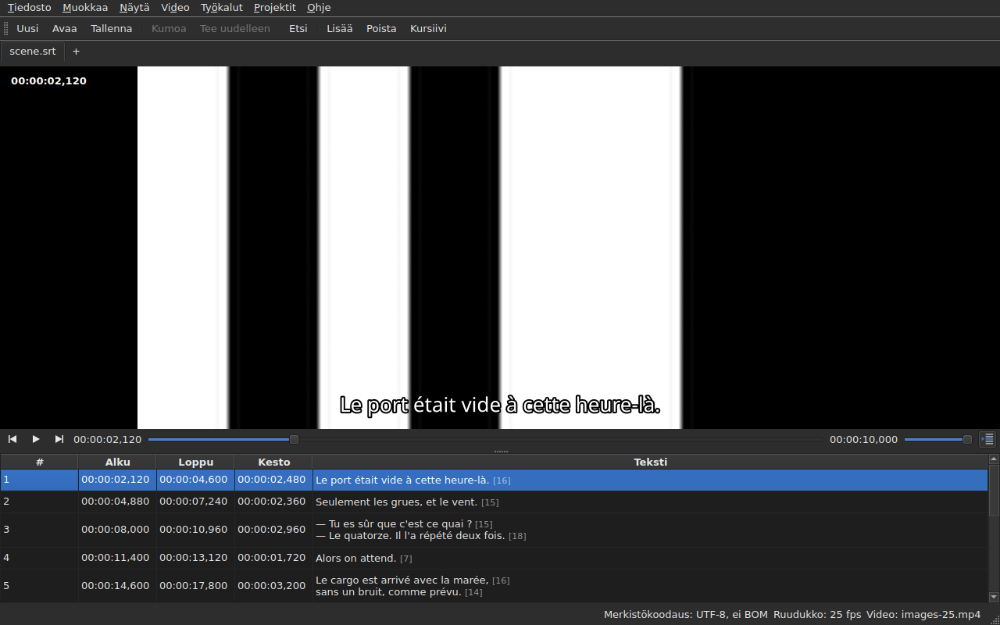

# Soitin

<!-- machine-translated -->
> Tämä sivu on konekäännös, eikä kukaan tämän kielen lukija ole vielä tarkistanut sitä.

Liitettyä videota katsotaan **ikkunassa**, ja nykyinen rivi piirretään sen
päälle. Sen avulla voit tarkistaa elokuvasta siirron, muunnoksen tai
ruutunopeuden muunnon tuloksen.

Katso elokuvan liittäminen sivulta [Liitetty video](video.md); tämä sivu
kuvaa, mitä tapahtuu, kun elokuva on liitetty.

## Videonäkymä

| Tilanne | Mitä ikkuna näyttää |
| :-------- | :-------------------- |
| video on liitetty ja avautuu | kuva on ylhäällä, taulukko alla |
| videota ei ole liitetty | ei kuvaa, taulukko vie koko ikkunan |
| video ei avaudu | ei kuvaa, viesti, ja ikkuna pysyy käyttökelpoisena |

Kuvan ja taulukon välinen jako **siirtyy hiirellä**. Kuva ei mene alle
180 pikselin korkuiseksi. Ikkunan suurentaminen antaa saadun tilan
taulukolle eikä kuvalle: muokatessa puuttuu nimenomaan rivejä.

Kuvan alla on **toistopalkki**: missä elokuva on, kuinka kauan se kestää,
toisto ja tauko sekä äänenvoimakkuus. Katso [Toistopalkki](#toistopalkki).

## Toistaminen ja pysäyttäminen

| Komento | Pikanäppäin | Mitä se tekee |
| :------ | :------- | :----------- |
| Video ▸ Toista / tauko | `Ctrl+P` | toistaa, jos toisto on pysäytetty, ja muuten pysäyttää sen |

Komento **ei ole käytettävissä niin kauan kuin mitään videota ei ole auki**.
Juuri liitetty video avataan **pysäytettynä**: elokuvan avaaminen ei ole sen
katsomista.

`Ctrl+P` siellä, missä Gaupolilla on pelkkä `P`: ikkunan laajuinen
yksikirjaiminen pikanäppäin otetaan ennen kuin kohdistettu pienoisohjelma näkee
sen, joten `P` jäisi matkalla solun muokkaimeen nielaistuksi. Tämä yhdistelmä ei
tuota merkkiä, joten se on vapaa.

## Toistopalkki

Kuvan alla vasemmalta oikealle — kolme painiketta ovat **kuvakkeita**,
työpöydän teeman kuvakkeita, kun teemassa niitä on, ja muuten Qt:n tyylin
kuvakkeita:

| Osa | Mitä se tekee |
| :------ | :----------- |
| kaksi askelpainiketta | siirtävät elokuvaa taaksepäin tai eteenpäin **yhden ruutuaskeleen** — katso [Ruutu ruudulta](timing.md#ruutu-ruudulta) |
| toisto / tauko | toistaa tai pysäyttää kuten `Ctrl+P` — painike näyttää, **mitä se tekee**: kolmion pysäytettynä, kaksi palkkia toistettaessa; työkaluvihje kertoo sen sanoin |
| kohta | `HH:MM:SS,mmm` kirjoitettuna samoin kuin taulukko kirjoittaa kohdan — **ruudun numerona**, kun [`Näytä ▸ Kohdat ruutuina`](table.md#kohdat-ruutuina) on valittuna |
| liukusäädin | **lukee ja siirtää**: vedät kahvaa, napsautat uraa tai käytät nuolinäppäimiä |
| kesto | videon ilmoittama kesto kirjoitettuna samoin kuin kohta |
| äänenvoimakkuus | 0–100, katso [Äänenvoimakkuus](#äänenvoimakkuus) |
| taulukon seuraaminen | alas painettuna niin kauan kuin taulukko seuraa toistoa, ja painettaessa tuo taulukon takaisin toistettavalle riville — katso [Taulukko seuraa toistoa](#taulukko-seuraa-toistoa) |

**Liukusäädin ei luovuta jokaisella pikselillä.** Kahvan vetäminen pyytää
kymmeniä kohtia sekunnissa, ja kukin niistä maksaa puretun ruudun: ensimmäinen
kohta lähtee heti, seuraavat odottavat kahdeskymmenesosasekunnin, ja **viimeksi
pyydetty kohta on aina se, joka saavutetaan** — viimeistään silloin, kun
päästät kahvasta irti. Kuva ei siis laahaa käden perässä eikä ala piirtää
reittiä, jota kukaan ei katso.

**Liukusäädin liikkuu itsestään toiston aikana**, eikä sitä lasketa eleeksi:
vain se, mitä teet, siirtää elokuvaa. Kun pidät kahvasta kiinni, toisto ei ota
sitä takaisin.

## Aikakoodi

**Kohta kirjoitetaan kuvan päälle** vasempaan yläkulmaan läpikuultavalle
taustalle, joka tekee siitä luettavan missä tahansa kohtauksessa. Sen piirtää
ikkuna omalla fontillaan, eikä se pyydä soittimelta mitään muuta kuin kohdan,
jonka soitin jo antaa; se päivittyy jokaisella eleellä odottamatta seurannan
seuraavaa kierrosta.

## Elokuvassa liikkuminen

Valikossa **Video** ovat **Gaupolin eleet** sen nimillä. Kaikki ovat **poissa
käytöstä ilman videota** kuten toisto; kolme valintaan kohdistuvaa ovat lisäksi
poissa käytöstä niin kauan kuin mitään ei ole valittu.

| Komento | Pikanäppäin | Mitä se tekee |
| :------ | :------- | :----------- |
| Video ▸ Toista valinta | `Ctrl+Shift+P` | toistaa **hieman ennen valinnan alkua** alkaen **sen viimeisen kappaleen loppuun** ja pysähtyy kuvaan |
| Video ▸ Kelaa edelliseen | `Ctrl+Left` | asettaa toiston viimeisen ennen kohtaa **päättyneen** kappaleen alkuun |
| Video ▸ Kelaa seuraavaan | `Ctrl+Right` | asettaa toiston ensimmäisen kohdan jälkeen **alkavan** kappaleen alkuun |
| Video ▸ Kelaa taaksepäin | `Ctrl+Shift+Left` | siirtyy yhden hypyn taaksepäin — oletuksena kolmekymmentä sekuntia |
| Video ▸ Kelaa eteenpäin | `Ctrl+Shift+Right` | siirtyy yhden hypyn eteenpäin |
| Video ▸ Kelaa valinnan alkuun | `Ctrl+Up` | asettaa toiston valinnan alkuun **esivara sitä ennen** |
| Video ▸ Kelaa valinnan loppuun | `Ctrl+Down` | asettaa toiston valinnan loppuun **esivara sitä ennen** |

**Pikanäppäimet ovat Gaupolin**, yhtä lukuun ottamatta: `Play Selection` on
siellä `O`, ja ikkuna ottaa pelkän kirjaimen ennen kuin muokattava solu näkee
sen — kirjaimen `o` kirjoittaminen tekstiin käynnistäisi elokuvan. `Ctrl+P` on
toiston vastaus, `Ctrl+Shift+P` valinnan. Näppäimistön nuolet jäävät solun
muokkaimelle, kun se on auki: `Ctrl+Left` siirtää siellä kohdistinta yhden
sanan verran, ei toistoa.

- **Hyppy** on 30 sekuntia, ja sen voi asettaa yhdestä sekunnista yhteen
  tuntiin — katso [Asetukset](preferences.md#soitin). Se ei mene elokuvan
  alun ohi eikä sen lopun ohi.
- **Esivara** on yksi sekunti: katsot vähän **ennen** kappaletta nähdäksesi sen
  tulevan. Sen voi asettaa 0–60 sekuntiin, eikä toisto mene alle nollan.
- **Naapuri, jota ei ole olemassa** — ei mitään ennen ensimmäistä kappaletta,
  ei mitään viimeisen jälkeen — ei tee mitään eikä sano mitään: toisto pysyy
  paikallaan.
- **Jokainen ele näkyy heti**: palkki, aikakoodi ja piirretty rivi ovat ajan
  tasalla sen päättyessä odottamatta seuraavaa kierrosta.

## Äänenvoimakkuus

Äänenvoimakkuus on **soittimen**, 0–100, eikä järjestelmän. Se asetetaan
palkin liukusäätimellä tai kahdella eleellä alivalikossa `Video ▸ Ääni`
viiden askelin:

| Komento | Pikanäppäin | Mitä se tekee |
| :------ | :------- | :----------- |
| Video ▸ Ääni ▸ Hiljemmalle | `Ctrl+-` | laskee äänenvoimakkuutta viidellä |
| Video ▸ Ääni ▸ Kovemmalle | `Ctrl++` tai `Ctrl+=` | nostaa sitä viidellä — jälkimmäinen näppäimistöille, joissa plus vaatii vaihtonäppäimen |

**Se muistetaan istunnosta toiseen** ja annetaan jokaiselle avattavalle
videolle. Asetustiedostossa oleva arvo välin 0–100 ulkopuolella ei riko
avaamista: se ohitetaan, ja ikkuna kertoo siitä.
**Ääniraitaa sen sijaan ei muisteta** — raidan numero kuuluu tiedostolleen;
katso [Ääniraita](video.md#ääniraita).

## Valinta ja toisto

Molemmat toimivat kumpaankin suuntaan.

| Mitä teet | Mitä tapahtuu |
| :---------- | :----------- |
| valitset rivin | toisto siirtyy **tuon kappaleen alkuun** |
| laajennat valintaa alaspäin | ei muuta: ratkaiseva on valinnan ensimmäinen rivi |
| toisto etenee | **nykyinen rivi** seuraa ruudulla näkyvää kappaletta **sävytettynä**, ja taulukko **keskittää** sen — katso [Taulukko seuraa toistoa](#taulukko-seuraa-toistoa) |

Nykyinen rivi ja valinta ovat kaksi eri asiaa. Toisto siirtää ensimmäistä
eikä **koskaan koske toiseen**: valinta on se, mihin toiminto kohdistuu, eikä
nurkassa pyörivän elokuvan kuulu kirjoittaa käyttäjän kohdetta uudelleen rivi
riviltä.

Sävytys noudattaa samaa sääntöä: se on merkki eikä valinta. **Poikkeama voittaa
sen** — rivi, jolla on molemmat, säilyttää vikansa värin, koska vika on olemassa
korjattavaksi, kun taas näytetty rivi on näytetty vain yhden repliikin ajan.
Katso [Taulukko](table.md).

### Taulukko seuraa toistoa

**Taulukko keskittää toistettavan rivin** — näyttämänsä alueen keskelle eikä
reunaan, jossa rivi juuri ja juuri näkyisi. Se tekee niin **rivin vaihtuessa**
eikä seurannan jokaisella tikillä: repliikki kestää sekunteja, ja
keskittäminen kymmenesosasekunnin välein olisi turhaa vierittämistä.

**Käsin vierittäminen keskeyttää seurannan.** Hiiren rulla, vierityspalkki ja
napsautus taulukossa keskeyttävät sen: taulukko pysyy siellä, mihin sen
asetit, kun taas nykyinen rivi, piirretty rivi ja palkki seuraavat edelleen
elokuvaa. Seurantapainike — **taulukon rivien kuvake, joista yksi on merkitty
nuolella**, toistopalkin oikeassa reunassa; sen työkaluvihjeessä lukee
”Seuraa toistoa” — **on alas painettuna niin kauan kuin taulukko seuraa**, ja
nousee sitten ylös.

**Seuranta jatkuu soittimen eleestä**: toiston käynnistys, hyppy, askel,
asetettu merkki, lisäys kohtaan tai palkin siirto — taulukko keskittyy silloin
heti toistettavaan riviin, vaikka se olisi jo sama. **Tai pyynnöstä**:
painikkeen painaminen palauttaa sen, ja sen vapauttaminen keskeyttää sen.
Ajastinta ei ole: seurannan jatkaa aina jokin ele.

Siirtyminen toiseen välilehteen jatkaa seurantaa tuon välilehden elokuvassa.

**Käynnissä olevaa muokkausta ei keskeytetä.** Niin kauan kuin solun muokkain
on auki, nykyinen rivi pysyy paikallaan; kuvaan piirretty rivi puolestaan
seuraa edelleen, koska se ei häiritse ketään.

## Kuvaan piirretty rivi

Kuvassa näytettävä tulee **avoimesta asiakirjasta**, ei koskaan tiedostosta:
**se, minkä näet kuvassa, on se, minkä juuri kirjoitit**, kulkematta levyn
kautta. Teksti näkyy keskitettynä kuvan alareunassa ja katoaa kahden
kappaleen välissä.

**Käännöksen kanssa rivi on kohdetekstin rivi**: käännös, kun nykyinen solu on
sarakkeessa `Translation`, ja päätekstiä kaikkialla muualla. Se on kaikkien
tekstitoimintojen sääntö — katso [Teksti, johon toiminnot
kohdistuvat](table.md#teksti-johon-toiminnot-kohdistuvat) — eikä **asetusta
ole**: siirtyminen sarakkeesta toiseen muuttaa sitä, mitä kuva näyttää,
enintään kymmenesosasekuntia myöhemmin. Ilman käännöstä tai kun sarake on
poistettu, mikään ei muutu: näytetään pääteksti.

Kappale, jota käännös ei ole vielä tavoittanut, näyttää **ei mitään** niin
kauan kuin nykyinen sarake on käännös: pääteksti ei tule sen tilalle.

**Muodon tagit ymmärretään, eikä niitä koskaan piirretä sellaisinaan.** Malli
kantaa tekstiä sellaisena kuin tiedosto sen kirjoittaa, ja tagien välimuoto —
sama kuin muotojen muunnossa — lukee sen ennen kuin antaa sen kuvalle:

| Tiedostossa | Kuvassa |
| :---------- | :------------- |
| lihavointi, kursiivi, alleviivaus | toteutetaan: `<i>no</i>` näkyy muodossa *no* ilman tagejaan |
| väri | toteutetaan |
| fontti, koko | poistetaan, teksti jää |
| sijainti, tasaus, puhuja, kaikki, millä ei ole vastinetta ruudulla | poistetaan, teksti jää |
| `{` ja `}` tekstissä | piirretään: ”{laughs}” näkyy muodossa ”{laughs}” |

Advanced SSA -tiedosto luetaan samalla tavalla: sen `{\i1}` toteutetaan, ja
sen `{\an8}` poistetaan — rivi pysyy kuvan alareunassa. Jokainen teksti
luetaan **oman tiedostonsa muodossa**, niin käännös kuin pääteksti.

**Soitin ei lataa viereistä tekstitystiedostoa**, vaikka sillä olisi elokuvan
nimi. Se olisi juuri muokattavana oleva tiedosto, ja kuva näyttäisi silloin
levyn tilan, kun taas taulukko näyttää jotain muuta.

## Muutoksen esikatselu

**Mitään erityistä ei tarvitse tehdä**: teet toiminnon, katsot elokuvaa ja
valitset `Undo: shifting` — tai kyseisen toiminnon — jos tulos ei kelpaa.
Katso [Kumoa ja tee uudelleen](undo.md).

Erillistä esikatselutilaa ei ole, ja se on tarkoituksellista: katsot
asiakirjaa sellaisenaan etkä näkymätöntä väliaikaista tilaa.

## Kun kuvaa ei näy

Kaksi mahdollista viestiä, kummankin edessä tiedoston polku:

| Viesti | Mitä tapahtui |
| :------ | :------------ |
| `<file>: <reason>` | soitin hylkäsi tiedoston — tuntematon muoto, puuttuva tiedosto, hakemisto |
| `<file>: no video player is available` | yhtään soitinta ei voitu luoda |

Kummassakin tapauksessa **video pysyy liitettynä** — sinun täytyy nähdä, mikä
tiedosto se on, voidaksesi valita toisen — ja **ikkuna pysyy
käyttökelpoisena**: asiakirja on auki, toiminnot toimivat, ja niin toimii
tallentaminenkin.

**Kuva piirretään itse ikkunaan**: `libmpv` täyttää näkymän kokoisen
puskurin todellisin pikselein, ja ikkuna maalaa sen. Mikään siitä ei riipu
grafiikka-alustasta — sama kuva järjestelmissä X11 ja Wayland sekä ilman näyttöä — ja se
seuraa koon muuttamista: elokuvan kuvasuhde säilytetään, ja näkymän loppuosa on
musta.

Toinen viesti näkyy siis vain, jos kirjasto `libmpv` kieltäytyy käynnistymästä,
vaikka se vaaditaan käännösvaiheessa.

Piirtäminen kulkee suorittimen kautta, mutta **purkamisen voi tehdä
näytönohjain**: se purkaa, kuva kopioidaan takaisin muistiin ja piirretään
sitten kuten ennenkin. Kone, jossa ei ole käyttökelpoista näytönohjainta,
purkaa suorittimella ilman viestiä. 1080p-elokuvassa H.264-muodossa toisto
pysyy reaaliajassa reilulla varalla. **Raskaassa HEVC-muodossa oleva
4K-elokuva ei välttämättä pysy mukana**: kahdella ytimellä mitattuna se purkautuu
0,6-kertaisella reaaliajan nopeudella ilman näytönohjainta, ja yhden ruudun
askel kestää siinä useita sekunteja, kun avainruutu on kaukana. Näytönohjain
lyhentää tätä aikaa — elokuvasta riippuen kolmanneksella tai kahdella
kolmanneksella — poistamatta sitä. **Se ei muuta näytettyä kuvaa**: askel tai
kelaus päätyy samaan ruutuun sen kanssa ja ilman. Poista se käytöstä poistamalla
valinta ruudusta `Decode on the graphics card` kohdassa
[`Preferences…`](preferences.md#soitin).

## Mitä ei ole

**Merkin asettaminen, ruutu ruudulta eteneminen ja reunan siirtäminen yhden
ruudun verran** ovat sivulla [Ajoitus videon avulla](timing.md), eivät täällä.
Mitä ei ole olemassa ja mitä on turha etsiä:

- aaltomuoto;
- automaattinen toisto elokuvaa avattaessa;
- piirretyn rivin tyyli (fontti, väri, sijainti, tausta): se käyttää ikkunan
  tyyliä;
- laitteistopurku ilman kopiointia: katso edellä ”Kun kuvaa ei näy”.

Tämä käyttöopas kuvaa sen, mikä on olemassa: tuleva ja sen järjestys ovat
[tiekartassa](../../../../feuille-de-route.md).
