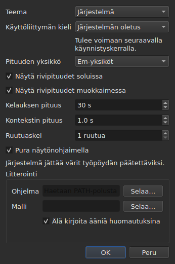

# Asetukset

<!-- machine-translated -->
> Tämä sivu on konekäännös, eikä kukaan tämän kielen lukija ole vielä tarkistanut sitä.

Ikkuna muistaa, mitä hiirellä asetetaan — **missä se oli**, **oliko se
suurennettu**, **sarakkeiden leveydet**, **elokuvan ja taulukon välisen
jakokahvan sijainnin** — sekä **missä työskentelet**, jotta komento
`Open…` avautuu oikeaan paikkaan. Mitään näistä ei aseteta valintaikkunassa:
siirrät, vedät, ja se muistetaan.

**Kuudella asetuksella on oma valintaikkunansa**, `Muokkaa ▸ Asetukset…`, ja se on
peruste: asetus, jolla on jo oma ele, ei tarvitse kenttää. Teemalla ei ole elettä,
ei myöskään rivipituuksien yksiköllä, ei kahdella valintaruudulla, jotka näyttävät
ne, eikä soittimen hypyllä ja esivaralla. Katso [Teema](#teema),
[Rivipituudet](#rivipituudet) ja [Soitin](#soitin).

**Käyttöliittymän kieli on samassa valintaikkunassa, ja se on asetus, joka odottaa**:
se tulee voimaan seuraavalla käynnistyskerralla, ei heti. Katso
[Käyttöliittymän kieli](#käyttöliittymän-kieli).

**Äänenvoimakkuudella ei ole kenttää**: kuvan alla oleva palkki ja kaksi elettä
asettavat sen, ja se muistetaan.

**Yksi asetus asetetaan siellä, missä sitä käytetään**: puoli, jolle komento
`Insert Subtitles…` lisää rivinsä, on tuon valintaikkunan kenttä, ja viimeisin
valinta muistetaan. Katso
[Rivien lisääminen, poistaminen, yhdistäminen ja jakaminen](lines.md#puoli-muistetaan).

**Samoin kaksi hakuasetusta**: `Regular expression` ja
`Ignore case` pysyvät valittuina tai valitsematta valintaikkunan avauskerrasta
toiseen ja istunnosta toiseen. Katso
[Etsi ja korvaa](find-and-replace.md#kaksi-asetusta).

**Samoin komennon `Adjust Durations…` asetukset**: lukunopeus, sen kaksi
suuntaa sekä kolme kestoa valintaruutuineen — kukin säilyttää arvonsa, oli se
valittuna tai ei. Katso [`Adjust Durations…`](operations.md#adjust-durations).

**Ja viimeksi komennossa `Save As…` valittu merkistökoodaus**
tavujärjestysmerkkeineen. Katso [tiedosto](#tiedosto).

**Ja se, mitä avustaja `Correct Texts…` ja valintaikkuna `Spell-Check Settings…`
asettavat**: valitut tehtävät ja niiden koodi, lausekkeiden valintaruudut,
rivinvaihdon asetukset, kieli, tarkistuksen kohde ja alleviivaus kirjoitettaessa.
Katso [Korjaa tekstejä…](correct-texts.md) ja
[Tarkista oikeinkirjoitus…](check-spelling.md#oikoluvun-asetukset). **Avustajan
`Correct Texts…` kohdetta ja asiakirjaa ei muisteta.**

**Mitä ei muisteta:** viimeksi avattua tiedostoa — katso
[Muistettu hakemisto](#muistettu-hakemisto).

## Soitin

Neljä kenttää. **Kelauksen pituus** ja **Kontekstin pituus** ovat Gaupolin
asetuksia ja käyttävät sen arvoja; **Ruutuaskel** ja **Pura näytönohjaimella**
ovat subeditin omia:

| Kenttä | Mitä se asettaa | Oletus | Rajat |
| :---- | :----------- | ------: | :----- |
| `Seek length` | komentojen `Seek Backward` ja `Seek Forward` hypyn pituus | 30 s | 1 sekunnista yhteen tuntiin |
| `Context length` | esivara ennen valintaa komennoille `Seek Selection Start`, `Seek Selection End` ja `Play Selection` | 1 s | 0–60 s, kymmenyksen tarkkuudella |
| `Frame step` | komentojen `Step Backward` ja `Step Forward` sekä reunan siirtämisen askel **ruutuina** | 1 ruutu | 1–1 000 ruutua |
| `Decode on the graphics card` | antaa näytönohjaimen purkaa elokuvan, jos koneessa sellainen on; ilman näytönohjainta mikään ei muutu | valittu | valittu tai ei |

Ne tulevat voimaan **heti** ilman uudelleenkäynnistystä, ja ne muistetaan
istunnosta toiseen avaimissa `video.seek-length` (sekunteina),
`video.context-length-ms` (millisekunteina), `video.step-frames` (ruutuina) ja
`video.hardware-decoding` (`true` tai `false`).
**Rajojen ulkopuolinen arvo tai arvo, joka ei ole luku**, ei estä ikkunaa
avautumasta: se ohitetaan, oletus säilyy, ja ikkuna kertoo siitä avautuessaan.
**Ruutuaskel ei ole koskaan millisekunteina**: N ruudun askel on aina N ruutua,
oli elokuvan ruutunopeus mikä tahansa — katso
[Ajoitus videon avulla](timing.md#ruutu-ruudulta). Äänenvoimakkuus muistetaan
avaimessa `video.volume`, arvona 0–100, samalla sietokyvyllä.

## Tiedosto

```
~/.config/subedit/settings.conf
```

Tarkemmin sanottuna `$XDG_CONFIG_HOME/subedit/settings.conf`, kun tuo muuttuja
on asetettu. Se kirjoitetaan **ikkunan sulkeutuessa** ja luetaan sen avautuessa.
Keskeytetty ohjelma — tapettu tai kaatumiseen pysähtynyt — ei kirjoita mitään,
ja seuraava istunto löytää sen, minkä edellinen jätti.

Tiedosto on tekstiä, ja sitä voi muokata käsin. Se on ominaisuus eikä
sivuvaikutus: juuri se tekee asetuksesta korjattavan silloin, kun sen asettava
käyttöliittymä on itse rikki.

### Kaksi lohkoa, joista yksi on yhteinen komentorivin kanssa

Tiedosto kirjoitetaan **kahtena lohkona**, kumpikin otsikkokommentin alle:

| Lohko | Avaimet | Lukija |
| :---- | :--- | :------ |
| `# Operation settings: shared by the window and the command line` | avaimet `duration-adjust.*` ja `correction.*` | ikkuna **ja** `subedit-cli` |
| `# Display preferences: the window's own` | kaikki muut avaimet — geometria, sarakkeet, teema, käyttöliittymän kieli, haku, oikoluku, muokkain, video, viimeisin hakemisto, kirjoituksen merkistökoodaus | vain ikkuna |

**`subedit-cli` lukee toimintolohkon oletuksena**: se, minkä komennot
`Adjust Durations…` ja `Correct Texts…` tähän muistavat, on myös lähtökohta
alikomennolle [`subedit-cli adjust`](../subedit-cli/adjust.md) ja osalle
alikomentoa [`subedit-cli correct`](../subedit-cli/correct.md), ellei jokin
komentorivin valitsin määrää muuta. **Se ei koskaan lue näyttöasetuksia.** Sen
alikomento [`config`](../subedit-cli/config.md) luettelee toimintoavaimet,
näyttää niiden arvot ja muuttaa niitä — `subedit-cli config set duration-adjust.speed 12` —
ja ikkuna näkee muutoksen seuraavalla avauskerrallaan. **Muutos, joka tehdään
ikkunan ollessa auki, ei säily sen sulkemisen yli**: ikkuna kirjoittaa koko
tiedoston uudelleen sillä, mitä sillä on. Valitsin `--no-config` saa komentorivin
jättämään tiedoston huomiotta. Katso
[Asetustiedosto](../subedit-cli/invocation.md#asetustiedosto).

Lukija hyväksyy avaimet missä järjestyksessä tahansa, otsikkokommenttien kanssa
tai ilman: ennen kahden lohkon käyttöönottoa kirjoitettu tiedosto luetaan
sellaisenaan ja kirjoitetaan kahtena lohkona seuraavalla sulkemiskerralla.

| Asetus | Mitä se sisältää | Oletus |
| :----- | :------------ | :------ |
| `window.geometry` | `x,y,width,height` pikseleinä; leveys ja korkeus nollasta poikkeavia | ikkuna mitoittaa itsensä |
| `window.maximised` | `true` tai `false` | `false` |
| `table.columns` | neljä leveyttä pikseleinä pilkuilla erotettuina — `#`, `Start`, `End`, `Duration`, myös piilotettuina | taulukko mitoittaa itsensä |
| `table.order` | kuusi saraketta, **kukin kerran**, siinä järjestyksessä kuin taulukko ne näyttää: `number`, `start`, `end`, `duration`, `text`, `translation` | `number,start,end,duration,text,translation` |
| `table.hidden` | poistetut sarakkeet joukosta `number`, `start`, `end` ja `duration`; tyhjä: ei yhtään | ei yhtään |
| `window.table-share` | taulukolle annettu osuus korkeudesta prosentteina, 1–99 | ikkuna jakaa kuten aina ennenkin |
| `file.directory` | **absoluuttinen** hakemistopolku | ei mitään: `Open…` avautuu siihen hakemistoon, josta ohjelma käynnistettiin |
| `general.theme` | `system`, `light` tai `dark` | `system` |
| `interface.language` | `system` tai kielen nimi sellaisena kuin sen käännösluettelo on nimetty: kaksi tai kolme pientä kirjainta, sitten valinnaisesti `_` ja kaksi isoa kirjainta — `fr`, `pt_BR`; englannille `en` | `system` |
| `edit.insert-placement` | `above` tai `below` | `below` |
| `file.write-encoding` | sellaisen merkistökoodauksen nimi, jota ICU osaa kirjoittaa ja jonka muunnin ei kirjoita omaa merkkiään | ei mitään |
| `file.write-bom` | `true` tai `false` | `false` |
| `search.regex` | `true` tai `false` — lauseke on säännöllinen lauseke | `false` |
| `search.ignore-case` | `true` tai `false` — kirjainkokoa ei eroteta | `true` |
| `duration-adjust.speed` | lukunopeus merkkeinä sekunnissa, aidosti positiivinen; desimaaliluku kirjoitetaan mahdollisimman lyhyenä (`15`, `12.5`) | `15` |
| `duration-adjust.lengthen` | `true` tai `false` — pidennetään se, mikä on liian lyhyt luettavaksi | `true` |
| `duration-adjust.shorten` | `true` tai `false` — lyhennetään se, mikä pysyy näkyvissä tarpeettoman kauan | `false` |
| `duration-adjust.minimum-enabled` | `true` tai `false` — vähimmäiskesto on pyydetty | `true` |
| `duration-adjust.minimum-ms` | vähimmäiskesto millisekunteina, kokonaisluku, ei negatiivinen | `1500` |
| `duration-adjust.maximum-enabled` | `true` tai `false` — enimmäiskesto on pyydetty | `false` |
| `duration-adjust.maximum-ms` | enimmäiskesto millisekunteina, kokonaisluku, ei negatiivinen | `6000` |
| `duration-adjust.gap-enabled` | `true` tai `false` — väli seuraavaan kappaleeseen on pyydetty | `true` |
| `duration-adjust.gap-ms` | väli millisekunteina, kokonaisluku, ei negatiivinen | `0` |
| `correction.mentions.enabled`, `correction.common-errors.enabled`, `correction.capitalization.enabled`, `correction.line-break.enabled` | `true` tai `false` — tehtävä on valittuna avustajan `Correct Texts…` ensimmäisellä sivulla | `false`, `true`, `true`, `false` |
| `correction.mentions.code`, `correction.common-errors.code`, `correction.capitalization.code`, `correction.line-break.code` | tehtävän lausekkeiden koodi: `Zyyy` tai `Script[-language[-COUNTRY]]` — `Latn-en-US`; ei tyhjä | `Zyyy` |
| `correction.human`, `correction.ocr` | `true` tai `false` — yleisten virheiden luokat | `true`, `true` |
| `correction.sound-in-brackets`, `correction.sound-in-parentheses` | `true` tai `false` — sivun `Mentions` kaksi valintaruutua | `false`, `false` |
| `correction.line-break.max-length` | rivin enimmäispituus, desimaaliluku; valintaikkuna rajaa sen välille 1–1 000 | `24` |
| `correction.line-break.max-lines` | rivien enimmäismäärä, kokonaisluku; valintaikkuna rajaa sen välille 1–100 | `3` |
| `correction.line-break.in-ems` | `true`: pituus mitataan *em-yksikköinä*; `false`: merkkeinä | `true` |
| `correction.line-break.skip-on-length`, `correction.line-break.skip-on-lines` | `true` tai `false` — kaksi ohitusehtoa on pyydetty | `true`, `true` |
| `correction.line-break.skip-max-length`, `correction.line-break.skip-max-lines` | kaksi ohituskynnystä valitussa yksikössä | `24`, `3` |
| `correction.join-split.enabled` | `true` tai `false` — tehtävä `Join or Split Words` on valittuna | `false` |
| `correction.join-split.join`, `correction.join-split.split` | `true` tai `false` — yhdistäminen, jakaminen | `true`, `false` |
| `correction.join-split.language` | kieliasetuksen koodi — `fr`, `en_US`, `sr@Latn` —; tyhjä: järjestelmän kieli | tyhjä |
| `correction.remove-blank` | `true` tai `false` — `Remove all blank subtitles` | `true` |
| `transcription.engine` | moottorin nimi: pieniä kirjaimia, numeroita, `.`, `-` ja `_` | `whisper.cpp` |
| `transcription.executable`, `transcription.model` | absoluuttinen polku; tyhjä: moottori haetaan `PATH`-polusta, eikä mallia ole asetettu | tyhjä |
| `transcription.language` | kaksi pientä kirjainta, ISO 639-1 -koodi; tyhjä: kieli tunnistetaan | tyhjä |
| `transcription.suppress-notes` | `true` tai `false` — `Do not write sounds as notes` | `true` |
| `transcription.merge-gap-ms` | saman lauseen palat, jotka ovat tätä lähempänä toisiaan, yhdistetään, millisekunteina, kokonaisluku, ei negatiivinen | `400` |
| `transcription.max-duration-ms` | pisin aika, jonka litteroitu tekstitys pysyy näytöllä, millisekunteina, 1–3600000 | `7000` |
| `transcription.max-characters` | litteroidun tekstityksen merkkien enimmäismäärä, 1–1000 | `84` |
| `correction.activations` | käyttäjän muuttamat lausekkeiden valintaruudut, `<type>:<code>:<name>:<0\|1>`, pilkuilla erotettuina; **nimessä oleva pilkku tai kenoviiva kirjoitetaan kenoviivan jälkeen** (`\,` ja `\\`), ja lukukelvoton merkintä menettää vain oman asetuksensa — siitä ilmoitetaan, ja muut säilytetään | tyhjä |
| `spell-check.language` | kieliasetuksen koodi, esimerkiksi `fr_FR`; tyhjä: järjestelmän kieli | tyhjä |
| `spell-check.target` | `selection`, `current-project` tai `all-projects` | `current-project` |
| `spell-check.document` | `main` tai `translation` | `main` |
| `spell-check.inline` | `true` tai `false` — tuntemattomat sanat alleviivataan kirjoitettaessa solun muokkaimeen | `false` |
| `editor.length-unit` | `em` tai `characters` — taulukon ja muokkaimen näyttämien rivipituuksien yksikkö | `em` |
| `editor.show-lengths-cell` | `true` tai `false` — tekstisolun jokaisen rivin perässä on sen pituus | `true` |
| `editor.show-lengths-edit` | `true` tai `false` — solun muokkain näyttää jokaisen rivin pituuden marginaalissa | `true` |

**Tiedosto hyväksyy enemmän kuin valintaikkuna.** Lukija hyväksyy minkä tahansa
aidosti positiivisen nopeuden ja minkä tahansa ei-negatiivisen keston;
valintaikkuna `Adjust
Durations…` puolestaan rajaa nopeuden välille 1–99 merkkiä sekunnissa ja kunkin
keston välille 0–99 s. Tiedoston arvo, joka on näiden rajojen ulkopuolella,
tuodaan rajalle valintaikkunan avautuessa, ja tiedosto säilyttää sen sellaisena,
kun valintaikkuna on hyväksytty ja ikkuna suljettu. Peruttu valintaikkuna ei
muuta mitään siitä, mitä muistetaan.

**`file.write-encoding` muistaa viimeksi komennossa `Save As…` valitun
merkistökoodauksen, eikä se koskaan pakota itseään tiedostoon.** Avoimella
asiakirjalla on oma merkistökoodauksensa, ja juuri sitä ikkuna ehdottaa: sen
kirjoittaminen uudelleen toisella koodauksella vain siksi, että kolme viikkoa
vanha asetus niin sanoo, menettäisi sen, minkä lukeminen säilytti.
Se, minkä tämä asetus muistaa, palvelee asiakirjaa, jolla ei ole tiedostoa —
juuri luotua.

**Se on harkittu ”ei” eikä unohdus.** Joka toimittaa aina samalla
merkistökoodauksella ja avaa perittyjä tiedostoja toisella, valitsee sen
uudelleen jokaiselle tiedostolle; ikkuna ehdottaa sitä hänelle, ja
edestakaisen muunnoksen takuu pätee kaikille.

**`file.write-bom` kantaa saman merkistökoodauksen merkin**, ja kaksi riviä
todella tarvitaan: merkistökoodauksen nimi ei kerro, edeltääkö sitä sen merkki,
yhtä vähän kuin `--encoding` kertoo sen, minkä `--bom` kertoo. Molemmat luetaan
yhdessä, missä järjestyksessä tahansa, eikä `file.write-bom` ilman muistettua
merkistökoodausta aseta mitään.

**Jakokahvalle osuus eikä korkeuksia**, ja juuri se tekee siitä hyödyllisen:
kolme korkeutta pikseleinä ei enää tarkoita mitään heti, kun ikkuna avautuu
toisen kokoisena, ja ikkuna avautuu usein toisen kokoisena.
Osuus toistuu missä tahansa. Se **tuodaan siihen, minkä ikkuna hyväksyy**, jos
se on liian pieni — elokuvan kaistalla on vähimmäiskorkeus.

**Neljä leveyttä kuudelle sarakkeelle**, eikä se ole unohdus: ne ovat sarakkeiden
`#`, `Start`, `End` ja `Duration` leveydet, tässä järjestyksessä taulukon
järjestyksestä riippumatta, ja **piilotettu sarake säilyttää omansa** — se saa
sen takaisin, kun se näytetään uudelleen. Viimeinen näytetty sarake ottaa sen,
minkä muut jättävät, eikä sille annettu leveys tekisi mitään; tekstin ja
käännöksen leveyksiä ei siksi muisteta.

## Mitä tapahtuu, kun tiedostossa ei ole odotettua

Asetukset ovat mukavuutta. **Niiden epäonnistuminen maksaa mukavuuden eikä
mitään muuta**: ikkuna avautuu joka tapauksessa.

| Tapaus | Mitä tapahtuu |
| :--- | :----------- |
| tiedostoa ei ole | kaikki oletukset, eikä mitään sanota — kyseessä on ensimmäinen käynnistys |
| tiedosto on olemassa, mutta sitä ei voi lukea | kaikki oletukset, ja syy kirjoitetaan virhetulosteeseen |
| asetus puuttuu | sen oletus |
| avain on tuntematon | ohitetaan sanaakaan sanomatta, eikä se ole uudelleen kirjoitetussa tiedostossa |
| arvoa ei voi lukea | sen oletus säilytetään, ja asetus nimetään virhetulosteessa |

```console
$ subedit-gui film.srt
subedit-gui: /home/vous/.config/subedit/settings.conf: window.geometry: "plus tard" cannot be read, keeping the default
```

**Viesti menee virhetulosteeseen eikä minnekään muualle.** Modaalinen ikkuna
käynnistyksessä lukukelvottoman asetuksen vuoksi pysäyttäisi käyttäjän vian
takia, joka ei estä häntä tekemästä mitään, ja ennen kuin hän on pyytänyt mitään.

## Kommentoidut asetukset

Uudelleen kirjoitettu tiedosto sisältää **kaikki** tunnetut asetukset, ja
oletusarvoonsa jätetyt kirjoitetaan kommentteina:

```
#window.geometry = 0,0,1280,800
#window.maximised = false
#table.columns = 60,110,110,110
#table.order = number,start,end,duration,text,translation
#table.hidden = start,end
```

Se ei ole maneeri. Ilman sitä asetus, johon ei ole koskaan koskettu, jäisi
jumiin siihen arvoon, joka sillä oli kirjoituspäivänä, eikä **parannettu oletus
tavoittaisi koskaan ketään**. Sen ansiosta oletuksen muuttaminen muuttaa
kaikkien niiden käyttäytymistä, jotka eivät ole ohittaneet sitä — juuri sitä,
mitä oletuksen pitää tehdä.

Asetuksen ohittaminen: poista `#` ja muuta arvoa. Paluu oletukseen: poista
rivi tai kommentoi se uudelleen.

Geometria, leveydet ja poistetut sarakkeet näyttävät **muodon** eivätkä
voimassa olevaa arvoa: geometrian ja leveyksien oletus on ”se, minkä ikkuna
valitsee”, mitä ei voi kirjoittaa numeroina, ja asetuksen
`table.hidden` oletus on ”ei yhtään”, mitä ei voi lukea. Tiedoston otsake
kertoo saman. `table.order` puolestaan näyttää oletusjärjestyksen.

## Muistettu hakemisto

`Open…` avautuu **viimeksi avatun tai tallennetun tiedoston** hakemistoon
eikä peruutetun valintaikkunan hakemistoon: ratkaisevaa on, missä työskentelet,
ei se, mistä katsoit.

**Viimeistä tiedostoa puolestaan ei muisteta.** Sen muistaminen tarkoittaisi,
että käynnistyksessä avattaisiin uudelleen asiakirja, jota kukaan ei pyytänyt.
Hakemiston muistaminen *suuntaa* valintaikkunan; tiedoston muistaminen avaisi
sellaisen.

## Teema

`Muokkaa ▸ Asetukset…` avautuu teemalla, asetuksella ilman elettä,
[rivipituuksien](#rivipituudet) yläpuolella.

| Arvo | Mitä se tekee |
| :---- | :----------- |
| `System` | **ei mitään** — värit pysyvät työpöydän väreinä |
| `Light` | asettaa vaalean paletin |
| `Dark` | asettaa tumman paletin |

Valittu teema tulee voimaan **välittömästi** ilman uudelleenkäynnistystä.

**”Järjestelmä” ei tee mitään, eikä se ole puute.** Qt-versiossa, jonka päälle
subedit on rakennettu, ei ole keinoa kysyä työpöydältä, haluaako se olla vaalea
vai tumma, eikä saada ilmoitusta, kun se muuttaa mieltään. Sen sijaan että
keksittäisiin lukutapa, jota ei osata toteuttaa, työkalu toimittaa ne kaksi
teemaa, joita voi pyytää, ja antaa graafisen kirjaston päättää kolmannesta —
mitä Gaupol tekee samoissa oloissa.

Työpöydällä, jonka teema on jo tumma, `System` antaa siis tumman ikkunan;
vaalealla työpöydällä vaalean ikkunan. `Light` ja `Dark` ohittavat sen
työpöydästä riippumatta.

**Poikkeamien sävyt pysyvät luettavina molemmilla paleteilla** — katso
[Taulukko](table.md#poikkeamat). Se ei ole oletus: tekstin kontrasti jokaisella
sävyllä tarkistetaan testillä molemmilla taustoilla.

## Litterointi

Valintaikkunan ryhmä **`Transcription`** sisältää ne kaksi tietoa koneesta, joita
[`Transcribe Audio…`](video.md#äänen-litterointi) tarvitsee: moottorin **ohjelman** (whisper.cpp,
`whisper-cli`) ja **mallin**, jota se lukee. Kummallakin on painike `Browse…`. Jos ohjelma jätetään tyhjäksi, sitä haetaan
`PATH`-polusta; mallilla ei ole oletusarvoa.

Kenttien alla **valintaikkuna kertoo, mitä on paikalla**: löytyykö moottori ja mistä, löytyykö `ffmpeg`,
ja malli — ei asetettu, ei löytynyt, ei ole malli, vain englannille tai monikielinen. Kun jotakin
puuttuu, se lisää viittauksen sivuun
[Litterointityökalujen asentaminen](../subedit-cli/install-transcription.md), joka kertoo, mistä kukin löytyy.
Nämä kaksi kenttää ovat asetukset `transcription.executable` ja `transcription.model`.

Ruutu **“Älä kirjoita ääniä huomautuksina”** on asetus `transcription.suppress-notes` (oletuksena valittuna): moottorille sanotaan, ettei se kirjoita ääniä
huomautuksina, kuten `(phone ringing)`. Poista valinta, jos haluat säilyttää ne, kuulovammaisten tekstityksiä varten. `Transcribe Audio…` -valintaikkuna tarjoaa saman ruudun yksittäistä litterointia varten.

## Käyttöliittymän kieli

`Muokkaa ▸ Asetukset…` valitsee ikkunan kielen teeman alapuolella.

| Kenttä | Arvot | Oletus |
| :---- | :----- | :------ |
| `Interface language` | `System default`; `English`; sitten jokainen ohjelman mukana asennettu kieli omalla nimellään — `Français` | `System default` |

**Se tulee voimaan seuraavalla käynnistyskerralla**, ja valintaikkuna kertoo sen
kentän alla: ikkuna käännetään sitä rakennettaessa, ja käynnissä oleva ikkuna
säilyttää kielen, jolla se käynnistyi. Valinta säilytetään asetustiedostossa
avaimessa `interface.language`, ja se luetaan, kun ikkuna seuraavan kerran
avautuu.

| Valinta | Ikkunan kieli käynnistettäessä |
| :----- | :------------------- |
| `System default` | ympäristön kieli kuten ennen mitään valintaa — `LANGUAGE`, `LC_ALL`, `LC_MESSAGES`, `LANG`; katso [Kieli](invocation.md#kieli) |
| `English` | englanti, sanoipa ympäristö mitä tahansa |
| asennettu kieli | tuo kieli, **sanoipa ympäristö mitä tahansa**, myös `LC_ALL=C`: tässä tehty valinta on nimenomainen |

Luettelossa ovat kielet, joiden käännösluettelo on asennettu hakemistoon
`<prefix>/share/subedit/locale`; englanti on aina mukana, koska ohjelma on
kirjoitettu sillä. Kieli näytetään sen omalla nimellä, jota mikään käännösluettelo ei
käännä, jotta lukija löytää sen kielen, jota hän lukee.

**Arvo, jota ohjelma ei voi noudattaa, maksaa vain valinnan:**

| Mitä tiedostossa lukee | Mitä tapahtuu |
| :----------------- | :----------- |
| kielen nimi, jolle ei ole asennettu käännösluetteloa — toiselta koneelta tuotu tiedosto | ikkuna seuraa ympäristöä sanaakaan sanomatta; `Preferences…` näyttää tuon kielen nimellään tai koodillaan ja säilyttää sen, ellei toista valita |
| jokin, mikä ei ole kielen nimi — `French`, `fr_FR.UTF-8` | `system`, oletus, ja asetus nimetään virhetulosteessa kuten mikä tahansa lukukelvoton arvo |

```console
$ subedit-gui film.srt
subedit-gui: /home/vous/.config/subedit/settings.conf: interface.language: "French" cannot be read, keeping the default
```

**Komentorivi ei koskaan lue sitä**: `subedit-cli` valitsee kielensä pelkästä
ympäristöstä, ja `subedit-cli config set interface.language fr` hylätään
näyttöasetuksena.

## Rivipituudet




`Muokkaa ▸ Asetukset…` asettaa myös sen, **mitä taulukko ja muokkain näyttävät
rivien pituudesta** — Gaupolin viivain ja marginaali.

| Kenttä | Mitä se tekee | Oletus |
| :---- | :----------- | :------ |
| `Length unit` | pituuksien yksikkö: `Ems` tai `Characters` | `Ems` |
| `Show line lengths in cells` | tekstisolun jokaisen rivin perässä on sen pituus | valittu |
| `Show line lengths in the editor` | solun muokkain näyttää jokaisen rivin pituuden oikeanpuoleisessa marginaalissa | valittu |

**`Length unit` on harmaana, kun kumpikaan valintaruutu ei ole valittuna**:
kun näytettävää pituutta ei ole, yksikkö ei aseta mitään. Valinta tulee
**heti** voimaan taulukossa, ja sen jälkeen avautuvat muokkaimet noudattavat
sitä. Kolme arvoa muistetaan istunnosta toiseen: `editor.length-unit`,
`editor.show-lengths-cell` ja `editor.show-lengths-edit`, [tiedoston](#tiedosto)
taulukossa. Katso [Rivien pituus](table.md#rivien-pituus) ja
[muokkaimessa](editing.md#rivien-pituus).

**Se ei ole avustajan raja.** Avustajan `Correct Texts…` yksikkö — pituus,
jossa se katkaisee rivit — on erillinen asetus, omassa avustajassaan: voit
lukea em-yksiköitä taulukosta ja katkaista merkkeinä.

## Mitä ei voi asettaa

**Yhdeksän muistettua asetusta valitaan valintaikkunassa** — lukuun ottamatta
korjausavustajan ja oikoluvun asetuksia, joilla kummallakin on omansa —, ja
kukin siinä, jossa sitä käytetään: teema ja kolme rivipituuksien asetusta
täällä; lisäyksen puoli lisäyksen valintaikkunassa; kaksi hakuasetusta haun
valintaikkunassa; merkistökoodaus ja tavujärjestysmerkki komennossa `Save As…`;
keston säädön lukunopeus, kestot ja väli sen omassa valintaikkunassa. Muita ei
ole: mitään ei voi asettaa huomautuksille, soittimen äänenvoimakkuudelle eikä
oletustallennusmuodolle — se tulee avoimesta tiedostosta.

Eikä **mitään asiakirjaan kuuluvaa lukua säilytetä istunnosta toiseen**:
siirron määrä tai kaksi muunnoksen merkkikohtaa pitävät paikkansa yhdelle
tiedostolle ja ovat väärin seuraavalle. Valintaikkunat kysyvät ne uudelleen
jokaisella käynnistyskerralla, tarkoituksella. Komennon `Adjust Durations…`
asetukset ovat poikkeus samalla tavalla kuin kaksi hakuasetusta: lukunopeus,
vähimmäiskesto tai väli ovat menetelmän valintoja eivätkä tiedoston mittauksia,
ja siksi ne säilyvät istunnosta toiseen.

Tämä käyttöopas kuvaa sen, mikä on olemassa: tuleva on
[tiekartassa](../../../../feuille-de-route.md).
