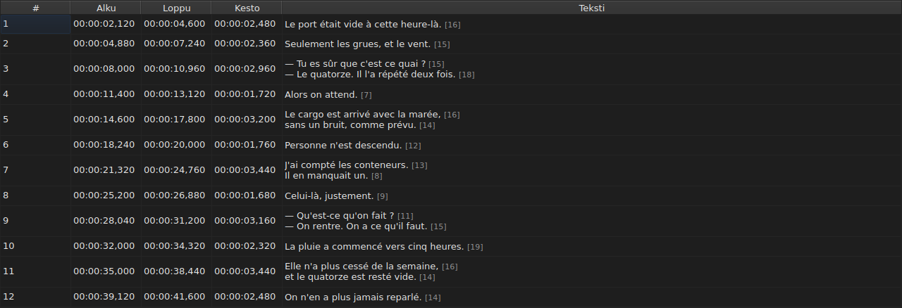
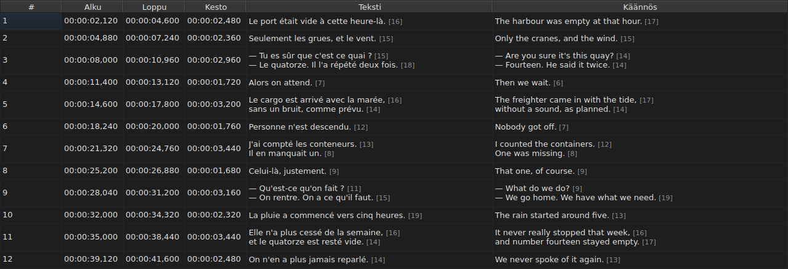
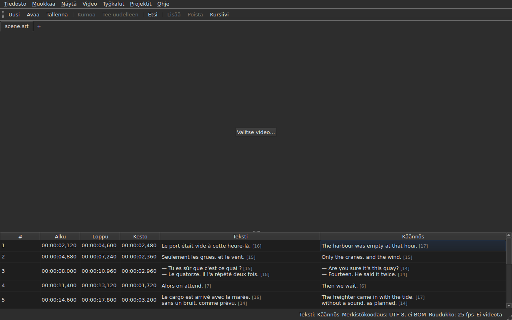

# Taulukko

<!-- machine-translated -->
> Tämä sivu on konekäännös, eikä kukaan tämän kielen lukija ole vielä tarkistanut sitä.

Ikkuna näyttää avoimen tiedoston kappaleet, yhden riviä kohti, viidessä
sarakkeessa — kuudessa, kun projektissa on käännös.

**Tämä käyttöopas lainaa ikkunan sarakeotsikot sellaisina kuin
englanninkielinen ikkuna ne näyttää**, kuten se tekee myös komentoriville;
suomenkielinen ikkuna ja sen kuvakaappaukset näyttävät ne suomeksi.

| Sarake | Mitä se näyttää |
| :----- | :------------ |
| `#` | kappaleen järjestysnumero alkaen numerosta 1 |
| `Start` | kohta, jossa kappale ilmestyy, `HH:MM:SS,mmm` |
| `End` | kohta, jossa se katoaa |
| `Duration` | `End − Start` |
| `Text` | kappaleen teksti |
| `Translation` | kappaleen käännös — **puuttuu niin kauan kuin projektissa ei ole käännöstä** |




## Rivien pituus


**Tekstisolun jokaisen rivin perässä on sen pituus**, `[N]`, pienempänä ja
vaaleampana — sarakkeessa `Text` samoin kuin sarakkeessa `Translation`.
Niin Gaupol tekee.

| Mikä vaikuttaa | Mitä taulukko tekee |
| :---------- | :------------------ |
| **tagit** | eivät ole mukana laskussa: `<i>Bonjour</i>` antaa tuloksen `[7]` kuten `Bonjour` |
| **pyöristys** | alaspäin: 12,9 em-yksikön pituinen rivi näytetään muodossa `[12]` |
| **tyhjä rivi** | sillä ei ole pituutta; ei myöskään tyhjällä tekstillä |
| **yksikkö** | oletuksena *em-yksiköt* tai merkit — `Muokkaa ▸ Asetukset…` |
| **sarakkeeseen liian pitkä rivi** | katkaistaan merkillä `…` **ennen** lukua, joka pysyy näkyvissä |

**Em on Gaupolin eikä typografian**: pienaakkosto on 0,55 em kirjainta kohti
taulukon fontilla. *Em-yksiköinä* ilmaistu pituus riippuu siis fontista;
merkkeinä ilmaistu pituus laskee koodipisteet, aksenttimerkki mukaan lukien
yhtenä.

**Taulukko ei merkitse liian pitkää riviä.** Se näyttää luvun, ja silmän
tehtävä on verrata sitä itse asettamaasi rajaan — kuten Gaupolissa. Se ei ole
avustajan `Correct Texts…` raja, jolla on oma asetuksensa.

**Jos et halua nähdä niitä:** poista valinta ruudusta
`Show line lengths in cells` kohdassa `Muokkaa ▸ Asetukset…`. Katso
[Rivipituudet](preferences.md#rivipituudet).

## Sarakkeiden piilottaminen ja siirtäminen

**`Näytä ▸ Sarakkeet`** sisältää yhden valittavan kohdan saraketta kohti,
**paitsi sarakkeelle `Text`**: ilman päätekstiä ei jäisi mitään muokattavaa.

| Kohta | Sarake |
| :---- | :----- |
| `Näytä ▸ Sarakkeet ▸ Nro` | `#` |
| `Näytä ▸ Sarakkeet ▸ Alku` | `Start` |
| `Näytä ▸ Sarakkeet ▸ Loppu` | `End` |
| `Näytä ▸ Sarakkeet ▸ Kesto` | `Duration` |
| `Näytä ▸ Sarakkeet ▸ Käännös` | `Translation` — katso [Käännössarake](#käännössarake) |

Kohdan valinnan poistaminen poistaa sen sarakkeen, ja uudelleen valitseminen
palauttaa sen leveydellä, joka sillä oli. **Asetus koskee koko ikkunaa**,
kaikki välilehdet mukaan lukien: taulukkoja on vain yksi, ja sen projekti
vaihtuu välilehden mukana.

**Nykyinen solu poistuu poistettavasta sarakkeesta**: se siirtyy sarakkeeseen
`Text` samalla rivillä, eikä valinta liiku. Nykyinen solu sarakkeessa, jota
kukaan ei näe, olisi solu, jota näppäimen painallus muokkaisi sokkona.

**Sarakkeita siirretään vetämällä niiden otsikkoa**, mitä tahansa niistä,
myös saraketta `Text`. Viimeinen näytetty sarake ottaa tilan, jonka muut
jättävät.

**Järjestys ja poistetut sarakkeet muistetaan istunnosta toiseen** leveyksien
kanssa [asetustiedostossa](preferences.md) — `table.order` ja `table.hidden`.
Käännössarake ei ole mukana: se noudattaa omaa sääntöään ja palaa jokaisen
avatun käännöksen mukana.

**Numero ei ole tiedoston tietoa** vaan rivin järjestysnumero. Lisäys tai
poisto numeroi siis uudelleen kaiken sen jälkeen tulevan ilman, että mitään
kirjoitetaan uudelleen.

**Desimaalierotin noudattaa tiedoston muotoa**: pilkku SubRip-muodossa, piste
kahdeksassa muussa. SubRip on yhdeksästä ainoa, joka kirjoittaa pilkun.

**Erotin noudattaa muotoa, ei koko kirjoitusasu.** Taulukko kirjoittaa aina
tunnit ja aina kolme desimaalia; WebVTT-tiedosto jättää tunnit pois alle tunnin
kohdissa, SubViewer 2 ja kaksi Sub Station Alpha -muotoa laskevat sadasosina,
MPL2 kymmenyksinä, TMPlayer sekunteina, MicroDVD ruutuina. Sarake, jonka
leveys seuraisi muotoa, olisi raskaampi lukea kuin sarake, joka yksinkertaisesti
ei ole tiedoston tarkka kirjoitusasu.

Taulukko takaa siis **arvon ja erottimen**, ei desimaalien määrää. Se, minkä
kohdemuoto pyöristäisi, kerrotaan tallennettaessa — katso
[Mitä muoto ei säilytä](files.md#mitä-muoto-ei-säilytä-kerrotaan-ennen-kirjoittamista).

**Kesto (`Duration`) lasketaan**, eikä sitä koskaan tallenneta: sen
kirjoittaminen siirtää loppua. Kappale, jonka loppu edeltää sen alkua, näyttää
negatiivisen keston eikä nollaa: se on tiedoston poikkeama, ja sen
piilottaminen tekisi sen löytämisen mahdottomaksi.

**Alkua, loppua, kestoa, tekstiä ja käännöstä muokataan paikallaan**; numeroa
ei. Katso [Solun muokkaaminen](editing.md).

**Valinta osoittaa, mihin toiminto kohdistuu** — katso
[Toiminnot](operations.md).

**Rivin korkeus noudattaa sen sisältämää kappaletta**: kaksirivinen kappale vie
kaksi riviä, kolmirivinen kolme. Teksti näytetään kokonaan, sellaisena kuin se
kirjoitetaan.

**Katkaistuksi jää vain sarakkeeseensa liian pitkä rivi**, ja se päättyy
silloin kolmeen pisteeseen. Sarakkeen `Text` tai ikkunan leventäminen näyttää
sen kokonaan; samoin solun avaaminen. Tekstin rivejä ei koskaan rivitetä:
vain todellinen rivinvaihto tekee rivin, jotta taulukon rivin korkeus ei muutu,
kun vedät sarakkeen reunaa.

## Kohdat ruutuina

**`Näytä ▸ Kohdat ruutuina`** — valittava kohta, yksi asetus koko ikkunalle —
näyttää sarakkeet `Start` ja `End` **ruutujen numeroina** aikaleimojen sijaan
ja **hyväksyy syötteeksi ruudun numeron**. Otsikot kertovat sen:
`Start (frames)` ja `End (frames)`.

| Mikä muuttuu | Mikä ei muutu |
| :----------- | :------------------- |
| mitä `Start` ja `End` kirjoittavat ja mitä ne hyväksyvät | sarake `Duration`, joka pysyy aikana |
| noiden kahden sarakkeen otsikot | asiakirja: mitään ei muuteta, historiassa ei ole uutta merkintää, ja **tiedosto kirjoittaa sen, minkä se kirjoitti** |

**Ruudut laskeva ruutunopeus** on tässä järjestyksessä:

1. **tiedoston ruutunopeus**, kun tiedosto lasketaan ruutuina — MicroDVD, jossa
   on numeroita mutta ei ruutunopeutta: **ikkuna näyttää silloin tiedostonsa
   luvut** videosta riippumatta;
2. **liitetyn videon ilmoittama ruutunopeus**;
3. **kohtien muodostama ruudukko**, kun ne muodostavat sellaisen.

Kohdan työkaluvihje kertoo, mikä valittiin: *Positions are frame numbers,
counted at 25 fps, the rate the video declares*. **Jos mitään kolmesta ei ole,
kohta ei ole käytettävissä, ja sen työkaluvihje kertoo syyn**: tiedostoa ei
lasketa ruutuina, video ei ilmoita ruutunopeutta, eivätkä kohdat osu mihinkään
ruudukkoon.

- **Numero on sen ruudun numero, johon kohta osuu**, pyöristettynä lähimpään
  ruutuun. **Kirjoitettuna se antaa hetken, jolloin tuo ruutu alkaa**,
  pyöristettynä **vain kerran** tarkasta suhteesta
  ([ADR 0013](../../../../adr/0013-mise-a-l-echelle-exacte-des-positions.md)):
  ruutu 37 nopeudella 23,976 ruutua sekunnissa alkaa kohdassa 1 543,04 ms eli
  `00:00:01,543`.
- **Vain kokonaisluvut hyväksytään** — miinusmerkin kanssa, koska alku voi
  edeltää elokuvaa. Ruututilassa kirjoitettu aikaleima tai luku, joka ei ole
  kokonaisluku, jättää solun ennalleen.
- **Toistopalkki noudattaa samaa asetusta**: kohta ja kesto liukusäätimen
  kummallakin puolella kirjoitetaan ruutujen numeroina kuten `Start` ja `End`,
  samalla hetkellä — katso [Toistopalkki](player.md#toistopalkki). Kuvan
  yläreunaan piirretty kello pysyy aikaleimana.
- **Tätä asetusta ei muisteta** istunnosta toiseen: se on ikkunan asetus eikä
  asiakirjan, ja sen saa takaisin päälle yhdellä eleellä.

## Poikkeamat

Kappale, jonka kohdat eivät sovi yhteen, **sävytetään sen aikasarakkeissa**,
ja kun osoitin viedään sen päälle, kerrotaan, mikä on vialla.

| Sävy | Mitä se ilmoittaa | Mitä tehdä |
| :--- | :-------------- | :--------- |
| punainen | `ends before it starts` | korjaa sen loppu tai alku |
| sininen | `starts before the previous one starts` | palauta se paikalleen järjestyksessä |
| meripihka | `starts before the previous one ends` | säädä sen ajoitusta |


Vain sarakkeet `Start`, `End` ja `Duration` sävytetään: poikkeama koskee vain
aikaa, ja tekstin sävyttäminen antaisi ymmärtää, että sillä olisi jotain
tekemistä tekstin kanssa.

**Kappaleella voi olla useita poikkeamia**, ja työkaluvihje nimeää ne kaikki.
Sävy on ensimmäisenä korjattavan poikkeaman sävy: itsessään rikkinäinen
kappale on rikki riippumatta siitä, mitä sen naapurit tekevät; väärässä
paikassa oleva kappale palautetaan paikalleen, ja sen päällekkäisyys poistuu
samalla.

> Ei ole sattumaa, että epäjärjestys voittaa lähes aina päällekkäisyyden:
> alkaminen ennen kuin edellinen alkaa on alkamista ennen kuin edellinen
> päättyy — ellei edellinen ole itse rikki.

**Merkintä lasketaan uudelleen jokaisen kohdan muutoksen jälkeen**, tulipa
muutos muokatusta solusta, toiminnosta tai kumoamisesta. Se kertoo, millainen
tiedosto on nyt, ei millainen se oli avattaessa.

Se ei nojaa mihinkään ruuturuudukkoon: heti kun kohtaa korjataan käsin, se
poistuu ruudukolta, ja ruudukkoon perustuva merkintä ilmoittaisi käyttäjän
työstä.

## Käännössarake

Kappaleella on **kaksi tekstiä ja yksi ainoa kohtapari**: käännöksellä ei ole
omaa ajoitustaan, vaan se on sidottu kappaleen ajoitukseen. Taulukko näyttää
sen kuudennessa sarakkeessa, `Translation`, sarakkeen `Text` oikealla puolella.




**Sarake on olemassa vain, jos projektissa on käännös.** Ilman käännöstä
taulukko säilyttää viisi saraketta, ja ikkuna käyttäytyy kuin käännöstä ei
olisi — mitään ei muuteta harmaaksi eikä lisätä. `Tiedosto ▸ Avaa käännös…`
avaa käännöksen: katso [Käännöksen avaaminen](files.md#käännöksen-avaaminen).

**Valikon `View` kohta näyttää tai poistaa sen**:

| Kohta | Mitä se tekee |
| :---- | :----------- |
| `Näytä ▸ Sarakkeet ▸ Käännös` | valittuna: sarake näytetään; valitsematta: se poistetaan |

Kohta **ei ole käytettävissä, kun projektissa ei ole käännöstä** — näytettävää
ei ole — ja se on valittuna käynnistettäessä. **Sarakkeen poistaminen on
käyttäjän valinta**: se pysyy tiedostosta toiseen, kunnes kohta valitaan uudelleen.
Sarakkeen poistaminen ei poista käännöstä: se pysyy projektissa ja palaa kohdan
mukana. Sellaisen tiedoston avaaminen, jossa käännöstä ei ole, poistaa
sarakkeen.

**Käännöksen soluihin kirjoitetaan kuten tekstin soluihin** — katso
[Solun muokkaaminen](editing.md).

### Teksti, johon toiminnot kohdistuvat

Kun rivillä on kaksi tekstiä, tekstitoimintojen on tiedettävä, kumman ne
kirjoittavat uudelleen. **Se on nykyisen solun sarakkeen teksti**: käännös,
jos nykyinen solu on sarakkeessa `Translation`, ja pääteksti kaikkialla
muualla — aikasarakkeessa samoin kuin sarakkeessa `Text`.

| Toiminto | Mihin se kohdistuu |
| :-------- | :-------------- |
| `Italic`, `Case`, `Dialogue`, `Remove Hearing-Impaired Mentions…` | nykyisen sarakkeen tekstiin |
| `Cut Texts`, `Copy Texts`, `Paste Texts` | nykyisen sarakkeen tekstiin |
| `Find and Replace…` | nykyisen sarakkeen tekstiin — katso [Etsi ja korvaa](find-and-replace.md#missä-tekstissä) |
| kohtien toiminnot, lisäys, poisto, yhdistäminen, jakaminen | **molempiin teksteihin**: kappale on kokonaisuus |

**Tilarivi kertoo sen, kun tekstejä on kaksi**, muiden tietojen vasemmalla
puolella:

```text
Text: Translation
```

tai `Text: Main` päätekstille. Se on hiljaa, kun saraketta ei näytetä: tekstiä
on silloin vain yksi, eikä sitä ole syytä kertoa.




**Kuvaan piirretty rivi noudattaa samaa sääntöä**: se on nykyisen sarakkeen
teksti. Katso [Soitin](player.md#kuvaan-piirretty-rivi).

**Mitään ei muuteta harmaaksi.** Tekstitoiminnot pysyvät käytettävissä
nykyisestä sarakkeesta riippumatta, ja ilman käännössaraketta ne kohdistuvat
päätekstiin kuten ennenkin.

## Rivien lisääminen ja poistaminen

`Muokkaa ▸ Lisää kappaleita…` ja `Muokkaa ▸ Poista kappaleet` lisäävät ja
poistavat rivejä, `Muokkaa ▸ Yhdistä kappaleet` ja `Muokkaa ▸ Jaa kappale`
yhdistävät ja jakavat niitä; taulukko numeroi itsensä uudelleen. Katso
[Rivien lisääminen, poistaminen, yhdistäminen ja jakaminen](lines.md).

## Mitä taulukko ei tee

**Sarakkeen mukaan järjestämistä ei ole.** Näytetty järjestys on tiedoston
järjestys, ja se on ainoa, jolla on merkitystä tekstityksille: rivin
järjestysnumero *on* sen paikka ajassa.
