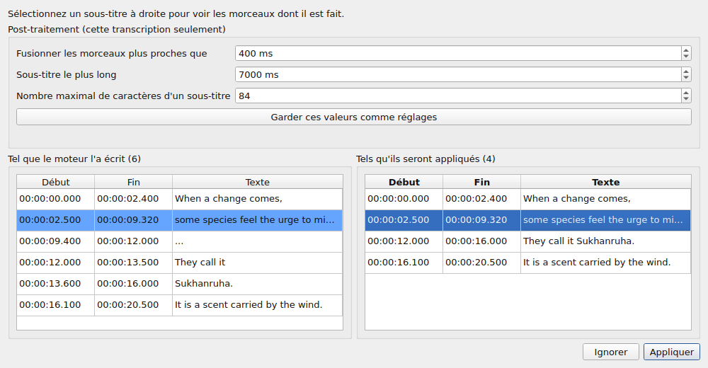
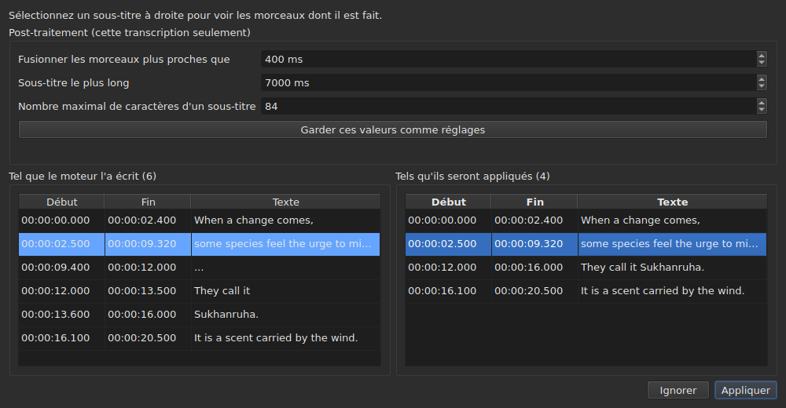

# La vidéo associée

Le menu **Vidéo** porte d'abord trois commandes, et les gestes qui pilotent le film
— voir [Le lecteur](player.md#se-déplacer-dans-le-film).

| Commande | Raccourci | Ce qu'elle fait |
| :------- | :-------- | :-------------- |
| Choisir une vidéo… | aucun | choisit le fichier vidéo que le document accompagne |
| Transcrire l'audio… | aucun | transcrit l'audio du film en sous-titres qui remplacent ceux du projet — voir [Transcrire l'audio](#transcrire-laudio) |
| Lecture / Pause | `Ctrl+P` | joue ou arrête la vidéo — voir [Le lecteur](player.md#jouer-et-arrêter) |

La vidéo associée est **une propriété du document ouvert**, pas un réglage de
l'application : ouvrir un autre fichier de sous-titres repart de zéro. Elle
n'est écrite dans aucun fichier et disparaît avec la fenêtre.

## La piste audio

Un film peut porter plusieurs pistes sonores — la version originale, un doublage, un commentaire. Le
sous-menu **`Vidéo ▸ Audio ▸ Langue`** les liste, **une entrée par piste**, et **marque celle qui joue** :

| Ce que le fichier donne | Ce que l'entrée dit |
| :---------------------- | :------------------ |
| une langue et un titre | `1: fra — Original` |
| une langue seule | `2: eng` |
| un titre seul | `3: Commentary` |
| ni l'un ni l'autre | `1` |

Le numéro est **la place de la piste dans le film**, de un en un, dans l'ordre du fichier : deux pistes
peuvent dire `eng`, et un fichier muet sur ses étiquettes a tout de même une première et une seconde.

**Choisir une entrée joue cette piste.** La marque est la réponse du lecteur, non le clic : elle dit la
piste qui joue.

- **Le sous-menu est éteint** sans vidéo ou sans piste audio. Avec une seule piste, il reste actif et
  la montre, cochée : il dit la langue du film. Les deux gestes du volume, qui sont à côté, restent
  actifs quoi qu'il en soit : voir [Le volume](player.md#le-volume).
- **La piste n'est pas retenue** d'une vidéo à l'autre, ni d'une session à l'autre : un numéro de piste est
  celui de son fichier, et le reporter sur le film suivant choisirait ce qui porte ce numéro là-bas.
  Revenir sur un onglet rouvre son film sur la piste que le lecteur choisit de lui-même.
- Aucun raccourci : on change de langue rarement, et le menu suffit.

## Choisir une vidéo

Le dialogue s'ouvre sur le répertoire du fichier de sous-titres et filtre sur
les extensions vidéo reconnues :

    .avi .flv .m2ts .mkv .mov .mp4 .ogg .ogv .vob .webm

Il propose aussi d'afficher tous les fichiers. Renoncer au dialogue ne change
rien.

Le fichier choisi est **ouvert aussitôt** : l'image apparaît dans la fenêtre, à
l'arrêt sur son premier instant. Voir [Le lecteur](player.md).

**Glisser un fichier vidéo sur la fenêtre fait la même chose** — voir
[Glisser des fichiers sur la fenêtre](files.md#glisser-des-fichiers-sur-la-fenêtre).

**La vidéo est celle du projet de l'onglet courant.** Chaque onglet garde la
sienne ; changer d'onglet change le film. **Revenir sur un onglet reprend son
film où on l'avait laissé**, en pause, comme toute ouverture. Un autre film
choisi pour ce projet entre-temps repart, lui, du début.

## La proposition automatique

À l'ouverture d'un fichier de sous-titres, **si aucune vidéo n'a été choisie**,
la fenêtre en cherche une dans le même répertoire : un fichier vidéo dont le nom
sans extension est un préfixe du nôtre, au point près.

| Fichier de sous-titres | Vidéo trouvée | Pourquoi |
| :--------------------- | :------------ | :------- |
| `film.fr.srt` | `film.mkv` | `film` est un préfixe de `film.fr` |
| `film.en.forced.srt` | `film.mkv` | idem, quel que soit le nombre de segments |
| `film.fr.srt` | `film.fr.mkv` plutôt que `film.mkv` | le nom le plus long l'emporte |
| `film.fr.srt` | aucune, si `film.mkv` **et** `film.mp4` sont là | deux candidats ne se départagent pas |
| `film.fr.srt` | aucune, si seul `fil.mkv` est là | `fil` ne s'arrête pas sur un point |

**Une proposition n'est pas un choix.** Elle se laisse remplacer par une autre
proposition — ouvrir un autre fichier, enregistrer sous un autre nom. Un choix
explicite, lui, n'est jamais réécrasé : une fois `Select Video…` utilisé, la
proposition automatique ne repasse plus derrière.

C'est ce qui rend la devinette acceptable : elle est corrigible, et sa
correction tient.

## Ce que la barre d'état montre

À droite de la barre d'état, une ligne dit ce que le document accompagne. Elle
est la dernière des trois : l'[encodage](files.md#lencodage-dans-la-barre-détat)
du fichier lu vient en premier, la [grille d'images](frame-grid.md) déduite des
positions ensuite.

| Situation | Ce qui est écrit |
| :-------- | :--------------- |
| une vidéo est associée | `Video: film.mkv` |
| … et `ffprobe` en donne la cadence | `Video: film.mkv, 24000/1001 fps` |
| aucune | `No video` |

**La cadence va avec le film plutôt qu'à côté.** Ce sont un seul fait — ce que
ce document accompagne — et une troisième mention la mettrait au même rang que
la [grille déduite des positions](frame-grid.md), qui en est un autre.

## Transcrire l'audio

**`Transcribe Audio…`** écrit la parole du film sous forme de sous-titres. Elle est éteinte tant qu'aucun film n'est
ouvert : c'est l'audio du **film du projet**, jamais un fichier que l'on choisirait — pour transcrire un
fichier audio, utilisez [`transcribe`](../subedit-cli/transcribe.md) en ligne de commande.

La boîte de dialogue demande quatre choses, et dit si elle peut démarrer :

- **la piste audio**, listée comme le fait le menu [`Audio`](#la-piste-audio), avec la langue
  et le titre que le fichier déclare ;
- **la langue**, choisie dans une **liste** : d'abord une entrée qui la détecte, « Détecter d'après les 30 premières secondes de son », puis les
  langues que le moteur offre pour le modèle, par leur nom dans la langue de la fenêtre et suivies de leur code — « français (fr) ». La liste est
  celle du moteur : une centaine avec un modèle multilingue ; avec un modèle pour l'anglais seul elle a une seule entrée, l'anglais, et ne peut être
  changée, et une ligne dit que le film sortira en anglais quelle que soit sa langue. La liste commence sur la langue de la piste choisie quand le
  fichier en déclare une et que le moteur l'offre, suit la piste tant que vous n'en avez pas choisi, et **une ligne dessous dit d'où elle vient**.
  Quand le fichier ne déclare aucune langue pour la piste, la ligne le dit, et avertit : le modèle la détectera alors d'après les trente premières
  secondes de son, et **un film qui s'ouvre sur de la musique ou du silence peut être pris pour une autre langue et sa parole alors traduite dans
  celle-ci**. Choisissez la langue si vous la connaissez ;
- **les sons écrits comme des notes** : une case, « Ne pas écrire les sons comme des notes », cochée par défaut. Le moteur a alors ordre de ne pas
  écrire les sons comme des notes, par exemple `(phone ringing)` ou `[MUSIC PLAYING]` ; là où il n'a pas de parole à écrire il écrit `...`, et les morceaux
  qui n'ont ni lettre ni chiffre sont écartés par le post-traitement. Décochez la case pour garder les notes, pour des sous-titres pour sourds et malentendants.
  La case est grisée, avec la raison, pour un moteur à qui on ne peut le dire. C'est le réglage `transcription.suppress-notes`, que les
  [préférences](preferences.md#transcription) tiennent aussi ;
- **la partie du film**, d'une durée à une autre — voir [Essayer une partie d'abord](#essayer-une-partie-dabord). Les deux champs
  vides, c'est le film entier.

**Elle dit aussi ce qui manque.** Trois lignes disent si le moteur, `ffmpeg` et le modèle sont là, et
où ; quand l'un ne l'est pas, `OK` reste éteint, et la boîte le dit avec le renvoi vers
[Installer les outils de transcription](../subedit-cli/install-transcription.md). Un bouton `Preferences…` ouvre
les [préférences](preferences.md#transcription), où se règlent le programme et le modèle — ce sont des faits
sur la machine, pas des choix à refaire à chaque transcription — et la boîte regarde de nouveau quand elles se ferment.

La langue est gardée pour la fois suivante. Le moteur lui-même et les limites des sous-titres sont des
[réglages](preferences.md) (`transcription.*`).

**Quand le projet contient déjà des sous-titres, la fenêtre demande avant de les remplacer**, et dit
combien partent. Elle demande avant le travail, pour que refuser ne coûte rien. Quand le projet est vide, il n'y a
rien à demander.

Le travail se fait **en arrière-plan**, avec une boîte et un bouton `Cancel` ; la fenêtre reste utilisable autour. **La boîte
dit où en est le travail**, pour que vous sachiez qu'il est vivant et combien de temps il prendra :

- **l'étape** : « Extraction de l'audio… » d'abord — la boîte est alors occupée, sans chiffre, car extraire ne dit rien de
  l'avancement —, puis « Transcription de l'audio… », avec une barre ;
- **le temps restant**, « environ 38 min restantes » : absent au début, montré quand le moteur a rapporté assez de progression pour extrapoler, et
  calculé sur sa vitesse depuis le début, jusqu'à la dernière minute ; c'est une précision de quelques minutes, pas une promesse ;
- **le temps écoulé**, « elapsed: 0:05:12 », qui avance même quand rien d'autre ne bouge ;
- **la position** : « 0:12:30 sur 0:50:00 », jusqu'où dans le film le moteur est arrivé, dès qu'il a produit son premier texte, montrée **juste au-dessus du dernier texte** auquel elle correspond ;
- **le dernier texte** obtenu, pour voir que le travail a du sens.

Sur un long film avec un grand modèle sur processeur, les premières minutes peuvent être longues : le moteur charge le modèle et
travaille sur ses premières fenêtres de trente secondes. La position et le dernier texte bougent avant le pour cent propre du
moteur, qui ne vient que par pas de 5 % du film.

### L'aperçu

**Rien ne remplace les sous-titres du projet avant que vous les ayez vus.** Quand le travail s'achève — et aussi quand vous l'annulez, ou qu'il échoue après
avoir produit quelque chose — une fenêtre montre le résultat en deux tableaux côte à côte, chacun avec **ses propres début et fin** :

- **à gauche, « Tel que le moteur l'a écrit »** : tout ce que le moteur a rendu, comme il l'a découpé, sans aucun post-traitement — ce qu'écrirait
  [`--raw`](../subedit-cli/transcribe.md) —, les marqueurs de remplissage (`...`) compris ;
- **à droite, « Tels qu'ils seront appliqués »** : les sous-titres après le post-traitement, exactement ce qui ira dans le projet. Il se fait en trois étapes, chacune sur toute la transcription avant que la suivante commence : les morceaux sans lettre ni chiffre (`...`) sont écartés ; les morceaux proches d'une même phrase sont fusionnés ; ceux qui sont trop longs sont coupés — **d'abord à une fin de phrase (`. ? ! …`), puis à une virgule, un point-virgule ou deux-points, et au milieu d'une phrase seulement quand il n'y a pas de ponctuation où couper**. Une coupe qui laisserait un sous-titre trop petit pour être lu (quelques caractères, une fraction de seconde) est évitée quand une autre existe. Un sous-titre qui commence un morceau garde son début, et celui qui le termine garde sa fin : les heures des mots ne servent qu'aux coupes à l'intérieur d'un morceau.

Au-dessus des tableaux, **«Post-traitement (cette transcription seulement)»** porte les trois limites du post-traitement : «Fusionner les morceaux plus proches que», «Sous-titre le plus long» et «Nombre maximal de caractères d'un sous-titre» — les réglages `transcription.merge-gap-ms`, `transcription.max-duration-ms` et `transcription.max-characters`. **En changer une refait aussitôt le tableau de droite**, sans passer par le moteur, et le sous-titre que vous aviez sélectionné reste sélectionné. Les valeurs saisies ne valent que pour **cette transcription** : que vous l'appliquiez ou l'ignoriez, les réglages de l'application restent ce qu'ils étaient. **«Garder ces valeurs comme réglages»** confie les trois valeurs aux réglages de l'application — ceux des [préférences](preferences.md#transcription), enregistrés avec eux —, et la fenêtre le dit ; fermer la fenêtre ne le fait pas à lui seul.

Les deux ne se correspondent pas ligne à ligne, d'où des heures propres à chacun. **Sélectionner un sous-titre à droite surligne, à gauche, les morceaux dont il
est fait**, et fait défiler la gauche jusqu'à eux ; un sous-titre à la fois, et dans ce sens seulement. Aucun des deux tableaux ne s'édite : ce qu'aucun réglage ne rend juste se corrige ensuite, dans le tableau du projet, comme n'importe quel sous-titre.

Deux boutons le ferment. **« Appliquer »** remplace les sous-titres du projet **en une seule opération** : un `Undo` rend ce qui était là, textes de traduction
compris. **« Ignorer »** jette le résultat, qui est perdu. « Appliquer » est éteint quand il n'y a
rien à appliquer.

**Quand le travail a été interrompu**, la fenêtre le dit — « Résultat partiel : le travail s'est arrêté à … » — et offre ce qui avait été obtenu jusque-là, à appliquer
ou à ignorer, pour qu'une longue course arrêtée tard ne perde pas son travail sans qu'on l'ait demandé. Ces morceaux n'ont pas de mots horodatés (le moteur les écrit à la
fin), et le post-traitement coupe aux limites propres des morceaux. Un échec est d'abord dit dans une boîte, comme tout échec ; une annulation ne dit rien de tel.

### Essayer une partie d'abord

Une plage permet de **juger un modèle ou une langue sur deux minutes avant de s'engager sur deux heures**. Les champs « Partie du film » prennent un début et une fin, chacun écrit `HH:MM:SS`, comme les champs le disent (`2:00` et un nombre de secondes, `90`,
sont lus aussi) ; un seul est permis (de là jusqu'à la fin, ou du début jusque-là). `OK` reste éteint tant qu'un champ n'est
pas une durée ou que la fin ne vient pas après le début, et une ligne sous les champs dit lequel.

- **Les sous-titres gardent le temps du film** : ce qui est dit à 2:10 est à `0:02:10` dans le résultat.
- **Elle passe par l'aperçu comme toute transcription**, et remplace les sous-titres du projet une fois appliquée ; un `Undo` les rend. Pour essayer
  une plage sans toucher à votre travail, ignorez l'aperçu, ou enregistrez d'abord.

**Ce dont elle a besoin n'est pas livré** : un moteur (whisper.cpp), un modèle, et `ffmpeg` pour extraire l'audio.
Voir [Installer les outils de transcription](../subedit-cli/install-transcription.md).

## Quand il n'y a pas de film

La fenêtre montre un bouton **`Select Video…`** là où l'image irait, plutôt que
rien du tout. C'est la même commande que celle du menu `Video`, à portée de
souris : une absence sur laquelle on ne peut pas agir se distingue mal d'un
défaut.

Le bouton disparaît dès qu'un film est ouvert, et l'image prend **toute** sa
place : la hauteur que la table laisse au-dessus d'elle — celle que
[`window.table-share`](preferences.md) a retenue d'une session à l'autre —, et
jamais moins que la hauteur minimale de l'image, que la table cède au besoin.
Quand le film s'en va, le bouton reprend la même place.

**Le nom du fichier, jamais son chemin.** Un chemin de deux cents caractères
chasserait tout le reste de la barre ; le chemin complet est celui que le
dialogue a montré.

## `ffmpeg` n'est pas requis

`subedit-gui` interroge `ffprobe` — livré avec `ffmpeg` — pour une chose et une
seule : **la fréquence d'images que le conteneur déclare**. Elle est lue une fois
par film, au moment où il est associé.

| Avec `ffprobe` | Sans |
| :------------- | :--- |
| la barre d'état écrit la cadence à côté du nom du film | elle n'écrit que le nom |
| le dialogue de conversion propose la fréquence du film au champ du bas | il ne propose rien, et s'ouvre comme avant |
| le dialogue d'alignement s'ouvre sur elle | il s'ouvre sur la cadence du projet |

**Rien d'autre n'en dépend, et aucune opération ne se refuse.** Le lecteur, lui,
n'a pas besoin de `ffprobe` du tout : il s'appuie sur `libmpv`, qui est une
dépendance de compilation. La durée du film, celle qui sert à signaler ce qui
dépasse la fin, vient du lecteur et non de `ffprobe`.

**La transcription est la seule chose qui ait besoin de `ffmpeg`** : il extrait l'audio du film. Voir
[Installer les outils de transcription](../subedit-cli/install-transcription.md).

Ce n'est donc pas un mode dégradé mais **le fonctionnement normal** d'une machine
qui n'a jamais installé `ffmpeg` : la donnée vient de l'utilisateur, et `ffprobe`
la propose quand il est là.

Une fréquence lue est un **rationnel exact** — `24000/1001`, et non `23.976`.
C'est la raison pour laquelle `ffprobe` est gardé pour cette réponse-là : le
lecteur connaît la même chose sous forme de nombre à virgule, et une fréquence
approchée re-calerait tout le fichier à côté.
