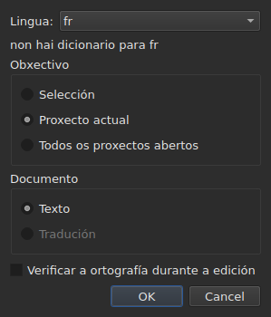
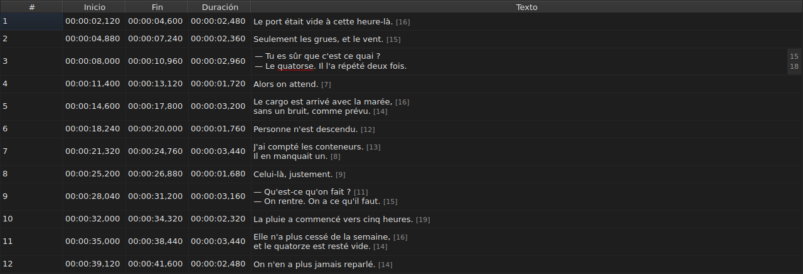
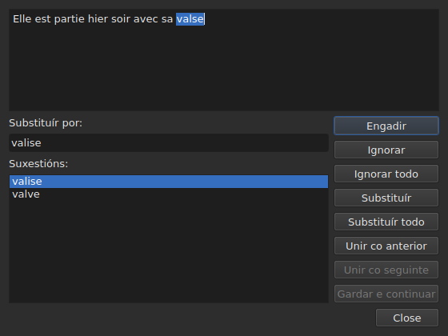

# Verificar a ortografía…

<!-- machine-translated -->
> Esta páxina é unha tradución automática e aínda non a revisou ningún lector da lingua.

`Ferramentas ▸ Verificar a ortografía…` percorre as palabras que o dicionario non coñece,
unha a unha, segundo o modelo do corrector ortográfico de Gaupol. Ten un compañeiro,
`Ferramentas ▸ Configuración da corrección ortográfica…`, que fixa a lingua, o obxectivo e o documento, e o subliñado mentres se escribe.
Os dous apóianse nos dicionarios do sistema, a través de Enchant.

A etiqueta do primeiro escríbese `Chec&k Spelling…`: `C` xa é
o acelerador de `Correct Texts…`, e `k` está libre no menú `Tools`.
Ningún dos dous ten atallo.

**Os dous están desactivados nun documento sen ningún subtítulo**, como
[`Correct Texts…`](correct-texts.md): non hai nada que verificar. `Check Spelling…`
tamén está desactivado se non hai dicionario para a lingua fixada, véxase
[Sen dicionario](#sen-dicionario).

## Configuración da corrección ortográfica…




| Grupo | Opcións | Predeterminado |
| :---- | :------ | :------ |
| `Language` | os códigos de lingua que ofrece o sistema, e o xa escollido | a lingua do sistema, se está entre eles |
| `Target` | `Selection`, `Current Project`, `All Open Projects` | `Current Project` |
| `Document` | `Text`, `Translation` | `Text` |
| `Check spelling while editing` | unha caixa de verificación, véxase [Subliñar mentres se escribe](#subliñar-mentres-se-escribe) | desmarcada |

`Selection` está desactivado se non hai ningunha liña escollida na lapela mostrada; `Translation`
está desactivado mentres ningún proxecto aberto leve unha tradución. Un axuste
lembrado que xa non está dispoñible — unha selección baleira, unha tradución ausente —
ábrese en `Current Project` ou `Text`. `OK` conserva a configuración, `Cancel` non cambia
nada.

**Esta xanela non depende do dicionario**: segue activada mentres o
documento teña subtítulos, mesmo sen dicionario para a lingua fixada, e é
a que permite saír dunha lingua que non ten ningún. A lingua para a que non
existe dicionario segue sendo editable e aparece na lista, con, debaixo
dela, a frase `no dictionary for` seguida do seu código.

**Os catro axustes lémbranse** dunha sesión á seguinte, no
ficheiro de configuración de `subedit` — véxase [As preferencias](preferences.md) para a súa
localización:

| Clave | Valores | Predeterminado |
| :-- | :----- | :------ |
| `spell-check.language` | un código de lingua, como `fr_FR`; baleiro: a lingua do sistema | baleiro |
| `spell-check.target` | `selection`, `current-project`, `all-projects` | `current-project` |
| `spell-check.document` | `main`, `translation` | `main` |
| `spell-check.inline` | `true` ou `false` — subliñar as palabras descoñecidas no editor dunha cela | `false` |

Un valor que a clave non acepta ignórase, aplícase o predeterminado, e a opción
nómease na saída de erro cando se abre a xanela — véxase
[As preferencias](preferences.md#o-que-pasa-cando-o-ficheiro-non-di-o-que-se-agarda).

## Subliñar mentres se escribe




A caixa de verificación `Check spelling while editing` de `Spell-Check Settings…` subliña,
**cunha liña vermella ondulada e mentres se escribe**, cada palabra descoñecida no editor dunha
cela de texto — o da columna `Text` así como o da
columna `Translation`. O subliñado segue a escritura: aparece, móvese e
desaparece coa palabra. **Está desmarcada de forma predeterminada**, como en Gaupol: sen
ela, nada cambia no editor.

**A lingua é a de `Language:`**, na mesma xanela, e as palabras descoñecidas
son as que atoparía `Check Spelling…`: os mesmos casos de inglés coloquial
(`goin'`, `we'd`, `1st`), a mesma división en palabras. Unha palabra subliñada non se corrixe
desde un menú: a caixa de verificación só a mostra.

**Sen dicionario para a lingua fixada, o editor queda en silencio**: nada se
subliña e nada falla, e a frase `no dictionary for` da xanela di
por que. A caixa de verificación aplícase aos editores abertos despois dela; un editor xa
aberto conserva o que tiña.

## O percorrido




A xanela mostra o texto do subtítulo onde se detivo, coa palabra descoñecida
seleccionada nel. **En cada palabra descoñecida, a lapela do proxecto volve e a
liña do subtítulo selecciónase na táboa.** O percorrido vai subtítulo
tras subtítulo, e despois proxecto tras proxecto cando o obxectivo designa varios.

Baixo o texto: a caixa `Replace with:`, enchida coa primeira suxestión, e a
lista `Suggestions:`. Escoller unha suxestión cópiaa na caixa; escribir na
caixa renova a lista.

| Botón | O que fai |
| :----- | :----------- |
| `Add` | engade a palabra ao dicionario persoal do usuario e pasa á seguinte |
| `Ignore` | deixa esta palabra e pasa á seguinte |
| `Ignore All` | deixa esta palabra, e todas as súas outras aparicións durante este percorrido |
| `Replace` | substitúe a palabra polo contido de `Replace with:`; desactivado mentres a caixa estea baleira |
| `Replace All` | fai o mesmo coas súas outras aparicións; desactivado mentres a caixa estea baleira |
| `Join with Previous` | une a palabra á palabra anterior; desactivado se non hai ningunha, ou se non están separadas por un espazo |
| `Join with Next` | une a palabra á palabra seguinte, nas mesmas condicións |
| `Save and Resume` | conserva o texto tal como o leva a área de texto, e retoma a lectura **deste texto desde o seu comezo** |
| `Close` | pecha a xanela |

**A área de texto é editable.** En canto se escribe nela, só `Save and Resume`
segue activado: os outros xestos actúan sobre a palabra escollida, que xa non é
a do texto.

**O percorrido remata só** cando non queda ningunha palabra descoñecida: os
botóns desactívanse, o texto baléirase. Un obxectivo sen ningunha palabra descoñecida
non mostra ningunha xanela.

### Pechar a medio camiño

`Close`, ou a cruz da xanela, **aplica o que se fixo**, como o final
do percorrido: os textos xa deixados, **e** os xestos — substituír,
substituír todo, unir — xa feitos sobre o texto actual. É unha diferenza respecto de
Gaupol, que perde o texto actual. O que non conta é o que queda do percorrido, nin
os retoques escritos na área de texto que `Save and Resume` non
validou.

**Unha soa entrada do historial por proxecto tocado**, sexa cal sexa o número de
substitucións: `Undo` desfai todas as correccións dese proxecto dunha vez.
O menú noméaa `Undo: correcting texts`. A barra de estado dá entón o
reconto:

```text
Edited 2 and removed 0 subtitles
```

**A lista de substitucións** — o que substituíu o usuario, e con que —
escríbese ao pechar en `spell-check/<language>.repl`, baixo o directorio de configuración
de `subedit`, e non no de Gaupol, que nunca se le.
Despois conta entre as suxestións do corrector ortográfico, aquí como en
[`Correct Texts…`](correct-texts.md#unir-ou-dividir-palabras--unión-e-división-segundo-o-corrector-ortográfico).
Se non se pode escribir, unha caixa de erro dio, `Could not save the
replacements for` seguido da lingua e do motivo, sen cancelar as
correccións.

## Sen dicionario

Cando a lingua fixada — a do sistema, se non se escolleu ningunha — non ten
dicionario, **`Check Spelling…` está desactivado**, e a súa axuda emerxente así como a barra
de estado, cando se pasa o rato pola entrada, din por que:

```text
no dictionary for fr
```

`Spell-Check Settings…` queda, para escoller unha lingua que teña un. Unha xanela
compilada sen ningún provedor de dicionarios di o mesmo e non verifica
nada.

## As mensaxes

| Mensaxe | Onde | O que a provoca |
| :------ | :---- | :--------------- |
| `no dictionary for fr` | axuda emerxente e barra de estado | ningún dicionario para a lingua fixada |
| `Nothing to check.` | barra de estado | o obxectivo non designa ningún texto — unha selección baleira, por exemplo |
| `Edited N and removed M subtitles` | barra de estado | ao final ou ao pechar; `M` queda en `0` |
| `Could not save the replacements for fr: …` | caixa de erro | a lista de substitucións non se escribiu |

## Un exemplo

Un ficheiro aberto leva `Elle est partie hier soir avec sa valse`. O dicionario
francés está presente: `Ferramentas ▸ Verificar a ortografía…` detense en `valse`, selecciona a
liña na táboa, e propón `valise`, xa en `Replace with:`. `Replace`
e despois `Close`: a liña pasa a ser `Elle est partie hier soir avec sa valise`, e a
barra de estado di:

```text
Edited 1 and removed 0 subtitles
```
