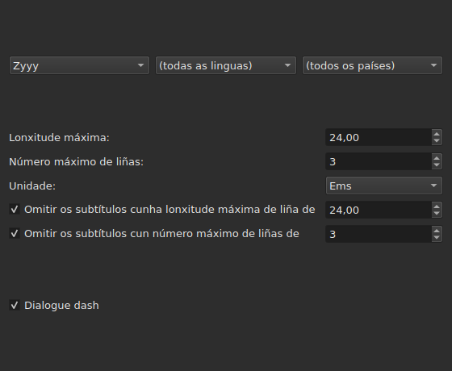
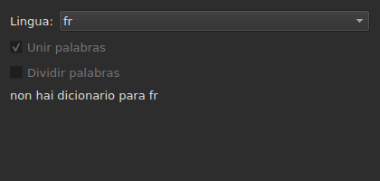
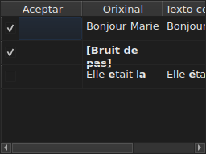

# Corrixir os textos…

<!-- machine-translated -->
> Esta páxina é unha tradución automática e aínda non a revisou ningún lector da lingua.

`Ferramentas ▸ Corrixir os textos…` abre un asistente de varias páxinas, segundo o modelo
do de Gaupol: unha páxina de obxectivo e tarefas, unha páxina por cada tarefa marcada,
unha páxina de progreso, e unha páxina de confirmación que propón os
cambios sen impoñelos nunca.

**Desactivado nun documento baleiro**: non hai nada que corrixir.

**A liña de ordes fai o mesmo** para todas as tarefas: [`subedit-cli correct`](../subedit-cli/correct.md), cos
mesmos padróns e as mesmas contas — e en caracteres alí onde a xanela mide en ems.
**Le catro dos axustes lembrados deste asistente** de maneira predeterminada — as dúas clases de
erros comúns (`Human`, `OCR`), `Remove all blank subtitles` e o número máximo de liñas de
`Line Break` — e toma todo o demais (as tarefas, o seu código, a lonxitude das liñas, a lingua,
as caixas dos padróns) da súa propia liña. Véxase
[Dous bloques, un compartido coa liña de ordes](preferences.md#dous-bloques-un-compartido-coa-liña-de-ordes)
e [`subedit-cli config`](../subedit-cli/config.md).

## Tarefas e obxectivo — a primeira páxina

| Grupo | Opcións | Predeterminado |
| :---- | :------ | :------ |
| `Target` | `Selection`, `Current Project`, `All Open Projects` | `Current Project` |
| `Document` | `Text`, `Translation` | `Text` |
| `Tasks` | `Mentions`, `Join or Split Words`, `Common Errors`, `Capitalization`, `Line Break` — para marcar, unha ou máis | `Common Errors` e `Capitalization` marcadas, as outras tres non |

`Selection` está desactivada se non hai ningunha liña escollida na lapela mostrada; `Translation`
está desactivada mentres ningún proxecto aberto leve unha tradución.

**O obxectivo e o documento non se lembran**: o asistente sempre se reabre
en `Current Project` e `Text`. As tarefas marcadas, pola súa banda, si se lembran.

**O que designa cada obxectivo**:

| Obxectivo | Actúa sobre |
| :----- | :------ |
| `Selection` | as liñas escollidas na lapela mostrada |
| `Current Project` | todo o ficheiro da lapela mostrada |
| `All Open Projects` | todo o ficheiro de cada lapela aberta |

**`All Open Projects` sobre `Translation` salta os proxectos sen tradución**:
un proxecto que non leva ningunha non ten nada que propor nunha columna baleira, e
o asistente non o conta.

**As páxinas das tarefas seguen a orde de Gaupol — `Mentions`,
`Join or Split Words`, `Common Errors`, `Capitalization`, `Line Break` —, nunca aquela na que se
marcaron as caixas.** Unha tarefa desmarcada non ten páxina; os seus axustes
lembrados non cambian por iso. **Ningunha páxina de tarefa leva a súa propia
caixa «activa»**: é a desta primeira páxina, e só ela, a que
decide se a tarefa se executa.

## As páxinas das tarefas

Cada unha das catro páxinas de padróns — todas agás `Join or Split Words`, que non ten ningún — leva a mesma base: tres menús
despregables en cascada — escritura, lingua, país — para escoller o código dos padróns que
aplicar, e despois a lista dos padróns dese código, un para marcar por nome. **Os
tres menús só ofrecen o que o catálogo de padróns leva
realmente** — os que se distribúen co programa e os que un usuario
depositou alí (véxase [Os padróns depositados](#os-padróns-depositados)) —, nunca unha lista
de linguas ou países lida noutro sitio. `Zyyy` («calquera escritura») é o código
de partida de `Common Errors`, que dá os padróns válidos en todas partes. **Os outros
tres tipos só teñen padróns baixo unha escritura**: a súa páxina ábrese na
primeira que ofrece o catálogo, `Latn` cos padróns distribuídos, e non en `Zyyy`.

**A descrición de cada padrón é a axuda emerxente da súa caixa.** Os nomes e as descricións seguen a
lingua da xanela para os padróns distribuídos co programa; un padrón propio móstrase tal como
o escribe o seu ficheiro ([Lingua](invocation.md#lingua)).

**Un padrón desmarcado segue desmarcado ata que se marca de novo**, incluso ao
cambiar de código e volver a el despois, e esa escolla lémbrase dunha apertura
do asistente á seguinte. Marcado de novo, simplemente recupera o seu axuste
orixinal, e a escolla lembrada desaparece.

| Páxina | O que engade á base |
| :--- | :----------------------- |
| `Mentions` | dúas caixas de verificación, `Sound in brackets` e `Sound in parentheses`, desmarcadas de maneira predeterminada |
| `Common Errors` | dúas caixas de verificación, `Human` e `OCR`, marcadas de maneira predeterminada |
| `Capitalization` | nada máis |
| `Line Break` | unha lonxitude máxima (`24`, de maneira predeterminada), un número máximo de liñas (`3`), unha unidade — `Characters` ou `Ems`, `Ems` de maneira predeterminada —, e dúas condicións de omisión, descritas máis abaixo |

**As dúas caixas de `Mentions` non nomean ningún padrón compilado**:
dirixen unha análise do texto no núcleo, a mesma que
[`Remove Hearing-Impaired Mentions…`](operations.md#remove-hearing-impaired-mentions)
xa fai nun xesto directo. Abonda con que estea marcada unha **ou** a outra para lanzala. **A lista de padróns da páxina non as repite**: eses dous nomes só aparecen nela unha vez, como caixas de verificación.

**`Common Errors` filtra por clase**: un padrón que leva as dúas clases
aplícase en canto unha das dúas caixas está marcada; as outras tres páxinas non
coñecen esta distinción.

### Salto de liña — a unidade e a omisión




| Axuste | O que fai | Predeterminado |
| :------ | :----------- | :------ |
| `Maximum length` | a lonxitude dunha liña, na unidade escollida; de `1` a `1000` | `24` |
| `Maximum lines` | o número de liñas que se procura; de `1` a `100` | `3` |
| `Unit` | `Characters` conta caracteres; `Ems` mide a largura co tipo de letra da xanela, no que unha letra minúscula media vale `0.55` — a unidade de Gaupol | `Ems` |
| `Skip subtitles with maximum line length of` | deixa tal como está un subtítulo cuxa liña máis longa cabe nesta lonxitude, na unidade escollida | marcada, `24` |
| `Skip subtitles with maximum line amount of` | deixa tal como está un subtítulo cuxo número de liñas cabe neste número | marcada, `3` |

**A omisión ten os seus propios limiares**, distintos dos límites que se procuran: é
a regra de Gaupol. Un subtítulo déixase tal como está se cabe en **todos os
limiares cuxa caixa está marcada**; se non, divídese, e a división
só se conserva se achega o subtítulo a un limiar que superaba — menos
lonxitude, ou menos liñas. Ningunha caixa marcada: divídense todos os subtítulos,
caiban xa ou non.

**Cambiar a unidade cambia o que se propón**: a lonxitude de cada liña
mídese en cada cálculo, na unidade da páxina nese momento, e non queda
nada dunha medida anterior. Un texto de vinte e nove caracteres, a metade
deles letras estreitas, supera `24` en `Characters` e cabe folgadamente
en `Ems`.

**Os sete axustes lémbranse** dunha sesión á seguinte, unidade incluída.

### Unir ou dividir palabras — unión e división segundo o corrector ortográfico




Unha páxina á parte, entre `Mentions` e `Common Errors`, para reparar o que
o software de recoñecemento de texto lles fai aos espazos. Non ten lista de
padróns: apóiase nos dicionarios do sistema, a través de Enchant.

| Axuste | O que fai | Predeterminado |
| :------ | :----------- | :------ |
| `Language` | a lingua do dicionario; os códigos que ofrece o sistema, e o xa escollido | a lingua do sistema, se está entre eles |
| `Join words` | une unha palabra mal escrita á palabra veciña | marcada |
| `Split words` | corta en dúas unha palabra mal escrita | desmarcada |

**Unión**: unha palabra mal escrita únese á palabra anterior ou á
seguinte **se, e só se, unha soa das dúas direccións dá unha palabra
ben escrita**. Cando as dúas dan unha, ou ningunha, non se fai nada.
`bon jour` convértese en `bonjour`; dous espazos seguidos redúcense primeiro a
un, pero un texto no que non se une nada devólvese tal como estaba, espazos
incluídos.

**División**: unha palabra mal escrita córtase se, entre as suxestións do
corrector ortográfico, **unha soa** é esa palabra cun espazo dentro — as mesmas
letras, na mesma orde. Dúas suxestións dese tipo, ou ningunha: non se fai
nada. Unha palabra na que só a inicial é maiúscula (`Bonjourtous`)
nunca se divide: adoita ser un nome, e os dicionarios non os teñen.

**A lista de substitucións do usuario** (`spell-check/<language>.repl`,
no directorio de configuración do programa) conta entre as suxestións do
corrector ortográfico; o asistente léa e non a escribe.

**Sen dicionario para a lingua escollida, a páxina segue alí e en gris**: as
dúas caixas están desactivadas e a páxina di `no dictionary for` seguido do código da
lingua. A lingua segue sendo editable — pode haber un dicionario para outra —,
e a tarefa, marcada ou non na primeira páxina, non fai entón nada e
non indica ningún erro.

**A lingua, as dúas caixas e a caixa da primeira páxina lémbranse** dunha
apertura do asistente á seguinte.

### Os padróns depositados

Un padrón que un usuario depositou no seu propio directorio de padróns
engádese aos distribuídos co programa, no mesmo catálogo e baixo os
mesmos menús — unha vez cargados, nada os distingue.

| Padróns | Onde |
| :------- | :---- |
| distribuídos | `<prefix>/share/subedit/patterns`, xunto a `<prefix>/bin` |
| os do usuario | `$XDG_DATA_HOME/subedit/patterns`, ou `~/.local/share/subedit/patterns` se a variable non está definida ou non é unha ruta absoluta |

**O formato é o de Gaupol, lido tal cal**: un ficheiro `<Code>.<type>` por escritura,
lingua e país — `Latn-en.common-error` —, coa súa activación `.conf` ao lado. Os tipos
son `common-error`, `capitalization`, `hearing-impaired` e `line-break`. Os ficheiros
distribuídos serven de modelo. **Os padróns lense unha vez, no inicio**: un ficheiro
depositado mentres a xanela está aberta só se ve no seguinte inicio.

## Progreso

Unha vez premido `Next` desde a última páxina de tarefa marcada (ou desde a
primeira páxina se non hai ningunha tarefa marcada), o asistente calcula as correccións
propostas nun fío en segundo plano, cunha barra de progreso indeterminada na
pantalla. Unha vez rematado o cálculo, a páxina de confirmación ábrese por si mesma.

**`Cancel` nesta etapa abandona o cálculo sen interrompelo**: non se aplica
nada, pero o asistente agarda, antes de pecharse, a que remate o cálculo en
curso — unha espera limitada polo tempo máximo que o motor de
padróns impón a cada busca.

**`Back` nesta etapa volve á páxina anterior sen agardar**: o cálculo
remata en segundo plano e o seu resultado descártase — o asistente non salta
por si mesmo á confirmación. `Next` inicia un novo cálculo.

## Confirmación — a última páxina




Unha liña por cada texto que o asistente cambiaría — nunca unha liña para un
texto que unha tarefa deixou tal como está.

| Columna | O que mostra |
| :----- | :------------ |
| `Accept` | unha caixa de verificación, marcada de maneira predeterminada: a corrección aplicarase ou non |
| `Original` | o texto tal como está, coa parte que cambiaría **en negra** |
| `Corrected Text` | o texto proposto, coa parte cambiada en negra, **editable** — retocalo cambia o que se escribirá, sen cambiar a caixa `Accept` |

**O cambio márcase en negra, nunca en cor**: a mesma diferenza lese
nas dúas paletas sen depender de ningunha tinguidura.

**Unha liña cuxa proposta é unha eliminación** — ao subtítulo non lle quedaría
texto — mostra a columna `Corrected Text` baleira, e todo o seu `Original` en
negra.

| Botón | O que fai |
| :----- | :----------- |
| `Mark All` | marca `Accept` en todas as liñas |
| `Unmark All` | desmarca `Accept` en todas as liñas |
| `Preview` | pon o reprodutor integrado no subtítulo da liña escollida, se o proxecto ten unha película — nada se non ten ningunha |
| `Finish` | aplica as liñas marcadas e pecha o asistente |

`Remove all blank subtitles`, marcada de maneira predeterminada, elimina os subtítulos
que unha corrección deixaría sen ningún texto en lugar de conservalos baleiros.

**Un padrón que o cálculo non puido aplicar nómease baixo a táboa**, co
motivo:

```text
Not applied: some pattern (will not compile)
```

Un padrón nomeado deste xeito nómease **unha vez por motivo**, sexa cal sexa o número de
textos ou de proxectos nos que fallou: a pantalla non di en cales.

| Motivo | O que o provoca |
| :----- | :--------------- |
| `cannot be translated` | a expresión usa algo que a tradución da sintaxe de Python rexeita |
| `will not compile` | o motor rexeita a expresión |
| `has an invalid replacement` | a substitución non se le como a le Python |
| `timed out` | unha busca superou o tempo que o motor lle concede sobre un texto |
| `never settled` | `Repeat` seguía cambiando o texto despois de cen pasadas |
| `grew the text too long` | o texto superou os 16 384 bytes mentres o padrón traballaba nel |

**Un padrón que falla nun texto déixao tal como estaba antes del**: unha substitución
feita a medias vale menos ca ningunha substitución. Os demais padróns aplícanse.

**Unha liña dun ficheiro de padróns que non se pode ler nómease no mesmo
lugar**, polo seu ficheiro, a súa liña e o motivo — en cada apertura do
asistente, xa que os padróns só se len unha vez, no inicio:

```text
Could not be read: Zyyy.common-error, line 8 (malformed line)
```

| Motivo | O que o provoca |
| :----- | :--------------- |
| `directory cannot be read` | non se puido percorrer o directorio dos padróns distribuídos |
| `file cannot be read` | non se puido ler un ficheiro de padróns |
| `malformed line` | unha liña que non é nin unha cabeceira, nin un comentario, nin `Key=Value` |
| `field outside any pattern` | un `Key=Value` antes da primeira cabeceira de padrón |
| `unknown field` | unha clave que non lle serve a este tipo de padrón — o padrón consérvase |
| `missing field` | unha clave sen a que este tipo de padrón non pode facer nada — o padrón descártase |
| `invalid value` | un valor que a clave non acepta — o padrón descártase |
| `malformed activation` | un elemento `<pattern>` dun `.conf` que non nomea nada |

Os demais padróns, os que se leron e se aplicaron correctamente, non están
afectados.

## O que di desfacer, e o que `Cancel` nunca fai

**`Finish` fai unha entrada do historial por cada proxecto tocado**, nunca unha por
corrección: `Undo` desfai dunha vez todas as correccións aceptadas nese
proxecto, cada unha co texto que tiña. O menú chámaa
`Undo: correcting texts`.

A barra de estado dá a conta, primeiro os textos cambiados, despois os subtítulos
eliminados:

```text
Edited 3 and removed 1 subtitles
```

**`Cancel`, en calquera páxina, non aplica nada nin lembra nada** — nin
os axustes escollidos durante esta apertura, nin a máis mínima corrección. A
seguinte apertura do asistente parte de novo dos axustes de antes.

## Un exemplo

Un ficheiro aberto leva dous espazos entre dúas palabras dunha liña e unha
mención entre corchetes sen ningún outro texto. `Ferramentas ▸ Corrixir os textos…`,
`Common Errors` xa marcada, `Next` ata a confirmación: a liña cos dous espazos
mostra `Bonjour  Marie` á esquerda, `Bonjour Marie` á dereita, a corrección en
negra e xa aceptada. `Finish` aplícaa, e a barra de estado di:

```text
Edited 1 and removed 0 subtitles
```
