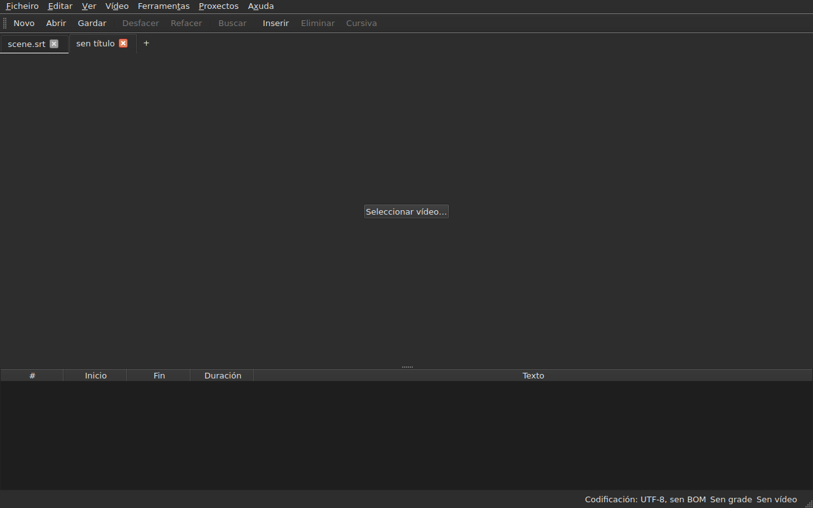
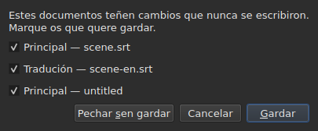
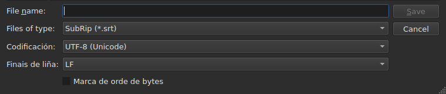
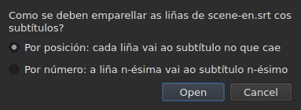
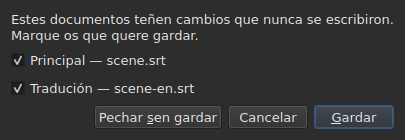

# Abrir e gardar

<!-- machine-translated -->
> Esta páxina é unha tradución automática e aínda non a revisou ningún lector da lingua.

O menú **Ficheiro** leva as tres ordes, dúas para as lapelas, e tres
máis para a tradución; o menú **Proxectos** actúa sobre todas as lapelas á vez.

| Orde | Atallo | O que fai |
| :------ | :------- | :----------- |
| Novo proxecto | `Ctrl+N` | un proxecto baleiro, nunha lapela nova — tamén o botón `+` despois da última lapela |
| Abrir… | `Ctrl+O` | escolle un ficheiro e ábreo nunha lapela nova — ou no lugar dun proxecto en branco |
| Abrir tradución… | — | escolle un ficheiro de tradución e alíñao co ficheiro principal da lapela actual |
| Gardar | `Ctrl+S` | reescribe o ficheiro aberto |
| Gardar como… | `Ctrl+Shift+S` | escolle unha ruta e un formato, e despois escribe |
| Gardar tradución | — | reescribe o ficheiro da tradución |
| Gardar tradución como… | — | escolle unha ruta e un formato para a tradución, e despois escribe |
| Pechar | `Ctrl+W` | pecha a lapela actual — desactivada se só hai unha |

`New Project`, `Open…` e `Save` tamén están na
[barra de ferramentas](index.md#a-barra-de-ferramentas), coas palabras `New`, `Open` e
`Save`. **As tres entradas da
tradución non están na barra**: só serven a quen ten unha
tradución, e a barra é de todo o mundo.

## Varios proxectos, en lapelas

**Cada proxecto aberto ten a súa lapela**, por riba da imaxe e da táboa:
a súa etiqueta é o nome do ficheiro, ou `untitled` para un proxecto que aínda non
ten ningún. Facer clic nunha lapela cambia a ela; `Ctrl+PageDown` e `Ctrl+PageUp` fan
o mesmo, sen o rato, e volven á primeira lapela despois da última.
**O botón `+`, xusto despois da última lapela**, abre un proxecto baleiro nunha
lapela nova, como `New Project`.




**`Open…` nunca as toca.** Abrir un ficheiro xa non substitúe o que a
xanela mostraba: chega nunha lapela nova, ao lado, e a lapela que se estaba
a mirar antes conserva todo o que tiña — o seu historial, a súa selección, o seu
vídeo asociado. Por iso tamén abrir xa non pregunta nada: non hai
nada que perder, xa que non hai nada que substituír.

**Unha excepción: o proxecto en branco cede o seu sitio.** Iniciada sen ficheiro, ou
despois de `New Project`, a xanela mostra un proxecto `untitled` sen nada dentro.
Un ficheiro aberto — con `Open…` igual que soltándoo — **ocupa entón a súa lapela,
no mesmo lugar da barra**, en vez de abrir outra ao lado dun
proxecto inútil. Un proxecto está en branco cando **non ten ficheiro, nin subtítulo,
nada que desfacer nin refacer, nin película, e nunca se modificou**: calquera
destas cousas basta para que conserve a súa lapela. Un proxecto en branco que non é
a lapela actual non se toca.

**Un ficheiro xa aberto non se abre unha segunda vez.** `Open…` sobre un
ficheiro que xa ten outra lapela devolve o foco a esa lapela, e dío
na barra de estado:

```text
premier.srt: already open
```

**Cada lapela é un proxecto enteiro, independente dos demais**: o seu
historial, a súa selección, o seu vídeo asociado e o que atopou a súa última
lectura só se mostran cando esa lapela é a actual, e non
cambian mentres o é outra. **Unha excepción, e está no ADR
0033**: o reprodutor de vídeo é único para toda a xanela — un só proceso
mpv — e a súa película cambia coa lapela; **cada lapela lembra onde estaba a súa
película**, e retómaa alí, en pausa, cando se volve a ela. O portapapeis, pola súa parte, pertence á xanela: copiar
nunha lapela e pegar noutra é para o que se abren dúas.

**`Close` pecha a lapela actual**, facendo se cómpre
[a pregunta dos cambios sen gardar](#cambios-sen-gardar) —
a desta lapela soa, sen que as demais se vexan afectadas. **Desactivada cando só
hai unha lapela**: a xanela sempre conserva polo menos unha, e pechala
sería pechar a xanela — o que xa fai o botón do sistema.

**Cada lapela leva tamén unha cruz**, que pecha **o seu** proxecto, coa mesma
pregunta. A cruz dunha lapela que non é a actual pecha esa, e
a lapela que se está a mirar segue mostrándose; se ese proxecto ten cambios, a súa
lapela pasa ao primeiro plano durante a pregunta. **Non hai cruz cando só
queda unha lapela**, polo mesmo motivo polo que `Close` está desactivada.

**Unha lapela di que está modificada**: unha estrela segue o seu nome, `premier.srt*`,
mentres un dos seus documentos difira do seu ficheiro — como di o título da xanela
do proxecto que se está a mirar. Desaparece ao gardar.

## O menú Proxectos

Dúas ordes actúan sobre todos os proxectos á vez.

| Orde | Atallo | O que fai |
| :------ | :------- | :----------- |
| Gardar todos | `Ctrl+Shift+L` | escribe cada documento modificado, lapela por lapela |
| Pechar todo | `Ctrl+Shift+W` | pecha todos os proxectos — é dicir, a xanela |

**`Save All` segue a orde das lapelas**, o documento principal antes da tradución.
Un documento que ten un ficheiro reescríbese alí **sen que a súa lapela pase ao primeiro plano**;
**un documento que non ten ningún abre `Save As…`, un de cada vez**, na súa lapela —
o único caso no que `Save All` cambia de lapela, para que a caixa mostre de que
proxecto se trata. **Cancelar un `Save As…`, ou un
gardado que falla, detén o resto**: os proxectos seguintes non se
tocan, e unha caixa di o que se escribiu.

```text
Save All stopped: 1 of 3 documents saved
```

Cando todo está escrito, a barra de estado dío — `2 documents saved`, ou
`Nothing to save` cando non se modificou nada. Se un `Save As…` trouxo
unha lapela ao primeiro plano, a xanela volve despois a aquela onde se
lanzou a orde.

**`Close All` e a cruz da xanela son unha mesma cousa**: a xanela
sempre conserva un proxecto, e pechalos todos é pechala. Por iso fan
**unha soa pregunta para todos os proxectos**, a mesma que con
[dous documentos modificados](#pechar-con-dous-documentos-modificados), cunha caixa de verificación
por documento modificado de cada lapela:




**`Cancel` non pecha nada**, e non deixa nada escrito. `Save` escribe os
documentos marcados como `Save All`: detrás da súa lapela, agás un documento sen
nome, cuxa lapela pasa ao primeiro plano para o seu `Save As…`. Cun só documento
modificado en todos os proxectos, é a pregunta simple que sempre se
fixo, na súa lapela. `Save All As…` non existe: é unha serie de
`Save As…`, que `Save All` xa pide, un de cada vez, para os documentos sen nome.

## Abrir

O diálogo filtra **os nove formatos que se len**, unha entrada para cada un, e unha primeira
entrada que os mostra todos. O formato recoñécese despois **polo contido, non pola
extensión**: un `.txt` que contén SubRip ábrese, e o filtro non decide
nada — só oculta ficheiros.

| Entrada do filtro | Extensión |
| :----------- | :-------- |
| `SubRip` | `.srt` |
| `WebVTT` | `.vtt` |
| `SubViewer 2` | `.sub` |
| `Sub Station Alpha` | `.ssa` |
| `Advanced SSA` | `.ass` |
| `MicroDVD` | `.sub` |
| `MPL2` | `.txt` |
| `TMPlayer` | `.txt` |
| `LRC` | `.lrc` |

**Dúas extensións designan dous formatos cada unha** — `.sub` é SubViewer 2 e
MicroDVD, `.txt` é MPL2 e TMPlayer. Non ten ningunha consecuencia ao abrir,
xa que decide o contido; ao gardar, é o **nome** da
entrada escollida o que dá o formato, nunca o seu padrón.

**Un ficheiro ilexible non abre nada.** Ausente, rexeitado polo sistema, escrito
nunha codificación na que os seus bytes non se descodifican, ou de ningún formato
coñecido: unha caixa modal **indica a causa**, non se abre ningunha lapela, e as que
había non se moven.

| Mensaxe | O que pasou |
| :------ | :------------ |
| `does not exist` | a ruta non designa ningún ficheiro |
| `cannot be opened: permission denied` | o sistema négase a abrilo |
| `cannot be read` | o sistema negouse por outro motivo |
| `cannot be decoded in the chosen encoding` | os bytes non se len na codificación escollida |
| `is in no format this tool knows` | ningún formato recoñece o contido |
| `holds nothing recognisable as a subtitle` | o formato recoñécese, pero nada do que contén é un subtítulo |

A mensaxe vai precedida da ruta: `notes.txt: is in no format this tool knows`.
Son as palabras da liña de ordes, e non é casualidade — as dúas
superficies len un ficheiro coa mesma receita.

### Soltar ficheiros na xanela

**Soltar ficheiros en calquera parte da xanela ábreos**, desde o
xestor de ficheiros: a táboa, a barra de lapelas, o
botón `Select Video…`, e **a propia imaxe da película**, tanto en reprodución como parada.
A imaxe é unha xanela aparte debuxada polo reprodutor, que nada garantía
que deixase pasar un ficheiro soltado; comprobouse a man nun escritorio real,
nunha sesión Wayland. `subedit-gui` lánzase alí baixo X11 para poder mostrar
a película, así que o soltado pasa polo protocolo X11 — o dunha
sesión X11, onde non se probou por separado.

- **Cada ficheiro de subtítulos abre a súa lapela**, na orde en que se
  soltaron — exactamente como `Open…`. Un ficheiro **xa aberto** non se
  le de novo: a súa lapela pasa ao primeiro plano, e a barra de estado dío
  (`premier.srt: already open`).
- **Un vídeo soltado asóciase á lapela actual**, como con
  `Select Video…`. Soltado xunto con subtítulos, vai á última lapela
  que abriron, sexa cal sexa a orde do soltado. Un vídeo recoñécese pola
  súa extensión — a mesma lista que a que propón unha película ao lado do
  ficheiro.
- **Dous vídeos ou máis á vez non se abren**: un proxecto mira unha
  soa película. Os subtítulos do mesmo soltado, pola súa parte, ábrense.
- **Un ficheiro que non se abre non detén os demais.** Unha soa caixa di entón
  o que non se puido facer, unha liña por ficheiro, coas palabras
  de `Open…`:

  ```text
  /films/notes.txt: is in no format this tool knows
  /films/absent.srt: does not exist
  ```

Só se aceptan ficheiros locais: unha ligazón arrastrada desde un navegador
non designa nada que a xanela poida ler.

Abrir desde a liña de ordes segue funcionando: `subedit-gui film.srt`.
Alí, o mesmo motivo escríbese na saída de erro, e a xanela ábrese
baleira — véxase [Invocación](invocation.md#cando-falla-a-apertura).

## Os diagnósticos dunha lectura

Un ficheiro real raramente é perfecto, e a lectura recupera en vez de
renderse: un número que falta, unha liña que non leva a ningures, finais de liña
mesturados. **O que atopou cabe nun botón da barra de estado**
— `2 diagnostics`, á esquerda do que a barra xa di do documento —, e **a lista ábrese cun clic
nunha xanela flotante** por riba do botón. Non se lle quita ningunha liña á xanela:
a táboa conserva toda a súa altura, tivese a lectura algo que dicir ou non. A lista
péchase cun clic noutro lugar ou con `Esc`.

```
a SubRip block without its number, settled by the reader: 5
```

**Cada liña conta**: o que se atopou, o que se fixo con iso, e
cantas veces. Un ficheiro mal feito atopa centos, e saber
cantos de cada tipo é o que permite actuar; o número de liña de cada aparición no
ficheiro, pola súa parte, lese na liña de ordes, co nivel de detalle `-vvv`. O
botón conta estas liñas — unha por tipo —, non as aparicións.

**A codificación adiviñada tamén aparece alí**, unha vez: propúxose sopesando os
bytes, antes de que existise unha soa liña do ficheiro.

```
an encoding nothing declared, settled by the reader: 1
```

Só se mostra cando a codificación foi **adiviñada e non é
UTF-8** — un ficheiro UTF-8 lido como tal non é ningún acontecemento, e dicilo en
cada apertura poría un botón na barra de estado de calquera documento
corrente. Un ficheiro que leva unha marca de orde de bytes tampouco o provoca:
declarou a súa codificación, non se adiviñou nada.

**A mesma lista conta tamén o que está mal nos propios subtítulos**: un
subtítulo que comeza antes de que remate o anterior, un final antes do seu
inicio, un inicio antes do do subtítulo de enriba. A táboa tínguenos, pero
unha tinguidura atópase desprazándose, e nun ficheiro de dúas mil liñas
é doado pasar unha por alto; aquí os tipos están todos xuntos, **un por
liña e co seu número**, coas palabras do informe de `inspect`:

```
subtitle starts before the previous one ends: 12
subtitle starts before the previous one starts: 3
```

**Un clic nunha delas leva ao primeiro subtítulo afectado**, seleccionado na
táboa. Estas liñas **seguen as correccións** — ordenar ou corrixir unha duración
elimina algunhas, ou baixa o seu número —, sen pechar a lista que se está a
ler. Un subtítulo pode contarse dúas veces: comezar antes do final do
anterior e antes do seu inicio son dúas constatacións, que se corrixen de dúas
maneiras. Para nomealos un a un, `subedit-cli inspect --detail`.

O botón **non aparece** cando non hai nada que indicar, nin na lectura nin
nos subtítulos, e **segue a lapela**: cada proxecto conserva os
diagnósticos da súa propia lectura, e o botón mostra os do proxecto mostrado.

## A codificación na barra de estado

**A barra de estado sempre dá a codificación do documento aberto**, á esquerda do que
di sobre a [grade de fotogramas](frame-grid.md) e o
[vídeo asociado](video.md):

| Situación | O que se escribe |
| :-------- | :-------------- |
| o ficheiro leuse como UTF-8, sen marca | `Encoding: UTF-8, no BOM` |
| … con marca | `Encoding: UTF-8, BOM` |
| un ficheiro en Latin-1 | `Encoding: ISO-8859-1, no BOM` |

**O diagnóstico e esta liña non responden á mesma pregunta**, e por iso
existen os dous. O diagnóstico di o que **fixo** a lectura — adiviñou,
e pode que se queira comprobar; por iso só se mostra cando houbo
unha adiviña. A barra de estado di o que **é** o documento,
de xeito permanente, mesmo para un ficheiro que declara el mesmo a súa codificación e sobre
o que a lectura non ten nada que contar.

**De onde vén a resposta non aparece alí.** Dáo `inspect` — `detected`,
`from its byte order mark`, `as asked for` — porque un informe ten sitio para
dicilo; unha liña da barra de estado non, e a lista de diagnósticos xa o leva cando
importa.

## Gardar

`Save` reescribe o ficheiro aberto **na súa forma orixinal**: o seu formato, a súa
codificación, os seus finais de liña, a súa marca de orde de bytes e a súa cabeceira. Un
ficheiro aberto e despois gardado sen modificacións non se move nin un byte — véxase
a garantía exacta máis abaixo.

A escritura é **atómica**: pasa por un ficheiro temporal que se renomea
por riba. Un gardado interrompido en calquera momento deixa a versión anterior
intacta.

Gardar un documento que nunca estivo no disco equivale a `Save As…`.

**Unha escritura que falla dío e non perde nada**: un disco cheo, un
ficheiro de só lectura, un directorio que falta — ou **un carácter que a codificación do ficheiro
non pode escribir**, un `ł` nun ficheiro Latin-1. A mensaxe é
entón `holds a character the chosen encoding cannot write`, e non se escribe
nada: substituír o carácter por un `?` perdería texto diante dos ollos de quen
o acaba de escribir. A mensaxe nomea o ficheiro e o motivo, a xanela conserva
as súas modificacións, e a marca do título permanece.

## Gardar como

`Save As…` pide unha ruta, un formato, **e a forma dos bytes escritos**:
a codificación, os finais de liña, a marca de orde de bytes. O documento **vive despois
alí**: o título cambia, `Save` apunta ao novo ficheiro e escribe na
forma escollida, e o ficheiro orixinal queda como estaba.

**Ofrécense os nove formatos**, e a entrada seleccionada cando se abre
a caixa é **a do documento**. Gardar con outro nome sen tocar o
filtro, polo tanto, non cambia o formato.




**As imaxes só mostran a parte inferior da caixa**, non a lista de ficheiros
de enriba: esa depende da máquina — os seus directorios, as súas datas, os seus
atallos laterais —, así que a súa fotografía nunca sería igual dúas veces.
Esta franxa si, e é onde pasa todo.

| Campo | O que ofrece | Predeterminado |
| :---- | :------------- | :------ |
| `Encoding` | catorce codificacións que leva na práctica un ficheiro de subtítulos, máis `Other…` | **a do ficheiro lido** |
| `Other…` | un campo para escribir calquera codificación que ICU poida escribir, **con completado** — `cp1257`, `EUC-KR` | — |
| `Line endings` | `LF`, `CRLF` ou `CR` | os do ficheiro lido |
| `Byte order mark` | a marca, **desactivada para unha codificación que non leva ningunha** | a do ficheiro lido |

**Os valores predeterminados son os do ficheiro lido, e iso é unha garantía máis ca unha
comodidade**: un ficheiro aberto e despois gardado de novo sen tocar estes tres
campos devolve os mesmos bytes.

**A lista é curta, e non é un teito.** ICU coñece douscentas
vinte e unha; o que ofrece o menú é o que leva na práctica un ficheiro de subtítulos,
porque un menú de douscentas entradas non axuda a ninguén. `Other…`
abre o resto.

**O campo completa sobre as douscentas vinte e unha**, así que non cómpre
saber o nome exacto: escribir `1252` propón `windows-1252`, escribir `koi`
propón `KOI8-R` e `KOI8-U`. O completado faise sobre o que o nome **contén**
e non sobre o que comeza — o nome canónico de Windows Western é
`windows-1252`, e `cp1252` é o que a xente ten en mente. Os dous tamén se poden
escribir enteiros sen completado: ICU acepta os seus propios alias.

**Un nome que ninguén coñece non escribe nada.** Escribir `klingon-1` non
recorre a UTF-8: non se escribe nada, e a mensaxe dío.

**Tampouco un nome que non indica a súa orde de bytes.** `UTF-16` e `UTF-32` son
nomes que ICU coñece, cuxo conversor escribe **a súa propia marca**: a
caixa de verificación `Byte order mark` deixaría entón de decidir nada. Os dous
rexéitanse, e a mensaxe remite a `UTF-16LE` ou `UTF-16BE`, que escriben
os mesmos bytes baixo o control da caixa de verificación. É o mesmo rexeitamento, coas
mesmas palabras, que o da liña de ordes.

**Un carácter que a codificación escollida non pode escribir detén o gardado**
— un `ł` en Latin-1. A mensaxe é
`holds a character the chosen encoding cannot write`, a xanela conserva as súas
modificacións, e o ficheiro de destino non se toca.

**O documento tampouco se move**: queda no seu ficheiro, no seu
formato e na súa codificación, e o seguinte `Save` reescribe o que se abriu.
Un gardado que non tivo lugar non cambia absolutamente nada — nin no disco,
nin na xanela.

Cambiar de formato cambia o que mostra a táboa — o separador decimal segue o
formato, unha coma para SubRip, un punto para WebVTT, e **as etiquetas reescríbense
no vocabulario do formato de destino**: un `<i>` pasa a ser `{\i1}` en Sub
Station Alpha, `{Y:i}` en MicroDVD, `/` ao comezo dunha liña en MPL2. O documento
**converteuse** nese ficheiro, así que a táboa mostra o que leva o ficheiro.

**Non é unha orde, e `Ctrl+Z` non o desfai.** Un documento cuxo
formato dixese LRC e cuxos textos aínda dixesen `<i>` sería un
documento incoherente; non hai ningunha metade que desfacer.

## O que un formato non levará, dito antes de escribir

**Unha caixa modal avisa, e aínda se pode responder que non.** Lista o que
o formato de destino non conservará, elemento por elemento, coas palabras que a liña
de ordes escribe despois:

```
ends are not carried by LRC, line breaks were joined in 2 subtitles, 1 tag dropped
```

| Botón | Efecto |
| :----- | :----- |
| `Save` | escribe igualmente, aceptando a perda |
| `Cancel` | non escribe nada; o documento non se move, nin ficheiro nin formato |

`Cancel` é o botón predeterminado: unha tecla Enter premida sen ler conserva o
ficheiro tal como está.

**Non se pregunta nada cando non se perde nada.** Unha caixa que anunciase «non
se perderá nada» ensinaría a descartar a que importa.

O que se pode anunciar:

| Elemento | Cando |
| :--- | :--- |
| os finais | o formato de destino non leva ningún — TMPlayer, LRC |
| os saltos de liña | o formato de destino non leva ningún — LRC |
| as etiquetas | unha etiqueta da orixe non ten equivalente no destino, ou o pivote non a coñece |
| a cabeceira | o ficheiro lido levaba unha, e non pasa ao outro lado |
| os campos declarados | a orde das columnas SSA, a forma do tempo TMPlayer |
| a precisión | o formato de destino conta de xeito máis groso — a décima de MPL2, o segundo de TMPlayer |

**O que pertence ao outro formato déixase de lado.** Un ficheiro WebVTT
leva identificadores de indicación e axustes de colocación; SubRip leva
coordenadas de visualización. Escribir no outro formato ignóraos en vez de
traducilos ao chou — non se perden por iso, simplemente
non se escriben.

## A garantía da viaxe de ida e volta

Ten dúas metades, e cómpren as dúas:

- **fiel byte a byte** nun ficheiro que xa está na disposición que
  escribe `subedit` — a de Gaupol, liña baleira final incluída —, e **sexa cal sexa
  a súa codificación**: un ficheiro en CP1252 ou en UTF-16 reescríbese na
  súa propia, marca incluída;
- **idempotente** no resto dos casos: o primeiro gardado normaliza a disposición,
  e ningún dos seguintes xa non toca nada.

En concreto, un ficheiro cuxo último bloque non vai seguido dunha liña baleira
gaña unha, unha vez. É o único cambio que pode producir un gardado sen
modificacións.

## Abrir unha tradución

`Ficheiro ▸ Abrir tradución…` coloca un **segundo ficheiro** ao lado do principal.
A entrada está desactivada mentres non haxa ningún subtítulo ao que dar as liñas da
tradución.

**Dúas preguntas, unha despois da outra.** O selector de ficheiros, o de
`Open…` — mesmo filtro, mesmo cartafol de partida, a codificación recoñecida como para o
ficheiro principal — e despois **o método de aliñamento**:




| Método | O que fai |
| :----- | :----------- |
| `By position` (predeterminado) | cada liña vai ao subtítulo onde cae o seu medio |
| `By number` | a liña n-ésima vai ao subtítulo n-ésimo, sen mirar as posicións |

**A posición é o predeterminado**, porque unha soa liña que falte no medio fai
esvarar por número *todas* as seguintes, mentres que por posición un só
subtítulo queda sen tradución.

**O que se fai, o que se escribe:**

- os textos das liñas unidas entran na columna `Translation`, que
  aparece;
- **unha liña que non atopa ningún subtítulo dá orixe a un**, coas
  **posicións desa liña** — con calquera dos dous métodos;
- **non se ordena nada**, nin o ficheiro nin o documento: as liñas percórrense
  en orde temporal, e dáse o reconto das que non o estaban;
- **unha tradución xa aberta substitúese**, borrando antes todos os seus textos.

**O que pasou dise.** Cando cada liña atopou o seu subtítulo e
ningún queda só, a barra de estado escríbeo; se non, **unha caixa que pechar**,
como para calquera xesto que ten algo que dicir:

```text
translation: 3 lines attached
translation: 2 lines attached; 1 subtitle left without a translation
translation: 3 lines attached; 1 subtitle born of a line; 2 lines out of order
```

Os elementos só se escriben se non son cero: as liñas unidas, os
subtítulos nados dunha liña, aqueles aos que non chegou ningunha liña, as liñas fóra
de orde. Un ficheiro sen ningunha liña dío
(`translation: the file holds no line`) en vez de culpar diso os
subtítulos.

**Unha tradución desprazada recoñécese, e vólvese abrir desprazada.** Unha tradución temporizada dous
segundos demasiado tarde alíñase cos subtítulos equivocados sen que nada a distinga dunha
unión correcta. Cando a apertura **por posición** non é limpa, a xanela busca
**un desprazamento constante**: as diferenzas entre o inicio de cada liña e o dos subtítulos
que a rodean dan candidatos, agrupados á decena de milisegundos, e **cada un
xúlgase pola propia unión da apertura**. Se un só desprazamento fai a apertura
limpa, a caixa dío despois do seu reconto e **ofrece volver abrir desprazada**:

```text
translation: 4 subtitles born of a line; 4 subtitles left without a translation
the lines sit 2.000 s later than the subtitles; moved back, 4 lines would attach instead of 0
```

`Yes` desfai a apertura e refaina coas liñas devoltas por ese desprazamento; `No`, a
resposta predeterminada, deixa a apertura tal como está. **O resultado é unha soa entrada
do historial**: desfacela devólveo todo, como para calquera apertura.

**Non se propón nada cando o desprazamento non é constante** — unha deriva, un desprazamento que
só afecta a unha parte do ficheiro —, cando dous desprazamentos farían a apertura igual de
limpa, ou cando ningún a fai limpa: a frase non di entón que haxa un. Tampouco
por número, onde non se miran as posicións. **Non hai liña de ordes** para
isto.

**Abrir unha tradución é unha soa entrada do historial**, `Undo: opening a translation`,
e desfacela devólveo todo: os textos, os subtítulos nados eliminados,
o ficheiro da tradución desvinculado — a columna desaparece con el. Para abrila polo
outro método, desfaise primeiro.

**A tradución que se acaba de abrir non está modificada**: non se escribiu nada, e
pechala non ofrece gardala. Se naceron subtítulos, é o
documento principal o que está modificado.

**Unha tradución modificada ofrécese para gardar antes de ser
substituída**, cos tres desenlaces da sección sobre os
[cambios sen gardar](#cambios-sen-gardar).

| Mensaxe | O que pasou |
| :------ | :------------ |
| `the file is already open as the main document` | o ficheiro escollido é o propio documento principal, se escriba como se escriba a súa ruta |
| `does not exist`, `cannot be decoded in the chosen encoding`, … | as mesmas causas que para `Open…` |

A mensaxe vai precedida da ruta, e **non cambia nada**: a xanela conserva o seu
historial e as súas modificacións.

**Os problemas que atopou a lectura**, se os houbo — unha liña reparada,
un campo ignorado —, van á lista de diagnósticos, a da
[última lectura](#os-diagnósticos-dunha-lectura).

**O que a tradución non conserva**: os axustes **por subtítulo** do seu
ficheiro — un estilo SSA, a posición dun subtítulo WebVTT. Un subtítulo
só leva un conxunto, o do documento principal; nin se volven ler nin se reescriben.

## Gardar a tradución

**Cada documento gárdase por separado**, no seu ficheiro, no seu formato, na súa
codificación e cos seus finais de liña: unha tradución en `.ass` baixo un ficheiro principal en
`.srt`, en Windows-1252 baixo un ficheiro principal en UTF-8, volve tal como está.

| Entrada | O que fai |
| :---- | :----------- |
| `Save Translation` | reescribe o ficheiro da tradución — aquel do que procede |
| `Save Translation As…` | o selector de `Save As…`, aberto no ficheiro **da tradución**, co seu formato e a súa codificación |

As dúas están **desactivadas mentres o proxecto non ten tradución**.
`Save Translation As…` é `Save As…` sobre o outro documento: os mesmos campos, o mesmo
[aviso de perda](#o-que-un-formato-non-levará-dito-antes-de-escribir), que
conta **o que perdería o ficheiro escrito** — as etiquetas do texto principal
non son as da tradución, e un formato que non escribe cursivas
só se queixa diso se a tradución as ten.

**Cada documento ten o seu propio estado de modificación.** Gardar o documento principal deixa a
tradución modificada, e ao revés; **o título da xanela está modificado se o está calquera
dos dous**, e só ten un asterisco.

**Nada dun toca o outro**: gardar a tradución non escribe o
documento principal, e non cambia nin o seu ficheiro, nin o seu formato, nin os seus textos.

## Pechar con dous documentos modificados

Pechar a lapela actual, ou a xanela, mentres **dous documentos** ou máis
difiren dos seus ficheiros fai **unha soa pregunta**, cunha caixa de verificación por
documento:




| Botón | O que pasa |
| :----- | :----------- |
| `Save` | escribe os documentos cuxa caixa de verificación está marcada, e despois continúa — desactivado cando non o está ningunha |
| `Close Without Saving` | perde os dous, sexan cales sexan as caixas de verificación |
| `Cancel` | non pasa nada; a xanela queda como estaba |

**Desmarcar un documento significa perdelo**: `Save` escribe os demais e
continúa. **Se un gardado falla, a acción non continúa.** Pechar a
caixa sen responder equivale a `Cancel`.

**Cun só documento modificado, a pregunta é a de sempre**,
descrita máis abaixo, e a frase di cal: `The translation has changes that were never written.`
ou `The document has …`.

**Un ficheiro desaparecido do disco conta como modificado**, e a lista dío —
`(file is gone from the disk)`: o que contén a xanela é entón **a única
copia**, e pechar sen escribir sería destruíla. Cun só documento nese caso,
a frase é `The document is no longer where it was read from.`

## Cambios sen gardar

Pechar a xanela, a lapela actual, ou abrir unha tradución que substituiría
a que xa está, mentres o documento difire do que está no disco **pide
confirmación**, con tres desenlaces:

| Resposta | O que pasa |
| :----- | :----------- |
| `Save` | o documento escríbese, e despois a acción continúa |
| `Discard` | as modificacións pérdense, e a acción continúa |
| `Cancel` | non pasa nada; a xanela queda como estaba |

Pechar a caixa sen responder equivale a `Cancel`.

**Se o gardado falla**, a acción non continúa: o traballo nin se
escribe nin se perde.
