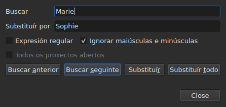
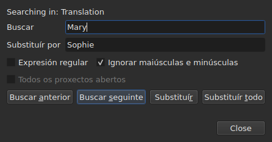

# Buscar e substituír

<!-- machine-translated -->
> Esta páxina é unha tradución automática e aínda non a revisou ningún lector da lingua.

`Editar ▸ Buscar e substituír…`, ou `Ctrl+F`, abre o diálogo de busca.




**O diálogo non é modal**: segue aberto mentres se mira a táboa,
se edita unha cela ou se busca de novo. `Close` péchao; abrilo de novo
devólveo tal como se deixou, padrón e substitución incluídos.

| Campo | O que leva |
| :---- | :-------------- |
| `Find` | o padrón que se busca |
| `Replace with` | o que o substitúe |
| `Regular expression` | o padrón é unha expresión regular en lugar de texto simple |
| `Ignore case` | «marie» atopa «Marie» |
| `All open projects` | a busca percorre todas as lapelas — [véxase máis abaixo](#en-todos-os-proxectos-abertos) |

A entrada está desactivada nun documento baleiro: non hai nada que buscar.

## Os catro xestos

| Botón | O que fai |
| :----- | :----------- |
| `Find Previous` | atopa a coincidencia anterior, e a táboa vai a ela |
| `Find Next` | atopa a seguinte — é o botón que preme `Enter` |
| `Replace` | substitúe a coincidencia atopada e despois atopa a seguinte |
| `Replace All` | substitúe todas as do obxectivo |

Os catro están desactivados mentres `Find` estea baleiro.

**A táboa vai á coincidencia** seleccionando a súa liña. Unha vez chegado á
última, `Find Next` comeza de novo pola primeira; `Find Previous` fai o mesmo no
outro sentido.

**`Replace` sen ningunha coincidencia atopada busca primeiro**: a primeira pulsación
mostra o que se vai substituír, a seguinte substitúeo. É o que
fai Gaupol.

## O que abrangue a busca

**A selección, ou o documento enteiro se non hai nada seleccionado** — a regra do
menú `Tools`. Véxase [As operacións](operations.md#sobre-que-actúan).

**O obxectivo tómase no primeiro xesto e consérvase** mentres a busca
continúa: `Find Next` selecciona a liña dunha coincidencia, e esa
selección non reduce o obxectivo. **Seleccionar outras liñas a man
cambia o obxectivo** para o xesto seguinte.

A busca abrangue o texto dos subtítulos; nin as posicións nin o número
se buscan.

### En todos os proxectos abertos

A caixa de verificación **`All open projects`** estende o alcance a todas as lapelas. **Desactivada cun
só proxecto aberto** — non hai nada que estender —, actívase en canto se abre unha
segunda lapela, e desmárcase soa cando só queda unha.

**Marcada, a selección xa non conta**: cada proxecto búscase enteiro,
**no documento obxectivo** — o da columna actual, o principal ou a
tradución, como para un só proxecto.

- **`Find Next` e `Find Previous` van de lapela en lapela, na orde das
  lapelas.** Primeiro o proxecto mostrado; cando xa non ten coincidencias, o
  seguinte, cuxa lapela mostra a xanela e cuxa liña selecciona.
- **A volta remata onde comezou**: cando a busca pasa da última
  lapela para volver á primeira — ou ao revés subindo —, a liña do diálogo
  dio, en lugar de comezar de novo sen dicir nada:

  ```text
  Search wrapped around
  ```

  O paso seguinte é un paso normal, e a liña bórrase.
- **`Replace` substitúe onde está a busca**, e despois pasa á seguinte
  coincidencia, que pode estar noutra lapela.
- **`Replace All` percorre todos os proxectos**, e **fai unha entrada do historial
  por proxecto tocado**: desfacer nunha lapela desfai só o que esa lapela
  recibiu. O reconto di cantos proxectos cambiaron, non só cantas
  substitucións:

  ```text
  replaced 4 matches in 3 projects
  ```

  Un proxecto onde non está o padrón non se toca, e non ten nada que desfacer.
  **Ningunha lapela pasa á fronte**: cada proxecto recibe as súas substitucións
  detrás da súa lapela, que leva o seu asterisco, e a lapela desde a que comezou o
  xesto segue á vista, coa súa película.

### En que texto

**Cunha tradución, a busca abrangue só un dos dous textos: o da
columna da cela actual** — a tradución se a cela actual está
na columna `Translation`, o texto principal en calquera outro lugar. É a
regra de todas as operacións sobre o texto, e non hai ningún axuste adicional:
véxase [O texto ao que apuntan as operacións](table.md#o-texto-ao-que-apuntan-as-operacións).

**O diálogo di en que texto busca**, nunha liña por riba de
`Find`, e cámbiaa cando cambia a columna actual — mesmo estando aberto:




| A cela actual está en | A liña di |
| :--------------------- | :------------ |
| a columna `Translation` | `Searching in: Translation` |
| calquera outra columna | `Searching in: Main` |
| — o proxecto non ten tradución, ou a columna está eliminada | nada: a liña non está |

**Substituír escribe nese texto, e só nel.** `Replace` e `Replace
All` sobre a tradución deixan o texto principal tal como estaba, e
ao revés; `Undo` devolve o que escribiron. **As etiquetas son as do formato
do ficheiro dese texto**: unha tradución en Advanced SSA lese co seu
`{\i1}`, mesmo cando o texto principal é un SubRip. `Replace with` escríbese alí
coas mesmas etiquetas.

**A táboa queda na columna onde estaba.** `Find Next` selecciona a liña
dunha coincidencia sen mover a cela actual dunha columna á outra:
unha busca comezada na tradución continúa na tradución.

**Buscar nos dous textos á vez non existe**: cada coincidencia
sería un par (subtítulo, texto), e a táboa, ao ir a ela, non tería
ningún lugar claro ao que ir. Búscase nun, e despois cámbiase de columna.

**O que comeza de novo desde cero**:

| Xesto | O que se esquece |
| :------ | :---------------- |
| cambiar `Find`, `Replace with` ou unha opción | a coincidencia actual, e a liña de estado |
| seleccionar outras liñas a man | o obxectivo e a coincidencia |
| mover a cela actual dun texto ao outro — de `Text` a `Translation`, ou ao revés | a coincidencia: é un lugar nun texto |
| abrir outro ficheiro | o obxectivo e a coincidencia; o diálogo segue aberto, padrón incluído |

## O texto buscado é o texto visible

**As etiquetas non son texto.** Buscar `<i>` non atopa nada, e buscar
`Bonjour` atopa un `<i>Bon</i>jour` cortado por unha etiqueta.

**A substitución faise no texto do ficheiro, sen romper as etiquetas**:

| Texto | Buscado → posto no seu lugar | O que se escribe |
| :--- | :-------------------------- | :-------------- |
| `<i>Bonjour</i>` | `Bonjour` → `Salut` | `<i>Salut</i>` |
| `<i>Bon</i>jour` | `Bonjour` → `Salut` | `<i>Salut</i>` |
| `<i>Bonjour</i> Marie` | `Bonjour Marie` → `Salut Sophie` | `<i>Salut Sophie</i>` |

Unha etiqueta que corta unha palabra abrangue a palabra enteira, e calquera estilo que toque a
coincidencia cobre a substitución. **As etiquetas que a coincidencia non
toca quedan onde están**, mesmo unha que corte outra palabra do mesmo
subtítulo: substituír `Marie` en `<i>Bon</i>jour Marie` dá
`<i>Bon</i>jour Sophie`. Unha palabra está feita de letras e díxitos — un espazo
non separable ou unhas comiñas non forman parte dela. **`Replace with` lese coas etiquetas do
texto obxectivo**: escribir alí `<b>Salut</b>` nun SubRip pon a palabra en negra.

## As dúas opcións

| Opción | Predeterminado | O que cambia |
| :----- | :------ | :-------------- |
| `Regular expression` | desmarcada | `.` xa non busca un punto senón calquera carácter |
| `Ignore case` | marcada | as maiúsculas e minúsculas non contan, letras acentuadas incluídas: `élise` atopa `Élise` |

Son os valores predeterminados de Gaupol. **As dúas lémbranse** dunha apertura á
seguinte e dunha sesión á seguinte, nas opcións `search.regex` e
`search.ignore-case` do [ficheiro de preferencias](preferences.md#o-ficheiro).

### Unha expresión regular

O padrón leo ICU. Como en Gaupol, `.` atravesa un salto de liña, e `^`
e `$` aplícanse ao comezo e ao final **de cada liña** dun subtítulo:
substituír `^` por `- ` pon un trazo diante de cada liña.

En `Replace with`, e só para unha expresión regular:

| Escrito | O que pon |
| :------ | :----------- |
| de `$1` a `$9` | o grupo dese número; un grupo ausente non pon nada |
| `$0` | a coincidencia enteira |
| `\n` | un salto de liña |
| `\$`, `\\` | un `$`, unha barra invertida |
| `\` seguido de calquera outro carácter | ese carácter: `\t` pon un `t` |

**`\1` non é un grupo**, e pon un `1`. Esa é a sintaxe de Gaupol, que le
as súas expresións en Python; a de aquí é a de ICU, que le o padrón.

## O que di o diálogo

Baixo os botóns, unha liña di o que a busca non puido facer, ou o que fixo un
`Replace All`:

| Situación | O que se mostra |
| :-------- | :------------ |
| ningunha coincidencia no obxectivo | `"Sophie" not found` |
| unha expresión regular que non se pode ler | `not a regular expression (U_REGEX_MISMATCHED_PAREN)` |
| `Replace All` substituíu | `replaced 3 matches` |
| `Replace All` atopou o padrón, pero a substitución non cambia ningún texto | `nothing to change` |

**Unha busca que non atopa nada non toca nada**: a selección queda onde
estaba, e nada entra no historial.

**`not found` e `nothing to change` non din o mesmo.** `not found`
di que o padrón non está en ningunha parte do obxectivo. `nothing to change` di que
está, pero a substitución deixa cada texto tal como estaba — substituír
`Marie` por `Marie`, por exemplo. Nos dous casos nada entra
no historial. O número de `replaced N matches` conta as coincidencias dos
subtítulos cuxo texto cambiou.

## O que di diso a acción de desfacer

| Xesto | O que se le en `Undo` |
| :------ | :---------------- |
| `Replace` | `Undo: replacing` — unha por substitución |
| `Replace All` | `Undo: replacing all` — **unha soa entrada**, sexa cal sexa o número de coincidencias |

Véxase [Desfacer e refacer](undo.md).
