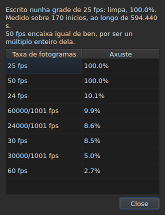

# A grade de fotogramas

<!-- machine-translated -->
> Esta páxina é unha tradución automática e aínda non a revisou ningún lector da lingua.

Un ficheiro de subtítulos **non declara** a taxa de fotogramas coa
que se calcularon as súas posicións: SubRip non ten cabeceira, a de
WebVTT é texto libre. A xanela **dedúcea** das propias posicións,
ao abrir, e móstraa en dous lugares que non responden á mesma
pregunta.

| Superficie | O que dá |
| :------ | :------------ |
| a barra de estado | **a resposta**, de forma permanente e sen que se pida |
| `Ferramentas ▸ Análise da taxa de fotogramas…` | **o razoamento**, cando se quere velo |

## O que mostra a barra de estado

Á dereita, entre o que di sobre a
[codificación](files.md#a-codificación-na-barra-de-estado) do ficheiro lido e o que
di sobre o [vídeo asociado](video.md#o-que-mostra-a-barra-de-estado):

| Situación | O que se escribe |
| :-------- | :-------------- |
| as posicións están nunha grade | `Grid: 24 fps` |
| só algunhas delas | `Grid: 29.97 fps (partial)` |
| ningunha grade coñecida encaixa | `No grid` |

**`No grid` non nomea ningunha taxa de fotogramas, e é intencionado.** O conxunto de
candidatas é pechado — as oito que ofrece o diálogo de conversión — e
indicar a menos errada delas sería dar unha resposta errada alí onde
«non sei» é a correcta.

**`No grid` ten dúas causas, e non son a mesma resposta.** Ou ningunha
grade encaixa, ou o ficheiro ten demasiado poucos subtítulos para que se poida dicir
nada del — dous inicios sempre parecen perfectamente aliñados, e iso non proba
nada. A barra de estado di o mesmo dos dous casos;
**a análise distíngueos**, e indica no primeiro caso por canto falla a
mellor candidata.

A liña **actualízase despois de cada operación**. Aliñar un ficheiro noutra
taxa de fotogramas cambia a grade, e a barra de estado non debe seguir
anunciando a antiga.

### Un documento contado en fotogramas non ten grade, ten unha taxa de fotogramas

**MicroDVD é o único dos nove que conta en fotogramas.** Cada unha das súas liñas
leva dous números de fotograma e nada máis, e o ficheiro **non di** a
que taxa de fotogramas lelos. O mesmo lugar da barra de estado escribe entón:

| Situación | O que se escribe |
| :-------- | :-------------- |
| o documento está contado en fotogramas | `Frames: 24000/1001 fps` |

**Isto non é a grade, e aquí a grade sería circular.** As posicións
dun documento MicroDVD calculáronse *a partir dos* seus fotogramas a esa mesma
taxa de fotogramas; deducir delas unha grade devolvería ese número, é dicir, un dato
disfrazado de medida.

**De onde vén dise unha soa vez**, na lectura, na
[lista de diagnósticos](files.md#os-diagnósticos-dunha-lectura):
`counts in frames and states no rate; it was read at ("24000/1001")`. A liña da
barra de estado, pola súa parte, di o que hai, de forma permanente.

**Errar na taxa de fotogramas despraza o ficheiro enteiro**, e o
diálogo [`Convert Frame Rate…`](operations.md#convert-frame-rate) é onde se corrixe:
ábrese na taxa de fotogramas de lectura e di que é esa.

## O que mostra a análise

`Ferramentas ▸ Análise da taxa de fotogramas…` **non modifica nada.** Ábrese cun resumo e
a clasificación das oito candidatas coa súa puntuación.




O resumo dá a resposta, e despois o que a matiza — cada frase aparece
só se ten algo que dicir:

| O que se pode ler alí | Cando |
| :--------------------- | :--- |
| sobre cantos inicios, e sobre que intervalo | sempre |
| canto está desprazado o ficheiro respecto da súa grade | as súas posicións están nela salvo unha constante |
| que outra taxa de fotogramas encaixa igual de ben | é un múltiplo enteiro da escollida |
| que o intervalo non permite distinguir dúas taxas de fotogramas | o ficheiro é demasiado curto para separalas |
| cantos inicios saen da grade, **e en cantas series** | o ficheiro é parcial |

**O número de series é o que distingue dúas historias** que a
porcentaxe por si soa confunde. Moitas series dun só inicio son posicións
corrixidas a man, unha a unha. Unhas poucas series longas son unha sección
cos tempos recalculados, ou un ficheiro montado a partir doutros dous.

**Móstrase a clasificación completa en lugar dunha soa resposta.** Un ficheiro que
encaixa en 25 ao cen por cento e en 50 ao cen por cento di algo que un
veredicto só ocultaría.

## Cando a conversión foi errada

Un ficheiro que non cae en ningunha grade é ás veces un ficheiro que se **converteu á taxa
de fotogramas errada**: está entón nunha grade moi real, pero desprazada por unha razón que non é a de
ningunha das oito. Cando a dedución devolve `none` ou `partial`, a análise busca **entre os
cincuenta e seis pares ordenados das oito taxas de fotogramas estándar** — ese é o conxunto, pechado — o par
cuxa conversión volve poñer as posicións nunha grade. Cada razón aplícase ás posicións, e
**é a propia dedución a que xulga o resultado**: a confianza é o que ela diría, nunca un
número inventado. Dous pares que dan a mesma razón, como de 30 a 25 e de 60 a 50, son unha soa
conversión.

A frase engádese ao resumo:

```text
converting from 24 to 25 fps puts the positions on a 24 fps grid: 99.9%, against 11.8% as they are and 14.9% for the next best conversion
```

Dá a conversión, a grade na que caerían as posicións e o ben que caen nela,
**e despois a diferenza coas posicións tal como están e coa mellor das outras
conversións.** Un botón `Convert Frame Rate…` pecha a análise e abre [o diálogo
de conversión](operations.md#convert-frame-rate) **enchido co par atopado** — non se aplica nada
mentres non se acepte o diálogo, e basta con cancelar para volver atrás. O vídeo, aberto ao lado,
permite xulgar na imaxe se a resposta é a correcta.

**Cando dous pares son igual de bos, non se propón ningún, e a frase dio:**

```text
converting from 30 to 25 fps and converting from 25 to 24 fps fit equally well (99.7% and 99.6%), so none is proposed
```

Este é o caso habitual máis ca a excepción: unha grade a 28,8 fotogramas por segundo volve
a 24 tan ben coma a 30, e un ficheiro cuxos tempos están todos duplicados segue na grade de 25.
O xesto que ten unha soa reparación é converter un ficheiro **que xa está** na taxa de fotogramas obxectivo. Nun
empate, decide o vídeo: ábrese a man `Convert Frame Rate…` nun dos dous pares.

**Non se di nada** dun ficheiro xa nunha grade, dun ficheiro demasiado curto para que un veredicto
valla algo, nin dun ficheiro que ningunha conversión do conxunto volve poñer nunha grade — unha deriva, unha
razón fóra das oito taxas de fotogramas, posicións sen estrutura.

## O que non mostra a táboa

**Ningunha liña da táboa se marca por mor da grade**, nunca.

En canto se corrixe unha posición a man, deixa de estar aliñada. Unha
marcaxe automática sinalaría entón o traballo do usuario como unha
anomalía, nun ficheiro que precisamente está a corrixir. A dedución
fala do **documento**, e a análise é a única excepción — porque se
abriu para iso.

As marcas da táboa, pola súa parte, refírense ao que non cadra: un final
antes do seu inicio, un solapamento, unha orde rota. Véxase [A táboa](table.md).
