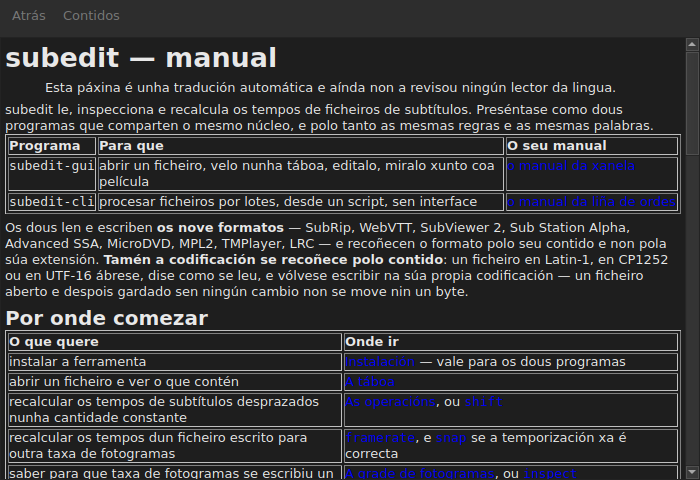

# O manual na xanela

<!-- machine-translated -->
> Esta páxina é unha tradución automática e aínda non a revisou ningún lector da lingua.

`Axuda ▸ Manual`, ou `F1`, abre **este mesmo manual** nunha xanela propia.




## O que abre, e por que non un enderezo

**O manual instalado xunto ao programa**, non unha páxina de Internet.

Un enderezo describiría a versión en desenvolvemento, non a que se ten á man.
Quen le o manual dunha versión que non ten está peor servido ca quen
non ten ningún manual — por iso a xanela le os ficheiros depositados
pola instalación, en `<prefix>/share/subedit/manual`. Véxase
[Instalación](../subedit-cli/installation.md).

Ábrese na [páxina de inicio](../index.md), a que di por onde comezar.

## En que lingua

**Na lingua da xanela.** O manual ábrese na lingua que fala a
interface: a escollida en `Editar ▸ Preferencias…`, ou se non a do
contorno — véxase
[A lingua da interface](preferences.md#a-lingua-da-interface).

| A xanela fala | O manual ábrese en |
| :---------------- | :------------------ |
| inglés | inglés |
| unha lingua cuxo manual está instalado — catalán, checo, alemán, español, finés, francés, galego, hebreo, húngaro, interlingue, islandés, italiano, neerlandés, polaco, portugués, portugués do Brasil | esa lingua |
| unha lingua cuxo manual non está instalado | inglés |

**Páxina a páxina, non todo ou nada**: unha páxina que a tradución non ten
ábrese en inglés, e todas as demais páxinas quedan na lingua da xanela. Unha
ligazón leva dunha á outra do mesmo xeito.

As traducións instálanse xunto ao manual inglés, cada unha nun directorio
co nome da súa lingua: `<prefix>/share/subedit/manual/fr` para o francés. A
lingua é a coa que se iniciou a xanela, así que unha lingua escollida nas
preferencias aplícase tamén ao manual, no seguinte inicio.

## Navegar

| O que se fai | O que pasa |
| :---------- | :----------- |
| facer clic nunha ligazón do manual | a páxina ábrese na mesma xanela |
| facer clic nunha ligazón que apunta a unha sección | a páxina ábrese, e a xanela desprázase ata ela |
| facer clic nunha ligazón que só apunta a unha sección | a xanela desprázase ata ela, sen cambiar de páxina |
| `Back` | volve á páxina anterior; desactivado na primeira |
| `Contents` | volve á páxina de inicio; desactivado cando se está nela |

A xanela **non é modal**: queda aberta mentres se traballa, que é todo o
sentido de ter o manual á man. Escoller de novo a entrada non crea unha
segunda xanela, trae esta ao primeiro plano.

## O que non pode abrir, e dío

O manual remite ás veces á **folla de ruta** ou a unha **decisión de
arquitectura**. Son documentos do repositorio, non do paquete: non están
instalados, e a xanela dío con palabras claras en vez de deixar o
clic sen efecto.

```
../../feuille-de-route.md is not part of the installed manual;
it lives in the project's repository.
```

Pódense ler no repositorio, cuxo enderezo está en `Axuda ▸ Acerca de subedit`.

## Cando a entrada está desactivada

**`Axuda ▸ Manual` está desactivada cando non hai ningún manual xunto ao programa.** Dous
casos, e ningún deles é un fallo:

| Caso | Por que |
| :--- | :-- |
| o binario execútase desde a súa árbore de compilación | alí non se instalou nada, así que non hai nada que ler |
| a instalación é parcial | o manual eliminouse, ou nunca se copiou |

Ao pasar o rato por riba da entrada dise cal dos dous: «Non hai ningún manual instalado xunto
a este programa».

Unha páxina que falta mentres o manual está alí — un ficheiro borrado a man — non
pecha a xanela: nomea o ficheiro que non puido ler e mantén na pantalla o que
estaba a mostrar.

## Onde se busca o manual

**Xunto ao executable**, en `../share/subedit/manual` — a disposición que produce
calquera instalación, sexa cal sexa o prefixo. Iso é o que permite que unha instalación
en `~/.local` atope o seu manual igual que un paquete instalado en `/usr`.
