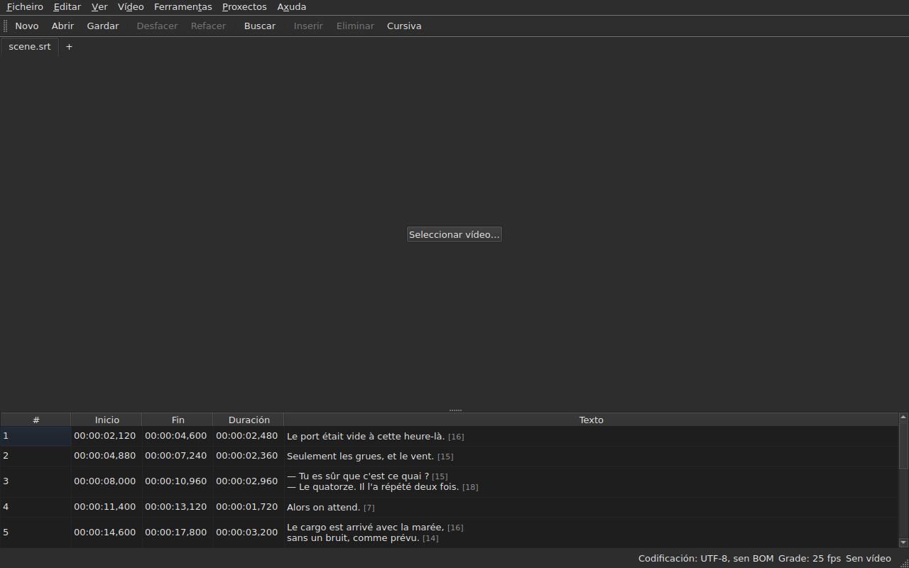

# subedit-gui — manual

<!-- machine-translated -->
> Esta páxina é unha tradución automática e aínda non a revisou ningún lector da lingua.

A xanela de subedit: abrir un ficheiro de subtítulos e velo nunha táboa. Para o
outro programa e para saber por onde comezar, véxase [o manual](../index.md).

> **Estado actual.** A xanela **abre varios ficheiros, unha lapela para cada un**, sexa cal sexa
> a súa codificación — con `Open…` ou soltándoos enriba dela —, **móstraos**,
> **edita as súas celas**, **insire e elimina liñas**,
> **desfai**, **garda — escollendo a codificación, os finais de liña e a
> marca de orde de bytes** —, e **marca os subtítulos cuxas posicións
> non son coherentes**. **Fusiona e divide** liñas, **corta,
> copia e pega** textos, e **busca e substitúe** no texto visible
> sen romper as etiquetas, nun proxecto ou en todos. **Abre unha tradución
> ao lado do ficheiro principal**, aliñada por posición ou por número, nunha columna máis,
> e gárdaa por separado. O menú `Tools` leva dezaseis operacións e dúas entradas de ortografía —
> desprazar, transformar, converter a taxa de fotogramas, axustar as duracións,
> **engadir un ficheiro ao final, dividir o proxecto en dous**, poñer en
> cursiva, engadir trazos de diálogo, cambiar as maiúsculas de catro maneiras,
> eliminar as mencións para persoas xordas, **corrixir os textos cun
> asistente de varias páxinas**, **verificar a ortografía palabra por palabra**, aliñar a unha taxa de fotogramas, devolver
> á grade — e a análise da grade, que non modifica nada. O menú `Projects`
> **gárdao e péchao todo** nun só xesto. **Asocia un vídeo
> ao documento**, escollido ou adiviñado, e **reprodúceo na xanela**, coa liña
> actual debuxada sobre a imaxe; **fixa un inicio, un final ou un
> subtítulo a partir da posición da película**, **avanza fotograma a fotograma** e **move un bordo un fotograma**. A barra de reprodución **salta, regula o
> volume e a posición**, a táboa **segue a reprodución** sen desfacer un desprazamento manual, as posicións
> pódense mostrar **en fotogramas**, e o menú `Video` **escolle a pista de son**. Dúas deteccións
> **propoñen sen aplicar nunca nada**: unha tradución desprazada unha cantidade constante, que se pode **volver abrir
> desprazada**, e a conversión de taxa de fotogramas que devolve un ficheiro a unha grade. **Lembra a súa xeometría, a orde, a largura e a presenza das súas
> columnas, e a súa configuración** dunha
> sesión á seguinte, e preséntase **clara ou escura**, como se prefira. `Axuda ▸ Manual`
> abre **este manual** nunha xanela. Este manual describe o que existe, nunca
> o que está previsto; o que vén despois está na
> [folla de ruta](../../../../feuille-de-route.md).

> **As imaxes deste manual xéranse, a prosa non.** Os exemplos de
> `subedit-cli` xéranse executando a orde; as capturas de pantalla
> xéranse construíndo a xanela real e fotografándoa — `make
> manual` fai as dúas cousas. Polo tanto, unha imaxe non pode describir unha interface que
> xa non existe, e unha interface que cambia vese no diff
> do repositorio. O que queda sen rede de seguridade é o texto que as rodea, cuxa
> exactitude depende da revisión.

**Cada pantalla móstrase dúas veces, coas dúas paletas que define
a aplicación** — `Light` e `Dark`, as que ofrecen
[as preferencias](preferences.md#o-tema). Nun escritorio cuxo
tema manda, `System` dá unha ou outra segundo o que escollese o escritorio.

## Os menús

`File`, `Edit`, `View`, `Video`, `Tools`, `Projects`, `Help` — na orde en
que se usan: o documento, o que se lle fai, como se mira, o que
o acompaña, o que o examina, o que se aplica a todos os proxectos abertos, o que
o explica.

`View` leva un submenú, `Columns`, unha entrada marcable por columna agás `Text`
— véxase [A táboa](table.md#ocultar-e-mover-columnas) — e un axuste, `Positions in Frames`, que mostra
`Start` e `End` como números de fotograma — véxase [Posicións en fotogramas](table.md#posicións-en-fotogramas).

`Projects` leva dúas entradas, `Save All` e `Close All` — véxase
[O menú Proxectos](files.md#o-menú-proxectos).

`Edit` leva cinco bloques, cada un baixo un separador: desfacer; o
portapapeis — cortar, copiar, pegar textos; `Find and Replace…`;
inserir, eliminar, fusionar e dividir liñas; finalmente
`Preferences…`. Desfacer é o que se lle fai *a* unha edición, mover un texto
nin engade nin elimina ningunha liña, as catro do bloque seguinte cambian o número de
liñas, e definir o tema non é ningunha edición.

**As teclas noméanse como as mostra o menú**, en inglés como o resto
da interface: `Ins`, `Del`, `Ctrl+Shift+Z`. Unha tecla que se preme e
que ningún menú nomea conserva o seu nome inglés: `Enter`, `Esc`, `Shift`.

`Help` leva dúas entradas, na orde en que as mostra o menú. `Manual`, ou
`F1`, abre este manual nunha xanela — véxase
[O manual na xanela](help.md). `About subedit` indica a versión, a
licenza, e as bibliotecas coas que funciona a xanela, coas súas versións — véxase
[`--version`](invocation.md#--version).

## A barra de ferramentas

Baixo os menús, unha barra leva **os xestos máis frecuentes**, en grupos.
Cada botón mostra unha palabra curta; o menú conserva a entrada completa, e o
atallo é o mesmo.

| Botón | Entrada do menú | Atallo |
| :----- | :--------- | :------- |
| Novo | Ficheiro ▸ Novo proxecto | `Ctrl+N` |
| Abrir | Ficheiro ▸ Abrir… | `Ctrl+O` |
| Gardar | Ficheiro ▸ Gardar | `Ctrl+S` |
| Desfacer | Editar ▸ Desfacer | `Ctrl+Z` |
| Refacer | Editar ▸ Refacer | `Ctrl+Shift+Z` |
| Buscar | Editar ▸ Buscar e substituír… | `Ctrl+F` |
| Inserir | Editar ▸ Inserir subtítulos… | `Ins` |
| Eliminar | Editar ▸ Eliminar os subtítulos | `Del` |
| Cursiva | Ferramentas ▸ Cursiva | `Ctrl+I` |

**Un botón desactivado estao pola mesma razón que a súa entrada**: `Undo` sen
nada que desfacer, `Remove` sen ningunha liña escollida. As entradas da tradución
e as operacións do menú `Tools`, agás `Italic`, quedan nos seus
menús: úsanse con menos frecuencia, ou non as usa todo o mundo.

## Seccións

| Sección | Contido |
| :------ | :------- |
| [Instalación](../subedit-cli/installation.md) | compilar e instalar — a páxina vale para os dous programas |
| [Invocación](invocation.md) | iniciar a xanela, argumentos, códigos de saída |
| [Abrir e gardar](files.md) | as ordes, as lapelas, o menú `Projects`, soltar ficheiros, a tradución e volvela abrir desprazada, os diagnósticos, a codificación na barra de estado, a viaxe de ida e volta, o peche |
| [A táboa](table.md) | o que mostra cada columna, ocultalas e movelas, as posicións en fotogramas, a columna da tradución e o texto ao que apuntan as operacións |
| [Editar unha cela](editing.md) | que celas se poden editar, e como |
| [Cortar, copiar e pegar textos](clipboard.md) | as tres entradas, o que viaxa, as liñas engadidas, as etiquetas traducidas |
| [Buscar e substituír](find-and-replace.md) | o diálogo, os catro xestos, as dúas opcións, o que abrangue a busca, en todos os proxectos abertos |
| [Inserir, eliminar, fusionar e dividir liñas](lines.md) | as catro entradas, os seus atallos, onde van as liñas novas |
| [Desfacer e refacer](undo.md) | o historial, as dúas accións, a marca de modificación |
| [A grade de fotogramas](frame-grid.md) | a taxa de fotogramas deducida das posicións, a análise, e a conversión que devolve un ficheiro a unha grade |
| [As operacións](operations.md) | desprazar, transformar, converter, axustar as duracións, engadir un ficheiro, dividir o proxecto, poñer en cursiva, as maiúsculas, os trazos, eliminar as mencións, aliñar, devolver á grade, e o que pasa do final da película |
| [Corrixir os textos…](correct-texts.md) | o asistente de corrección: o obxectivo e as tarefas, cada páxina de tarefa, o progreso, a confirmación |
| [Verificar a ortografía…](check-spelling.md) | a verificación ortográfica: a súa configuración, o percorrido, pechar a medio camiño, a ausencia de dicionario |
| [O vídeo asociado](video.md) | escoller un vídeo, a proposta automática, a pista de son, a barra de estado, `ffmpeg` |
| [O reprodutor](player.md) | a vista de vídeo, a barra de reprodución, reproducir, moverse, o volume, a táboa que segue, a liña debuxada |
| [Temporizar desde o vídeo](timing.md) | fixar o inicio ou o final dun subtítulo, inserir, seleccionar a partir da posición da película, avanzar fotograma a fotograma, mover un bordo |
| [As preferencias](preferences.md) | o tema, o ficheiro de preferencias, as súas opcións, e o que pasa cun valor ilexible |
| [O manual na xanela](help.md) | `Axuda ▸ Manual`, o que abre e como se navega nel |
