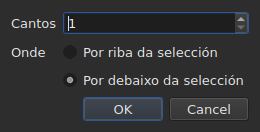

# Inserir, eliminar, fusionar, dividir, ordenar e facer disxuntas as liñas

<!-- machine-translated -->
> Esta páxina é unha tradución automática e aínda non a revisou ningún lector da lingua.

Oito entradas do menú `Edit`, baixo un separador que as aparta de
`Find and Replace…`. Catro teñen en común que cambian o número de liñas, mentres que
cortar, copiar e pegar, máis arriba, moven textos; `Sort Subtitles` só cambia
**a orde** das liñas, `Join Repeated Subtitles` volve facer un único
subtítulo dos anacos consecutivos dun mesmo texto, e `Make Ranges Disjoint…`
córtaos de novo alí onde se solapan.

| Entrada | Atallo | O que fai |
| :---- | :------- | :----------- |
| Inserir subtítulos… | `Ins` | abre un diálogo e despois engade liñas en branco |
| Eliminar os subtítulos | `Del` | elimina a selección, sen preguntar nada |
| Fusionar os subtítulos | ningún | fai unha soa liña dun bloque de liñas veciñas |
| Dividir o subtítulo | ningún | corta unha liña en dúas á metade da súa duración |
| Unir os subtítulos repetidos | ningún | fai un único subtítulo dos anacos consecutivos dun mesmo texto |
| Ordenar os subtítulos | ningún | volve poñer as liñas na orde do seu inicio, en todo o proxecto |
| Facer as franxas disxuntas… | ningún | corta as liñas que se solapan para que ningunha franxa se solape xa con outra |
| Reparar os subtítulos… | ningún | encadea as tres entradas anteriores — unir as repeticións, ordenar, cortar as franxas — dunha soa vez |

As oito entran no historial: `Ctrl+Z` desfainas como o resto.

## Inserir

| Campo | O que contén | Predeterminado |
| :---- | :------------ | :------ |
| `How many` | un número enteiro de 1 a 99 999 | `1` |
| `Where` | `Above the selection` ou `Below the selection` | a última escolla, `Below` no primeiro inicio |

`OK` engade as liñas, `Cancel` non engade nada.

### Onde van

**Na última seleccionada**, non na primeira. Seleccionar as liñas 1 e 3
e despois inserir por debaixo pon a nova liña na posición 4 — non na
posición 2. É o que Gaupol fai desde hai vinte anos, e o que a man
agarda despois de percorrer de arriba abaixo.

`Above the selection` ponna xusto antes desa mesma liña.

### Canto duran

Unha liña en branco non ten texto, pero ten posicións. Dedúcense
do espazo dispoñible:

| Situación | Inicio | Duración |
| :-------- | :---- | :------- |
| entre dous subtítulos | o final do anterior | o espazo ata o seguinte, repartido a partes iguais |
| despois do último | o final do último | tres segundos cada unha |
| ao comezo dun ficheiro | a orixe | o espazo ata o primeiro, repartido |
| nun ficheiro baleiro | a orixe | tres segundos cada unha |

Cando o ficheiro se solapa no lugar escollido, **non hai espazo que
repartir**: as liñas reciben unha duración nula, que a táboa mostra, en lugar
dunha duración inventada que pasaría por riba da veciña.

### O documento baleiro

**Non se precisa ningunha selección**, e é a única maneira de comezar un
ficheiro novo: as liñas van ao índice cero. A escolla do lado queda entón desactivada
no diálogo — non hai selección respecto da que situalas.

En canto o documento ten unha liña, a entrada `Insert Subtitles…` **queda desactivada mentres
non haxa nada seleccionado**: sen selección, o índice adiviñaríase.

### Despois

As liñas engadidas quedan **seleccionadas**, e a táboa vai a elas. Premer
`Ins` unha segunda vez insire polo tanto despois delas, sen ter que facer clic entre as
dúas.

### O lado lémbrase

`Above` ou `Below` lémbrase **dunha inserción á seguinte, e dunha sesión á
seguinte**: é a opción `edit.insert-placement` do
[ficheiro de preferencias](preferences.md#o-ficheiro). Non se insire unha soa vez,
insírense dez liñas seguidas, sempre do mesmo lado.

## Eliminar

`Remove Subtitles`, ou `Del`, elimina as liñas seleccionadas — incluída unha
selección descontinua, e cada liña volve ao seu lugar se se desfai.

**Non se pide ningunha confirmación**, e non é un descoido:
a operación desfaise con `Ctrl+Z`. Un diálogo modal antes dun xesto que se pode desfacer
custaría un clic cada vez para aforrar un `Ctrl+Z` de cando en vez.

**A entrada está desactivada cando non hai nada seleccionado.** Noutros lugares da xanela,
«nada seleccionado» significa «todo o ficheiro» — é o que fai que un
desprazamento se poida usar sen seleccionar catro mil liñas. Aquí, esa lectura
baleiraría un documento cun `Del` desafortunado, así que non se ofrece.

Despois da eliminación, **a liña que ocupou o lugar da primeira eliminada queda
seleccionada** — ou a última que queda, se a eliminación levou o final do
ficheiro. Premer `Del` varias veces seguidas elimina polo tanto as liñas unha
por unha.

Un ficheiro baleirado por completo deixa a xanela utilizable: `Insert Subtitles…`
volve estar activada, xa que nun documento baleiro se insire sen selección.

## Fusionar

`Merge Subtitles` fai **unha soa liña** das liñas seleccionadas:

| O que recibe a liña fusionada | De onde vén |
| :---------------------------- | :------------------ |
| o seu inicio | o inicio da primeira |
| o seu final | o final da última |
| o seu texto | os textos de todas, en orde, cun salto de liña entre dous |
| a súa tradución | as traducións, unidas do mesmo xeito |
| o que o formato leva ademais — un estilo, unha capa, coordenadas | a primeira |

**Un texto baleiro non deixa ningunha liña baleira**: fusionar `Un.`, unha liña sen
texto e `Trois.` dá dúas liñas de texto, non tres.

As liñas fusionadas desaparecen, e a liña que as substitúe ocupa o lugar
da primeira.

**A entrada está desactivada** mentres a selección non sexa **un bloque de polo menos
dúas liñas veciñas**. Unha soa liña non ten con que fusionarse; as liñas
1 e 3 sen a 2 tampouco, xa que o resultado pasaría por riba da 2 e
cubriríaa.

Despois da fusión, **a liña fusionada queda seleccionada**: `Split Subtitle` está
listo para cortala de novo.

## Dividir

`Split Subtitle` corta a liña seleccionada **á metade da súa duración**, ao
milisegundo:

| Metade | Inicio | Fin | Texto |
| :--- | :---- | :-- | :--- |
| a primeira | o inicio orixinal | a metade | **todo** o texto, e a tradución |
| a segunda | a metade | o final orixinal | baleira |

**O texto non se corta no seu salto de liña.** Iso sería correcto para un
subtítulo de dúas liñas e incorrecto para un subtítulo dunha liña ou de tres;
todo o texto queda na primeira metade, e é vostede quen move o que debe
ir á segunda.

A primeira metade conserva o que o formato levaba ademais do texto; a segunda
nace como unha liña inserida, sen nada.

**A entrada está desactivada** mentres a selección non conte **exactamente unha
liña**. Aquí, nada seleccionado non significa «todo o ficheiro».

Despois da división, **as dúas metades quedan seleccionadas** — é o que fai Gaupol
despois de calquera inserción, e `Merge Subtitles` está entón listo para desfacer o
xesto.

## Ordenar

`Sort Subtitles` volve poñer **todo o proxecto** na orde dos inicios. Nunca a
selección: unha orde é unha propiedade do documento, e ordenar a metade dun
ficheiro non significa nada. A ordenación é **estable**: dous subtítulos que
comezan á vez conservan a orde que lles daba o ficheiro.

**Durante a ordenación corre unha barra na barra de estado, e o cursor convértese nun
reloxo de area**: nun ficheiro longo, a xanela queda sen responder un momento — a
táboa reconstrúese liña a liña —, e sen iso non se sabe se algo
está en curso. A barra non mostra ningunha fracción, a ordenación non indica ningunha,
e desaparece con ela.

A barra de estado di cantas liñas cambiaron de lugar — `3 subtitles moved`
— ou, cando todo estaba en orde, `already in order`. **Un proxecto xa en orde
non entra no historial**: unha operación que non cambia nada non é
unha operación que desfacer. A entrada está desactivada para un proxecto dun só subtítulo.

Un ficheiro **con algo que corrixir ao abrilo** ofréceo por si mesmo,
[nunha soa caixa](#ao-abrir-unha-soa-caixa): véxase máis abaixo. Os subtítulos
mal situados tamén se [contan cos diagnósticos](files.md#os-diagnósticos-dunha-lectura),
para que se atopen sen percorrer a táboa.

Na liña de ordes, [`sort`](../subedit-cli/sort.md) fai o mesmo con
ficheiros, e `--sort` faino de paso en
[`convert`](../subedit-cli/convert.md#ordenar-ao-escribir),
[`append`](../subedit-cli/append.md#ordenar-o-resultado) e
[`split-file`](../subedit-cli/split-file.md#cortar-en-orde-temporal).

## Unir os subtítulos repetidos

`Join Repeated Subtitles` fai **un único subtítulo** dos subtítulos que mostran
o mesmo seguidos: un texto cortado en anacos consecutivos, tal como
o deixan algunhas ferramentas de segmentación. Actúa sobre **todo o proxecto**.

**Unha repetición** ten o mesmo texto, a mesma tradución e os mesmos axustes de formato
(un estilo, unha posición, axustes de *cue*) que outro, **e comeza como
moi tarde cando ese remata**. Unha serie de repeticións convértese na que comeza
primeiro, co final máis grande da serie; as demais desaparecen.
`Alpha [1, 2]`, `Alpha [2, 4]` e `Alpha [4, 6]` dan `Alpha [1, 6]`.

- **A orde do ficheiro non cambia nada, e isto non a cambia**: o subtítulo conservado
  é o que comeza primeiro, estean onde estean os demais.
- **Nada se une por erro**: outro texto, outros axustes, unha separación
  entre dous anacos, un subtítulo sen texto ou cuxo final precede ao seu inicio
  quedan separados.
- A barra de estado di o que se fixo — `2 repeated subtitles joined`, ou
  `no repeated subtitles`.

**Cómpre facelo antes de ordenar e de cortar**, que len mellor unha serie limpa: un
texto en tres anacos, máis outro texto sobre toda a franxa, dados fóra
de orde, ordénase e córtase en liñas que pasan dun anaco ao outro; unido
primeiro, cae na súa orde e fusiónase limpamente. A caixa da apertura, máis abaixo, fai
os tres nesa orde.

## Facer as franxas disxuntas

`Make Ranges Disjoint…` corta os subtítulos que se solapan para que **ningunha
franxa `[start, end]` se solape xa con outra**. Actúa sobre **todo o
proxecto**, nunca sobre a selección: un grupo de subtítulos que se solapan
córtase alí onde se solapan, e a metade dun grupo non significa nada.

**Nada se acurta nin se alonga.** En cada instante, a xanela mostra os
mesmos textos ca antes. O que cambia é como se corta a liña de tempo:
córtase en cada inicio e en cada final dun grupo; un intervalo cuberto
por un só subtítulo segue sendo ese subtítulo; un intervalo cuberto por varios
convértese en **un** subtítulo cuxas liñas son as súas, **o máis temperán na liña 1**.
`A [0, 5]` e `B [3, 8]` dan `[0, 3] A`, `[3, 5] A / B`, `[5, 8] B`.

O diálogo pide tres axustes, lembrados dunha vez á seguinte:

| Campo | O que contén | Predeterminado |
| :---- | :------------ | :------ |
| `Shortest interval kept` | de 0 a 10 000 ms: un intervalo máis curto queda absorbido por un veciño | `80 ms` (uns dous fotogramas) |
| `Most lines in a subtitle` | de 0 a 10; `No limit` en 0 | `2` |
| `Put a dash before each subtitle's text` | un trazo antes do que cada subtítulo achega a un subtítulo fusionado | desmarcada |

`OK` corta, `Cancel` non fai nada. **As liñas escritas quedan seleccionadas**
despois, e a barra de estado di o que se fixo: `2 subtitles split, 1 merged`.
Unha segunda pasada non cambia nada e dio: `already disjoint`.

- **Unha liña nunca se duplica.** Dous subtítulos co mesmo texto dan unha
  soa liña alí onde se solapan, e dous anacos veciños que mostran o
  mesmo fan un só subtítulo. Pola contra, o texto dun subtítulo cortado en varios
  anacos repítese en cada un: é o que hai na pantalla nese instante.
- **Un intervalo moi curto queda absorbido por un veciño**: aquel cuxas liñas
  xa conteñen as súas, ou se non o máis longo, estende a súa franxa para cubrilo.
  Un subtítulo enteiro máis curto ca o limiar nunca queda absorbido.
- **Máis liñas ca o límite: xanelas.** Tres liñas durante tres segundos
  convértense en dúas metades, primeiro as dúas primeiras liñas e despois as dúas últimas;
  catro liñas, tres terzos, e así sucesivamente. Nada se trunca.
- A tradución segue os mesmos cortes; consérvanse o estilo e a posición do primeiro
  subtítulo que cobre.

**O que non se puido facer por completo dise nunha caixa que hai que pechar**, non na
barra de estado: xanelas, intervalos absorbidos, subtítulos demasiado curtos
deixados enteiros, estilos que difiren, subtítulos cuxo final precede ao seu
inicio (deixados onde están).

**A entrada rexéitase, co motivo, cando os subtítulos non están na
orde do seu inicio**: os grupos son series de veciños, e o núcleo nunca
ordena por si mesmo. Primeiro `Sort Subtitles` — ou a caixa da apertura, que
fai as dúas cousas nesa orde.

### Todo dunha vez: `Repair Subtitles…`

`Repair Subtitles…` fai as tres entradas anteriores **unha despois da outra**, na única orde que funciona: únense as
repeticións, póñense os subtítulos na orde do seu inicio, e despois fanse disxuntas as franxas. É a entrada
para un ficheiro mal segmentado, mal ordenado e con solapamentos, cando se sabe que se queren as tres. O diálogo pide os
axustes de corte (os mesmos que `Make Ranges Disjoint…`, lembrados dunha vez á seguinte) e di que primeiro une e
ordena. A barra de estado — ou a caixa que hai que pechar, cando algo non se puido facer por completo — dá **unha soa conta**
das tres: `2 repeated subtitles joined; already in order; 2 subtitles split, 1 merged`. Cada corrección é a súa propia
entrada do historial: `Ctrl+Z` desfaias unha por unha. Na liña de ordes: [`repair`](../subedit-cli/repair.md).

### Ao abrir, unha soa caixa

Un ficheiro que se abre con algo que se sabe corrixir **ofréceo nunha
soa caixa**, `Problems found in this file`, en lugar de abrir unha por
problema. Cada problema atopado é unha liña coa súa caixa de verificación, marcada:

- `Join the repeated subtitles` — hai subtítulos que repiten outro que
  tocan, co seu número;
- `Sort the subtitles` — os subtítulos non están na orde do seu inicio,
  co seu número;
- `Make the ranges disjoint` — hai subtítulos que comezan antes do final do anterior,
  contados **unha vez que o ficheiro está en orde**, xa que é aí onde se corrixen.

**Cada problema cóntase alí onde se corrixe**, sobre unha copia á que xa se lle
aplicaron as correccións que o preceden: un texto cortado en anacos é a
causa dalgunha desorde, e unilo primeiro pode non deixar ningunha — a caixa
entón non ofrece a ordenación.

Un problema que non se atopou non ten liña. Desmarcar a ordenación **pon en gris e
desmarca** a outra caixa: as franxas só se fan disxuntas en orde.
`Fix` aplica o que está marcado — a unión, despois a ordenación, despois o corte, cos
axustes do último `Make Ranges Disjoint…` — e dá **unha soa conta** diso;
`Keep as is` non toca nada. **Non se fai nada sen un si**, cada corrección
é unha entrada do historial, e un ficheiro sen nada que corrixir non é obxecto
de ningunha pregunta.

Na liña de ordes, [`disjoint`](../subedit-cli/disjoint.md) fai o mesmo con ficheiros, e `--disjoint`
faino de paso en [`convert`](../subedit-cli/convert.md#facer-as-franxas-disxuntas),
[`append`](../subedit-cli/append.md#facer-as-franxas-disxuntas) e
[`split-file`](../subedit-cli/split-file.md#facer-as-franxas-disxuntas).

### Por que non os atallos de Gaupol

Gaupol fusiona con `M` e divide con `S`. Unha letra soa sería collida pola
táboa antes de chegar a unha cela en edición, e `Ctrl+S`
xa garda: ás dúas entradas chégase polo menú.

## O que di a acción de desfacer

**Unha entrada do historial por xesto.** A fusión de cinco liñas desfaise cun só
`Ctrl+Z`, e devolve as cinco liñas tal como estaban — posicións, textos e
todo o que levaba o formato.

| Operación | O que se le en `Undo` |
| :-------- | :---------------- |
| unha inserción | `Undo: inserting` |
| unha eliminación | `Undo: removing` |
| unha fusión | `Undo: merging` |
| unha división | `Undo: splitting` |
| unha unión de repeticións | `Undo: joining repeated subtitles` |
| un corte das franxas | `Undo: making the ranges disjoint` |

Unha corrección ofrecida ao abrir é unha entrada do historial por corrección: a unión, a ordenación, e despois o corte, desfanse unha despois da outra.

Véxase [Desfacer e refacer](undo.md).

## Atallos mentres unha cela está aberta

`Ins` e `Del` pertencen ao campo de entrada mentres hai un editor de cela
aberto: a tecla de borrado apaga alí un carácter, non un
subtítulo. Pechar o editor — `Enter` ou `Esc` — devólvelles o seu significado. Lanzada
desde o menú, `Remove Subtitles` valida primeiro a entrada, como os demais
xestos de [Editar unha cela](editing.md).

Este manual nomea as teclas tal como as mostra o menú — véxase
[Os menús](index.md#os-menús).
