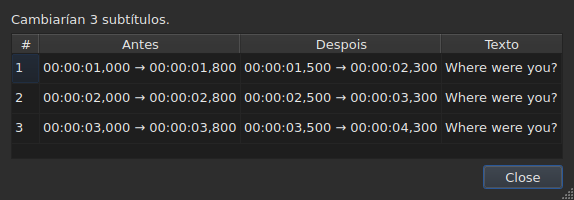
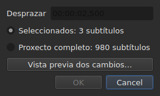
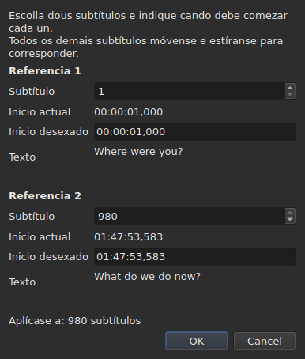
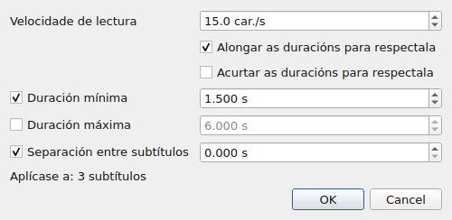
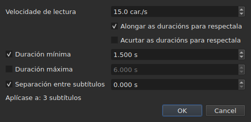
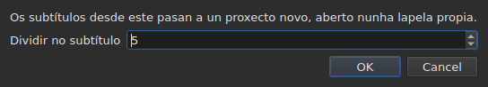

# As operacións

<!-- machine-translated -->
> Esta páxina é unha tradución automática e aínda non a revisou ningún lector da lingua.

O menú **Ferramentas** leva dezaseis operacións, unha análise e dúas entradas de ortografía. Cada unha das
dezaseis desfaise cun `Ctrl+Z`; a análise non modifica nada. `Check Spelling…` tamén se desfai, e `Spell-Check Settings…` non toca ningún texto.

| Entrada | Diálogo | O que fai |
| :---- | :----- | :----------- |
| `Shift Positions…` | si | despraza o obxectivo unha duración |
| `Transform Positions…` | si | corrixe o obxectivo a partir de dúas referencias |
| `Convert Frame Rate…` | si | recalcula os tempos do obxectivo dunha taxa de fotogramas a outra |
| `Adjust Durations…` | si | move os finais para respectar unha velocidade de lectura, unhas duracións e unha separación |
| `Append File…` | un selector de ficheiros | engade un ficheiro ao final do proxecto |
| `Split Project…` | si | corta o proxecto en dous, o resto vai a unha lapela nova |
| `Italic` | **non** | pon o obxectivo en cursiva, ou quítao dela |
| `Dialogue` | **non** | pon un trazo de diálogo ao comezo de cada liña, ou quítao |
| `Maiúsculas ▸ Maiúsculas de título` | **non** | cada palabra leva maiúscula |
| `Maiúsculas ▸ Maiúsculas de frase` | **non** | a primeira letra do texto, e só ela |
| `Maiúsculas ▸ MAIÚSCULAS` | **non** | todo en maiúsculas |
| `Maiúsculas ▸ minúsculas` | **non** | todo en minúsculas |
| `Remove Hearing-Impaired Mentions…` | si, sen axustes | elimina as mencións para persoas xordas |
| `Correct Texts…` | si, un asistente de varias páxinas | propón correccións — mencións, unir e dividir palabras, erros comúns, maiúsculas, salto de liña — e aplícaas unha vez aceptadas, véxase [Corrixir os textos…](correct-texts.md) |
| `Check Spelling…` | si, un percorrido palabra por palabra | percorre as palabras que o dicionario non coñece e aplica o que se corrixiu, véxase [Verificar a ortografía…](check-spelling.md) |
| `Spell-Check Settings…` | si | escolle a lingua, o obxectivo e o documento da verificación, e o subliñado mentres se escribe, véxase [Verificar a ortografía…](check-spelling.md#configuración-da-corrección-ortográfica) |
| `Snap to Frame Rate…` | si | volve poñer cada marca de tempo no fotograma máis próximo |
| `Shift Whole File onto Grid (…)` | **non** | devolve todo o ficheiro á súa grade |
| `Frame Rate Analysis…` | si, sen axustes | **non modifica nada** — véxase [A grade de fotogramas](frame-grid.md) |

**O que fixo unha operación dise nunha caixa de información que hai que
pechar, agás para `Italic`, `Case` e `Dialogue`**: esas tres non abren ningún
diálogo, e o seu informe — «nada que cambiar» incluído — móstrase
na barra de estado, sen nada que pechar. `Split Project…` tamén dá o seu
na barra de estado: o seu resultado xa está diante dos ollos, na lapela nova. As mensaxes cítanse na
sección de cada operación.

Inserir, eliminar, fusionar e dividir liñas non están aquí senón no
menú `Edit`, porque cambian o número de liñas. Véxase
[Inserir, eliminar, fusionar e dividir liñas](lines.md).

## Sobre que actúan

**As liñas seleccionadas, ou todo o ficheiro se non hai ningunha.** É a mesma
regra para todas, e os diálogos, cando hai un, lémbrana con palabras
claras:

```
Applies to: 4 subtitles
```

Seleccionar todas as liñas equivale a non seleccionar ningunha.

**Cando só está seleccionada unha parte das liñas, o diálogo pregunta
sobre que actuar.** Móstranse dúas opcións, co seu reconto, e **a selección
é a marcada**:

```
(•) Selected: 2 subtitles
( ) Whole project: 4 subtitles
```

Marcar `Whole project` amplía a operación a todo o ficheiro sen ter que
cambiar antes a selección. Cando non hai nada que escoller — nada
seleccionado, ou todo —, a liña `Applies to:` de enriba queda soa.

Os diálogos de `Shift Positions…`, `Transform Positions…`,
`Convert Frame Rate…`, `Adjust Durations…`, `Snap to Frame Rate…` e
`Remove Hearing-Impaired Mentions…` ofrecen esta escolla.

### Ver antes de aplicar

`Shift Positions…`, `Transform Positions…`, `Convert Frame Rate…`,
`Adjust Durations…` e `Snap to Frame Rate…` levan un botón **`Preview changes…`**.
Abre unha pequena xanela que di cantos subtítulos cambiaría a operación
**co que está escrito nese momento, no obxectivo marcado**, e
lista os doce primeiros: o seu número, a súa posición antes, a súa posición
despois, e a primeira liña do seu texto. **Non se aplica nada**: pechar a
xanela volve ao diálogo, onde se pode cambiar un valor e mirar
de novo.




Ábrese o bastante grande para mostrar todas as columnas, e pódese redimensionar
a man.

Se a operación non cambiase nada, a xanela dío (`Nothing would change.`).
Mentres o que está escrito non define unha operación — unha duración ilexible, dúas
referencias no mesmo subtítulo —, a vista previa está baleira polo mesmo motivo polo que o
botón `OK` está en gris. `Remove Hearing-Impaired Mentions…` non ten vista previa: o que
cambia é texto, e o informe que dá despois
dío.

**Cunha tradución, que texto?** As operacións de posición e de estrutura
actúan sobre o subtítulo enteiro — os seus dous textos seguen. As que
reescriben un texto — `Italic`, `Case`, `Dialogue`,
`Remove Hearing-Impaired Mentions…` — apuntan ao **texto da columna da cela actual**: a
tradución na súa columna, o texto principal no resto. O outro queda intacto, e
a barra de estado di cal é o obxectivo. Véxase [A táboa](table.md#o-texto-ao-que-apuntan-as-operacións).

**Unha excepción, e a súa etiqueta lévaa**: `Shift Whole File onto Grid`
ignora a selección. Unha grade é unha propiedade do documento, e a metade dun
documento non ten grade propia; por iso a entrada dío no seu nome en vez de
só neste manual.

**`Append File…` tamén ignora a selección**, por outro motivo: non é
un obxectivo que reescriba, é un final que empurra máis alá. Véxase a súa
[propia sección](#append-file). **Igual que `Split Project…`**: corta onde se
lle indica. Véxase [a súa](#split-project).

**`Correct Texts…` escolle o seu obxectivo na súa propia páxina**, en vez de seguir
a selección actual: a selección, o proxecto actual ou todos os proxectos
abertos. Véxase [Corrixir os textos…](correct-texts.md). **`Check Spelling…` escólleo en
`Spell-Check Settings…`**, e lémbrao: véxase [Verificar a ortografía…](check-spelling.md).

**As dúas operacións de grade non falan do mesmo ca a grade.**
Unha operación actúa sobre a selección; a análise e a barra de estado falan do
**documento enteiro**. Aliñar cinco liñas de cento setenta e seis cambia ben esas
cinco — a táboa móstrao — sen que ningunha das dúas se mova, o que
parece unha actualización que non se fixo. Non o é: non teñen nada que
dicir. Véxase [`Snap to Frame Rate…`](#snap-to-frame-rate) e
[A grade de fotogramas](frame-grid.md).

### O que significa «nada seleccionado», entrada por entrada

A regra aplícase ao menú `Tools` e á busca. As entradas do
menú `Edit` que tocan as liñas ou as baleiran léna doutro xeito — se non, un
`Del` ou un `Ctrl+X` desafortunado baleiraría o documento.

| Entrada | Sen selección | O que require |
| :---- | :------------------ | :--------------- |
| as operacións do menú `Tools` | todo o ficheiro | un documento non baleiro |
| `Shift Whole File onto Grid` | todo o ficheiro, **sempre** | unha grade atopada |
| `Find and Replace…` | todo o ficheiro | un documento non baleiro |
| `Cut Texts`, `Copy Texts`, `Paste Texts` | **desactivadas** | polo menos unha liña seleccionada |
| `Remove Subtitles` | **desactivada** | polo menos unha liña seleccionada |
| `Merge Subtitles` | **desactivada** | un bloque de polo menos dúas liñas veciñas |
| `Split Subtitle` | **desactivada** | exactamente unha liña |
| `Insert Subtitles…` | desactivada, agás nun documento baleiro | unha liña á que referilos |

Cada páxina dá o motivo: [o portapapeis](clipboard.md#sobre-que-actúan),
[as liñas](lines.md), [a busca](find-and-replace.md#o-que-abrangue-a-busca).

As entradas están **desactivadas nun ficheiro baleiro**: non habería nada que
desprazar. `Italic` ten unha segunda condición, que describe a súa sección: o formato
aberto debe poder escribir un estilo. As maiúsculas e os trazos non teñen ningunha — un
texto é un texto nos nove formatos.

## `Shift Positions…`

Move o obxectivo unha duración, cara adiante ou cara atrás. Os dous límites de
cada subtítulo móvense a mesma cantidade: ningún queda na pantalla máis nin menos tempo
ca antes.

A duración escríbese **como unha marca de tempo, signo incluído** — `00:00:02,500` move cara adiante,
`-0:01,250` move cara atrás. As formas aceptadas son as dunha cela de posición.




| Rexeitamento | Por que |
| :------ | :-- |
| unha duración ilexible | o botón queda desactivado; non se despraza nada ao chou |
| un desprazamento de cero | non hai ningunha operación que rexistrar |
| un subtítulo quedaría antes do comezo do vídeo | **ningún ficheiro pode levar tal posición** |

O terceiro caso nomea o culpable — «o subtítulo 1 comezaría antes da orixe» —
e é o que hai que mirar para ver canto se errou. Non se
aplica nada.

## `Transform Positions…`

A corrección dun ficheiro temporizado para outra montaxe. Indícase onde comezan
realmente **dous** subtítulos, e todo o demais segue, proporcionalmente.

O diálogo pide dúas veces o mesmo: un número de subtítulo, e a
posición onde debe estar o seu inicio. Para cada referencia, mostra **o que designa
ese número** — o seu texto (`Text`) e o momento no que comeza
**agora** (`Now starts`), como etiquetas simples — e estas seguen o número
a medida que se cambia. O texto conserva **tres liñas de espazo** diga o que diga o
subtítulo: un máis longo, ou un enderezo longo, desprázase dentro del, e
o diálogo conserva o seu tamaño cando cambia a referencia. **Só hai que escribir un campo por referencia:
`Should start`**, o momento no que debe comezar este subtítulo. Non cómpre buscar na táboa cal é a liña `980`.

`Should start` **propóñese co valor actual**: mentres non se
toque, a referencia di «este subtítulo xa está onde debe estar». Só se
cambia o que se quere cambiar. A segunda referencia vén xa enchida co último
subtítulo do ficheiro — dúas referencias afastadas dan unha corrección máis segura
ca dúas veciñas.




**As dúas referencias quedan exactamente onde se pediu.** Non é
unha aproximación: o cálculo faise para que sexa certo.

| Rexeitamento | Por que |
| :------ | :-- |
| dúas referencias no mesmo subtítulo | non definen ningunha corrección |
| unha posición ilexible | o mesmo motivo que para o desprazamento |

Non se pode escribir un número fóra do ficheiro: o campo está limitado polo
número de subtítulos.

## `Convert Frame Rate…`

Recalcula os tempos do obxectivo cando as posicións se calcularon para unha taxa de
fotogramas e deben estalo para outra.

As dúas listas ofrecen as oito taxas de fotogramas estándar.

> **Equivocarse na taxa de fotogramas de entrada despraza todo o ficheiro sen indicar
> nada.** É o peor modo de fallo desta operación, e por iso
> o diálogo di de onde veñen os valores que propón en vez de
> fixalos en silencio.

### As dúas fontes, e a que responden

O diálogo leva ata dúas liñas máis, e cada unha aparece cando ten
algo que dicir:

| Liña | O que di | O que enche previamente |
| :--- | :----------- | :---------------- |
| `The positions say` | a [grade de fotogramas](frame-grid.md) deducida das posicións do ficheiro | `Timed against` |
| `The video declares` | a taxa de fotogramas que anuncia o contedor, por exemplo `24000/1001` | `Should play at` |
| `The file was read at` | a taxa de fotogramas á que se leu un ficheiro **contado en fotogramas** | `Timed against` |

**Cada proposta vai ao campo ao que responde.** A grade di para que se
*escribiu* o ficheiro — é a lista de arriba. O que anuncia o contedor é
a taxa de fotogramas á que *vai* a película, e polo tanto aquela á que deben
chegar os subtítulos — é a lista de abaixo.

**Só unha grade limpa enche previamente a entrada.** Unha grade parcial é un
indicio que a propia dedución cualifica de parcial, e este campo decide unha
operación sobre todo o ficheiro. A [barra de estado](frame-grid.md) e a análise
levan ese caso; este non.

**Un ficheiro contado en fotogramas substitúe a grade en vez de engadirse a ela.**
MicroDVD leva números de fotograma, e as posicións do documento
calculáronse a partir deles á taxa de lectura: unha grade deducida desas posicións
só pode volver atopar ese número. Por iso `The positions say` desaparece, e
`The file was read at` ocupa o seu lugar — é a mesma escolla que fai
[a barra de estado](frame-grid.md#un-documento-contado-en-fotogramas-non-ten-grade-ten-unha-taxa-de-fotogramas).

**Así se cambia a taxa de fotogramas dun MicroDVD.** Poñer a taxa de fotogramas lida
como entrada e a verdadeira como saída recalcula cada posición a partir dos
fotogramas do ficheiro — sen volver ler nada, e a operación desfaise como as
demais.

### Un desacordo non é unha contradición

As dúas liñas pódense mostrar xuntas e anunciar números distintos.
**Non é un erro que arbitrar**: a película vai a unha taxa de fotogramas, o
ficheiro escribiuse noutra grade. Un ficheiro a 24 para unha película a 25 é
exactamente o caso que o aliñamento — `snap` na liña de ordes — existe para
tratar.

Por iso non se escolle nada no lugar do usuario: as dúas listas quedan
editables, e é deliberado. Unha fonte que se impón impide contrastar.

As liñas non aparecen cando non hai nada que dicir: ningún vídeo
asociado, nin `ffprobe`, nin grade limpa. O diálogo é entón o
descrito arriba, e **ningunha operación se nega por iso** — a
taxa de fotogramas vén do usuario. Véxase
[O vídeo asociado](video.md#ffmpeg-non-é-obrigatorio).

Unha taxa de fotogramas que a película anuncia pero que non é unha das oito estándar
**móstrase sen ser escollida**: saber que a película vai a unha
taxa pouco habitual é a información, e aquí non hai nada ao que convertela.

Converter unha taxa de fotogramas nela mesma non cambia nada: o botón queda desactivado.

## `Adjust Durations…`

Alonga ou acurta a duración dos subtítulos do obxectivo **movendo o seu
final, nunca o seu inicio**. Mover o inicio movería o subtítulo, que é
o traballo de [`Shift Positions…`](#shift-positions).





### As catro restricións

| Campo | O que pide | Valores | Predeterminado |
| :---- | :--------------- | :----- | :------ |
| `Reading speed` | o tempo necesario para ler o texto | de 1 a 99 caracteres por segundo, á décima | 15 car./s |
| `Lengthen durations to match it` | alongar o que é demasiado curto para lerse | marcado ou non | marcado |
| `Shorten durations to match it` | acurtar o que queda na pantalla máis tempo do necesario | marcado ou non | desmarcado |
| `Minimum duration` | unha duración mínima | de 0 a 99 s, ao milisegundo | marcado, 1,5 s |
| `Maximum duration` | unha duración máxima | de 0 a 99 s, ao milisegundo | desmarcado, 6 s |
| `Gap between subtitles` | a separación que deixar antes do subtítulo seguinte | de 0 a 99 s, ao milisegundo | marcado, 0 s |

Son os valores predeterminados de Gaupol.

**Unha restrición desmarcada está ausente**: o seu campo está en gris e non se le.
Unha restrición marcada en cero vale cero — unha separación de 0 s impide que un
subtítulo se solape co seguinte. A velocidade de lectura só se le se
está marcado `Lengthen` ou `Shorten`.

**Cando todo está desmarcado, `OK` está desactivado**: non hai nada que pedir.

O diálogo volve abrirse cos valores do último axuste, **e consérvaos dunha
sesión á seguinte** — como as dúas opcións da busca. **Unha caixa desmarcada
conserva o seu valor**: desmarcar `Minimum duration` despois de fixar 2 s non devolve
1,5 s, e volvela marcar atopa 2 s. Os nove axustes están no
[ficheiro de preferencias](preferences.md#o-ficheiro), baixo `duration-adjust.`.

**A liña de ordes compárteos.** [`subedit-cli adjust`](../subedit-cli/adjust.md) le os
mesmos nove axustes de modo predeterminado, así que unha velocidade fixada aquí é a velocidade que usa, salvo que as súas propias opcións
digan outra cousa; [`subedit-cli config`](../subedit-cli/config.md) móstraos e cámbiaos. Véxase
[Dous bloques, un compartido coa liña de ordes](preferences.md#dous-bloques-un-compartido-coa-liña-de-ordes).

### En que orde, e cal gaña

Cada subtítulo do obxectivo pasa polas catro restricións **nesta orde**, e
cada unha fixa o final á súa vez:

| Posto | Restrición | O que fixa |
| ---: | :--------- | :----------- |
| 1 | velocidade de lectura | `end = start + length ÷ speed`, se o subtítulo é demasiado curto (`Lengthen`) ou demasiado longo (`Shorten`) |
| 2 | duración mínima | `end = start + minimum`, se a duración é máis curta |
| 3 | duración máxima | `end = start + maximum`, se a duración é máis longa |
| 4 | separación | `end = next start − gap`, se o final está demasiado preto del — nunca antes do inicio |

**Gaña a última que se aplica.** A separación vén ao final e pode devolver unha
duración por debaixo do mínimo que se acaba de fixar: dous subtítulos na pantalla ao mesmo
tempo son un defecto que o espectador ve, un subtítulo un pouco curto
non.

**A lonxitude do texto cóntase sen etiquetas**, en caracteres, saltos de liña
incluídos: `<i>été</i>` conta tres caracteres. A velocidade de lectura fala do
que le o espectador.

**O seguinte é o subtítulo seguinte do ficheiro**, estea ou non no
obxectivo. **O último subtítulo do ficheiro non ten seguinte**: a separación non
o restrinxe.

### Dise o que ningún final pode satisfacer

Unha vez feito o axuste, a xanela di cantos finais se moveron, e **o que
non se puido respectar** — unha restrición só aparece se se
sacrificou polo menos para un subtítulo:

```text
adjusted the durations of 12 subtitles; could not satisfy the reading speed in 9 subtitles, the minimum duration in 4 subtitles
```

As tres mencións posibles son `the reading speed`, `the minimum duration` e
`the gap`. **A duración máxima respéctase sempre**: vén despois da velocidade
e do mínimo, e só a segue a separación, que só pode acurtar. Un mínimo
maior que o máximo cédelle o paso, e é o mínimo o que se conta. A separación
só se sacrifica cando o seguinte comeza antes do inicio do propio
subtítulo.

O reconto abrangue todo o obxectivo, **incluídos os subtítulos cuxo final non
se moveu**: un subtítulo xa pegado ao seguinte e demasiado curto para o
mínimo cóntase. Cando non se move ningún final, a xanela dío —
`no duration to adjust` — e non entra nada no historial.

## `Append File…`

Engade un ficheiro ao final do proxecto aberto. **Non se insire nada entre os
dous**: o ficheiro escollido desprázase ata o final do último subtítulo do
proxecto, exactamente como fai Gaupol.

**Desactivada nun documento baleiro**: non habería ningún final desde o que desprazar. Ábrese un
selector de ficheiros, sen codificación que escoller — como `Open…`.

**O ficheiro engadido pasa pola conversión**, coas palabras de `Save As…` e de
[pegar desde outro formato](clipboard.md#as-etiquetas-doutro-formato-tradúcense):
as súas etiquetas tradúcense ao formato do proxecto, e o que ese formato non pode
escribir dise:

```text
appended 12 subtitles; Advanced SSA into SubRip: 1 tag dropped
```

**O que levaba o ficheiro engadido non sobrevive enteiro.** As súas posicións
seguen, etiquetas incluídas; a súa cabeceira, os seus campos propios do formato — nome
do estilo, marxes — e o que unha etiqueta non pode chegar a ser no formato do proxecto non
seguen, e dise. **Non ten tradución**: unha tradución segue sendo
propia do documento que a recibiu, e o ficheiro engadido chega só.

**Seleccionado despois**, como as liñas que un pegado escribiu máis alá
do final. Cando non se perde nada, o reconto móstrase na barra de estado en vez de
nunha caixa que pechar — a mesma regra que para
[abrir unha tradución](files.md#abrir-unha-tradución).

**Unha soa entrada do historial**, sexa cal sexa o número de subtítulos
engadidos: `Ctrl+Z` elimínaos todos dunha vez.

**Un ficheiro xa aberto pódese engadir a si mesmo**: nada o impide, como
en Gaupol.

**Na liña de ordes**, [`append`](../subedit-cli/append.md) fai o mesmo con varios ficheiros á
vez, nun só resultado.

## `Split Project…`

Corta o proxecto en dous: **o inverso exacto de `Append File…`**. Unha caixa
pregunta a partir de que subtítulo cortar — do segundo ao último, numerados
como na táboa — e ábrese na liña actual.

**A táboa mostra onde se corta antes de cortar**: cada número que
toma a caixa selecciona a súa liña. `Cancel` devolve a selección anterior.




**Desactivada con menos de dous subtítulos**: un corte quere un subtítulo a cada
lado.

**O resto cópiase nun proxecto novo, aberto nunha lapela nova, e
elimínase do proxecto orixinal.** O proxecto novo **desprázase menos o final do
último subtítulo que quedou**: dividir e despois engadir devolve o proxecto de partida.
Os seus dous textos, principal e tradución, seguen os seus subtítulos, e
conserva o formato e a codificación do orixinal — **sen ruta**: ningún ficheiro
o contén aínda. Por iso a súa lapela escríbese `untitled*` desde o seu nacemento, e
pechala sen gardar fai a pregunta que se fai para todo o que non está
escrito.

**A barra de estado di cantos subtítulos marcharon**, sen ningunha caixa que
pechar — a lapela nova xa mostra o resultado:

```text
split 12 subtitles into a new project
```

**Unha soa entrada do historial**, no proxecto orixinal:
`Undo: splitting the project` devólvelle o seu resto. O proxecto novo ten un historial
propio, baleiro; desfacer non o toca, e queda aberto.

**Rexeitado cando ningún ficheiro podería escribir o resultado.** Se as dúas
metades se solapan no corte, o desprazamento levaría un subtítulo antes
do comezo do vídeo — unha posición negativa, que ningún formato escribe. A caixa
que o rexeita **nomea o subtítulo** e suxire cortar noutro lugar:

```text
Cannot split at subtitle 3: subtitle 3 would fall before the start of the video. Cut somewhere else.
```

Chegar exactamente ao comezo está permitido: cero é unha posición.

**Na liña de ordes**, [`split-file`](../subedit-cli/split-file.md) corta un ficheiro do mesmo xeito, en dous
ficheiros con nome.

## `Snap to Frame Rate…`

Pon **cada marca de tempo** — inicio e final — no fotograma máis próximo da
taxa de fotogramas escollida. Unha soa lista, e esa é toda a diferenza coa
conversión: unha conversión necesita dúas taxas de fotogramas porque escala o
ficheiro dunha á outra; un aliñamento só necesita a
grade na que caer.

| | `Convert Frame Rate…` | `Snap to Frame Rate…` |
| :--- | :-------------------- | :-------------------- |
| movemento | proporcional ao tempo — **varios segundos** nunha longametraxe | medio fotograma como máximo, **en todas partes** |
| para que ficheiro | un ficheiro cuxa **temporización é incorrecta** | un ficheiro cuxa temporización é **correcta** e cuxa grade é incorrecta |

**O caso de uso**, explicado: unha película a 25 fotogramas por segundo,
subtítulos escritos nunha grade a 24, liñas xa aproximadamente no seu
sitio con poucos milisegundos de diferenza. Non hai nada que recalcular — só
volver poñer as marcas de tempo nos fotogramas correctos.

A lista **ábrese no que declara o vídeo**, e non no que din as
posicións: a intención é unirse á grade da película, e a
dedución nomea a que se abandona. Sen vídeo ou sen `ffprobe`, ábrese
na taxa de fotogramas do proxecto.

Aliñar un ficheiro na grade que xa ocupa non o cambia, e non é
un erro: a operación aplícase, non move nada, e desfaise como
calquera outra.

**Aliñar unha parte do ficheiro dío, unha vez feito.** Móstrase un aviso
cando a selección non o abrangue todo e o documento aínda se le noutra
grade:

```
5 of 176 subtitles aligned to 25 fps; the document is still read on a 24 fps grid
```

Vincula o xesto co seu efecto, e explica por que a barra de estado e
a análise non se moveron: falan do documento, a operación actuou sobre
cinco liñas. Non se impide nada — aliñar unha parte dun ficheiro pode ser
intencionado.

**Case sempre é involuntario, e iso está medido.** Nos oito ficheiros de grade
do repositorio, aliñar todo o ficheiro leva a taxa de fotogramas deducida ao
obxectivo e a súa concentración ao 100 %; aliñar cinco liñas nunca move a
taxa de fotogramas deducida e **baixa** a concentración en sete casos de oito — as
liñas aliñadas abandonaron a grade na que vive o resto do ficheiro. O oitavo é
de 50 a 25, onde a grade de destino divide a do ficheiro e onde as posicións xa
estaban nela.

O aviso non se mostra cando a selección abrangue todo o ficheiro, cando
non se deduce ningunha grade, ou cando o documento se le agora na
taxa de fotogramas pedida — é entón cando o aliñamento fixo o que se lle pediu.

## `Shift Whole File onto Grid`

Despraza **todo o ficheiro** a cantidade que devolve as súas posicións á grade
que abandonaron. Un ficheiro cuxas posicións están nunha grade salvo unha
constante foi desprazado, e esa constante pódese medir.

**A entrada do menú leva a cantidade e o alcance** —
`Shift Whole File onto Grid (+0.001 s)`. Non hai diálogo:
a operación non toma ningunha opción, e unha entrada que vai mover un ficheiro
enteiro debe dicir canto, e que o fará por completo, antes de ser escollida.
É a única operación do menú que ignora a selección.

**Está desactivada cando non se atopou ningunha grade.** Non hai entón nada ao que
unirse, e unha fase medida sobre ruído movería o ficheiro ao chou.
«Nada ao que unirse» e «unirse por cero» non din o mesmo: a
segunda segue ofrecéndose, porque un ficheiro que xa está na súa grade é un
caso normal dela.

**Isto non é `Snap to Frame Rate…`.** Esta entrada desprázao todo a mesma cantidade
e conserva a temporización relativa **exactamente**; o aliñamento move cada
posición por separado e absorbe de paso as que se corrixiran
a man. Nun ficheiro limpo as dúas dan o mesmo resultado; nun
ficheiro parcial, non — e o [detalle da análise](frame-grid.md) di cal das
dúas se ten diante.

## `Italic`

Pon o obxectivo en cursiva escribindo as etiquetas do **formato aberto**, ou
quítaas se xa está en cursiva. Sen diálogo: a operación non ten ningún axuste, e
desfaise cun `Ctrl+Z` como as demais.

| Acción | Atallo | Onde |
| :----- | :------- | :---- |
| Cursiva | `Ctrl+I` | menú **Ferramentas**, barra de ferramentas |

É a única operación do menú `Tools` que ten un botón na
[barra de ferramentas](index.md#a-barra-de-ferramentas).

### O que escribe, formato por formato

O texto dun subtítulo é o do seu ficheiro, etiquetas incluídas — véxase
[Editar unha cela](editing.md). Cada formato ten as súas, e iso é o que
esta entrada aforra saber:

| Formato | O que se escribe |
| :----- | :-------------- |
| SubRip, WebVTT, SubViewer 2 | `<i>text</i>` |
| Sub Station Alpha, Advanced SSA | `{\i1}text{\i0}` |
| MicroDVD | `{Y:i}text` — a etiqueta chega ata o final do subtítulo, non hai nada que pechar |
| MPL2 | `/` ao comezo de **cada** liña, e a marca só se aplica á súa |
| TMPlayer, LRC | nada: estes dous formatos non escriben ningún estilo |

**A entrada está desactivada para un TMPlayer e un LRC, non oculta.** Unha
entrada ausente non ensina nada; unha entrada en gris responde a «por que non
podo?».

**O formato que se le é o do texto obxectivo.** Cunha tradución, o texto principal
pode estar en SubRip e a tradución en Advanced SSA: `Italic` escribe `<i>` no
primeiro e `{\i1}` na segunda. A entrada tamén está desactivada cando o
texto obxectivo está nun formato que non escribe ningún estilo, aínda que o outro si.

### En que sentido vai

Unha soa entrada para os dous sentidos, e é o obxectivo o que decide:

- **basta un só subtítulo sen cursiva** para que todo o obxectivo pase a cursiva;
- o obxectivo só sae dela cando está **enteiramente** en cursiva.

É a regra de Gaupol, e é a única que fai utilizable un só
botón: unha selección mesturada vai como un bloque en vez de invertirse
liña por liña, e premer dúas veces devólvea tal como estaba.

O informe di o que se fixo, no sentido no que se fixo:

```
2 subtitles put in italics
2 subtitles taken out of italics
```

**Unha liña baleira nunca gaña etiquetas** — un `<i></i>` arredor de nada
veríase na táboa. Un obxectivo que só contén liñas así non cambia nada, polo tanto, e
dío: «nada que cambiar». Non entra entón ningunha entrada no historial.

### O que non toca

**As outras etiquetas quedan exactamente onde están**: unha cor, un
tipo de letra, un `{\pos(x,y)}` de Advanced SSA atravesan a operación sen moverse.
Só se poñen e se quitan as etiquetas de cursiva.

Unha etiqueta que di varias cousas á vez non se quita enteira:
`{\b1\i1}` pasa a ser `{\b1}`, e `{Y:bi}` pasa a ser `{Y:b}`. A negra queda, e o
texto sae realmente da cursiva.

## `Case` e `Dialogue`

Dúas transformacións do **texto visible**, e as etiquetas non se tocan: un
subtítulo posto en minúsculas conserva o seu `<I>` tal como está, e un trazo ponse
antes do texto, non antes dunha etiqueta de apertura. **Ningunha etiqueta cambia
de sitio**: `<i>bon</i>jour` en maiúsculas dá `<i>BON</i>JOUR`, onde
[unha substitución](find-and-replace.md#o-texto-buscado-é-o-texto-visible) estendería
a cursiva a toda a palabra.

| Entrada | Atallo | O que fai |
| :---- | :------- | :----------- |
| Maiúsculas ▸ Maiúsculas de título | — | `bonjour marie` pasa a ser `Bonjour Marie` |
| Maiúsculas ▸ Maiúsculas de frase | — | `BONJOUR MARIE` pasa a ser `Bonjour marie` |
| Maiúsculas ▸ MAIÚSCULAS | — | todo en maiúsculas |
| Maiúsculas ▸ minúsculas | — | todo en minúsculas |
| Diálogo | — | engade ou quita os trazos |

### O que non tocan as maiúsculas

**O que precede a primeira letra ou a primeira cifra déixase tal como está.**
Un trazo de diálogo, unhas comiñas de apertura, un paréntese sobreviven:
`- bonjour` posto en maiúsculas de frase dá `- Bonjour`, e non `- bonjour` cun
trazo en maiúscula, o que non tería sentido.

**As maiúsculas de frase volven poñer o resto en minúsculas.** `BONJOUR MARIE` pasa a ser
`Bonjour marie`: é o que fai Gaupol, e é o que permite suavizar un
subtítulo escrito en maiúsculas.

**Os acentos e os alfabetos non latinos trátanse correctamente.** `éléonore`
dá `ÉLÉONORE`, e un apóstrofo non corta unha palabra: `l'été` posto en maiúsculas
de título dá `L'été` e non `L'Été`. Unha letra que cambia de lonxitude conserva as súas
etiquetas arredor: `fi <i>x</i>` en maiúsculas dá `FI <i>X</i>`.

**As maiúsculas non dependen da lingua do sistema.** Seguen as regras comúns
a todas as linguas: `istanbul` en maiúsculas dá `ISTANBUL`, estea a máquina
configurada en francés ou en turco.

### En que sentido vai `Dialogue`

Unha soa entrada para os dous sentidos, e é o obxectivo o que decide:

- **basta unha soa liña sen trazo** para que todo o obxectivo gañe un;
- o obxectivo só os perde cando **todas** as súas liñas teñen un.

Premer dúas veces devolve o obxectivo tal como estaba. É a regra de
[`Italic`](#italic), e a única que fai utilizable un só botón.

**Recoñécense tres trazos** — o guión do teclado e os dous
trazos tipográficos, `–` e `—` — e é o guión o que se escribe.
Os espazos sobrantes despois do trazo desaparecen. Unha liña baleira non gaña
ningún.

### O que din

```
2 subtitles recased
2 subtitles dashed
2 subtitles undashed
```

E cando non cambia nada — un obxectivo que xa está nas maiúsculas pedidas — «nada que
cambiar», sen poñer nada no historial.

## `Remove Hearing-Impaired Mentions…`

Elimina as mencións destinadas aos espectadores xordos ou con perda auditiva — as
descricións de sons entre corchetes. **As parénteses quedan**: tamén serven para
as réplicas susurradas, e é `Correct Texts…` o que as elimina, coa súa caixa de verificación `Sound in parentheses`.
**Nada máis**: as letras das cancións
entre cancelos e o nome de quen fala antes de dous puntos só se eliminan con
[`Correct Texts…`](correct-texts.md), páxina `Mentions`.

O diálogo non pregunta nada: a operación non ten ningún axuste, e o diálogo só serve para
confirmar e para lembrar sobre que actúa.

**É a única do menú `Tools` que fai desaparecer liñas**, e a única
de todo o programa que as fai desaparecer sen que se lle pida. Un
subtítulo que *só* era unha mención non ten texto unha vez limpo, e un
subtítulo sen texto non ten razón de ser: elimínase do ficheiro. Os demais
reescríbense sen a súa mención.

**As etiquetas do formato non contan como texto**: `<i>[SOUPIR]</i>` dun
SubRip e `{\i1}[SOUPIR]{\i0}` dun Advanced SSA elimínanse igual.
Un `<i>` nun TMPlayer ou nun LRC, que non escriben ningunha etiqueta, é texto.

**Aplicada á tradución, non elimina ningunha liña.** Unha tradución que a
regra baleira — un texto que só era unha mención — **baléirase** e o subtítulo
queda: ten un texto principal, que a operación non tiña como obxectivo, e eliminalo
destruiríao. O informe cóntao como limpo:

```text
1 subtitle cleaned, 0 removed
```

As etiquetas que se len son as do formato da tradución, que pode non ser o
do ficheiro principal.

O informe di as dúas cousas:

```
1 subtitle cleaned, 1 removed
```

**Cando non actúa nada, non pasa nada** — e o diálogo dío: «non hai ningunha mención
que eliminar». Non entra ningunha entrada no historial, porque unha operación que
non cambia nada non é unha operación que desfacer.

**Desfacer devólveo todo ao seu sitio**, tanto os subtítulos eliminados como os textos
reescritos, cada un co texto que tiña. Un subtítulo que a regra baleirou
nunca se reescribe antes de eliminarse, precisamente para que volva
enteiro.

> **A selección pérdese nesta ocasión**: eliminar liñas cambia a
> estrutura da táboa, que se reconstrúe. Todas as demais operacións do
> menú `Tools` consérvana, `Italic`, `Case` e `Dialogue` incluídas. As catro
> entradas de estrutura do menú `Edit` — inserir, eliminar, fusionar, dividir —
> tamén cambian a estrutura, e devolven unha selección en lugar da que
> quitaron — véxase
> [Inserir, eliminar, fusionar e dividir liñas](lines.md).

Unha referencia puramente numérica — «Véxase [1] a nota» — non é unha mención
e queda tal como está.

## Máis alá do final da película

Cando hai un vídeo aberto, unha operación que **empurra subtítulos máis alá do
final da película** indícao, unha vez feita:

```
shifting leaves 3 subtitles past the end of the video, by 4.200 s at most
```

A frase nomea a operación — `shifting`, `transforming`,
`converting the frame rate`, `adjusting durations`,
`aligning on the frame rate` —, cantos subtítulos pasan, e canto
pasa o máis afastado. `Shift Whole File onto Grid` é un desprazamento, e noméase
`shifting`.

| O que se conta | O que non |
| :-------------- | :---------- |
| o que a operación acaba de tocar, é dicir, o obxectivo | un subtítulo que ninguén moveu |
| un subtítulo que remata **despois** do final | un subtítulo que remata exactamente con el |

**É un aviso, e nada máis.** Non se rexeita nada, non se
corrixe nada: un subtítulo que cae despois dos créditos finais pode ser
exactamente o que se quería, e un rexeitamento equivocado custa máis ca un
aviso que se ignora. A operación está no historial, e `Undo`
desfaina como calquera outra.

**Unha soa caixa por operación.** `Adjust Durations…` e `Align` xa teñen
algo que dicir — o que un axuste non puido respectar, o que un aliñamento
parcial deixou de lado. Cando ademais empurran un subtítulo máis alá do final,
a caixa leva as dúas frases, unha debaixo da outra, primeiro a da
operación:

```
adjusted the durations of 2 subtitles
adjusting durations leaves 1 subtitle past the end of the video, by 1.000 s at most
```

A mensaxe non aparece se non hai ningún vídeo aberto: a duración vén do
reprodutor, e sen película non hai ningún final que pasar. Só as cinco operacións
nomeadas arriba están afectadas — `Adjust Durations…` incluída, que pode
alongar un final máis alá da película. Ningunha das demais o está: as do
menú `Tools` que reescriben un texto, e no menú `Edit` a inserción,
a fusión, a división, o pegado, a substitución e as celas editadas — un
final escrito a man máis alá da película non se indica.
