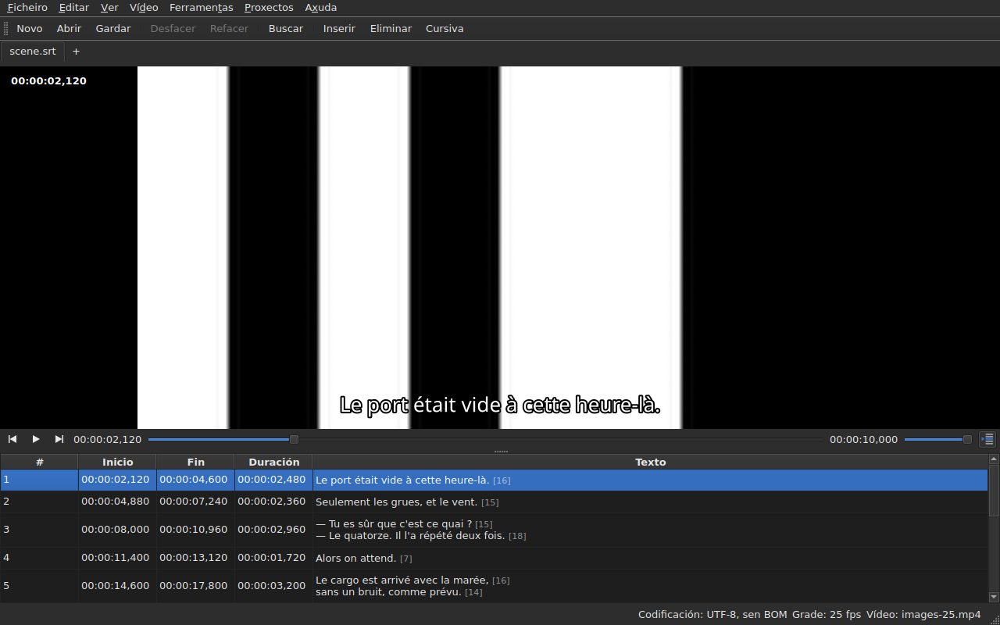

# O reprodutor

<!-- machine-translated -->
> Esta páxina é unha tradución automática e aínda non a revisou ningún lector da lingua.

O vídeo asociado vese **na xanela**, coa liña actual
debuxada enriba. É o que permite comprobar na película o resultado
dun desprazamento, dunha transformación ou dunha conversión da taxa de fotogramas.

Véxase [O vídeo asociado](video.md) para saber como asociar unha película; esta
páxina describe o que pasa unha vez asociada.

## A vista do vídeo

| Situación | O que mostra a xanela |
| :-------- | :-------------------- |
| hai un vídeo asociado e ábrese | a imaxe ocupa a parte superior, a táboa debaixo |
| ningún vídeo asociado | ningunha imaxe, a táboa ocupa toda a xanela |
| o vídeo non se abre | ningunha imaxe, unha mensaxe, e a xanela segue sendo utilizable |

A separación entre a imaxe e a táboa **móvese co rato**. A imaxe non
baixa de 180 píxeles de alto. Ampliar a xanela dálle o espazo gañado
á táboa, non á imaxe: o que falta ao editar son liñas.

Baixo a imaxe, **unha barra de reprodución**: onde está a película, canto dura,
reproducir e pausa, e o volume. Véxase [A barra de reprodución](#a-barra-de-reprodución).

## Reproducir e deter

| Orde | Atallo | O que fai |
| :------ | :------- | :----------- |
| Vídeo ▸ Reproducir / Pausa | `Ctrl+P` | reproduce se a reprodución está detida, e detena en caso contrario |

A orde está **desactivada mentres non hai ningún vídeo aberto**. Un vídeo que
se acaba de asociar ábrese **detido**: abrir unha película non é
mirala.

`Ctrl+P` alí onde Gaupol ten un simple `P`: un atallo dunha soa letra no
ámbito da xanela cóllese antes de que o vexa o compoñente que ten o foco,
así que un `P` perderíase no camiño cara a un editor de cela. Aquí non se
imprime nada, a combinación está libre.

## A barra de reprodución

Baixo a imaxe, de esquerda a dereita — os tres botóns son **iconas**, as do tema do escritorio cando as ten, as do estilo de Qt en caso contrario:

| Elemento | O que fai |
| :------ | :----------- |
| os dous botóns de paso | levan a película cara atrás, cara adiante **un paso en fotogramas** — véxase [Fotograma a fotograma](timing.md#fotograma-a-fotograma) |
| reproducir / pausa | reproduce ou detén, como `Ctrl+P` — o botón mostra **o que fará**: un triángulo cando está detido, dúas barras durante a reprodución; a axuda emerxente dio con palabras |
| a posición | `HH:MM:SS,mmm`, escrita como a táboa escribe unha posición — **como número de fotograma** cando [`Ver ▸ Posicións en fotogramas`](table.md#posicións-en-fotogramas) está marcada |
| o control desprazable | **le e move**: arrástrase o tirador, faise clic na canle, úsanse as frechas |
| a duración | a que declara o vídeo, escrita como a posición |
| o volume | de 0 a 100, véxase [O volume](#o-volume) |
| seguimento da táboa | premido mentres a táboa segue a reprodución, e lévaa de volta á liña que se reproduce cando se preme — véxase [A táboa segue a reprodución](#a-táboa-segue-a-reprodución) |

**O control desprazable non cede a cada píxel.** Arrastrar o tirador pide ducias de
posicións por segundo, e cada unha custa un fotograma descodificado: a primeira posición sae
de inmediato, as seguintes agardan unha vixésima de segundo, e **a última posición pedida é
sempre a que se alcanza** — como moi tarde cando se solta o tirador. A imaxe, polo tanto, non
vai por detrás da man, e non se pon a debuxar un percorrido que ninguén está mirando.

**O control desprazable móvese só durante a reprodución**, e iso non conta como un xesto:
só o que se fai move a película. Mentres se suxeita o tirador, a reprodución non o recupera.

## O código de tempo

**A posición escríbese sobre a imaxe**, arriba á esquerda, sobre un fondo translúcido que a fai
lexible en calquera escena. Debúxaa a xanela, co seu tipo de letra, e non lle pide
nada ao reprodutor agás a posición que xa dá; actualízase con cada xesto,
sen agardar á seguinte volta de seguimento.

## Moverse pola película

No menú **Vídeo**, **os xestos de Gaupol**, cos seus nomes. Todos están **desactivados sen vídeo**, como
a reprodución; os tres que actúan sobre a selección tamén están desactivados mentres non hai nada seleccionado.

| Orde | Atallo | O que fai |
| :------ | :------- | :----------- |
| Vídeo ▸ Reproducir a selección | `Ctrl+Shift+P` | reproduce desde **un pouco antes do inicio** da selección **ata o final do seu último subtítulo**, e detense na imaxe |
| Vídeo ▸ Saltar ao anterior | `Ctrl+Left` | pon a reprodución no inicio do último subtítulo **rematado** antes da posición |
| Vídeo ▸ Saltar ao seguinte | `Ctrl+Right` | pon a reprodución no inicio do primeiro subtítulo que **comeza** despois da posición |
| Vídeo ▸ Saltar cara atrás | `Ctrl+Shift+Left` | retrocede un salto — trinta segundos de maneira predeterminada |
| Vídeo ▸ Saltar cara adiante | `Ctrl+Shift+Right` | avanza un salto |
| Vídeo ▸ Saltar ao comezo da selección | `Ctrl+Up` | pon a reprodución no inicio da selección, **coa antelación por diante** |
| Vídeo ▸ Saltar ao final da selección | `Ctrl+Down` | pon a reprodución no final da selección, **coa antelación por diante** |

**Os atallos son os de Gaupol**, agás un: `Play Selection` é `O` alí, e unha
letra soa cóllea a xanela antes de que a vexa a cela en edición — escribir un
`o` nun texto iniciaría a película. `Ctrl+P` é a resposta da reprodución, `Ctrl+Shift+P` a da
selección. As frechas do teclado quedan para o editor de cela cando está
aberto: alí `Ctrl+Left` move o cursor unha palabra, non a reprodución.

- **O salto** é de 30 segundos, e pódese axustar desde 1 segundo ata unha hora — véxase
  [As preferencias](preferences.md#o-reprodutor). Non pasa nin do inicio da película nin do seu final.
- **A antelación** é dun segundo: mírase un pouco **antes** do subtítulo, para velo chegar.
  Pódese axustar de 0 a 60 segundos, e a reprodución non baixa de cero.
- **Un veciño que non existe** — nada antes do primeiro subtítulo, nada despois do último — non fai
  nada, e non di nada: a reprodución queda onde está.
- **Cada xesto vese de inmediato**: a barra, o código de tempo e a liña debuxada están
  ao día cando remata, sen agardar á seguinte volta.

## O volume

O volume é o do **reprodutor**, de 0 a 100, e non o do sistema. Axústase co control desprazable da
barra, ou con dous xestos, no submenú `Vídeo ▸ Son`, en pasos de cinco:

| Orde | Atallo | O que fai |
| :------ | :------- | :----------- |
| Vídeo ▸ Son ▸ Baixar o volume | `Ctrl+-` | baixa o volume en cinco |
| Vídeo ▸ Son ▸ Subir o volume | `Ctrl++` ou `Ctrl+=` | súbeo en cinco — o segundo para os teclados nos que o máis precisa a tecla de maiúsculas |

**Lémbrase dunha sesión á seguinte**, e dáselle a cada vídeo que se abre. Un valor fóra
de 0 a 100 no ficheiro de configuración non impide a apertura: ignórase, e a xanela dio.
**A pista de son, en cambio, non se lembra** — un número de pista é o do seu ficheiro; véxase
[A pista de son](video.md#a-pista-de-son).

## Selección e reprodución

As dúas funcionan nos dous sentidos.

| O que se fai | O que pasa |
| :---------- | :----------- |
| seleccionar unha liña | a reprodución vai **ao inicio dese subtítulo** |
| estender a selección cara abaixo | nada máis: conta a primeira liña da selección |
| a reprodución avanza | a **liña actual** segue o subtítulo en pantalla, **tinguida**, e a táboa **céntraa** — véxase [A táboa segue a reprodución](#a-táboa-segue-a-reprodución) |

A liña actual e a selección son dúas cousas distintas. A reprodución
move a primeira e **nunca toca a segunda**: a selección é aquilo ao que
se aplica unha operación, e unha película que se reproduce nun recanto non ten por que
reescribir a liña obxectivo do usuario liña tras liña.

A tinguidura segue esta mesma regra: é un marcador, non unha selección. **Unha
anomalía imponse a ela** — unha liña que leva as dúas conserva a cor do
seu defecto, xa que un defecto está aí para ser reparado mentres que unha liña mostrada só o está
durante unha réplica. Véxase [A táboa](table.md).

### A táboa segue a reprodución

**A táboa centra a liña que se reproduce** — no medio do que mostra, non no bordo onde abondaría para
facela visible. Faino **cando cambia a liña**, non a cada tic do seguimento: unha réplica dura
segundos, e volver centrar cada décima de segundo sería desprazarse sen propósito.

**Un desprazamento manual suspende o seguimento.** A roda, a barra de desprazamento e un clic na táboa
suspéndeno: a táboa queda onde se puxo, mentres que a liña actual, a liña debuxada e a barra
seguen a película. O botón de seguimento — **a icona das liñas dunha táboa, unha delas marcada cunha frecha**, á dereita da barra
de reprodución; a súa axuda emerxente di «Seguir a reprodución» — **está premido mentres a táboa segue** e despois levántase.

**O seguimento retómase cun xesto do reprodutor**: a reprodución iniciada, un salto, un paso, un marcador fixado, unha
inserción na posición, ou un movemento da barra — a táboa céntrase entón de inmediato na
liña que se reproduce, aínda que xa fose a mesma. **Ou a petición**: premer o botón restabléceo, e
soltalo suspéndeo. Non hai temporizador: o que retoma o seguimento é sempre un xesto.

Cambiar a outra lapela retoma o seguimento na película desa lapela.

**Unha edición en curso non se interrompe.** Mentres hai un editor de cela
aberto, a liña actual queda onde está; a liña debuxada sobre
a imaxe, pola súa banda, segue avanzando, xa que non molesta a ninguén.

## A liña debuxada

O que se mostra sobre a imaxe vén do **documento aberto**, nunca dun ficheiro:
**o que se ve na imaxe é o que se acaba de escribir**, sen pasar polo
disco. O texto aparece centrado, na parte inferior da imaxe, e desaparece entre dous
subtítulos.

**Cunha tradución, a liña é a do texto ao que se apunta**: a tradución cando
a cela actual está na columna `Translation`, o texto principal
en calquera outro lugar. É a regra de todas as operacións de texto — véxase [O
texto ao que apuntan as operacións](table.md#o-texto-ao-que-apuntan-as-operacións) —
e **non hai ningún axuste**: pasar dunha columna á outra cambia o que
mostra a imaxe, como moito unha décima de segundo despois. Sen tradución, ou
coa columna retirada, nada cambia: é o texto principal.

Un subtítulo ao que a tradución aínda non chegou non mostra **nada** mentres
a columna actual sexa a tradución: non é o texto principal o que
ocupa o seu lugar.

**As etiquetas do formato enténdense, nunca se debuxan tal cal.** O modelo leva o
texto tal como o escribe o ficheiro, e é o pivote de etiquetas — o da conversión
de formato — o que o le antes de pasarllo á imaxe:

| No ficheiro | Na imaxe |
| :---------- | :------------- |
| negra, cursiva, subliñado | aplicados: `<i>no</i>` móstrase como *no*, sen as súas etiquetas |
| cor | aplicada |
| tipo de letra, tamaño | retirados, o texto queda |
| posición, aliñamento, interlocutor, calquera cousa sen equivalente en pantalla | retirados, o texto queda |
| `{` e `}` no texto | debuxadas: «{laughs}» móstrase como «{laughs}» |

Un ficheiro Advanced SSA lese do mesmo xeito: os seus `{\i1}` aplícanse, e o seu
`{\an8}` retírase — a liña queda na parte inferior da imaxe. Cada texto lese **no formato
do seu propio ficheiro**, tanto a tradución como o texto principal.

**O ficheiro de subtítulos veciño non o carga** o reprodutor, aínda que leve o nome da
película. Sería o que se está a editar, e a imaxe mostraría entón o estado do disco
mentres a táboa mostra outra cousa.

## Previsualizar un cambio

**Non hai que facer nada especial**: aplícase a operación, mírase
a película, e escóllese `Undo: shifting` — ou a operación correspondente — se o
resultado non convén. Véxase [Desfacer e refacer](undo.md).

Non existe ningún modo de vista previa separado, e é deliberado: o que se
mira é o documento tal como está, non un estado provisional invisible.

## Cando non aparece a imaxe

Dúas mensaxes posibles, ambas precedidas da ruta do ficheiro:

| Mensaxe | O que pasou |
| :------ | :------------ |
| `<file>: <reason>` | o reprodutor rexeitou o ficheiro — formato descoñecido, ficheiro que falta, directorio |
| `<file>: no video player is available` | non se puido construír ningún reprodutor |

Nos dous casos, **o vídeo segue asociado** — cómpre ver de que
ficheiro se trata para escoller outro — e **a xanela segue sendo utilizable**:
o documento está aberto, as operacións funcionan, e o gardado tamén.

**A imaxe debúxase na propia xanela**: `libmpv` enche un búfer ao
tamaño da vista, en píxeles reais, e a xanela píntao. Nada diso depende da
plataforma gráfica — a mesma imaxe en X11, en Wayland e sen pantalla — e
segue os cambios de tamaño: consérvase a proporción da película, e o resto da
vista é negro.

A segunda mensaxe, polo tanto, só aparece se a biblioteca `libmpv` se nega a iniciarse,
aínda que é obrigatoria no momento da compilación.

A representación pasa polo procesador, pero **a descodificación pódese facer na tarxeta gráfica**: esta
descodifica, a imaxe cópiase de volta á memoria, e despois debúxase como antes. Unha máquina sen
tarxeta utilizable descodifica no procesador, sen mensaxe. Nunha película 1080p en H.264, a reprodución segue o
tempo real con marxe de sobra. **Unha película 4K en HEVC pesado pode non seguilo**: medido en dous
núcleos, descodifica a 0,6 veces o tempo real sen a tarxeta, e avanzar alí un fotograma leva varios
segundos cando o fotograma clave está lonxe. A tarxeta reduce ese tempo — entre un terzo e dous terzos segundo a película
— sen suprimilo. **Non cambia a imaxe mostrada**: un paso ou un salto caen no
mesmo fotograma con ela e sen ela. Para desactivala, desmarque `Decode on the graphics card` en
[`Preferences…`](preferences.md#o-reprodutor).

## O que non hai

**Fixar un marcador, avanzar fotograma a fotograma e desprazar un bordo un fotograma** están en
[Temporizar desde o vídeo](timing.md), non aquí. O que non existe, e é inútil buscar:

- unha forma de onda;
- a reprodución automática ao abrir unha película;
- o estilo da liña debuxada (tipo de letra, cor, posición, fondo): conserva o da xanela;
- a descodificación por hardware sen copia: véxase «Cando non aparece a imaxe» máis arriba.

Este manual describe o que existe: o que virá, e en que orde, está na
[folla de ruta](../../../../feuille-de-route.md).
