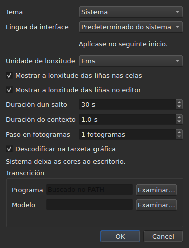

# As preferencias

<!-- machine-translated -->
> Esta páxina é unha tradución automática e aínda non a revisou ningún lector da lingua.

A xanela lembra o que se axusta co rato — **onde estaba**, **se estaba
maximizada**, **a largura das súas columnas**, **a posición do
separador** entre a película e a táboa — e **onde se traballa**, para que
`Open…` abra no lugar axeitado. Nada diso se axusta mediante un diálogo:
móvese, arrástrase, e queda lembrado.

**Seis preferencias teñen un diálogo propio**, `Editar ▸ Preferencias…`, e ese é o
criterio: unha preferencia que xa ten un xesto non precisa un campo. O
tema non ten ningún, nin a unidade das lonxitudes das liñas, nin as dúas caixas de verificación que
as mostran, nin o salto e a antelación do reprodutor. Véxase [O tema](#o-tema),
[Lonxitudes das liñas](#lonxitudes-das-liñas) e [O reprodutor](#o-reprodutor).

**A lingua da interface está no mesmo diálogo, e é a que agarda**: aplícase no
seguinte inicio, non de inmediato. Véxase [A lingua da interface](#a-lingua-da-interface).

**O volume non ten ningún**: axústano a barra baixo a imaxe e dous xestos, e queda lembrado.

**Outra axústase alí onde se usa**: o lado no que `Insert Subtitles…` pon as súas
liñas é un campo dese diálogo, e lémbrase a última escolla. Véxase
[Inserir, eliminar, fusionar e dividir liñas](lines.md#o-lado-lémbrase).

**Tamén as dúas opcións da busca**: `Regular expression` e
`Ignore case` quedan marcadas ou desmarcadas dunha apertura do diálogo á
seguinte, e dunha sesión á seguinte. Véxase
[Buscar e substituír](find-and-replace.md#as-dúas-opcións).

**Tamén os axustes de `Adjust Durations…`**: a velocidade de lectura, as súas dúas
direccións, e as tres duracións coas súas caixas de verificación — cada unha conserva o seu valor, marcada
ou non. Véxase [`Adjust Durations…`](operations.md#adjust-durations).

**E a última codificación escollida en `Save As…`**, coa súa marca de orde
de bytes. Véxase [o ficheiro](#o-ficheiro).

**E o que axustan o asistente `Correct Texts…` e `Spell-Check Settings…`**: as
tarefas marcadas e o seu código, as caixas de verificación dos padróns, os axustes do salto de liña, a lingua,
o obxectivo da verificación e o subliñado mentres se escribe. Véxase [Corrixir os textos…](correct-texts.md) e
[Verificar a ortografía…](check-spelling.md#configuración-da-corrección-ortográfica). **O obxectivo e o
documento de `Correct Texts…` non se lembran.**

**O que non se lembra:** o último ficheiro aberto — véxase
[O directorio lembrado](#o-directorio-lembrado).

## O reprodutor

Catro campos. **Duración dun salto** e **Duración do contexto** son de Gaupol e teñen os seus valores; **Paso en fotogramas** e **Descodificar na tarxeta gráfica** son propios de subedit:

| Campo | O que axusta | Predeterminado | Límites |
| :---- | :----------- | ------: | :----- |
| `Seek length` | o salto de `Seek Backward` e `Seek Forward` | 30 s | de 1 s a unha hora |
| `Context length` | a antelación antes da selección, para `Seek Selection Start`, `Seek Selection End` e `Play Selection` | 1 s | de 0 a 60 s, á décima |
| `Frame step` | o paso, **en fotogramas**, de `Step Backward` e `Step Forward`, e do desprazamento dun bordo | 1 fotograma | de 1 a 1000 fotogramas |
| `Decode on the graphics card` | deixa que a tarxeta gráfica descodifique a película cando a máquina ten unha; sen tarxeta, nada cambia | marcada | marcada ou non |

Aplícanse **de inmediato**, sen agardar a un reinicio, e lémbranse dunha sesión á seguinte
baixo `video.seek-length` (en segundos), `video.context-length-ms` (en milisegundos), `video.step-frames` (en fotogramas) e `video.hardware-decoding` (`true` ou `false`).
**Un valor fóra dos límites, ou que non é un número**, non impide que se abra a xanela:
ignórase, mantense o predeterminado, e a xanela dio ao abrir. **O paso en fotogramas nunca se expresa en milisegundos**: un paso de N fotogramas é sempre de N fotogramas, sexa cal sexa a taxa de fotogramas da película — véxase [Temporizar desde o vídeo](timing.md#fotograma-a-fotograma). O volume lémbrase en `video.volume`,
de 0 a 100, coa mesma tolerancia.

## O ficheiro

```
~/.config/subedit/settings.conf
```

Máis exactamente `$XDG_CONFIG_HOME/subedit/settings.conf` cando esa variable
está definida. Escríbese **cando se pecha a xanela**, e lese cando se abre.
Un programa interrompido — matado, ou detido por un fallo — non escribe nada, e a
sesión seguinte atopa o que deixara a anterior.

O ficheiro é de texto, e pódese editar a man. Iso é unha propiedade e non
un efecto secundario: é o que permite corrixir un axuste cando a interface
que o axusta é precisamente a que está estragada.

### Dous bloques, un compartido coa liña de ordes

O ficheiro escríbese en **dous bloques**, cada un baixo un comentario de cabeceira:

| Bloque | Claves | Lido por |
| :---- | :--- | :------ |
| `# Operation settings: shared by the window and the command line` | as claves `duration-adjust.*` e `correction.*` | a xanela **e** `subedit-cli` |
| `# Display preferences: the window's own` | todas as demais claves — xeometría, columnas, tema, lingua da interface, busca, corrección ortográfica, editor, vídeo, último directorio, codificación de escritura | só a xanela |

**`subedit-cli` le o bloque das operacións de maneira predeterminada**: o que `Adjust Durations…` e
`Correct Texts…` lembran aquí é tamén o punto de partida de [`subedit-cli adjust`](../subedit-cli/adjust.md)
e de parte de [`subedit-cli correct`](../subedit-cli/correct.md), salvo que unha opción da
liña de ordes diga outra cousa. **Nunca le as preferencias de visualización.** A súa
orde [`config`](../subedit-cli/config.md) lista as claves das operacións, mostra os seus valores e
cámbiaos — `subedit-cli config set duration-adjust.speed 12` — e a xanela ve o cambio
na súa seguinte apertura. **Un cambio feito mentres a xanela está aberta non sobrevive ao seu peche**: a
xanela reescribe o ficheiro enteiro co que ten. `--no-config` fai que unha liña de ordes ignore o
ficheiro. Véxase
[O ficheiro de configuración](../subedit-cli/invocation.md#o-ficheiro-de-configuración).

O lector toma as claves en calquera orde, con ou sen as cabeceiras: un ficheiro escrito antes de que
existisen os dous bloques lese sen cambios, e reescríbese en dous bloques no seguinte peche.

| Opción | O que contén | Predeterminado |
| :----- | :------------ | :------ |
| `window.geometry` | `x,y,width,height`, en píxeles; largura e altura distintas de cero | a xanela dimensiónase a si mesma |
| `window.maximised` | `true` ou `false` | `false` |
| `table.columns` | catro larguras en píxeles, separadas por comas — `#`, `Start`, `End`, `Duration`, aínda que estean ocultas | a táboa dimensiónase a si mesma |
| `table.order` | as seis columnas, **cada unha unha soa vez**, na orde na que as mostra a táboa: `number`, `start`, `end`, `duration`, `text`, `translation` | `number,start,end,duration,text,translation` |
| `table.hidden` | as columnas retiradas, entre `number`, `start`, `end` e `duration`; baleiro, ningunha | ningunha |
| `window.table-share` | a parte da altura dada á táboa, en tanto por cento, de 1 a 99 | a xanela repártea como sempre fixo |
| `file.directory` | a ruta **absoluta** dun directorio | ningunha: `Open…` abre onde se iniciou o programa |
| `general.theme` | `system`, `light` ou `dark` | `system` |
| `interface.language` | `system`, ou o nome dunha lingua tal como se chama o seu catálogo: dúas ou tres letras minúsculas, e despois, opcionalmente, `_` e dúas maiúsculas — `fr`, `pt_BR`; `en` para o inglés | `system` |
| `edit.insert-placement` | `above` ou `below` | `below` |
| `file.write-encoding` | o nome dunha codificación que ICU sabe escribir, e cuxo conversor non escribe a súa propia marca | ningunha |
| `file.write-bom` | `true` ou `false` | `false` |
| `search.regex` | `true` ou `false` — o padrón é unha expresión regular | `false` |
| `search.ignore-case` | `true` ou `false` — ignóranse as maiúsculas e minúsculas | `true` |
| `duration-adjust.speed` | a velocidade de lectura, en caracteres por segundo, estritamente positiva; un número decimal escríbese do xeito máis curto posible (`15`, `12.5`) | `15` |
| `duration-adjust.lengthen` | `true` ou `false` — alongar o que é demasiado curto para lerse | `true` |
| `duration-adjust.shorten` | `true` ou `false` — acurtar o que queda en pantalla máis tempo do necesario | `false` |
| `duration-adjust.minimum-enabled` | `true` ou `false` — pídese a duración mínima | `true` |
| `duration-adjust.minimum-ms` | a duración mínima, en milisegundos, enteira e non negativa | `1500` |
| `duration-adjust.maximum-enabled` | `true` ou `false` — pídese a duración máxima | `false` |
| `duration-adjust.maximum-ms` | a duración máxima, en milisegundos, enteira e non negativa | `6000` |
| `duration-adjust.gap-enabled` | `true` ou `false` — pídese a separación co subtítulo seguinte | `true` |
| `duration-adjust.gap-ms` | a separación, en milisegundos, enteira e non negativa | `0` |
| `correction.mentions.enabled`, `correction.common-errors.enabled`, `correction.capitalization.enabled`, `correction.line-break.enabled` | `true` ou `false` — a tarefa está marcada na primeira páxina de `Correct Texts…` | `false`, `true`, `true`, `false` |
| `correction.mentions.code`, `correction.common-errors.code`, `correction.capitalization.code`, `correction.line-break.code` | o código dos padróns da tarefa: `Zyyy`, ou `Script[-language[-COUNTRY]]` — `Latn-en-US`; non baleiro | `Zyyy` |
| `correction.human`, `correction.ocr` | `true` ou `false` — as clases de erros comúns | `true`, `true` |
| `correction.sound-in-brackets`, `correction.sound-in-parentheses` | `true` ou `false` — as dúas caixas de verificación da páxina `Mentions` | `false`, `false` |
| `correction.line-break.max-length` | a lonxitude máxima dunha liña, decimal; o diálogo limítaa de 1 a 1000 | `24` |
| `correction.line-break.max-lines` | o número máximo de liñas, enteiro; o diálogo limítao de 1 a 100 | `3` |
| `correction.line-break.in-ems` | `true`: a lonxitude mídese en *ems*; `false`: en caracteres | `true` |
| `correction.line-break.skip-on-length`, `correction.line-break.skip-on-lines` | `true` ou `false` — pídense as dúas condicións de omisión | `true`, `true` |
| `correction.line-break.skip-max-length`, `correction.line-break.skip-max-lines` | os dous limiares de omisión, na unidade escollida | `24`, `3` |
| `correction.join-split.enabled` | `true` ou `false` — a tarefa `Join or Split Words` está marcada | `false` |
| `correction.join-split.join`, `correction.join-split.split` | `true` ou `false` — unir, dividir | `true`, `false` |
| `correction.join-split.language` | un código de configuración rexional — `fr`, `en_US`, `sr@Latn` —; baleiro: a lingua do sistema | baleiro |
| `correction.remove-blank` | `true` ou `false` — `Remove all blank subtitles` | `true` |
| `transcription.engine` | o nome do motor: letras minúsculas, díxitos, `.`, `-` e `_` | `whisper.cpp` |
| `transcription.executable`, `transcription.model` | unha ruta absoluta; baleiro: o motor búscase no `PATH`, e non se fixa ningún modelo | baleiro |
| `transcription.language` | dúas letras minúsculas, un código ISO 639-1; baleiro: a lingua detéctase | baleiro |
| `transcription.merge-gap-ms` | os anacos dunha mesma frase máis próximos ca isto únense, en milisegundos, enteiro e non negativo | `400` |
| `transcription.max-duration-ms` | o máximo que un subtítulo transcrito permanece en pantalla, en milisegundos, de 1 a 3600000 | `7000` |
| `transcription.max-characters` | o máximo de caracteres dun subtítulo transcrito, de 1 a 1000 | `84` |
| `correction.activations` | as caixas de verificación de padróns que o usuario cambiou, `<type>:<code>:<name>:<0\|1>`, separadas por comas; **unha coma ou unha barra invertida nun nome escríbese precedida dunha barra invertida** (`\,` e `\\`), e unha entrada ilexible só perde o seu propio axuste — indícase, e as demais consérvanse | baleiro |
| `spell-check.language` | un código de configuración rexional, como `fr_FR`; baleiro: a lingua do sistema | baleiro |
| `spell-check.target` | `selection`, `current-project` ou `all-projects` | `current-project` |
| `spell-check.document` | `main` ou `translation` | `main` |
| `spell-check.inline` | `true` ou `false` — subliñar as palabras descoñecidas mentres se escribe no editor dunha cela | `false` |
| `editor.length-unit` | `em` ou `characters` — a unidade das lonxitudes das liñas que mostran a táboa e o editor | `em` |
| `editor.show-lengths-cell` | `true` ou `false` — cada liña dunha cela de texto vai seguida da súa lonxitude | `true` |
| `editor.show-lengths-edit` | `true` ou `false` — o editor dunha cela mostra a lonxitude de cada liña nunha marxe | `true` |

**O ficheiro acepta máis ca o diálogo.** O lector toma calquera velocidade estritamente
positiva e calquera duración non negativa; o diálogo `Adjust
Durations…`, pola súa banda, limita a velocidade de 1 a 99 caracteres por segundo e cada
duración de 0 a 99 s. Un valor do ficheiro fóra deses límites lévase ata o
límite cando se abre o diálogo, e o ficheiro consérvao así unha vez que se
acepta o diálogo e se pecha a xanela. Un diálogo cancelado non cambia nada do que
se lembra.

**`file.write-encoding` lembra a última codificación escollida en `Save As…`, e
nunca se impón a un ficheiro.** Un documento aberto leva a súa propia codificación,
e esa é a que propón a caixa: reescribilo noutra porque o diga un
axuste de hai tres semanas faría perder o que a lectura conservou.
O que lembra este axuste serve ao documento que non ten ficheiro — o que
se acaba de crear.

**É un «non» deliberado e non un descoido.** Quen entrega sempre na
mesma codificación e abre ficheiros herdados noutra escóllea de novo para
cada ficheiro; a caixa propóñella, e a garantía de ida e volta mantense
para todos.

**`file.write-bom` leva a marca da mesma codificación**, e cómpren de verdade dúas
liñas: o nome dunha codificación non di se vai precedida da súa marca, igual
que `--encoding` non di o que di `--bom`. Ambas lense xuntas, en
calquera orde, e un `file.write-bom` sen codificación lembrada non axusta nada.

**Unha parte e non alturas para o separador**, e iso é o que o fai
útil: tres alturas en píxeles deixan de significar nada en canto a xanela
se abre con outro tamaño, e unha xanela ábrese a miúdo con outro tamaño.
A parte reprodúcese en calquera sitio. **Lévase ao que a xanela acepta** se
é demasiado pequena — a franxa da película ten unha altura mínima.

**Catro larguras para seis columnas**, e non é un descoido: son as
de `#`, `Start`, `End` e `Duration`, nesa orde sexa cal sexa a da
táboa, e **unha columna oculta conserva a súa** — volve atopala cando se
mostra de novo. A última columna mostrada toma o que deixan as demais, e darlle
unha largura non faría nada; as do texto e da tradución, polo tanto,
non se lembran.

## O que pasa cando o ficheiro non di o que se agarda

Unha configuración é unha comodidade. **O seu fallo custa a comodidade e nada
máis**: a xanela ábrese en todos os casos.

| Caso | O que pasa |
| :--- | :----------- |
| o ficheiro non existe | todos os valores predeterminados, e non se di nada — é o primeiro inicio |
| o ficheiro existe e non se pode ler | todos os valores predeterminados, e o motivo escríbese na saída de erro |
| falta unha opción | o seu valor predeterminado |
| unha clave é descoñecida | ignórase, sen dicir nada, e non aparece no ficheiro reescrito |
| un valor non se pode ler | consérvase o seu valor predeterminado, e a opción nómease na saída de erro |

```console
$ subedit-gui film.srt
subedit-gui: /home/vous/.config/subedit/settings.conf: window.geometry: "plus tard" cannot be read, keeping the default
```

**A mensaxe vai á saída de erro e a ningún outro sitio.** Unha xanela
modal no inicio por unha preferencia ilexible detería o usuario por
un fallo que non lle impide nada, e antes de que pedise nada.

## As opcións comentadas

O ficheiro reescrito contén **todas** as opcións coñecidas, e as que quedan co
seu valor predeterminado escríbense como comentarios:

```
#window.geometry = 0,0,1280,800
#window.maximised = false
#table.columns = 60,110,110,110
#table.order = number,start,end,duration,text,translation
#table.hidden = start,end
```

Non é unha afectación. Sen iso, unha opción nunca tocada quedaría
conxelada no valor do día no que se escribiu, e **un valor predeterminado mellorado
nunca chegaría a ninguén**. Con iso, cambiar un valor predeterminado cambia o
comportamento de todos os que non o substituíron — que é exactamente
o que debe facer un valor predeterminado.

Para substituír unha opción: retire o `#` e cambie o valor. Para volver
ao valor predeterminado: borre a liña, ou volva comentala.

A xeometría, as larguras e as columnas retiradas mostran unha **forma** e
non un valor en vigor: o valor predeterminado da xeometría e o das larguras son
«o que escolle a xanela», que non se escribe en números, e o de
`table.hidden` é «ningunha», que non se pode ler. A cabeceira do ficheiro tamén o
di. `table.order`, pola súa banda, si mostra a orde predeterminada.

## O directorio lembrado

`Open…` ábrese no directorio do **último ficheiro aberto ou gardado**,
e non no dunha caixa que se cancelou: o que conta é onde se
traballa, non onde se mirou.

**O último ficheiro, pola súa banda, non se lembra.** Lembralo significaría
reabrir no inicio un documento que ninguén pediu. Lembrar un directorio
*orienta* unha caixa de diálogo; lembrar un ficheiro abriría un.

## O tema

`Editar ▸ Preferencias…` ábrese co tema, unha preferencia sen xesto, por riba das
[lonxitudes das liñas](#lonxitudes-das-liñas).

| Valor | O que fai |
| :---- | :----------- |
| `System` | **nada** — as cores seguen sendo as do escritorio |
| `Light` | aplica unha paleta clara |
| `Dark` | aplica unha paleta escura |

O tema escollido aplícase **inmediatamente**, sen reiniciar.

**«Sistema» non fai nada, e iso non é unha carencia.** A versión de Qt sobre
a que se compila subedit non ten maneira de preguntarlle ao escritorio se quere ser
claro ou escuro, nin de ser avisada cando cambia de idea. En lugar de
inventar unha lectura que non se sabe facer, a ferramenta ofrece os dous temas
que se poden pedir e deixa que o conxunto de ferramentas gráficas decida o terceiro —
que é o que fai Gaupol nas mesmas condicións.

Nun escritorio cuxo tema xa é escuro, `System` dá polo tanto unha xanela
escura; nun escritorio claro, unha xanela clara. `Light` e `Dark` substitúeno,
sexa cal sexa o escritorio.

**As tinguiduras das anomalías seguen sendo lexibles nas dúas paletas** — véxase
[A táboa](table.md#as-anomalías). Non é unha suposición: o contraste
do texto sobre cada unha das tinguiduras compróbao unha proba, sobre os dous fondos.

## Transcrición

O grupo **`Transcription`** do diálogo contén os dous datos sobre a máquina que
[`Transcribe Audio…`](video.md#transcribir-o-son) precisa: **o programa** do motor (whisper.cpp,
`whisper-cli`) e **o modelo** que le. Cada un ten un botón `Browse…`. Se se deixa baleiro, o programa búscase
no `PATH`; o modelo non ten valor predeterminado.

Baixo os campos, **o diálogo di o que hai**: se o motor está atopado e onde, se `ffmpeg`
está atopado, e o modelo — sen definir, non atopado, non é un modelo, só para inglés ou multilingüe. Cando algo
falta engade o enlace a
[Instalar as ferramentas de transcrición](../subedit-cli/install-transcription.md), que di onde atopar
cada un. Os dous campos son os axustes `transcription.executable` e `transcription.model`.

## A lingua da interface

`Editar ▸ Preferencias…` escolle a lingua da xanela, baixo o tema.

| Campo | Valores | Predeterminado |
| :---- | :----- | :------ |
| `Interface language` | `System default`; `English`; despois cada lingua instalada co programa, polo seu propio nome — `Français` | `System default` |

**Ten efecto no seguinte inicio**, e o diálogo dio baixo o campo: a xanela
tradúcese a medida que se constrúe, e unha xanela en execución conserva a lingua coa que se iniciou. A escolla
gárdase no ficheiro de configuración, baixo `interface.language`, e lese a próxima vez que se abre a xanela.

| Escolla | A xanela iníciase en |
| :----- | :------------------- |
| `System default` | a lingua do contorno, como antes de calquera escolla — `LANGUAGE`, `LC_ALL`, `LC_MESSAGES`, `LANG`; véxase [Lingua](invocation.md#lingua) |
| `English` | inglés, diga o que diga o contorno |
| unha lingua instalada | esa lingua, **diga o que diga o contorno**, `LC_ALL=C` incluído: unha escolla feita aquí é explícita |

A lista contén as linguas cuxo catálogo está instalado en `<prefix>/share/subedit/locale`;
o inglés está sempre, xa que é a lingua na que está escrito o programa. Cada lingua móstrase
polo seu propio nome, que ningún catálogo traduce, para que cada lector atope a que le.

**Un valor que o programa non pode respectar só custa a escolla:**

| O que di o ficheiro | O que pasa |
| :----------------- | :----------- |
| o nome dunha lingua sen catálogo instalado — un ficheiro traído doutra máquina | a xanela segue o contorno, sen dicir nada; `Preferences…` mostra esa lingua, polo seu nome ou o seu código, e consérvaa salvo que se escolla outra |
| algo que non é o nome dunha lingua — `French`, `fr_FR.UTF-8` | `system`, o valor predeterminado, e a opción nómease na saída de erro, como calquera valor ilexible |

```console
$ subedit-gui film.srt
subedit-gui: /home/vous/.config/subedit/settings.conf: interface.language: "French" cannot be read, keeping the default
```

**A liña de ordes nunca a le**: `subedit-cli` escolle a súa lingua só a partir do
contorno, e `subedit-cli config set interface.language fr` rexéitase por ser unha preferencia de visualización.

## Lonxitudes das liñas




`Editar ▸ Preferencias…` axusta tamén **o que a táboa e o editor mostran da
lonxitude das liñas** — a regra e a marxe de Gaupol.

| Campo | O que fai | Predeterminado |
| :---- | :----------- | :------ |
| `Length unit` | a unidade das lonxitudes: `Ems` ou `Characters` | `Ems` |
| `Show line lengths in cells` | cada liña dunha cela de texto vai seguida da súa lonxitude | marcada |
| `Show line lengths in the editor` | o editor dunha cela mostra a lonxitude de cada liña nunha marxe á dereita | marcada |

**`Length unit` aparece en gris cando non está marcada ningunha das dúas caixas**: sen
lonxitude que mostrar, a unidade non axusta nada. A escolla aplícase **de inmediato** á
táboa, e os editores que se abren despois séguena. Os tres valores
lémbranse dunha sesión á seguinte: `editor.length-unit`, `editor.show-lengths-cell`
e `editor.show-lengths-edit`, na táboa [do ficheiro](#o-ficheiro). Véxase
[A lonxitude das liñas](table.md#a-lonxitude-das-liñas) e
[no editor](editing.md#a-lonxitude-das-liñas).

**Non é o límite do asistente.** A unidade de `Correct Texts…` — a
lonxitude á que divide as liñas — é un axuste separado, no seu
asistente: pódense ler ems na táboa e dividir en caracteres.

## O que non se pode axustar

**Nove axustes lembrados escóllense nun diálogo** — sen contar os do
asistente de corrección e os da corrección ortográfica, que teñen cada un
os seus —, e cada un naquel onde se usa: o tema e os tres axustes de lonxitude das liñas, aquí; o lado dunha inserción, no diálogo de inserción;
as dúas opcións da busca, no diálogo de busca; a codificación e
a marca de orde de bytes, en `Save As…`; a velocidade de lectura, as duracións
e a separación do axuste das duracións, no seu propio diálogo. Non hai
ningún outro: non se pode axustar nada para os diagnósticos, o volume do reprodutor,
nin o formato de gardado predeterminado — ese vén do ficheiro aberto.

E **ningún número que pertenza a un documento se conserva dunha sesión á
seguinte**: unha cantidade de desprazamento, dous marcadores de transformación son certos para un
ficheiro e falsos para o seguinte. Os diálogos pídenos de novo en cada inicio,
deliberadamente. Os axustes de `Adjust Durations…` son unha excepción do mesmo xeito ca
as dúas opcións da busca: unha velocidade de lectura, unha duración mínima ou
unha separación son escollas de método máis ca medidas dun ficheiro, e
persisten dunha sesión á seguinte por esa razón.

Este manual describe o que existe: o que virá está na
[folla de ruta](../../../../feuille-de-route.md).
