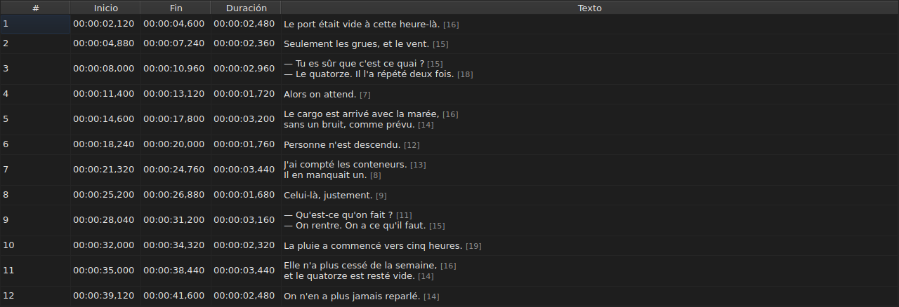
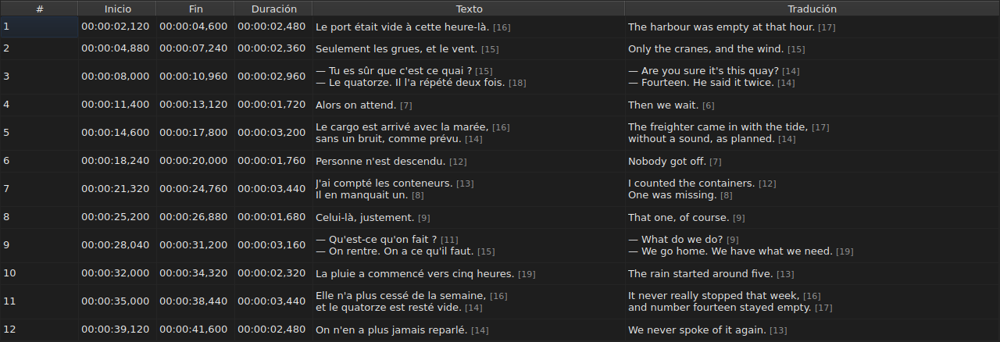
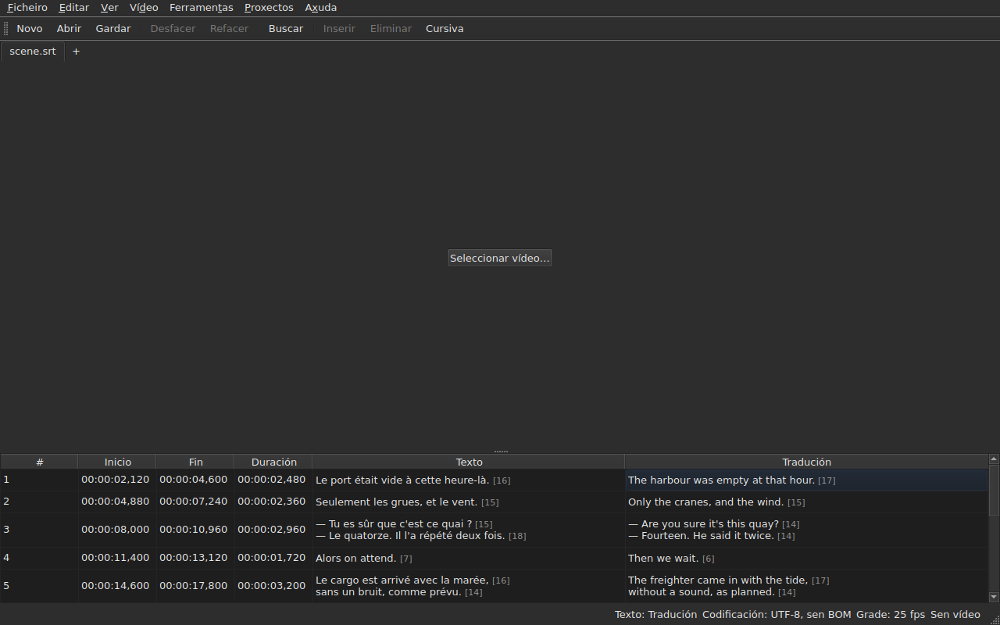

# A táboa

<!-- machine-translated -->
> Esta páxina é unha tradución automática e aínda non a revisou ningún lector da lingua.

A xanela mostra os subtítulos do ficheiro aberto, un por liña, en cinco
columnas — seis cando o proxecto leva unha tradución.

**Este manual cita as cabeceiras da xanela tal como as mostra a xanela
en inglés**, como fai coa liña de ordes; a xanela en galego e as súas capturas de pantalla
móstranos en galego.

| Columna | O que mostra |
| :----- | :------------ |
| `#` | o número de orde do subtítulo, desde 1 |
| `Start` | a posición na que aparece, `HH:MM:SS,mmm` |
| `End` | a posición na que desaparece |
| `Duration` | `End − Start` |
| `Text` | o texto do subtítulo |
| `Translation` | a tradución do subtítulo — **ausente mentres o proxecto non teña ningunha** |




## A lonxitude das liñas


**Cada liña dunha cela de texto vai seguida da súa lonxitude**, `[N]`, máis pequena
e máis pálida — na columna `Text` como na columna `Translation`.
É o que fai Gaupol.

| O que conta | O que fai a táboa |
| :---------- | :------------------ |
| **as etiquetas** | non contan: `<i>Bonjour</i>` dá `[7]`, como `Bonjour` |
| **o redondeo** | cara abaixo: unha liña de 12,9 ems móstrase `[12]` |
| **unha liña baleira** | non ten lonxitude; tampouco un texto baleiro |
| **a unidade** | *ems* de maneira predeterminada, ou caracteres — `Editar ▸ Preferencias…` |
| **unha liña demasiado longa para a columna** | córtase con `…` **antes** do número, que segue visible |

**O *em* é o de Gaupol, non o da tipografía**: o alfabeto en minúsculas
vale 0,55 em por letra, co tipo de letra da táboa. Unha lonxitude en *ems*, polo tanto,
depende do tipo de letra; unha lonxitude en caracteres conta puntos de código, e un
acento conta como un.

**A táboa non marca unha liña demasiado longa.** Mostra o número, e correspóndelle
ao ollo comparalo co límite que cada quen se fixou — como Gaupol. Non é
o límite do asistente `Correct Texts…`, que ten o seu propio axuste.

**Para non velas:** desmarque `Show line lengths in cells` en
`Editar ▸ Preferencias…`. Véxase [Lonxitudes das liñas](preferences.md#lonxitudes-das-liñas).

## Ocultar e mover columnas

**`Ver ▸ Columnas`** leva unha entrada marcable por columna, **agás `Text`**:
sen o texto principal, non quedaría nada que editar.

| Entrada | Columna |
| :---- | :----- |
| `Ver ▸ Columnas ▸ Nº` | `#` |
| `Ver ▸ Columnas ▸ Inicio` | `Start` |
| `Ver ▸ Columnas ▸ Fin` | `End` |
| `Ver ▸ Columnas ▸ Duración` | `Duration` |
| `Ver ▸ Columnas ▸ Tradución` | `Translation` — véxase [A columna da tradución](#a-columna-da-tradución) |

Desmarcar unha entrada retira a súa columna, marcala de novo volve poñela, coa largura
que tiña. **O axuste aplícase a toda a xanela**, todas as lapelas
incluídas: hai unha soa táboa, cuxo proxecto cambia coa lapela.

**A cela actual sae da columna que se retira**: pasa a `Text`,
na mesma liña, e a selección non se move. Unha cela actual nunha
columna que ninguén ve sería unha cela que unha pulsación de tecla editaría
ás cegas.

**As columnas móvense arrastrando a súa cabeceira**, calquera delas, `Text`
incluída. A última columna mostrada ocupa o espazo que deixan as demais.

**A orde e as columnas retiradas lémbranse dunha sesión á seguinte**, coas
larguras, no [ficheiro de preferencias](preferences.md) — `table.order`
e `table.hidden`. A columna da tradución non está aí: segue a súa propia
regra, e volve con cada tradución aberta.

**O número non é un dato do ficheiro**, senón o número de orde da liña. Unha
inserción ou unha eliminación renumera polo tanto todo o que segue, sen que se
reescriba nada.

**O separador decimal segue o formato do ficheiro**: unha coma para SubRip,
un punto para os outros oito. SubRip é o único dos nove que escribe unha coma.

**É o separador o que segue, non toda a escritura.** A táboa escribe sempre
as horas e sempre tres decimais; un ficheiro WebVTT omite as
horas por debaixo dunha hora, SubViewer 2 e os dous Sub Station Alpha contan en
centésimas, MPL2 en décimas, TMPlayer en segundos, MicroDVD en fotogramas. Unha
columna cuxa largura seguise o formato sería máis cansativa de ler ca unha
columna que simplemente non é a escritura exacta do ficheiro.

O que garante a táboa é polo tanto **o valor e o separador**, non o número
de decimais. O que un formato de destino redondearía dise no momento de
gardar — véxase
[O que un formato non levará](files.md#o-que-un-formato-non-levará-dito-antes-de-escribir).

**A duración (`Duration`) calcúlase**, nunca se almacena: escribila move o
final. Un subtítulo cuxo final precede ao seu
inicio mostra unha duración negativa en lugar de cero: é unha anomalía do
ficheiro, e ocultala faría imposible atopala.

**O inicio, o final, a duración, o texto e a tradución edítanse no seu sitio**; o
número non. Véxase [Editar unha cela](editing.md).

**A selección designa aquilo sobre o que actúa unha operación** — véxase
[As operacións](operations.md).

**A altura dunha liña segue o subtítulo que leva**: un subtítulo de
dúas liñas ocupa dúas, un de tres ocupa tres. O texto móstrase
enteiro, tal como se escribirá.

**O que segue cortado é unha liña demasiado longa para a súa columna**, e entón
remata cunha elipse. Ampliar a columna `Text`, ou a xanela, móstraa
enteira; abrir a cela tamén. As liñas do texto nunca se
axustan: só un salto de liña real fai unha liña, para que a altura
dunha fila da táboa non cambie cando se arrastra o bordo dunha columna.

## Posicións en fotogramas

**`Ver ▸ Posicións en fotogramas`** — unha entrada marcable, un único axuste para a xanela — mostra as
columnas `Start` e `End` **como números de fotograma** en lugar de marcas de tempo, e **acepta un número de fotograma como entrada**. As
cabeceiras dino: `Start (frames)` e `End (frames)`.

| O que cambia | O que non cambia |
| :----------- | :------------------- |
| o que escriben `Start` e `End`, e o que aceptan | a columna `Duration`, que segue sendo un tempo |
| as cabeceiras desas dúas columnas | o documento: non se modifica nada, o historial non ten ningunha entrada nova, e **o que escribe o ficheiro é o que escribía** |

**A taxa de fotogramas que conta os fotogramas** é, nesta orde:

1. **a do ficheiro**, cando está contado en fotogramas — MicroDVD, que leva números e ningunha
   taxa de fotogramas: **a xanela mostra entón as cifras do seu ficheiro**, sexa cal sexa o vídeo;
2. **a que declara o vídeo asociado**;
3. **a grade que debuxan as posicións**, cando debuxan unha.

A axuda emerxente da entrada di cal se retivo: *As posicións son números de fotograma, contados a 25 fps, a taxa que declara o
vídeo*. **Se non hai ningunha das tres, a entrada está desactivada, e a súa axuda emerxente di por que**: o ficheiro non está
contado en fotogramas, o vídeo non declara ningunha taxa de fotogramas, e as posicións non caen en ningunha grade.

- **Un número é o número do fotograma no que cae a posición**, redondeado ao fotograma máis próximo. **Escrito,
  dá o instante no que comeza ese fotograma**, redondeado **unha soa vez** a partir da razón exacta
  ([ADR 0013](../../../../adr/0013-mise-a-l-echelle-exacte-des-positions.md)): o fotograma 37 a 23,976 fotogramas por segundo
  comeza aos 1543,04 ms, é dicir `00:00:01,543`.
- **Só se aceptan números enteiros** — co signo menos, xa que un inicio pode preceder á película. Unha
  marca de tempo escrita no modo de fotogramas, ou un número que non o é, deixa a cela tal como estaba.
- **A barra de reprodución segue o mesmo axuste**: a posición e a duración a cada lado do control desprazable
  escríbense como números de fotograma igual que `Start` e `End`, no mesmo instante — véxase
  [A barra de reprodución](player.md#a-barra-de-reprodución). O reloxo debuxado na parte superior da imaxe segue sendo unha
  marca de tempo.
- **Este axuste non se lembra** dunha sesión á seguinte: é un axuste da xanela, non dun
  documento, e vólvese activar cun só xesto.

## As anomalías

Un subtítulo cuxas posicións non concordan queda **tinguido nas súas
columnas de tempo**, e pasar o rato por riba del di o que está mal.

| Tinguidura | O que indica | Que facer |
| :--- | :-------------- | :--------- |
| vermello | `ends before it starts` | corrixir o seu final, ou o seu inicio |
| azul | `starts before the previous one starts` | volver poñelo no seu lugar na orde |
| ámbar | `starts before the previous one ends` | axustar a súa temporización |


Só se tinguen as columnas `Start`, `End` e `Duration`: unha anomalía
só fala do tempo, e tinguir o texto suxeriría que tiña algo
que ver con el.

**Un subtítulo pode levar varias**, e a axuda emerxente nómeas todas. A
tinguidura é a da primeira que hai que reparar: un subtítulo estragado en si mesmo
está estragado faga o que faga a súa veciñanza; un subtítulo mal situado vólvese poñer no seu sitio,
e o seu solapamento desaparece con iso.

> Non é casualidade que a desorde case sempre se impoña ao
> solapamento: comezar antes de que comece o anterior é comezar
> antes de que remate — salvo que o anterior estea el mesmo estragado.

**A marcaxe recalcúlase despois de cada cambio de posición**, veña
dunha cela editada, dunha operación ou dun desfacer. Di o que o
ficheiro é agora, non o que era ao abrilo.

Non se apoia en ningunha grade de fotogramas: en canto unha posición se corrixe a
man, sae dela, e unha marcaxe baseada nela sinalaría o
traballo do usuario.

## A columna da tradución

Un subtítulo leva **dous textos e un único par de posicións**: a
tradución non ten temporización propia, vai unida á do subtítulo.
A táboa móstraa nunha sexta columna, `Translation`, á dereita de `Text`.




**A columna só está alí se o proxecto ten unha tradución.** Sen ela, a táboa
conserva as súas cinco columnas, e a xanela compórtase coma se a tradución
non existise — non se pon nada en gris nin se engade nada. `Ficheiro ▸ Abrir tradución…` abre
unha: véxase [Abrir unha tradución](files.md#abrir-unha-tradución).

**Unha entrada do menú `View` móstraa ou retíraa**:

| Entrada | O que fai |
| :---- | :----------- |
| `Ver ▸ Columnas ▸ Tradución` | marcada: a columna móstrase; desmarcada: retírase |

A entrada está **desactivada cando o proxecto non ten tradución** — non hai nada que
mostrar — e marcada no inicio. **A escolla de retirala é do
usuario**: mantense dun ficheiro ao seguinte, ata que se marca
de novo. Retirar a columna non retira a tradución: segue no
proxecto, e volve coa entrada. Abrir un ficheiro que non leva ningunha retira a
columna.

**Nas celas da tradución escríbese como nas do texto** — véxase
[Editar unha cela](editing.md).

### O texto ao que apuntan as operacións

Con dous textos nunha liña, as operacións de texto teñen que saber cal
reescriben. **É o da columna da cela actual**: a
tradución se a cela actual está na columna `Translation`, o texto
principal en calquera outro lugar — tanto nunha columna de tempo como en `Text`.

| Operación | A que apunta |
| :-------- | :-------------- |
| `Italic`, `Case`, `Dialogue`, `Remove Hearing-Impaired Mentions…` | o texto da columna actual |
| `Cut Texts`, `Copy Texts`, `Paste Texts` | o texto da columna actual |
| `Find and Replace…` | o texto da columna actual — véxase [Buscar e substituír](find-and-replace.md#en-que-texto) |
| as operacións de posición, a inserción, a eliminación, a fusión, a división | **os dous textos**: un subtítulo é un todo |

**A barra de estado dio cando hai dous textos**, á esquerda das outras
indicacións:

```text
Text: Translation
```

ou `Text: Main` para o texto principal. Cala cando a columna non se
mostra: entón só hai un texto, e non ten sentido dicilo.




**A liña debuxada sobre a imaxe segue a mesma regra**: é o texto da
columna actual. Véxase [O reprodutor](player.md#a-liña-debuxada).

**Non se pon nada en gris.** As operacións de texto seguen dispoñibles sexa cal sexa
a columna actual, e sen columna de tradución apuntan ao texto
principal, como antes.

## Engadir e eliminar liñas

`Editar ▸ Inserir subtítulos…` e `Editar ▸ Eliminar os subtítulos` engaden e eliminan
liñas, `Editar ▸ Fusionar os subtítulos` e `Editar ▸ Dividir o subtítulo` fusiónanas e
divídenas; a táboa renumérase. Véxase
[Inserir, eliminar, fusionar e dividir liñas](lines.md).

## O que non fai a táboa

**A ordenación por columna non existe.** A orde mostrada é a do ficheiro, e
é a única que ten sentido para os subtítulos: o número de orde dunha liña *é*
o seu lugar no tempo.
