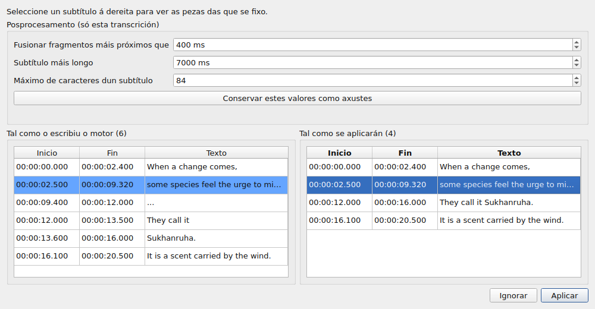
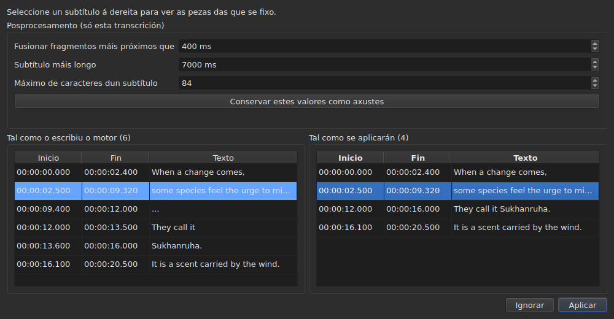

# O vídeo asociado

<!-- machine-translated -->
> Esta páxina é unha tradución automática e aínda non a revisou ningún lector da lingua.

O menú **Vídeo** leva primeiro tres ordes, e despois os xestos que manexan a película
— véxase [O reprodutor](player.md#moverse-pola-película).

| Orde | Atallo | O que fai |
| :------ | :------- | :----------- |
| Seleccionar vídeo… | ningún | escolle o ficheiro de vídeo ao que corresponde o documento |
| Transcribir o son… | ningún | transcribe o son da película en subtítulos que substitúen os do proxecto — véxase [Transcribir o son](#transcribir-o-son) |
| Reproducir / Pausa | `Ctrl+P` | reproduce ou detén o vídeo — véxase [O reprodutor](player.md#reproducir-e-deter) |

O vídeo asociado é **unha propiedade do documento aberto**, non un axuste da
aplicación: abrir outro ficheiro de subtítulos comeza desde cero. Non
se escribe en ningún ficheiro e desaparece coa xanela.

## A pista de son

Unha película pode levar varias pistas de son — a versión orixinal, unha dobraxe, un comentario. O
submenú **`Vídeo ▸ Son ▸ Lingua`** enuméraas, **unha entrada por pista**, e **marca a que se reproduce**:

| O que dá o ficheiro | O que di a entrada |
| :------------------ | :------------------ |
| unha lingua e un título | `1: fra — Original` |
| só unha lingua | `2: eng` |
| só un título | `3: Commentary` |
| ningún dos dous | `1` |

O número é **o lugar da pista na película**, unha a unha, na orde do ficheiro: dúas pistas
poden dicir `eng`, e un ficheiro que non di nada das súas etiquetas segue tendo unha primeira e unha segunda.

**Escoller unha entrada reproduce esa pista.** A marca é a resposta do reprodutor, non o clic: indica a
pista que se está a reproducir.

- **O submenú está desactivado** sen vídeo ou sen pista de son. Cunha soa pista, segue activado e
  móstraa, marcada: indica a lingua da película. Os dous xestos do volume, que están ao seu lado, seguen
  activados en calquera caso: véxase [O volume](player.md#o-volume).
- **A pista non se lembra** dun vídeo ao seguinte, nin dunha sesión á seguinte: un número de pista é
  o do seu ficheiro, e levalo á película seguinte escollería calquera cousa que leve alí ese número.
  Volver a unha lapela abre de novo a súa película na pista que o reprodutor escolle por si mesmo.
- Ningún atallo: cámbiase de lingua poucas veces, e o menú abonda.

## Escoller un vídeo

O diálogo ábrese no directorio do ficheiro de subtítulos e filtra polas
extensións de vídeo recoñecidas:

    .avi .flv .m2ts .mkv .mov .mp4 .ogg .ogv .vob .webm

Tamén ofrece mostrar todos os ficheiros. Cancelar o diálogo non cambia
nada.

O ficheiro escollido **ábrese de inmediato**: a imaxe aparece na xanela,
en pausa no seu primeiro instante. Véxase [O reprodutor](player.md).

**Soltar un ficheiro de vídeo na xanela fai o mesmo** — véxase
[Soltar ficheiros na xanela](files.md#soltar-ficheiros-na-xanela).

**O vídeo é o do proxecto da lapela actual.** Cada lapela conserva
o seu; cambiar de lapela cambia a película. **Volver a unha lapela retoma a súa
película onde se deixou**, en pausa, como calquera apertura. Outra película
escollida para ese proxecto mentres tanto comeza, pola súa parte, desde o principio.

## A proposta automática

Cando se abre un ficheiro de subtítulos, **se non se escolleu ningún vídeo**,
a xanela busca un no mesmo directorio: un ficheiro de vídeo cuxo nome
sen extensión é un prefixo do noso, ata un punto.

| Ficheiro de subtítulos | Vídeo atopado | Por que |
| :------------ | :---------- | :-- |
| `film.fr.srt` | `film.mkv` | `film` é un prefixo de `film.fr` |
| `film.en.forced.srt` | `film.mkv` | igualmente, sexa cal sexa o número de segmentos |
| `film.fr.srt` | `film.fr.mkv` en lugar de `film.mkv` | gaña o nome máis longo |
| `film.fr.srt` | ningún, se están `film.mkv` **e** `film.mp4` | non se poden distinguir dúas candidatas |
| `film.fr.srt` | ningún, se só está `fil.mkv` | `fil` non se detén nun punto |

**Unha proposta non é unha elección.** Déixase substituír por outra
proposta — abrir outro ficheiro, gardar con outro nome. Unha elección
explícita, en cambio, nunca se sobrescribe: unha vez usado `Select Video…`, a
proposta automática xa non volve detrás dela.

Iso é o que fai aceptable a suposición: pódese corrixir, e a súa
corrección mantense.

## O que mostra a barra de estado

Á dereita da barra de estado, unha liña di a que corresponde o documento. É
a última de tres: primeiro vén a [codificación](files.md#a-codificación-na-barra-de-estado)
do ficheiro lido, e despois a [grade de fotogramas](frame-grid.md) deducida das
posicións.

| Situación | O que se escribe |
| :-------- | :-------------- |
| hai un vídeo asociado | `Video: film.mkv` |
| … e `ffprobe` dá a súa taxa de fotogramas | `Video: film.mkv, 24000/1001 fps` |
| ningún | `No video` |

**A taxa de fotogramas vai coa película en lugar de ao seu lado.** Son un só feito — aquilo a que
corresponde este documento — e unha terceira mención poñeríaa no mesmo nivel que
a [grade deducida das posicións](frame-grid.md), que é outro.

## Transcribir o son

**`Transcribe Audio…`** escribe a fala da película como subtítulos. Está desactivada ata que se abre unha película: é
o son da **película do proxecto**, e nunca un ficheiro que escollese — para transcribir un
ficheiro de son, use [`transcribe`](../subedit-cli/transcribe.md) na liña de ordes.

O diálogo pide catro cousas, e di se pode comezar:

- **a pista de son**, listada como a lista o menú [`Audio`](#a-pista-de-son), coa lingua
  e o título que declara o ficheiro;
- **a lingua**, escollida nunha **lista**: primeiro unha entrada que a detecta, “Detectar a partir dos primeiros 30 segundos de son”, despois as linguas que
  o motor ofrece para o modelo, polo nome na lingua da xanela e seguidas do seu código — “Francés (fr)”. A lista é a propia do
  motor: unhas cen cun modelo multilingüe; cun modelo só para inglés ten a única entrada, inglés, e non se pode
  cambiar, e unha liña di que a película sairá en inglés sexa cal for a súa lingua. A lista comeza coa lingua da pista
  escollida cando o ficheiro a declara e o motor a ofrece, segue a pista mentres non escolla unha, e
  **unha liña baixo ela di de onde vén**. Cando o ficheiro non declara ningunha lingua para a pista, a liña di isto, e avisa:
  o modelo detectaraa entón a partir dos primeiros trinta segundos de son, e **unha película que comeza con música ou silencio pode tomarse por
  outra lingua e a súa fala traducirse a ela**. Escolla a lingua se a coñece;
- **os sons escritos como notas**: unha caixa, “Non escribir os sons como notas”, marcada por defecto. Ao motor dáselle entón a orde de non escribir os sons como
  notas, tales como `(phone ringing)` ou `[MUSIC PLAYING]`; onde non ten fala que escribir escribe `...`, e os anacos que non teñen nin letra nin díxito
  elimínaos o posprocesamento. Desmarque a caixa para conservar as notas, para subtítulos para xordos e con dificultades auditivas. A caixa está en gris, co motivo,
  para un motor ao que non se lle pode dicir. É o axuste `transcription.suppress-notes`, que as [preferencias](preferences.md#transcrición)
  tamén conteñen;
- **a parte da película**, desde un tempo ata outro — véxase [Probar primeiro unha parte](#probar-primeiro-unha-parte). Cos dous campos
  baleiros, é toda a película.

**Tamén di o que falta.** Tres liñas din se o motor, `ffmpeg` e o modelo están aí, e
onde; cando algún non está, `OK` queda apagado, e o diálogo dío co enlace a
[Instalar as ferramentas de transcrición](../subedit-cli/install-transcription.md). Un botón `Preferences…` abre
as [preferencias](preferences.md#transcrición), onde se definen o programa e o modelo — son feitos
sobre a máquina, non escollas que haxa que repetir en cada transcrición — e o diálogo mira de novo cando se pechan.

A lingua consérvase para a próxima vez. O motor en si e os límites dos subtítulos son
[axustes](preferences.md) (`transcription.*`).

**Cando o proxecto xa ten subtítulos, a xanela pregunta antes de substituílos**, e di
cantos se van. Pregunta antes do traballo, para que rexeitar non custe nada. Cando o proxecto está baleiro non hai
nada que preguntar.

O traballo faise **en segundo plano**, cunha caixa e un botón `Cancel`; a xanela segue sendo utilizable arredor. **A caixa
di en que punto está o traballo**, para que saiba que está vivo e canto vai tardar:

- **o paso**: primeiro “Extraendo o son…” — a caixa está entón ocupada, sen cifra, porque extraer non di nada de ata onde chegou —,
  despois “Transcribindo o son…”, cunha barra;
- **o tempo que queda**, “quedan uns 38 min”: ausente ao principio, mostrado cando o motor informou de progreso dabondo para extrapolar, e calculado coa súa velocidade desde o comezo ata o último minuto; é unha precisión de poucos minutos, non unha promesa;
- **o tempo transcorrido**, “transcorrido: 0:05:12”, que avanza mesmo cando nada máis se move;
- **a posición**, “0:12:30 de 0:50:00”: ata onde chegou o motor na película, en canto produciu o seu primeiro texto, mostrada **xusto enriba do último texto** ao que corresponde;
- **o último texto** obtido, para ver que o traballo ten sentido.

Nunha película longa cun modelo grande nun procesador, os primeiros minutos poden ser longos: o motor está cargando e traballando nas súas primeiras
xanelas de trinta segundos. A posición e o último texto móvense antes que o por cento propio do motor, que só vén a pasos
do 5 % da película.

### A vista previa

**Nada substitúe os subtítulos do proxecto ata que os viu.** Cando o traballo remata — e tamén cando o cancela, ou falla
despois de producir algo — unha xanela mostra o resultado en dúas táboas lado a lado, cada unha co **seu propio comezo e final**:

- **á esquerda, “Tal como o escribiu o motor”**: todo o que devolveu o motor, tal como o cortou, sen ningún posprocesamento — o que
  escribiría [`--raw`](../subedit-cli/transcribe.md) —, marcadores de posición (`...`) incluídos;
- **á dereita, “Tal como se aplicarán”**: os subtítulos despois do posprocesamento, exactamente o que entrará no proxecto. Faise en tres pasos, cada un sobre toda a transcrición antes de que comece o seguinte: descártanse os anacos sen letra nin díxito (`...`); únense os anacos próximos dunha mesma frase; córtanse os que son demasiado longos — **primeiro nun final de frase (`. ? ! …`), despois nunha coma, un punto e coma ou dous puntos, e no medio dunha frase só cando non hai puntuación onde cortar**. Evítase un corte que deixaría un subtítulo demasiado pequeno para lerse (uns poucos caracteres, unha fracción de segundo) cando existe outro. Un subtítulo que comeza un anaco consérvalle o inicio, e o que o remata consérvalle o final: os tempos das palabras só serven para os cortes dentro dun anaco.

Por riba das táboas, **“Posprocesamento (só esta transcrición)”** contén os tres límites do posprocesamento: “Fusionar fragmentos máis próximos que”, “Subtítulo máis longo” e “Máximo de caracteres dun subtítulo” — os axustes `transcription.merge-gap-ms`, `transcription.max-duration-ms` e `transcription.max-characters`. **Cambiar un refai á vez a táboa da dereita**, sen pasar polo motor, e o subtítulo que tiña seleccionado segue seleccionado. Os valores que escribe valen só para **esta transcrición**: a aplique ou a ignore, os axustes da aplicación quedan como estaban. **“Conservar estes valores como axustes”** entrega os tres valores aos axustes da aplicación — os das [preferencias](preferences.md#transcrición), gardados con eles —, e a xanela dío; pechar a xanela non o fai por si só.

As dúas non se aliñan fila a fila, e por iso cada unha ten os seus tempos. **Seleccionar un subtítulo á dereita realza, á esquerda, as pezas das que
se fixo**, e despraza o lado esquerdo ata elas; un subtítulo de cada vez, e só nese sentido. Ningunha das táboas se pode editar: o que ningún axuste deixa ben edítase despois, na táboa do proxecto, coma calquera subtítulo.

Dous botóns pechan a xanela. **“Aplicar”** substitúe os subtítulos do proxecto **nunha única operación**: un `Undo` devolve o que había, textos
de tradución incluídos. **“Ignorar”** descarta o resultado, e perdese. “Aplicar” está apagado cando
non hai nada que aplicar.

**Cando se detivo o traballo**, a xanela di isto — “Resultado parcial: o traballo detívose en …” — e ofrece o obtido ata aí, para aplicalo
ou ignoralo, de modo que unha execución longa detida tarde non perda o seu traballo sen pedilo. Eses anacos non teñen palabras con tempo (o motor escríbeas ao final), e o
posprocesamento corta nos límites propios dos anacos. Un fallo dise primeiro nunha caixa, como calquera fallo; unha cancelación non di nada diso.

### Probar primeiro unha parte

Un intervalo permite **xulgar un modelo ou unha lingua en dous minutos antes de comprometerse con dúas horas**. Os campos “Parte da película” toman un comezo e un final, cada un escrito `HH:MM:SS` e sobrescrito díxito a díxito, como en [o diálogo de desprazamento](operations.md#shift-positions) (un tempo pegado como `2:00` ponse en forma); permítese só un (desde aí ata o final, ou desde o principio ata aí). `OK` queda apagado mentres un campo non
é un tempo ou o final non vén despois do comezo, e unha liña baixo os campos di cal.

- **Os subtítulos conservan o tempo da película**: o que se di aos 2:10 está en `0:02:10` no resultado.
- **Pasa pola vista previa como calquera transcrición**, e substitúe os subtítulos do proxecto unha vez aplicada; un `Undo` devólveos.
  Para probar un intervalo sen tocar o seu traballo, ignore a vista previa, ou garde primeiro.

**O que necesita non vén co programa**: un motor (whisper.cpp), un modelo e `ffmpeg` para extraer o son.
Vexa [Instalar as ferramentas de transcrición](../subedit-cli/install-transcription.md).

## Cando non hai película

A xanela mostra un botón **`Select Video…`** onde iría a imaxe, en lugar de
nada en absoluto. É a mesma orde que a do menú `Video`, ao
alcance do rato: unha ausencia sobre a que non se pode actuar é difícil de distinguir dunha
avaría.

O botón desaparece en canto se abre unha película, e a imaxe ocupa **todo** o seu
lugar: a altura que lle deixa a táboa por riba — a que
[`window.table-share`](preferences.md) lembrou dunha sesión á seguinte —, e
nunca menos que a altura mínima da imaxe, que a táboa cede se fai falta.
Cando a película se vai, o botón recupera o mesmo lugar.

**O nome do ficheiro, nunca a súa ruta.** Unha ruta de douscentos caracteres
botaría todo o demais fóra da barra; a ruta completa é a que mostrou o
diálogo.

## `ffmpeg` non é obrigatorio

`subedit-gui` consulta `ffprobe` — distribuído con `ffmpeg` — para unha cousa e só
unha: **a taxa de fotogramas que declara o contedor**. Lese unha vez
por película, cando se asocia.

| Con `ffprobe` | Sen el |
| :------------- | :------ |
| a barra de estado escribe a taxa de fotogramas ao lado do nome da película | só escribe o nome |
| o diálogo de conversión propón a taxa de fotogramas da película no campo inferior | non propón nada, e ábrese como antes |
| o diálogo de aliñamento ábrese nela | ábrese na taxa de fotogramas do proxecto |

**Nada máis depende del, e ningunha operación se nega.** O reprodutor, pola súa parte,
non necesita `ffprobe` en absoluto: apóiase en `libmpv`, que é unha
dependencia de compilación. A duración da película, a que se usa para indicar o que
pasa do final, vén do reprodutor e non de `ffprobe`.

**A transcrición é a única cousa que si necesita `ffmpeg`**: extrae o son da película. Véxase
[Instalar as ferramentas de transcrición](../subedit-cli/install-transcription.md).

Non é polo tanto un modo degradado senón **o funcionamento normal** dunha máquina
que nunca instalou `ffmpeg`: o dato vén do usuario, e `ffprobe`
propóno cando está presente.

Unha taxa de fotogramas lida é un **racional exacto** — `24000/1001`, non `23.976`.
Esa é a razón pola que se conserva `ffprobe` para esa resposta: o
reprodutor sabe o mesmo como número en coma flotante, e unha taxa de fotogramas aproximada
recalcularía os tempos de todo o ficheiro lixeiramente desviados.
