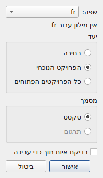
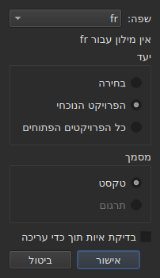
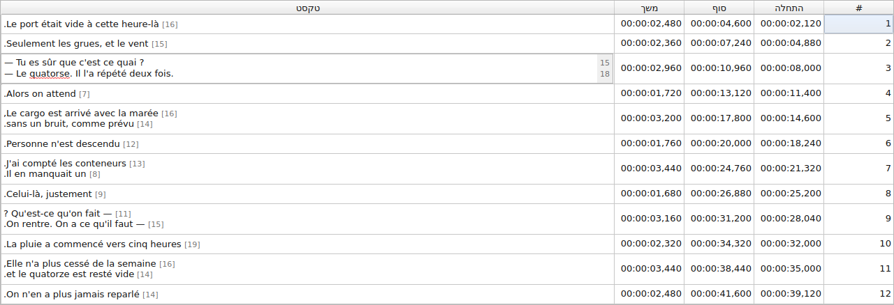
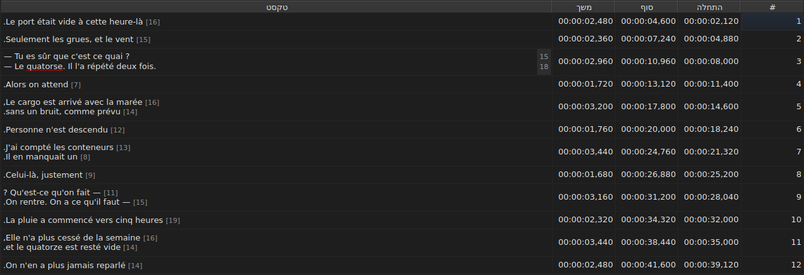
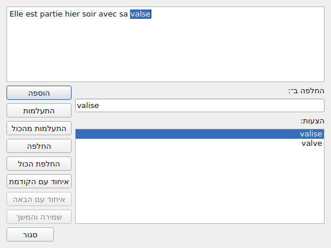
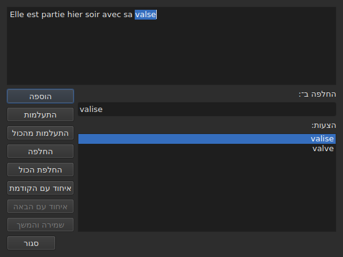

# בדיקת איות…

<!-- machine-translated -->
> דף זה הוא תרגום מכונה שעדיין לא נבדק על ידי דובר השפה.

`כלים ▸ בדיקת איות…` עובר על המילים שהמילון אינו מכיר, אחת אחת, על דגם בודק האיות של Gaupol. יש לו בן לוויה,
`כלים ▸ הגדרות בדיקת האיות…`, שקובע את השפה, את היעד ואת המסמך, ואת קו הציון התחתון בזמן ההקלדה.
שניהם נשענים על מילוני המערכת, באמצעות Enchant.

התווית של הראשון נכתבת `Chec&k Spelling…`: ה-`C` הוא כבר מקש הגישה של `Correct Texts…`, וה-`k` פנוי בתפריט `Tools`.
לאף אחד מהשניים אין קיצור דרך.

**שניהם מושבתים במסמך בלי כתוביות**, כמו [`Correct Texts…`](correct-texts.md): אין מה לבדוק. `Check Spelling…`
מושבת גם כשאין מילון לשפה שנקבעה, ראו [בלי מילון](#בלי-מילון).

## הגדרות בדיקת האיות…





| קבוצה | אפשרויות | ברירת מחדל |
| :---- | :------ | :------ |
| `Language` | קודי השפות שהמערכת מציעה, והקוד שכבר נבחר | שפת המערכת, אם היא ביניהם |
| `Target` | `Selection`, `Current Project`, `All Open Projects` | `Current Project` |
| `Document` | `Text`, `Translation` | `Text` |
| `Check spelling while editing` | תיבת סימון, ראו [קו תחתון בזמן ההקלדה](#קו-תחתון-בזמן-ההקלדה) | לא מסומן |

`Selection` מושבת כשאין שורה שנבחרה בלשונית המוצגת; `Translation` מושבת כל עוד אף מיזם פתוח אינו נושא תרגום.
הגדרה זכורה שאינה זמינה עוד — בחירה ריקה, תרגום חסר — נפתחת על `Current Project` או על `Text`. `OK` שומר את ההגדרות,
`Cancel` אינו משנה דבר.

**חלון זה אינו תלוי במילון**: הוא נשאר פעיל כל עוד יש כתוביות במסמך, גם בלי מילון לשפה שנקבעה, והוא זה שמאפשר לעזוב
שפה שאין לה כזה. השפה שאין לה מילון נשארת ניתנת לעריכה ומופיעה ברשימה, ומתחתיה המשפט `no dictionary for` ואחריו
הקוד שלה.

**ארבע ההגדרות זכורות** מהפעלה להפעלה, בקובץ ההגדרות של `subedit` — ראו [ההעדפות](preferences.md) למיקומו:

| מפתח | ערכים | ברירת מחדל |
| :-- | :----- | :------ |
| `spell-check.language` | קוד שפה, כגון `fr_FR`; ריק: שפת המערכת | ריק |
| `spell-check.target` | `selection`, `current-project`, `all-projects` | `current-project` |
| `spell-check.document` | `main`, `translation` | `main` |
| `spell-check.inline` | `true` או `false` — קו תחתון למילים לא מוכרות בעורך של תא | `false` |

ערך שהמפתח אינו מקבל מתעלמים ממנו, ברירת המחדל חלה, והאפשרות נקראת בשמה בפלט השגיאה כשהחלון נפתח — ראו
[מה קורה כשהקובץ אינו אומר את הצפוי](preferences.md#מה-קורה-כשהקובץ-אינו-אומר-את-הצפוי).

## קו תחתון בזמן ההקלדה





תיבת הסימון `Check spelling while editing` של `Spell-Check Settings…` מציבה קו תחתון **גלי אדום ובזמן ההקלדה** מתחת
לכל מילה לא מוכרת בעורך של תא טקסט — זה של העמודה `Text` וגם זה של העמודה `Translation`. הקו עוקב אחר ההקלדה: הוא
מופיע, זז ונעלם עם המילה. **היא אינה מסומנת כברירת מחדל**, כמו ב-Gaupol: בלעדיה דבר אינו משתנה בעורך.

**השפה היא זו של `Language:`**, באותו חלון, והמילים הלא מוכרות הן אלה ש-`Check Spelling…` היה מוצא: אותם מקרים של
אנגלית מדוברת (`goin'`, `we'd`, `1st`), אותו פירוק למילים. מילה עם קו תחתון אינה מתוקנת מתפריט: תיבת הסימון רק
מראה אותה.

**בלי מילון לשפה שנקבעה, העורך שותק**: דבר אינו מסומן בקו תחתון ושום דבר אינו נכשל, והמשפט `no dictionary for` של
החלון אומר מדוע. תיבת הסימון חלה על העורכים שנפתחים אחריה; עורך שכבר פתוח שומר על מה שהיה לו.

## הסריקה





החלון מציג את הטקסט של הכתובית שבה נעצר, והמילה הלא מוכרת נבחרת בו. **בכל מילה לא מוכרת, הלשונית של המיזם חוזרת
והשורה של הכתובית נבחרת בטבלה.** הסריקה עוברת כתובית אחר כתובית, ואז מיזם אחר מיזם כשהיעד מייעד כמה מהם.

מתחת לטקסט: התיבה `Replace with:`, מלאה בהצעה הראשונה, והרשימה `Suggestions:`. בחירת הצעה מעתיקה אותה לתיבה;
הקלדה בתיבה מחדשת את הרשימה.

| כפתור | מה הוא עושה |
| :----- | :----------- |
| `Add` | מוסיף את המילה למילון האישי של המשתמש ועובר לבאה |
| `Ignore` | משאיר את המילה הזאת ועובר לבאה |
| `Ignore All` | משאיר את המילה הזאת, ואת כל שאר המופעים שלה במהלך הסריקה הזאת |
| `Replace` | מחליף את המילה בתוכן של `Replace with:`; מושבת כל עוד התיבה ריקה |
| `Replace All` | עושה את אותו הדבר לשאר המופעים שלה; מושבת כל עוד התיבה ריקה |
| `Join with Previous` | מצרף את המילה למילה שלפניה; מושבת אם אין כזאת, או אם אינן מופרדות ברווח |
| `Join with Next` | מצרף את המילה למילה שאחריה, באותם תנאים |
| `Save and Resume` | שומר את הטקסט כפי שאזור הטקסט נושא אותו, וממשיך לקרוא **את הטקסט הזה מההתחלה** |
| `Close` | סוגר את החלון |

**אזור הטקסט ניתן לעריכה.** ברגע שמקלידים בו, רק `Save and Resume` נשאר פעיל: שאר המחוות פועלות על המילה שנבחרה,
שאינה עוד זו של הטקסט.

**הסריקה מסתיימת מעצמה** כשלא נותרה מילה לא מוכרת: הכפתורים מושבתים, הטקסט מתרוקן. יעד שאין בו מילה לא מוכרת כלל
אינו מציג חלון.

### סגירה באמצע

`Close`, או הצלב של החלון, **מחיל את מה שנעשה**, כמו סוף הסריקה: הטקסטים שכבר ננטשו, **וגם** המחוות — החלפה,
החלפת הכול, צירוף — שכבר בוצעו בטקסט הנוכחי. זו סטייה מ-Gaupol, שמאבד את הטקסט הנוכחי. מה שלא נחשב הוא מה שנותר
מהסריקה, ואף לא התיקונים הקטנים שהוקלדו באזור הטקסט ש-`Save and Resume` לא אישר.

**פריט היסטוריה אחד לכל מיזם שנגע בו**, יהא מספר ההחלפות אשר יהא: `Undo` מבטל בבת אחת את כל התיקונים של אותו מיזם.
התפריט קורא לו `Undo: correcting texts`. שורת המצב נותנת אז את המניין:

```text
Edited 2 and removed 0 subtitles
```

**רשימת ההחלפות** — מה שהמשתמש החליף, ובמה — נכתבת בסגירה אל `spell-check/<language>.repl`, בתיקיית ההגדרות של
`subedit`, ולא בזו של Gaupol, שאינה נקראת לעולם. היא נמנית אז עם ההצעות של בודק האיות, כאן כמו ב-
[`Correct Texts…`](correct-texts.md#צירוף-או-פיצול-מילים--צירוף-ופיצול-לפי-בודק-האיות).
אם אי אפשר לכתוב אותה, תיבת שגיאה אומרת זאת, `Could not save the
replacements for` ואחריו השפה והסיבה, בלי לבטל את התיקונים.

## בלי מילון

כשלשפה שנקבעה — זו של המערכת, אם לא נבחרה אחרת — אין מילון, **`Check Spelling…` מושבת**, והסבר הכלי שלו וגם שורת
המצב, כשמרחפים מעל הפריט, אומרים מדוע:

```text
no dictionary for fr
```

`Spell-Check Settings…` נשאר, כדי לבחור שפה שיש לה כזה. חלון שנבנה בלי שום ספק מילונים אומר את אותו הדבר ואינו בודק
דבר.

## ההודעות

| הודעה | היכן | מה מפעיל אותה |
| :------ | :---- | :--------------- |
| `no dictionary for fr` | הסבר כלי ושורת המצב | אין מילון לשפה שנקבעה |
| `Nothing to check.` | שורת המצב | היעד אינו מייעד שום טקסט — בחירה ריקה, למשל |
| `Edited N and removed M subtitles` | שורת המצב | בסוף או בסגירה; `M` נשאר `0` |
| `Could not save the replacements for fr: …` | תיבת שגיאה | רשימת ההחלפות לא נכתבה |

## דוגמה

קובץ פתוח נושא את `Elle est partie hier soir avec sa valse`. המילון הצרפתי קיים: `כלים ▸ בדיקת איות…` נעצר על
`valse`, בוחר את השורה בטבלה, ומציע `valise`, שכבר ב-`Replace with:`. `Replace` ואז `Close`: השורה הופכת ל-`Elle est partie hier soir avec sa valise`, ושורת המצב אומרת:

```text
Edited 1 and removed 0 subtitles
```
