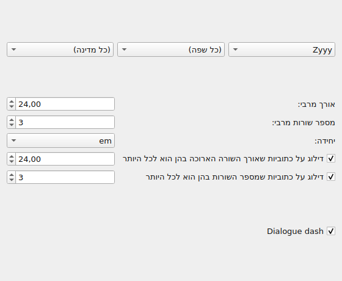
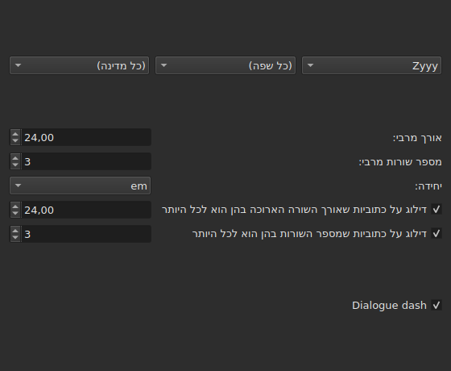
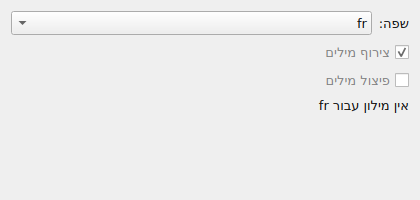
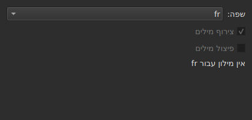
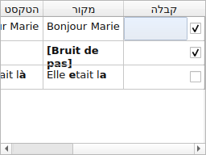
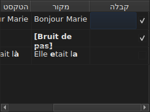

# תיקון הטקסטים…

<!-- machine-translated -->
> דף זה הוא תרגום מכונה שעדיין לא נבדק על ידי דובר השפה.

`כלים ▸ תיקון הטקסטים…` פותח אשף רב-עמודי, על דגם האשף של Gaupol: עמוד של יעד ומשימות, עמוד אחד לכל משימה
מסומנת, עמוד התקדמות, ועמוד אישור שמציע את השינויים בלי לכפות אותם לעולם.

**מושבת במסמך ריק**: אין מה לתקן.

**שורת הפקודה עושה את אותו הדבר** לכל המשימות: [`subedit-cli correct`](../subedit-cli/correct.md), עם אותן
תבניות ואותם מניינים — ובתווים במקום שהחלון מודד באמים. **היא קוראת כברירת מחדל ארבע מההגדרות הזכורות של האשף
הזה** — שתי המחלקות של שגיאות נפוצות (`Human`, `OCR`), `Remove all blank subtitles` והמספר המרבי של שורות ב-`Line Break` —
ואת כל השאר (המשימות, הקוד שלהן, אורך השורה, השפה, תיבות התבניות) היא לוקחת משורת הפקודה שלה. ראו
[שני חלקים, אחד מהם משותף עם שורת הפקודה](preferences.md#שני-חלקים-אחד-מהם-משותף-עם-שורת-הפקודה)
ו-[`subedit-cli config`](../subedit-cli/config.md).

## משימות ויעד — העמוד הראשון

| קבוצה | אפשרויות | ברירת מחדל |
| :---- | :------ | :------ |
| `Target` | `Selection`, `Current Project`, `All Open Projects` | `Current Project` |
| `Document` | `Text`, `Translation` | `Text` |
| `Tasks` | `Mentions`, `Join or Split Words`, `Common Errors`, `Capitalization`, `Line Break` — לסמן אחת או יותר | `Common Errors` ו-`Capitalization` מסומנות, שלוש האחרות לא |

`Selection` מושבת כשאין שורה שנבחרה בלשונית המוצגת; `Translation` מושבת כל עוד אף מיזם פתוח אינו נושא תרגום.

**היעד והמסמך אינם זכורים**: האשף נפתח תמיד מחדש על `Current Project` ו-`Text`. המשימות המסומנות, לעומת זאת, זכורות.

**מה כל יעד מייעד**:

| יעד | פועל על |
| :----- | :------ |
| `Selection` | השורות שנבחרו בלשונית המוצגת |
| `Current Project` | כל הקובץ של הלשונית המוצגת |
| `All Open Projects` | כל הקובץ של כל לשונית פתוחה |

**`All Open Projects` על `Translation` מדלג על המיזמים שאין להם תרגום**: למיזם שאינו נושא תרגום אין מה להציע בעמודה
ריקה, והאשף אינו סופר אותו.

**עמודי המשימות באים אחריו לפי הסדר של Gaupol — `Mentions`, `Join or Split Words`, `Common Errors`, `Capitalization`,
`Line Break` — ולעולם לא לפי הסדר שבו התיבות סומנו.** למשימה שלא סומנה אין עמוד; ההגדרות הזכורות שלה אינן משתנות
בשל כך. **אף עמוד משימה אינו נושא תיבת "פעיל" משלו**: התיבה של העמוד הראשון, והיא בלבד, היא שקובעת אם המשימה רצה.

## עמודי המשימות

כל אחד מארבעת עמודי התבניות — כולם חוץ מ-`Join or Split Words`, שאין בו תבניות — נושא אותו בסיס: שלוש תפריטים נגללים
מדורגים — כתב, שפה, מדינה — לבחירת הקוד של התבניות להחלה, ואחריהם רשימת התבניות של אותו קוד, אחת לסימון לכל שם.
**שלושת התפריטים מציעים רק מה שקטלוג התבניות נושא בפועל** — אלה שהגיעו עם התוכנית ואלה שמשתמש הניח שם (ראו
[תבניות שהונחו בתיקייה](#תבניות-שהונחו-בתיקייה)) — ולעולם לא רשימה של שפות או מדינות שנקראה ממקום אחר. `Zyyy` ("כל כתב")
הוא הקוד ההתחלתי של `Common Errors`, שנותן את התבניות התקפות בכל מקום. **שלושת הסוגים האחרים כוללים תבניות רק תחת
כתב**: העמוד שלהם נפתח על הראשון שהקטלוג מציע, `Latn` עם התבניות שהגיעו עם התוכנית, ולא על `Zyyy`.

**התיאור של כל תבנית הוא הסבר הכלי של תיבתה.** השמות והתיאורים עוקבים אחר שפת החלון בתבניות שהגיעו עם התוכנית;
תבנית משלכם מוצגת כפי שהקובץ שלה כותב אותה ([שפה](invocation.md#שפה)).

**תבנית שהסימון שלה הוסר נשארת לא מסומנת עד שמסמנים אותה שוב**, גם כשמחליפים קוד וחוזרים אליו, והבחירה הזאת זכורה
מפתיחה אחת של האשף לבאה. כשמסמנים אותה שוב היא פשוט מוצאת את ההגדרה המקורית שלה, והבחירה הזכורה נעלמת.

| עמוד | מה הוא מוסיף לבסיס |
| :--- | :----------------------- |
| `Mentions` | שתי תיבות סימון, `Sound in brackets` ו-`Sound in parentheses`, לא מסומנות כברירת מחדל |
| `Common Errors` | שתי תיבות סימון, `Human` ו-`OCR`, מסומנות כברירת מחדל |
| `Capitalization` | שום דבר נוסף |
| `Line Break` | אורך מרבי (`24`, כברירת מחדל), מספר מרבי של שורות (`3`), יחידה — `Characters` או `Ems`, `Ems` כברירת מחדל —, ושני תנאי דילוג, המתוארים להלן |

**שתי התיבות של `Mentions` אינן קוראות בשם לשום תבנית מהודרת**: הן מפעילות סריקה של הטקסט בליבה, אותה סריקה ש-
[`Remove Hearing-Impaired Mentions…`](operations.md#remove-hearing-impaired-mentions)
מבצע כבר בפעולה ישירה. סימון של אחת **או** של השנייה מספיק להפעלתה. **רשימת התבניות של העמוד אינה חוזרת עליהן**: שני
השמות האלה מופיעים שם פעם אחת בלבד, כתיבות סימון.

**`Common Errors` מסנן לפי מחלקה**: תבנית שנושאת את שתי המחלקות חלה ברגע שאחת משתי התיבות מסומנת; שלושת העמודים
האחרים אינם מכירים את ההבחנה הזאת.

### שבירת שורה — היחידה והדילוג





| הגדרה | מה היא עושה | ברירת מחדל |
| :------ | :----------- | :------ |
| `Maximum length` | אורך השורה, ביחידה שנבחרה; מ-`1` עד `1000` | `24` |
| `Maximum lines` | מספר השורות שמכוונים אליו; מ-`1` עד `100` | `3` |
| `Unit` | `Characters` סופר תווים; `Ems` מודד את הרוחב בגופן של החלון, שבו אות קטנה ממוצעת שווה `0.55` — היחידה של Gaupol | `Ems` |
| `Skip subtitles with maximum line length of` | משאיר כמות שהיא כתובית ששורתה הארוכה ביותר נכנסת באורך הזה, ביחידה שנבחרה | מסומן, `24` |
| `Skip subtitles with maximum line amount of` | משאיר כמות שהיא כתובית שמספר שורותיה נכנס במספר הזה | מסומן, `3` |

**לדילוג יש ספים משלו**, נפרדים מהגבולות שמכוונים אליהם: זה הכלל של Gaupol. כתובית נשארת כמות שהיא אם היא נכנסת
ב**כל הספים שתיבתם מסומנת**; אחרת היא נשברת, והשבירה נשמרת רק אם היא מקרבת את הכתובית לסף שחרגה ממנו — פחות אורך,
או פחות שורות. אם אף תיבה אינה מסומנת: כל כתובית נשברת, בין שהיא נכנסת כבר ובין שלא.

**שינוי היחידה משנה מה שמוצע**: אורך כל שורה נמדד בכל חישוב, ביחידה של העמוד באותו רגע, ושום דבר אינו נשאר ממדידה
קודמת. טקסט של עשרים ותשעה תווים, מחציתם אותיות צרות, חורג מ-`24` ב-`Characters` ונכנס בו בנוחות ב-`Ems`.

**שבע ההגדרות זכורות** מהפעלה להפעלה, היחידה בכלל זה.

### צירוף או פיצול מילים — צירוף ופיצול לפי בודק האיות





עמוד נפרד, בין `Mentions` ל-`Common Errors`, לתיקון מה שתוכנות זיהוי טקסט עושות לרווחים. אין בו רשימת תבניות: הוא
נשען על המילונים של המערכת, באמצעות Enchant.

| הגדרה | מה היא עושה | ברירת מחדל |
| :------ | :----------- | :------ |
| `Language` | שפת המילון; הקודים שהמערכת מציעה, והקוד שכבר נבחר | שפת המערכת, אם היא ביניהם |
| `Join words` | מצרף מילה שאויתה שגוי אל המילה השכנה | מסומן |
| `Split words` | חותך מילה שאויתה שגוי לשתיים | לא מסומן |

**צירוף**: מילה שאויתה שגוי מצורפת למילה שלפניה או לזו שאחריה **אם ורק אם רק אחד משני הכיוונים נותן מילה מאויתת
נכון**. כששניהם נותנים אחת, או אף אחד, דבר אינו נעשה. `bon jour` הופך ל-`bonjour`; שני רווחים ברצף מצטמצמים קודם
לאחד, אבל טקסט שבו דבר לא צורף מוחזר כפי שהיה, הרווחים בכלל זה.

**פיצול**: מילה שאויתה שגוי נחתכת אם, בין ההצעות של בודק האיות, **רק אחת** היא אותה מילה עם רווח בתוכה — אותן אותיות,
באותו סדר. שתי הצעות כאלה, או אף אחת: דבר אינו נעשה. מילה שרק האות הראשונה שלה גדולה (`Bonjourtous`) אינה נחתכת
לעולם: לרוב זה שם, ובמילונים אין כאלה.

**רשימת ההחלפות של המשתמש** (`spell-check/<language>.repl`, בתיקיית ההגדרות של התוכנית) נמנית עם ההצעות של בודק
האיות; האשף קורא אותה ואינו כותב אותה.

**בלי מילון לשפה שנבחרה, העמוד נשאר ומאופר**: שתי התיבות מושבתות והעמוד אומר `no dictionary for` ואחריו קוד השפה.
השפה נשארת ניתנת לעריכה — ייתכן שיש מילון לשפה אחרת — והמשימה, בין שסומנה בעמוד הראשון ובין שלא, אינה עושה אז דבר
ואינה מדווחת על שגיאה.

**השפה, שתי התיבות והתיבה של העמוד הראשון זכורות** מפתיחה אחת של האשף לבאה.

### תבניות שהונחו בתיקייה

תבנית שמשתמש הניח בתיקיית התבניות שלו מתווספת לאלה שהגיעו עם התוכנית, באותו קטלוג ותחת אותם תפריטים — דבר אינו
מבדיל ביניהן לאחר הטעינה.

| תבניות | היכן |
| :------- | :---- |
| מהתוכנית | `<prefix>/share/subedit/patterns`, ליד `<prefix>/bin` |
| של המשתמש | `$XDG_DATA_HOME/subedit/patterns`, או `~/.local/share/subedit/patterns` אם המשתנה אינו מוגדר או אינו נתיב מוחלט |

**הפורמט הוא של Gaupol, נקרא כמות שהוא**: קובץ `<Code>.<type>` אחד לכל כתב, שפה ומדינה — `Latn-en.common-error` —,
וקובץ ההפעלה `.conf` שלו לצדו. הסוגים הם `common-error`, `capitalization`, `hearing-impaired` ו-`line-break`. הקבצים
שהגיעו עם התוכנית משמשים דגם. **התבניות נקראות פעם אחת, בהפעלה**: קובץ שהונח בזמן שהחלון פתוח נראה רק בהפעלה הבאה.

## התקדמות

כשלוחצים על `Next` מעמוד המשימה האחרונה שסומנה (או מהעמוד הראשון אם לא סומנה משימה), האשף מחשב את התיקונים המוצעים
בתהליכון ברקע, ובמסך סרגל התקדמות בלתי מוגדר. כשהחישוב מסתיים, עמוד האישור נפתח מעצמו.

**`Cancel` בשלב הזה זונח את החישוב בלי להפסיק אותו**: דבר אינו מוחל, אבל האשף ממתין, לפני שהוא נסגר, שהחישוב
שמתבצע יסתיים — המתנה שמוגבלת בזמן שמנוע התבניות מטיל על כל חיפוש.

**`Back` בשלב הזה חוזר לעמוד הקודם בלי להמתין**: החישוב מסתיים ברקע ותוצאתו נזרקת — האשף אינו קופץ מעצמו אל האישור.
`Next` מתחיל חישוב חדש.

## אישור — העמוד האחרון





שורה אחת לכל טקסט שהאשף ישנה — לעולם לא שורה לטקסט שמשימה השאירה כמות שהוא.

| עמודה | מה היא מציגה |
| :----- | :------------ |
| `Accept` | תיבת סימון, מסומנת כברירת מחדל: התיקון יוחל או לא |
| `Original` | הטקסט כמות שהוא, החלק שישתנה **מודגש** |
| `Corrected Text` | הטקסט המוצע, החלק ששונה מודגש, **ניתן לעריכה** — תיקון קטן בו משנה מה שייכתב, בלי לשנות את התיבה `Accept` |

**השינוי מסומן בהדגשה, לעולם לא בצבע**: אותו הבדל נקרא בשתי הפלטות בלי להיסמך על שום גוון.

**שורה שההצעה בה היא הסרה** — לכתובית לא יישאר טקסט — מציגה את העמודה `Corrected Text` ריקה, ואת כל ה-`Original` שלה
מודגש.

| כפתור | מה הוא עושה |
| :----- | :----------- |
| `Mark All` | מסמן את `Accept` בכל השורות |
| `Unmark All` | מבטל את הסימון של `Accept` בכל השורות |
| `Preview` | מציב את הנגן המובנה על הכתובית של השורה שנבחרה, אם למיזם יש סרט — דבר אם אין |
| `Finish` | מחיל את השורות המסומנות וסוגר את האשף |

`Remove all blank subtitles`, מסומן כברירת מחדל, מסיר את הכתוביות שתיקון היה משאיר בלי טקסט כלל במקום להשאיר אותן ריקות.

**תבנית שהחישוב לא הצליח להחיל נקראת בשמה מתחת לטבלה**, עם הסיבה:

```text
Not applied: some pattern (will not compile)
```

תבנית שנקראת כך נקראת **פעם אחת לכל סיבה**, יהא מספר הטקסטים או המיזמים שבהם נכשלה אשר יהיה: המסך אינו אומר
באילו.

| סיבה | מה מפעיל אותה |
| :----- | :--------------- |
| `cannot be translated` | הביטוי משתמש במה שתרגום התחביר של Python מסרב לו |
| `will not compile` | המנוע מסרב לביטוי |
| `has an invalid replacement` | ההחלפה אינה נקראת כפי ש-Python קורא אותה |
| `timed out` | חיפוש חרג מהזמן שהמנוע מקצה לו על טקסט |
| `never settled` | `Repeat` עדיין שינה את הטקסט אחרי מאה מעברים |
| `grew the text too long` | הטקסט חרג מ-16,384 בתים בזמן שהתבנית עבדה עליו |

**תבנית שנכשלת על טקסט משאירה אותו כפי שהיה לפניה**: החלפה שנעשתה למחצה שווה פחות מהיעדר החלפה. התבניות האחרות חלות.

**שורה של קובץ תבניות שאי אפשר לקרוא נקראת באותו מקום**, בקובץ שלה, בשורה שלה ובסיבה — בכל פתיחה של האשף, שכן
התבניות נקראות פעם אחת בלבד, בהפעלה:

```text
Could not be read: Zyyy.common-error, line 8 (malformed line)
```

| סיבה | מה מפעיל אותה |
| :----- | :--------------- |
| `directory cannot be read` | לא ניתן היה לעבור על תיקיית התבניות שהגיעו עם התוכנית |
| `file cannot be read` | לא ניתן היה לקרוא קובץ תבניות |
| `malformed line` | שורה שאינה כותרת, אינה הערה ואינה `Key=Value` |
| `field outside any pattern` | `Key=Value` לפני כותרת התבנית הראשונה |
| `unknown field` | מפתח שאין לסוג התבנית הזה שימוש בו — התבנית נשמרת |
| `missing field` | מפתח שבלעדיו סוג התבנית הזה אינו יכול לעשות דבר — התבנית נזרקת |
| `invalid value` | ערך שהמפתח אינו מקבל — התבנית נזרקת |
| `malformed activation` | רכיב `<pattern>` של `.conf` שאינו קורא בשם לשום דבר |

התבניות האחרות, אלה שנקראו והוחלו כהלכה, אינן נוגעות בעניין.

## מה הביטול אומר, ומה `Cancel` אינו עושה לעולם

**`Finish` יוצר פריט היסטוריה אחד לכל מיזם שנגע בו**, לעולם לא אחד לכל תיקון: `Undo` מבטל בבת אחת את כל התיקונים
שהתקבלו במיזם הזה, כל אחד עם הטקסט שהיה לו. התפריט קורא לו `Undo: correcting texts`.

שורת המצב נותנת את המניין, הטקסטים ששונו קודם, הכתוביות שהוסרו אחר כך:

```text
Edited 3 and removed 1 subtitles
```

**`Cancel`, בכל עמוד, אינו מחיל דבר ואינו זוכר דבר** — לא את ההגדרות שנבחרו בפתיחה הזאת, ולא את התיקון הקל ביותר.
הפתיחה הבאה של האשף מתחילה שוב מההגדרות של קודם.

## דוגמה

קובץ פתוח נושא שני רווחים בין שתי מילים בשורה, והערה בסוגריים מרובעים בלי טקסט אחר. `כלים ▸ תיקון הטקסטים…`,
`Common Errors` כבר מסומן, `Next` עד האישור: השורה עם שני הרווחים מציגה את `Bonjour  Marie` בעמודת המקור, ואת
`Bonjour Marie` בעמודת התיקון, התיקון מודגש וכבר מתקבל. `Finish` מחיל אותו, ושורת המצב אומרת:

```text
Edited 1 and removed 0 subtitles
```
