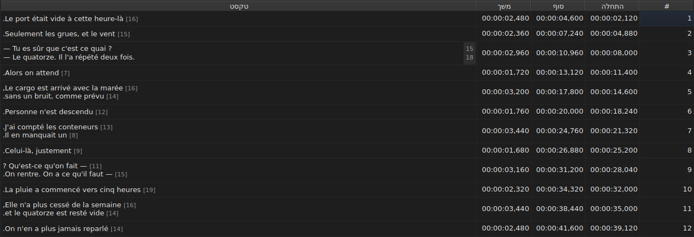

# עריכת תא

<!-- machine-translated -->
> דף זה הוא תרגום מכונה שעדיין לא נבדק על ידי דובר השפה.

ארבע עמודות נערכות במקומן: `Start`, `End`, `Duration` ו-`Text` — חמש
עם העמודה `Translation`, כשיש לפרויקט תרגום. את `#` אי אפשר
לערוך — המספר הוא דירוג השורה, לא נתון של הקובץ.

**פתיחת העורך של תא:** לחיצה כפולה עליו, או בחירה בו
ולחיצה על `F2`.

## הטקסט

**התרגום נערך כמו הטקסט**, באותו שדה רב־שורתי ובאותם
כללים; רק התא משתנה, והטקסט הראשי נשאר כפי
שהיה. אישור שאינו משנה דבר אינו עושה דבר, בזה כמו בזה —
ראו [להלן](#אישור-שאינו-משנה-דבר-אינו-עושה-דבר).

העורך הוא שדה **רב־שורתי**, והוא נפתח בגובה הכתובית:
כתובית של שתי שורות מוקלדת בו כפי שתיכתב, שתי שורותיה
קריאות וללא פס גלילה. `Shift+Enter` שמוסיף שורה מגדיל
את העורך; שורת הטבלה מתכווננת באישור.

| מקש | השפעה |
| :-- | :----- |
| `Enter` | מאשר וסוגר את העורך |
| `Shift+Enter` | מכניס מעבר שורה לטקסט |
| `Esc` | סוגר את העורך; התא שומר על מה שהיה לו |
| `Tab` | מאשר ועובר לתא הבא |

גם לחיצה במקום אחר מאשרת: אובדן המיקוד שווה ל-`Enter`.

**אחת עשרה מחוות בלי תיבת דו־שיח מאשרות כך גם הן** לפני שהן מחשבות את היעד שלהן:
`Italic`, `רישיות/קטנות ▸ …`, `Dialogue`, `Merge Subtitles`, `Split Subtitle`,
`Cut Texts`, `Paste Texts`, `Copy Texts`, `Remove Subtitles`, `Undo` ו-`Redo`.
כשהן מופעלות מהתפריט, מסרגל הכלים או מקיצור דרך של החלון, הן
לוקחות את הטקסט כפי שהעורך אישר אותו זה עתה, כמו אחרי לחיצה
במקום אחר. `Ctrl+X`, `Ctrl+C` ו-`Ctrl+V` נשארים עם העורך כל עוד
הוא פתוח — ראו [גזירה, העתקה והדבקה של טקסטים](clipboard.md): התפריט הוא אז
שמפעיל את `Cut Texts`, `Copy Texts` ו-`Paste Texts`.

`Undo` ו-`Redo` קוראות את ההיסטוריה ולא את המסמך: ראו
[ביטול וביצוע חוזר](undo.md). מחווה שפותחת תיבת דו־שיח אינה
זקוקה לכלל זה, שכן תיבת הדו־שיח לוקחת את המיקוד כשהיא נפתחת, וזה
כבר מאשר את הקלט.

### התגיות הן אלה של הקובץ

הטקסט המוצג והמוקלד הוא **זה של הקובץ, כולל התגיות**:
`<i>…</i>` של SubRip נכתב כך, וכך גם `{\i1}…{\i0}` של Advanced SSA.
דבר אינו מתורגם לצורך התצוגה — הטבלה של
[`Italic`](operations.md#italic) אומרת מה כל פורמט כותב.

בנוגע לנטוי אין אפוא מה לדעת: `Ctrl+I` קובע את התגית הנכונה
למסמך הפתוח, ופורמט שאינו נושא כזו — TMPlayer, LRC —
משבית את הפריט במקום להשאיר אתכם לחפש. מודגש וקו תחתון
מוקלדים, כמו ב-Gaupol.

**והתגיות אינן עוקבות אחר פעולות הטקסט**: העברת כתובית
לאותיות קטנות אינה הופכת את `<I>` שלה ל-`<i>`, ומקף דו־שיח
מוצב לפני הטקסט ולא לפני תגית פותחת. ראו
[`Case` ו-`Dialogue`](operations.md#case-ו-dialogue).

## אורך השורות

**עורך הטקסט מראה, בשוליים מימין, את אורך כל
שורה**, ביישור לשורת הטקסט הראשונה שלה. רוחב השוליים כרוחב
המספר הגדול ביותר, והם מתעדכנים **תוך כדי הקלדה** ועוקבים אחר הגלילה.
טקסט ריק אינו מראה דבר. האורכים הם אלה של הטבלה — בלי
התגיות, מעוגלים כלפי מטה, ביחידה שנקבעה — והם מוסרים באמצעות תיבת הסימון
`Show line lengths in the editor` של `עריכה ▸ העדפות…`. ראו
[אורכי שורה](preferences.md#אורכי-שורה).

## ההתחלה והסוף

העורך הוא שדה של שורה אחת, **מוגבל לצורה של חותמת זמן**:
הוא מסרב, תוך כדי הקלדה, למה שלעולם לא יוכל להיות כזו.

הצורות המתקבלות הן אלה שקריאת קובץ מקבלת כבר:

| רכיב | מה עובר |
| :------ | :---------- |
| שדות | `MM:SS` או `HH:MM:SS`, ספרה אחת או שתיים בכל אחד |
| שברים | אחד עד שלושה, אחרי פסיק או נקודה, או בלעדיהם |
| סימן | `-` בתחילת הערך, למיקום שלפני תחילת הווידאו |
| גבולות | דקות ושניות מתחת ל-60 |

`00:01:02,500`, `1:02.5` ו-`-0:01,000` הם אפוא שלושה קלטים תקפים.

**קלט שהקריאה מסרבת לו משאיר את התא בלי שינוי.** כך במקרה
של `00:70:00,000`, שצורתו נכונה אך הדקות בו חורגות
מהגבולות: העורך נסגר ושום דבר לא זז. שום מיקום אינו ממציאים
— טעות במיקום שקטה, דבר על המסך אינו מבחין בין כתובית
שתוזמנה גרוע לכתובית שתוזמנה היטב.

שינוי של התחלה או של סוף מעדכן מיד את ה-`Duration`.

## המשך

**הקלדת משך מזיזה את הסוף, ולעולם לא את ההתחלה**: הסוף נעשה
`Start + Duration`. הזזת ההתחלה הייתה מזיזה את הכתובית כולה, וזו
העבודה של [`Shift Positions…`](operations.md), ואת העמודה `Start` אפשר
כבר להקליד.

המשך מוקלד **בצורה של חותמת זמן**, זו שהעמודה
מציגה, והצורות שבטבלה שלמעלה חלות — בהבדל אחד:

| רכיב | התחלה, סוף | משך |
| :------ | :--------- | :------- |
| צורה | זו של חותמת זמן | אותה צורה |
| סימן `-` בתחילת הערך | מתקבל | **נדחה תוך כדי הקלדה** |

`0:02.5` ו-`00:00:02,500` הם אפוא שני קלטים תקפים של משך של שתי שניות
וחצי; את `-0:01,000` אי אפשר להקליד. משך אפס מתקבל:
הכתובית נעלמת אז ברגע שהיא מופיעה.

**סוף שחורג מעבר לכתובית הבאה מותר.** החפיפה
נצבעת בטבלה, עם הסבר הכלים שלה — ראו
[החריגות](table.md#החריגות) — הודעה, לא סירוב: ייתכן שזה מה
שרציתם. גם [רשימת האבחונים](files.md#אבחוני-הקריאה)
נושאת אותה, ומסירה אותה כשתיקנתם אותה.

**סוף שהוקלד מעבר לסוף הסרט אינו מדווח**, בניגוד
לפעולה מתפריט `Tools` שהייתה דוחפת אותו לשם — ראו
[הפעולות](operations.md#מעבר-לסוף-הסרט). תא כבר מראה
את הערך שהוקלד זה עתה.

קלט שאינו קריא משאיר את התא בלי שינוי, כמו במיקום, ומשך
זהה לזה שמוצג אינו נכנס להיסטוריה.

## אישור שאינו משנה דבר אינו עושה דבר

פותחים תא, אין מקלידים דבר, לוחצים `Enter`: דבר אינו קורה.
אף שינוי אינו נרשם, והקובץ עדיין נחשב זהה
לזה שבדיסק.

ההשוואה היא על **המיקום**, לא על המחרוזת: הקלדת `0:01.0`
בתא שמציג `00:00:01,000` מצביעה על אותו רגע,
ולכן גם היא אינה משנה דבר.

## מה עולה בגורלו של תא שנערך

אפשר **לבטל** אותו — תא אחד, רשומה אחת. ראו
[ביטול וביצוע חוזר](undo.md).

הוא **נשמר**, וסגירת החלון בלי לעשות זאת מבקשת
אישור. ראו [פתיחה ושמירה](files.md).
