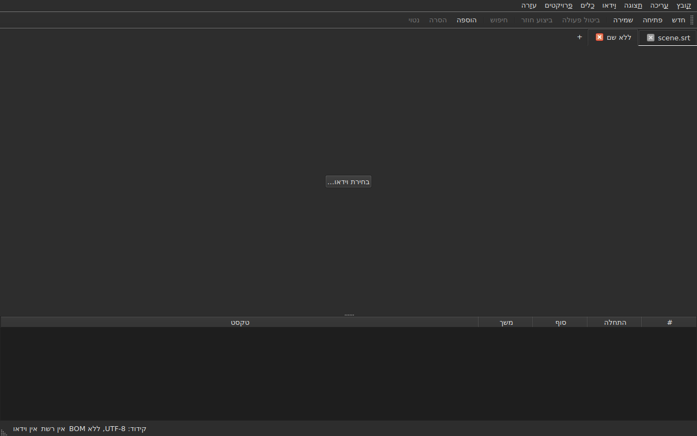
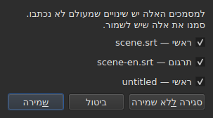
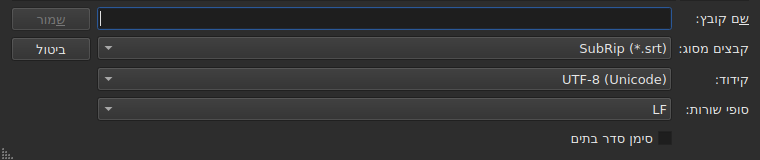
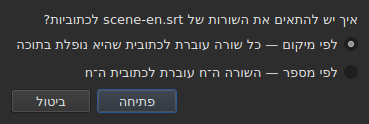
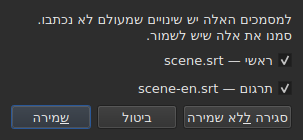

# פתיחה ושמירה

<!-- machine-translated -->
> דף זה הוא תרגום מכונה שעדיין לא נבדק על ידי דובר השפה.

התפריט **קובץ** כולל את שלוש הפקודות, שתיים ללשוניות, ושלוש
נוספות לתרגום; התפריט **פרויקטים** פועל על כל הלשוניות בבת אחת.

| פקודה | קיצור דרך | מה היא עושה |
| :------ | :------- | :----------- |
| פרויקט חדש | `Ctrl+N` | פרויקט ריק, בלשונית חדשה — וגם הלחצן `+` אחרי הלשונית האחרונה |
| פתיחה… | `Ctrl+O` | בוחרת קובץ ופותחת אותו בלשונית חדשה — או במקום פרויקט ריק |
| פתיחת תרגום… | — | בוחרת קובץ תרגום ומתאימה אותו לקובץ הראשי של הלשונית הנוכחית |
| שמירה | `Ctrl+S` | כותבת מחדש את הקובץ הפתוח |
| שמירה בשם… | `Ctrl+Shift+S` | בוחרת נתיב ופורמט, ואז כותבת |
| שמירת התרגום | — | כותבת מחדש את הקובץ של התרגום |
| שמירת התרגום בשם… | — | בוחרת נתיב ופורמט לתרגום, ואז כותבת |
| סגירה | `Ctrl+W` | סוגרת את הלשונית הנוכחית — מושבתת אם יש רק אחת |

`New Project`, `Open…` ו-`Save` נמצאים גם ב
[סרגל הכלים](index.md#סרגל-הכלים), תחת המילים `New`, `Open` ו-
`Save`. **שלושת הפריטים של
התרגום אינם בסרגל**: הם משרתים רק את מי שיש לו
תרגום, והסרגל הוא של כולם.

## כמה פרויקטים, בלשוניות

**לכל פרויקט פתוח יש לשונית משלו**, מעל התמונה והטבלה:
התווית שלה היא שם הקובץ, או `untitled` לפרויקט שאין לו עדיין
קובץ. לחיצה על לשונית עוברת אליה; `Ctrl+PageDown` ו-`Ctrl+PageUp` עושים
אותו דבר, בלי העכבר, וחוזרים ללשונית הראשונה אחרי האחרונה.
**הלחצן `+`, מיד אחרי הלשונית האחרונה**, פותח פרויקט ריק בלשונית
חדשה, כמו `New Project`.




**`Open…` לעולם אינו נוגע בהן.** פתיחת קובץ כבר אינה מחליפה את מה שהחלון
הציג: הוא מגיע ללשונית חדשה, לצדה, והלשונית שהסתכלתם עליה קודם
שומרת על כל מה שהיה לה — ההיסטוריה, הבחירה, הווידאו
המשויך. גם משום כך פתיחה כבר אינה שואלת דבר: אין
מה להפסיד, שהרי אין מה להחליף.

**יוצא מן הכלל אחד: הפרויקט הריק מוותר על מקומו.** כשהחלון מופעל בלי קובץ, או
אחרי `New Project`, הוא מציג פרויקט `untitled` שאין בו דבר.
קובץ שנפתח — דרך `Open…` וגם דרך גרירה — **תופס אז את הלשונית שלו,
באותו מקום בסרגל**, במקום לפתוח עוד אחת לצד פרויקט
חסר תועלת. פרויקט הוא ריק כש**אין לו קובץ, אין בו כתובית,
אין מה לבטל או לבצע שוב, אין לו סרט, והוא מעולם לא שונה**: די באחד
מהדברים האלה כדי שיישמר לו מקומו. פרויקט ריק שאינו
הלשונית הנוכחית אינו נפגע.

**קובץ שכבר פתוח אינו נפתח פעם שנייה.** `Open…` על
קובץ שלשונית אחרת מחזיקה כבר מחזיר את המיקוד ללשונית ההיא, ואומר זאת
בשורת המצב:

```text
premier.srt: already open
```

**כל לשונית היא פרויקט שלם, בלתי תלוי באחרות**: ההיסטוריה שלו,
הבחירה שלו, הווידאו המשויך שלו ומה שהקריאה האחרונה שלו
נתקלה בו מוצגים רק כשהלשונית היא הנוכחית, ואינם
משתנים בזמן שאחרת נוכחית. **יוצא מן הכלל אחד, והוא ב-ADR
0033**: נגן הווידאו יחיד לכל החלון — תהליך mpv
אחד — והסרט שלו משתנה עם הלשונית; **כל לשונית זוכרת היכן הסרט שלה
היה**, וממשיכה אותו משם, מושהה, כשחוזרים אליה. לוח ההעתקה, מצדו, שייך לחלון: העתקה
בלשונית אחת והדבקה באחרת היא הסיבה שבגללה פותחים שתיים.

**`Close` סוגר את הלשונית הנוכחית**, ושואל במידת הצורך
[את שאלת השינויים שלא נשמרו](#שינויים-שלא-נשמרו) —
של הלשונית הזו בלבד, שהאחרות אינן נוגעות בעניין. **מושבת כשיש
רק לשונית אחת**: החלון שומר תמיד לפחות אחת, וסגירתה
הייתה סגירת החלון — מה שהלחצן של המערכת כבר עושה.

**לכל לשונית יש גם איקס**, שסוגר את הפרויקט **שלה**, עם אותה
שאלה. האיקס של לשונית שאינה הנוכחית סוגר אותה, והלשונית
שמסתכלים עליה נשארת מוצגת; אם לפרויקט הזה יש שינויים, הלשונית שלו
עולה לחזית לזמן השאלה. **אין איקס כשנשארה רק
לשונית אחת**, מאותה סיבה ש-`Close` מושבת.

**לשונית אומרת שהיא שונתה**: כוכבית באה אחרי שמה, `premier.srt*`,
כל עוד אחד המסמכים שלה שונה מהקובץ שלו — כפי שכותרת החלון
אומרת על הפרויקט שמסתכלים עליו. היא נעלמת בשמירה.

## תפריט המיזמים

שתי פקודות פועלות על כל הפרויקטים בבת אחת.

| פקודה | קיצור דרך | מה היא עושה |
| :------ | :------- | :----------- |
| שמירת הכול | `Ctrl+Shift+L` | כותבת כל מסמך ששונה, לשונית אחר לשונית |
| סגירת הכול | `Ctrl+Shift+W` | סוגרת את כל הפרויקטים — כלומר את החלון |

**`Save All` הולך לפי סדר הלשוניות**, המסמך הראשי לפני התרגום.
מסמך שיש לו קובץ נכתב מחדש שם **בלי שהלשונית שלו תעלה לחזית**;
**מסמך שאין לו פותח `Save As…`, אחד בכל פעם**, בלשונית שלו —
המקרה היחיד ש-`Save All` מחליף בו לשונית, כדי שהתיבה תראה על איזה
פרויקט היא מדברת. **ביטול של `Save As…`, או של
שמירה שנכשלת, עוצר את היתר**: הפרויקטים הבאים אינם
נוגעים, ותיבה אומרת מה נכתב.

```text
Save All stopped: 1 of 3 documents saved
```

כשהכול כתוב, שורת המצב אומרת זאת — `2 documents saved`, או
`Nothing to save` כששום דבר לא שונה. אם `Save As…` העלה
לשונית לחזית, החלון חוזר אז לזו שבה הפקודה
הופעלה.

**`Close All` ואיקס החלון הם דבר אחד**: החלון
שומר תמיד פרויקט, וסגירת כולם היא סגירתו. לכן הם שואלים
**שאלה אחת לכל הפרויקטים**, זהה לזו של
[שני מסמכים ששונו](#סגירה-כששני-מסמכים-שונו), עם תיבת סימון אחת
לכל מסמך ששונה בכל לשונית:




**`Cancel` אינו סוגר דבר**, ואינו משאיר דבר כתוב. `Save` כותב
את המסמכים המסומנים כמו `Save All`: מאחורי הלשונית שלהם, פרט למסמך בלי
שם, שהלשונית שלו עולה לחזית בשביל `Save As…`. כששונה מסמך
אחד בלבד בכל הפרויקטים, זו השאלה הפשוטה שהייתה
תמיד, הנשאלת בלשונית שלו. `Save All As…` אינו קיים: זהו רצף של
`Save As…`, ש-`Save All` כבר שואל, אחד בכל פעם, על המסמכים שאין להם שם.

## פתיחה

התיבה מסננת **את תשעת הפורמטים הנקראים**, פריט לכל אחד, ופריט
ראשון שמראה את כולם. הפורמט מזוהה אחר כך **לפי התוכן, לא לפי
הסיומת**: קובץ `.txt` שמכיל SubRip נפתח, והמסנן אינו מכריע
דבר — הוא רק מסתיר קבצים.

| פריט במסנן | סיומת |
| :----------- | :-------- |
| `SubRip` | `.srt` |
| `WebVTT` | `.vtt` |
| `SubViewer 2` | `.sub` |
| `Sub Station Alpha` | `.ssa` |
| `Advanced SSA` | `.ass` |
| `MicroDVD` | `.sub` |
| `MPL2` | `.txt` |
| `TMPlayer` | `.txt` |
| `LRC` | `.lrc` |

**שתי סיומות מציינות שני פורמטים כל אחת** — `.sub` הוא SubViewer 2 ו-
MicroDVD, `.txt` הוא MPL2 ו-TMPlayer. אין לכך השלכה בפתיחה,
שכן התוכן מכריע; בשמירה, **השם** של
הפריט שנבחר הוא שקובע את הפורמט, לעולם לא התבנית שלו.

**קובץ שאינו קריא אינו פותח דבר.** חסר, נדחה על ידי המערכת, כתוב
בקידוד שהבתים שלו אינם מפוענחים בו, או שאינו בפורמט מוכר:
תיבה מודאלית **נוקבת בסיבה**, לא נפתחת לשונית, והלשוניות
שהיו אינן זזות.

| הודעה | מה קרה |
| :------ | :------------ |
| `does not exist` | הנתיב אינו מצביע על אף קובץ |
| `cannot be opened: permission denied` | המערכת מסרבת לפתוח אותו |
| `cannot be read` | המערכת סירבה מסיבה אחרת |
| `cannot be decoded in the chosen encoding` | הבתים אינם נקראים בקידוד שנבחר |
| `is in no format this tool knows` | אף פורמט אינו מזהה את התוכן |
| `holds nothing recognisable as a subtitle` | הפורמט מזוהה, אך דבר בו אינו כתובית |

לפני ההודעה בא הנתיב: `notes.txt: is in no format this tool knows`.
אלה המילים של שורת הפקודה, וזה אינו מקרה — שני
הממשקים קוראים קובץ באותו מתכון.

### גרירת קבצים אל החלון

**גרירת קבצים לכל מקום בחלון פותחת אותם**, ממנהל
הקבצים: הטבלה, סרגל הלשוניות, הלחצן
`Select Video…`, ו**תמונת הסרט עצמה**, בניגון וגם בעצירה.
התמונה היא חלון נפרד שהנגן מצייר, ושום דבר לא הבטיח
שהוא יעביר הלאה גרירה; זה נבדק ביד בשולחן עבודה אמיתי,
בהפעלת Wayland. `subedit-gui` מופעל שם תחת X11 כדי שיוכל להציג
את הסרט, ולכן הגרירה עוברת בפרוטוקול X11 — זה של
הפעלת X11, שבה לא נוסתה בנפרד.

- **כל קובץ כתוביות פותח לשונית משלו**, לפי הסדר שבו הם
  נגררו — בדיוק כמו `Open…`. קובץ **שכבר פתוח** אינו
  נקרא שוב: הלשונית שלו עולה לחזית, ושורת המצב אומרת זאת
  (`premier.srt: already open`).
- **וידאו שנגרר משויך ללשונית הנוכחית**, כמו ב-
  `Select Video…`. אם נגרר עם כתוביות, הוא הולך ללשונית האחרונה
  שהן פתחו, יהא סדר הגרירה אשר יהיה. וידאו מזוהה לפי
  הסיומת שלו — אותה רשימה כמו זו שמציעה סרט לצד
  הקובץ.
- **שני סרטונים או יותר בבת אחת אינם נפתחים**: פרויקט צופה
  בסרט אחד. הכתוביות של אותה גרירה, מצדן, נפתחות.
- **קובץ שאינו נפתח אינו עוצר את האחרים.** תיבה אחת אומרת אז
  מה לא ניתן היה לעשות, שורה לכל קובץ, במילים
  של `Open…`:

  ```text
  /films/notes.txt: is in no format this tool knows
  /films/absent.srt: does not exist
  ```

רק קבצים מקומיים נלקחים: קישור שנגרר מדפדפן
אינו מצביע על דבר שהחלון יכול לקרוא.

הפתיחה משורת הפקודה עדיין עובדת: `subedit-gui film.srt`.
שם אותה סיבה נכתבת בזרם השגיאות, והחלון נפתח
ריק — ראו [הפעלה](invocation.md#כשהפתיחה-נכשלת).

## אבחוני הקריאה

קובץ אמיתי הוא לעיתים נדירות מושלם, והקריאה מתאוששת במקום
לוותר: מספר חסר, שורה שאינה מובילה לשום מקום, סופי
שורות מעורבים. **מה שהיא נתקלה בו נכנס בלחצן בשורת המצב**
— `2 diagnostics`, משמאל למה שהסרגל כבר אומר על המסמך —, ו**הרשימה נפתחת בלחיצה
בחלון צף** מעל הלחצן. שום שורה של החלון אינה נלקחת בשבילה:
הטבלה שומרת על גובהה המלא, בין אם לקריאה היה מה לומר ובין אם לא. הרשימה
נסגרת בלחיצה במקום אחר או ב-`Esc`.

```
a SubRip block without its number, settled by the reader: 5
```

**כל שורה סופרת**: מה שנתקלו בו, מה שנעשה בנידון, וכמה
פעמים. קובץ שנעשה רע נתקל במאות, והידיעה
כמה מכל סוג היא שמאפשרת לפעול; מספר השורה של כל מופע בקובץ,
מצדו, נקרא בשורת הפקודה, ברמת הדיבור `-vvv`. הלחצן
סופר את השורות האלה — אחת לכל סוג —, לא את המופעים.

**הקידוד שנוחש מופיע גם הוא שם**, פעם אחת: הוא הוצע בשקילת
הבתים, לפני שנולדה שורה אחת של הקובץ.

```
an encoding nothing declared, settled by the reader: 1
```

הוא מוצג רק כשהקידוד **נוחש ואינו
UTF-8** — קובץ UTF-8 שנקרא ככזה אינו אירוע, ואמירה על כך
בכל פתיחה הייתה מציבה לחצן בשורת המצב של כל מסמך
רגיל. קובץ שנושא סימן סדר בתים אינו מפעיל אותו
גם הוא: הוא הצהיר על הקידוד שלו, לא נוחש דבר.

**אותה רשימה סופרת גם מה שאינו תקין בכתוביות עצמן**:
כתובית שמתחילה לפני שהקודמת הסתיימה, סוף לפני
ההתחלה שלו, התחלה לפני זו של הכתובית שמעליה. הטבלה צובעת אותן, אך
צבע מוצאים בגלילה, ובקובץ של אלפיים שורות
קל לפספס אחד; כאן הסוגים כולם יחד, **אחד בכל
שורה ועם מספרו**, במילים של הדוח של `inspect`:

```
subtitle starts before the previous one ends: 12
subtitle starts before the previous one starts: 3
```

**לחיצה על אחד מובילה לכתובית הראשונה הנוגעת בדבר**, שנבחרת
בטבלה. השורות האלה **עוקבות אחר התיקונים** — מיון או תיקון משך
מסירים חלק מהן, או מנמיכים את מספרן —, בלי לסגור את הרשימה
שקוראים. כתובית יכולה להיספר פעמיים: התחלה לפני הסוף של
הקודמת ולפני ההתחלה שלה הן שני ממצאים, המתוקנים בשתי
דרכים. כדי למנות אותם אחד אחד, `subedit-cli inspect --detail`.

הלחצן **אינו מופיע** כשאין מה לדווח, לא בקריאה ולא
בכתוביות, ו**הוא עוקב אחר הלשונית**: כל פרויקט שומר את
האבחונים של הקריאה שלו, והלחצן מראה את אלה של הפרויקט המוצג.

## הקידוד בשורת המצב

**שורת המצב נותנת תמיד את הקידוד של המסמך הפתוח**, משמאל למה
שהיא אומרת על [רשת הפריימים](frame-grid.md) ועל
[הווידאו המשויך](video.md):

| מצב | מה נכתב |
| :-------- | :-------------- |
| הקובץ נקרא כ-UTF-8, בלי סימן | `Encoding: UTF-8, no BOM` |
| … עם סימן | `Encoding: UTF-8, BOM` |
| קובץ ב-Latin-1 | `Encoding: ISO-8859-1, no BOM` |

**האבחון והשורה הזו אינם עונים על אותה שאלה**, וזו
הסיבה ששניהם קיימים. האבחון אומר מה הקריאה **עשתה** — היא
ניחשה, ואולי כדאי לבדוק; לכן הוא מוצג רק כשהיה
ניחוש. שורת המצב אומרת מה המסמך **הוא**,
באופן קבוע, כולל לקובץ שמצהיר בעצמו על הקידוד שלו ושעליו
לקריאה אין מה לספר.

**מקור התשובה אינו מופיע שם.** `inspect` נותן אותו — `detected`,
`from its byte order mark`, `as asked for` — כי לדוח יש מקום
לומר אותו; לשורת מצב אין, ורשימת האבחונים כבר נושאת אותו כשזה
חשוב.

## שמירה

`Save` כותב מחדש את הקובץ הפתוח **בצורתו המקורית**: הפורמט שלו,
הקידוד שלו, סופי השורות שלו, סימן סדר הבתים שלו והכותרת שלו.
קובץ שנפתח ואז נשמר בלי שינוי אינו זז בבית אחד — ראו
את האחריות המדויקת להלן.

הכתיבה היא **אטומית**: היא עוברת דרך קובץ זמני שמשנים את שמו
על הקובץ. שמירה שהופסקה בכל רגע משאירה את הגרסה הקודמת
שלמה.

שמירת מסמך שמעולם לא היה בדיסק שקולה ל-`Save As…`.

**כתיבה שנכשלת אומרת זאת ואינה מאבדת דבר**: דיסק מלא, קובץ
לקריאה בלבד, תיקייה חסרה — או **תו שקידוד הקובץ
אינו יכול לכתוב**, `ł` בקובץ Latin-1. ההודעה היא
אז `holds a character the chosen encoding cannot write`, ושום דבר אינו
נכתב: החלפת התו ב-`?` הייתה מאבדת טקסט לעיני מי
שהקליד אותו הרגע. ההודעה נוקבת בקובץ ובסיבה, החלון שומר
על השינויים שלו, והסימן בכותרת נשאר.

## שמירה בשם

`Save As…` שואל נתיב, פורמט, **ואת צורת הבתים הנכתבים**:
הקידוד, סופי השורות, סימן סדר הבתים. המסמך **חי אז
שם**: הכותרת משתנה, `Save` מכוון לקובץ החדש וכותב בצורה
שנבחרה, והקובץ המקורי נשאר כפי שהיה.

**תשעת הפורמטים מוצעים**, והפריט הנבחר כשהתיבה
נפתחת הוא **של המסמך**. שמירה בשם אחר בלי לגעת
במסנן לכן אינה משנה את הפורמט.




**התמונות מראות רק את תחתית התיבה**, לא את רשימת הקבצים
שמעליה: היא תלויה במחשב — התיקיות שלו, התאריכים שלו, קיצורי
הצד שלו —, ולכן הצילום שלה לא היה זהה פעמיים.
הפס הזה כן, ושם הכול קורה.

| שדה | מה הוא מציע | ברירת מחדל |
| :---- | :------------- | :------ |
| `Encoding` | ארבעה עשר קידודים שקובץ כתוביות נושא בפועל, ובנוסף `Other…` | **זה של הקובץ שנקרא** |
| `Other…` | שדה להקלדת כל קידוד ש-ICU יכול לכתוב, **עם השלמה** — `cp1257`, `EUC-KR` | — |
| `Line endings` | `LF`, `CRLF` או `CR` | אלה של הקובץ שנקרא |
| `Byte order mark` | הסימן, **מושבת לקידוד שאינו נושא כזה** | זה של הקובץ שנקרא |

**ברירות המחדל הן אלה של הקובץ שנקרא, וזו אחריות ולא
נוחות**: קובץ שנפתח ואז נשמר שוב בלי לגעת בשלושת
השדות האלה מחזיר את אותם בתים.

**הרשימה קצרה, והיא אינה תקרה.** ICU מכיר מאתיים
עשרים ואחד; מה שהתפריט מציע הוא מה שקובץ כתוביות נושא
בפועל, כי תפריט של מאתיים פריטים לא עוזר לאיש. `Other…`
פותח את היתר.

**השדה משלים על פני מאתיים עשרים ואחד**, ולכן אין צורך
לדעת את השם המדויק: הקלדת `1252` מציעה `windows-1252`, הקלדת `koi`
מציעה `KOI8-R` ו-`KOI8-U`. ההשלמה היא על מה שהשם **מכיל**
ולא על מה שהוא מתחיל בו — השם הקנוני של מערבי של Windows הוא
`windows-1252`, ו-`cp1252` הוא זה שאנשים חושבים עליו. אפשר גם
לכתוב את שניהם במלואם בלי השלמה: ICU מקבל את הכינויים שלו.

**שם שאיש אינו מכיר אינו כותב דבר.** הקלדת `klingon-1` אינה
חוזרת ל-UTF-8: דבר אינו נכתב, וההודעה אומרת זאת.

**וכך גם שם שאינו קובע את סדר הבתים.** `UTF-16` ו-`UTF-32` הם
שמות ש-ICU מכיר, והממיר שלהם כותב **סימן משלו**: תיבת הסימון
`Byte order mark` כבר לא הייתה מכריעה דבר. שניהם
נדחים, וההודעה מפנה אל `UTF-16LE` או `UTF-16BE`, שכותבים
את אותם בתים בשליטת תיבת הסימון. זהו אותו סירוב, באותן
מילים, כמו זה של שורת הפקודה.

**תו שהקידוד שנבחר אינו יכול לכתוב עוצר את השמירה**
— `ł` ב-Latin-1. ההודעה היא
`holds a character the chosen encoding cannot write`, החלון שומר על
השינויים שלו, והקובץ היעד אינו נפגע.

**גם המסמך אינו זז**: הוא נשאר על הקובץ שלו, בפורמט
ובקידוד שלו, וה-`Save` הבא כותב מחדש את זה שנפתח.
שמירה שלא התקיימה אינה משנה דבר — לא בדיסק,
ולא בחלון.

שינוי פורמט משנה את מה שהטבלה מציגה — המפריד העשרוני עוקב אחר
הפורמט, פסיק ב-SubRip, נקודה ב-WebVTT, ו**התגיות נכתבות מחדש
באוצר המילים של פורמט היעד**: `<i>` הופך ל-`{\i1}` ב-Sub
Station Alpha, ל-`{Y:i}` ב-MicroDVD, ל-`/` בראש שורה ב-MPL2. המסמך
**הפך** לקובץ הזה, ולכן הטבלה מראה את מה שהקובץ נושא.

**זו אינה פקודה, ו-`Ctrl+Z` אינו מבטל אותה.** מסמך שהפורמט שלו
אמר LRC והטקסטים שלו עדיין אמרו `<i>` היה מסמך
לא קוהרנטי; אין חצי שאפשר לבטל.

## מה שפורמט לא ישמור, נאמר לפני הכתיבה

**תיבה מודאלית מזהירה, ועדיין אפשר לענות לא.** היא מונה מה
פורמט היעד לא יחזיק, פריט פריט, במילים שבהן שורת
הפקודה כותבת אחר כך:

```
ends are not carried by LRC, line breaks were joined in 2 subtitles, 1 tag dropped
```

| לחצן | השפעה |
| :----- | :----- |
| `Save` | כותב בכל זאת, וההפסד התקבל |
| `Cancel` | אינו כותב דבר; המסמך אינו זז, לא הקובץ ולא הפורמט |

`Cancel` הוא לחצן ברירת המחדל: מקש Enter שנלחץ בלי לקרוא משאיר את
הקובץ כמות שהוא.

**לא נשאל דבר כשדבר אינו הולך לאיבוד.** תיבה שהכריזה „דבר
לא יאבד” הייתה מלמדת לסגור את זו שחשובה.

מה שאפשר להכריז:

| פריט | מתי |
| :--- | :--- |
| הסופים | פורמט היעד אינו נושא כאלה — TMPlayer, LRC |
| שבירות השורה | פורמט היעד אינו נושא כאלה — LRC |
| התגיות | לתגית של המקור אין מקבילה ביעד, או שהציר אינו מכיר אותה |
| הכותרת | הקובץ שנקרא נשא כזו, והיא אינה עוברת |
| השדות המוצהרים | סדר עמודות ה-SSA, צורת הזמן של TMPlayer |
| הדיוק | פורמט היעד סופר גס יותר — עשירית השנייה של MPL2, השנייה של TMPlayer |

**מה ששייך לפורמט האחר נשאר בצד.** קובץ WebVTT
נושא מזהי קטעים והגדרות מיקום; SubRip נושא קואורדינטות
תצוגה. כתיבה בפורמט האחר מתעלמת מהם במקום
לתרגם אותם באקראי — הם לא אבדו בשל כך, הם פשוט
לא נכתבים.

## האחריות להלוך ושוב

יש לה שני חצאים, ושניהם נחוצים:

- **נאמנות בית אחר בית** בקובץ שכבר במבנה ש-
  `subedit` כותב — זה של Gaupol, כולל השורה הריקה הסופית —, ו**יהא
  הקידוד שלו אשר יהיה**: קובץ ב-CP1252 או ב-UTF-16 נכתב מחדש
  בקידוד שלו, כולל הסימן;
- **אידמפוטנטיות** בכל מקרה אחר: השמירה הראשונה מנרמלת את המבנה,
  ואף אחת אחריה אינה נוגעת עוד בדבר.

בפועל, קובץ שהבלוק האחרון שלו אינו מלווה בשורה ריקה
מקבל אחת, פעם אחת. זה השינוי היחיד ששמירה בלי
שינוי יכולה לייצר.

## פתיחת תרגום

`קובץ ▸ פתיחת תרגום…` מציב **קובץ שני** לצד הראשי.
הפריט מושבת כל עוד אין כתובית שאפשר לתת לה את שורות
התרגום.

**שתי שאלות, זו אחר זו.** בוחר הקבצים, זה של
`Open…` — אותו מסנן, אותה תיקיית פתיחה, הקידוד מזוהה כמו בקובץ
הראשי — ואז **שיטת ההתאמה**:




| שיטה | מה היא עושה |
| :----- | :----------- |
| `By position` (ברירת מחדל) | כל שורה הולכת לכתובית שהאמצע שלה נופל בה |
| `By number` | השורה ה-n הולכת לכתובית ה-n, בלי להסתכל על המיקומים |

**מיקום הוא ברירת המחדל**, כי שורה חסרה אחת באמצע גורמת
ל*כל* אלה שאחריה להחליק לפי מספר, ואילו לפי מיקום רק כתובית
אחת נשארת בלי תרגום.

**מה נעשה, מה נכתב:**

- הטקסטים של השורות המחוברות נכנסים לעמודה `Translation`,
  שמופיעה;
- **שורה שאינה מוצאת כתובית מולידה אחת**, עם **המיקומים
  של אותה שורה** — בשתי השיטות;
- **שום דבר אינו ממוין**, לא הקובץ ולא המסמך: השורות נסרקות
  לפי סדר הזמן, ומספר אלה שלא היו בו מדווח;
- **תרגום שכבר פתוח מוחלף**, וכל הטקסטים שלו נמחקים קודם.

**מה שקרה נאמר.** כשכל שורה מצאה את הכתובית שלה ואף
אחת אינה נשארת לבדה, שורת המצב כותבת זאת; אחרת **תיבה לסגירה**,
כמו בכל מחווה שיש לה מה לומר:

```text
translation: 3 lines attached
translation: 2 lines attached; 1 subtitle left without a translation
translation: 3 lines attached; 1 subtitle born of a line; 2 lines out of order
```

הפריטים נכתבים רק אם אינם אפס: השורות המחוברות,
הכתוביות שנולדו משורה, אלה ששום שורה לא הגיעה אליהן, השורות
שלא בסדר. קובץ בלי שום שורה אומר זאת
(`translation: the file holds no line`) במקום להאשים את
הכתוביות.

**תרגום מוזז מזוהה, ונפתח מחדש מוזז.** תרגום שתוזמן שתי
שניות מאוחר מדי מתיישר על הכתוביות הלא נכונות בלי שדבר יבדיל אותו מחיבור
נכון. כשהפתיחה **לפי מיקום** אינה נקייה, החלון מחפש
**הזזה קבועה**: ההפרשים בין ההתחלה של כל שורה לזו של הכתוביות
שסביבה נותנים מועמדים, מקובצים לעשרות אלפיות שנייה, ו**כל
אחד נשפט לפי החיבור עצמו של הפתיחה**. אם הזזה אחת בלבד הופכת את הפתיחה
לנקייה, התיבה אומרת זאת אחרי הספירה שלה ו**מציעה לפתוח מחדש מוזז**:

```text
translation: 4 subtitles born of a line; 4 subtitles left without a translation
the lines sit 2.000 s later than the subtitles; moved back, 4 lines would attach instead of 0
```

`Yes` מבטל את הפתיחה ועושה אותה שוב עם השורות המוחזרות בהזזה הזו; `No`, תשובת
ברירת המחדל, משאיר את הפתיחה כמות שהיא. **התוצאה היא פריט אחד בהיסטוריה**:
ביטולו מחזיר הכול, כמו בכל פתיחה.

**דבר אינו מוצע כשההזזה אינה קבועה** — סחף, הזזה שנוגעת
רק בחלק מהקובץ —, כששתי הזזות היו הופכות את הפתיחה לנקייה באותה מידה,
או כשאף אחת אינה הופכת אותה לנקייה: המשפט אינו אומר אז שיש כזו. וכך גם
לפי מספר, שבו המיקומים אינם נבדקים. אין לכך **שורת פקודה**.

**פתיחת תרגום היא פריט אחד בהיסטוריה**, `Undo: opening a translation`,
וביטולו מחזיר הכול: הטקסטים, הכתוביות שנולדו מוסרות,
הקובץ של התרגום מנותק — והעמודה נעלמת איתו. כדי לפתוח אותו בשיטה
האחרת, מבטלים קודם.

**התרגום שנפתח הרגע לא שונה**: דבר לא הוקלד, וסגירתו
אינה מציעה לשמור אותו. אם נולדו כתוביות, המסמך
הראשי הוא ששונה.

**תרגום ששונה מוצע לשמירה לפני שהוא
מוחלף**, עם שלוש התוצאות של הסעיף על
[שינויים שלא נשמרו](#שינויים-שלא-נשמרו).

| הודעה | מה קרה |
| :------ | :------------ |
| `the file is already open as the main document` | הקובץ שנבחר הוא המסמך הראשי עצמו, בכל דרך שבה הנתיב נכתב |
| `does not exist`, `cannot be decoded in the chosen encoding`, … | אותן סיבות כמו ב-`Open…` |

לפני ההודעה בא הנתיב, ו**דבר אינו משתנה**: החלון שומר על
ההיסטוריה ועל השינויים שלו.

**הבעיות שהקריאה נתקלה בהן**, אם היו — שורה מתוקנת,
שדה שהתעלמו ממנו —, נכנסות לרשימת האבחונים, זו של
[הקריאה האחרונה](#אבחוני-הקריאה).

**מה שהתרגום אינו שומר**: ההגדרות **לכל כתובית** של
הקובץ שלו — סגנון SSA, המיקום של כתובית WebVTT. כתובית
נושאת רק קבוצה אחת, זו של המסמך הראשי; הן לא נקראות בחזרה ולא נכתבות מחדש.

## שמירת התרגום

**כל מסמך נשמר בנפרד**, בקובץ שלו, בפורמט שלו, בקידוד שלו
ובסופי השורות שלו: תרגום ב-`.ass` תחת קובץ ראשי ב-
`.srt`, ב-Windows-1252 תחת קובץ ראשי ב-UTF-8, חוזר כפי שהוא.

| פריט | מה הוא עושה |
| :---- | :----------- |
| `Save Translation` | כותב מחדש את הקובץ של התרגום — זה שממנו בא |
| `Save Translation As…` | בוחר הקבצים של `Save As…`, הנפתח על הקובץ **של התרגום**, עם הפורמט והקידוד שלו |

שניהם **מושבתים כל עוד אין לפרויקט תרגום**.
`Save Translation As…` הוא `Save As…` על המסמך האחר: אותם שדות, אותה
[אזהרת הפסד](#מה-שפורמט-לא-ישמור-נאמר-לפני-הכתיבה), שסופרת
**מה שהקובץ הנכתב יאבד** — התגיות של הטקסט הראשי
אינן אלה של התרגום, ופורמט שאינו כותב נטוי
מתלונן על כך רק אם בתרגום יש כאלה.

**לכל מסמך מצב שינוי משלו.** שמירת המסמך הראשי משאירה את
התרגום ששונה, ולהפך; **כותרת החלון מסומנת כששונה אחד
משניהם**, ויש בה כוכבית אחת בלבד.

**דבר מאחד אינו נוגע בשני**: שמירת התרגום אינה כותבת את
המסמך הראשי, ואינה משנה לא את הקובץ שלו, לא את הפורמט שלו ולא את הטקסטים שלו.

## סגירה כששני מסמכים שונו

סגירת הלשונית הנוכחית, או החלון, כש**שני מסמכים** או יותר
שונים מהקבצים שלהם שואלת **שאלה אחת**, תיבת סימון אחת לכל
מסמך:




| לחצן | מה קורה |
| :----- | :----------- |
| `Save` | כותב את המסמכים שתיבת הסימון שלהם מסומנת, ואז ממשיך — מושבת כשאין כאלה |
| `Close Without Saving` | מאבד את שניהם, יהיו תיבות הסימון אשר יהיו |
| `Cancel` | דבר אינו קורה; החלון נשאר כפי שהיה |

**ביטול הסימון של מסמך פירושו לאבד אותו**: `Save` כותב את האחרים וממשיך.
**אם שמירה נכשלת, הפעולה אינה נמשכת.** סגירת
התיבה בלי תשובה שווה ל-`Cancel`.

**כששונה מסמך אחד בלבד, השאלה היא זו שהייתה תמיד**,
המתוארת להלן, והמשפט אומר איזה: `The translation has changes that were never written.`
או `The document has …`.

**קובץ שנעלם מהדיסק נחשב ששונה**, והרשימה אומרת זאת —
`(file is gone from the disk)`: מה שהחלון מחזיק הוא אז **העותק
היחיד**, וסגירה בלי כתיבה הייתה משמידה אותו. כשמסמך יחיד במצב הזה,
המשפט הוא `The document is no longer where it was read from.`

## שינויים שלא נשמרו

סגירת החלון, הלשונית הנוכחית, או פתיחת תרגום שיחליף
את זה שכבר שם, כשהמסמך שונה מזה שבדיסק **מבקשות
אישור**, בשלוש תוצאות:

| תשובה | מה קורה |
| :----- | :----------- |
| `Save` | המסמך נכתב, ואז הפעולה נמשכת |
| `Discard` | השינויים אבדים, והפעולה נמשכת |
| `Cancel` | דבר אינו קורה; החלון נשאר כפי שהיה |

סגירת התיבה בלי תשובה שווה ל-`Cancel`.

**אם השמירה נכשלת**, הפעולה אינה נמשכת: העבודה אינה
כתובה ואינה אבודה.
