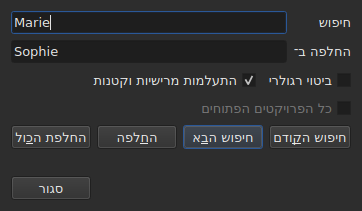
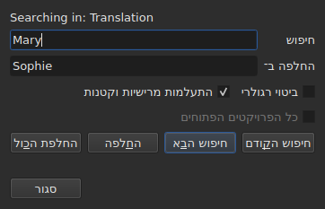

# חיפוש והחלפה

<!-- machine-translated -->
> דף זה הוא תרגום מכונה שעדיין לא נבדק על ידי דובר השפה.

`עריכה ▸ חיפוש והחלפה…`, או `Ctrl+F`, פותח את תיבת החיפוש.




**התיבה אינה מודלית**: היא נשארת פתוחה בזמן שמסתכלים בטבלה, עורכים תא, מחפשים שוב. `Close` סוגר אותה; פתיחה מחדש
מחזירה אותה כפי שהשארתם אותה, התבנית וההחלפה בכלל זה.

| שדה | מה הוא נושא |
| :---- | :-------------- |
| `Find` | התבנית שמחפשים |
| `Replace with` | מה שמחליף אותה |
| `Regular expression` | התבנית היא ביטוי רגולרי ולא טקסט פשוט |
| `Ignore case` | „marie” מוצא את „Marie” |
| `All open projects` | החיפוש עובר על כל הלשוניות — [ראו להלן](#בכל-המיזמים-הפתוחים) |

הפריט מושבת במסמך ריק: אין מה לחפש.

## ארבע הפעולות

| כפתור | מה הוא עושה |
| :----- | :----------- |
| `Find Previous` | מוצא את ההתאמה הקודמת, והטבלה עוברת אליה |
| `Find Next` | מוצא את הבאה — זה הכפתור ש-`Enter` לוחץ |
| `Replace` | מחליף את ההתאמה שנמצאה, ואז מוצא את הבאה |
| `Replace All` | מחליף את כל אלה של היעד |

ארבעתם מושבתים כל עוד `Find` ריק.

**הטבלה עוברת אל ההתאמה** בבחירת שורתה. אחרי שהגיעו לאחרונה, `Find Next` מתחיל שוב מהראשונה; `Find Previous` עושה
אותו הדבר בכיוון ההפוך.

**`Replace` כשלא נמצאה התאמה מחפש קודם**: הלחיצה הראשונה מראה מה עומד להיות מוחלף, הבאה מחליפה אותו. כך Gaupol
עושה.

## מה החיפוש כולל

**הבחירה, או כל המסמך אם דבר אינו נבחר** — הכלל של התפריט `Tools`. ראו [הפעולות](operations.md#על-מה-הן-פועלות).

**היעד נקבע במחווה הראשונה ונשמר** כל עוד החיפוש נמשך: `Find Next` בוחר את השורה של התאמה, והבחירה הזאת אינה מצמצמת
את היעד. **בחירת שורות אחרות בעצמכם משנה את היעד** למחווה הבאה.

החיפוש כולל את הטקסט של הכתוביות; לא המיקומים ולא המספר נבדקים.

### בכל המיזמים הפתוחים

תיבת הסימון **`All open projects`** מרחיבה את התחום לכל הלשוניות. **מושבתת כשמיזם אחד בלבד פתוח** — אין מה להרחיב —,
היא נעשית פעילה ברגע שלשונית שנייה נפתחת, ומבטלת את סימונה בעצמה כשנותרת רק אחת.

**כשהיא מסומנת, הבחירה אינה נחשבת עוד**: כל מיזם מחופש במלואו, ב**מסמך המיועד** — זה של העמודה הנוכחית, הראשי או
התרגום, כמו במיזם בודד.

- **`Find Next` ו-`Find Previous` עוברים מלשונית ללשונית, לפי סדר הלשוניות.** המיזם המוצג קודם; כשאין בו עוד התאמות,
  הבא אחריו, שהחלון מציג את הלשונית שלו ובוחר בו את השורה.
- **הסבב מסתיים היכן שהתחיל**: כשהחיפוש עובר את הלשונית האחרונה כדי לחזור לראשונה — או להפך בעלייה —, שורת התיבה
  אומרת זאת, במקום להתחיל שוב בלי מילה:

  ```text
  Search wrapped around
  ```

  הצעד שאחרי הוא צעד רגיל, והשורה מתנקה.
- **`Replace` מחליף היכן שהחיפוש נמצא**, ואז עובר להתאמה הבאה, שעשויה להיות בלשונית אחרת.
- **`Replace All` עובר על כל המיזמים**, ו**יוצר פריט היסטוריה אחד לכל מיזם שנגע בו**: ביטול בלשונית מבטל רק מה
  שאותה לשונית קיבלה. המניין אומר כמה מיזמים השתנו, לא רק כמה החלפות בוצעו:

  ```text
  replaced 4 matches in 3 projects
  ```

  אין נוגעים במיזם שהתבנית נעדרת ממנו, ואין בו מה לבטל. **שום לשונית אינה עולה לחזית**: כל מיזם מקבל את
  ההחלפות שלו מאחורי הלשונית שלו, שמקבלת את הכוכבית שלה, והלשונית שממנה המחווה יצאה נשארת מוצגת, עם הסרט שלה.

### באיזה טקסט

**עם תרגום, החיפוש כולל רק אחד משני הטקסטים: זה של העמודה של התא הנוכחי** — התרגום אם התא הנוכחי בעמודה
`Translation`, הטקסט הראשי בכל מקום אחר. זה הכלל של כל פעולות הטקסט, ואין הגדרה נוספת:
ראו [הטקסט שהפעולות מכוונות אליו](table.md#הטקסט-שהפעולות-מכוונות-אליו).

**התיבה אומרת באיזה טקסט היא מחפשת**, בשורה מעל `Find`, ומשנה אותה כשהעמודה הנוכחית משתנה — גם כשהיא פתוחה:




| התא הנוכחי נמצא ב | השורה אומרת |
| :--------------------- | :------------ |
| עמודה `Translation` | `Searching in: Translation` |
| כל עמודה אחרת | `Searching in: Main` |
| — אין תרגום למיזם, או שהעמודה הוסרה | דבר: השורה אינה שם |

**החלפה כותבת אל הטקסט הזה, ואליו בלבד.** `Replace` ו-`Replace
All` על התרגום משאירים את הטקסט הראשי כפי שהיה, ולהפך;
`Undo` מחזיר את מה שהם כתבו. **התגיות הן של הפורמט של הקובץ של אותו טקסט**: תרגום ב-Advanced SSA נקרא עם ה-`{\i1}`
שלו, גם כשהטקסט הראשי הוא SubRip. `Replace with` נכתב שם באותן תגיות.

**הטבלה נשארת בעמודה שבה הייתה.** `Find Next` בוחר את השורה של התאמה בלי להעביר את התא הנוכחי מעמודה לעמודה: חיפוש
שהותחל בתרגום נמשך בתרגום.

**חיפוש בשני הטקסטים בבת אחת אינו קיים**: כל התאמה הייתה זוג (כתובית, טקסט), ולטבלה שעוברת אליה לא היה מקום ברור
ללכת אליו. מחפשים באחד, ואז מחליפים עמודה.

**מה שמתחיל שוב מאפס**:

| מחווה | מה נשכח |
| :------ | :---------------- |
| שינוי של `Find`, `Replace with` או אפשרות | ההתאמה הנוכחית, ושורת המצב |
| בחירת שורות אחרות בעצמכם | היעד וההתאמה |
| העברת התא הנוכחי מטקסט אחד לאחר — מ-`Text` ל-`Translation`, או להפך | ההתאמה: היא מקום בטקסט |
| פתיחת קובץ אחר | היעד וההתאמה; התיבה נשארת פתוחה, התבנית בכלל זה |

## הטקסט שמחפשים הוא הטקסט הגלוי

**תגיות אינן טקסט.** חיפוש `<i>` אינו מוצא דבר, וחיפוש `Bonjour` מוצא את `<i>Bon</i>jour` שנחתך בתגית.

**ההחלפה נעשית בטקסט של הקובץ, בלי לשבור את התגיות**:

| טקסט | מה מחפשים ← מה מציבים | מה נכתב |
| :--- | :-------------------------- | :-------------- |
| `<i>Bonjour</i>` | `Bonjour` ← `Salut` | `<i>Salut</i>` |
| `<i>Bon</i>jour` | `Bonjour` ← `Salut` | `<i>Salut</i>` |
| `<i>Bonjour</i> Marie` | `Bonjour Marie` ← `Salut Sophie` | `<i>Salut Sophie</i>` |

תגית שחותכת מילה מקיפה את המילה כולה, וכל סגנון שנוגע בהתאמה מכסה את ההחלפה. **התגיות שההתאמה אינה נוגעת בהן נשארות
במקומן**, גם תגית שחותכת מילה אחרת של אותה כתובית: החלפת `Marie` בטקסט `<i>Bon</i>jour Marie` נותנת
`<i>Bon</i>jour Sophie`. מילה עשויה מאותיות וספרות — רווח בלתי שבור או מרכאה אינם חלק ממנה. **`Replace with` נקרא
בתגיות של הטקסט המיועד**: הקלדת `<b>Salut</b>` שם ב-SubRip הופכת את המילה למודגשת.

## שתי האפשרויות

| אפשרות | ברירת מחדל | מה היא משנה |
| :----- | :------ | :----------- |
| `Regular expression` | לא מסומן | `.` אינו מחפש עוד נקודה אלא תו כלשהו |
| `Ignore case` | מסומן | רישיות אינה נחשבת, אותיות מוטעמות בכלל זה: `élise` מוצא את `Élise` |

אלה ברירות המחדל של Gaupol. **שתיהן זכורות** מפתיחה לפתיחה ומהפעלה להפעלה, באפשרויות `search.regex` ו-
`search.ignore-case` של [קובץ ההעדפות](preferences.md#הקובץ).

### ביטוי רגולרי

התבנית נקראת בידי ICU. כמו ב-Gaupol, `.` חוצה מעבר שורה, ו-`^` ו-`$` חלים בתחילת **כל שורה** של כתובית ובסופה:
החלפת `^` ב-`- ` מציבה מקף לפני כל שורה.

ב-`Replace with`, ורק לביטוי רגולרי:

| כתוב | מה זה מציב |
| :------ | :----------- |
| `$1` עד `$9` | הקבוצה בעלת אותו מספר; קבוצה נעדרת לא מציבה דבר |
| `$0` | ההתאמה כולה |
| `\n` | מעבר שורה |
| `\$`, `\\` | `$`, לוכסן אחורי |
| `\` ואחריו כל תו אחר | אותו תו: `\t` מציב `t` |

**`\1` אינו קבוצה**, ומציב `1`. זה התחביר של Gaupol, שקורא את הביטויים שלו ב-Python; זה שכאן הוא של ICU, שקורא את
התבנית.

## מה התיבה אומרת

מתחת לכפתורים, שורה אומרת מה החיפוש לא הצליח לעשות, או מה `Replace All` עשה:

| מצב | מה מוצג |
| :-------- | :------------ |
| אין התאמה ביעד | `"Sophie" not found` |
| ביטוי רגולרי שאינו נקרא | `not a regular expression (U_REGEX_MISMATCHED_PAREN)` |
| `Replace All` החליף | `replaced 3 matches` |
| `Replace All` מצא את התבנית, אבל ההחלפה אינה משנה שום טקסט | `nothing to change` |

**חיפוש שאינו מוצא דבר אינו נוגע בדבר**: הבחירה נשארת היכן שהייתה, ושום דבר אינו נכנס להיסטוריה.

**`not found` ו-`nothing to change` אינם אומרים אותו דבר.** `not found` אומר שהתבנית אינה בשום מקום ביעד.
`nothing to change` אומר שהיא שם, אבל ההחלפה משאירה כל טקסט כפי שהיה — החלפת `Marie` ב-`Marie`, למשל. בשני המקרים
שום דבר אינו נכנס להיסטוריה. המספר ב-`replaced N matches` סופר את ההתאמות של הכתוביות שהטקסט שלהן השתנה.

## מה פעולת הביטול אומרת על כך

| מחווה | מה `Undo` קורא |
| :------ | :---------------- |
| `Replace` | `Undo: replacing` — אחד לכל החלפה |
| `Replace All` | `Undo: replacing all` — **פריט אחד בלבד**, יהא מספר ההתאמות אשר יהא |

ראו [ביטול וביצוע חוזר](undo.md).
