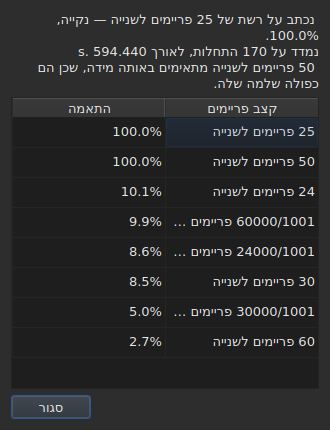

# רשת הפריימים

<!-- machine-translated -->
> דף זה הוא תרגום מכונה שעדיין לא נבדק על ידי דובר השפה.

קובץ כתוביות **אינו מצהיר** על קצב הפריימים שלפיו חושבו
המיקומים שלו: ל-SubRip אין כותרת, ובכותרת של
WebVTT יש טקסט חופשי. החלון **גוזר** אותו מהמיקומים עצמם,
בעת הפתיחה, ומראה אותו בשני מקומות שאינם עונים על אותה
שאלה.

| משטח | מה הוא נותן |
| :------ | :------------ |
| שורת המצב | **את התשובה**, באופן קבוע וללא בקשה |
| `Tools ▸ Frame Rate Analysis…` | **את הנימוק**, כשרוצים לראות אותו |

## מה שורת המצב מציגה

בצד ימין, בין מה שהיא אומרת על ה[קידוד](files.md#הקידוד-בשורת-המצב) של הקובץ
שנקרא לבין מה שהיא אומרת על ה[וידאו המשויך](video.md#מה-שורת-המצב-מציגה):

| מצב | מה כתוב |
| :-------- | :-------------- |
| המיקומים על רשת | `Grid: 24 fps` |
| רק חלקם | `Grid: 29.97 fps (partial)` |
| אף רשת ידועה אינה מתאימה | `No grid` |

**`No grid` אינה נותנת שם לשום קצב פריימים, וזה מכוון.** קבוצת
המועמדים סגורה — שמונת אלה שתיבת ההמרה מציעה — ודיווח
על הפחות גרוע שבהם היה מתן תשובה שגויה במקום שבו
"איני יודע" היא התשובה הנכונה.

**ל-`No grid` יש שתי סיבות, והן אינן אותה תשובה.** או שאף
רשת אינה מתאימה, או שבקובץ יש מעט מדי כתוביות כדי שאפשר יהיה לומר עליו
דבר — שתי התחלות תמיד נראות מיושרות לחלוטין, וזה אינו מוכיח
דבר. שורת המצב אומרת אותו דבר על שתיהן;
**הניתוח מבחין ביניהן**, ובראשונה נותן בכמה
המועמד הטוב ביותר נכשל.

השורה **מתעדכנת אחרי כל פעולה**. יישור קובץ לקצב
פריימים אחר משנה את הרשת, ושורת המצב אסור לה להמשיך
להכריז על הישנה.

### למסמך הנספר בפריימים אין רשת, יש לו קצב פריימים

**MicroDVD הוא היחיד מבין התשעה שסופר בפריימים.** כל שורה שלו
נושאת שני מספרי פריימים ודבר מלבדם, והקובץ **אינו אומר** באיזה
קצב פריימים לקרוא אותם. אותו מקום בשורת המצב כותב אז:

| מצב | מה כתוב |
| :-------- | :-------------- |
| המסמך נספר בפריימים | `Frames: 24000/1001 fps` |

**זו אינה הרשת, והרשת הייתה מעגלית כאן.** המיקומים
של מסמך MicroDVD חושבו *מתוך* הפריימים שלו באותו
קצב פריימים; גזירת רשת מהם הייתה מחזירה את המספר הזה, כלומר נתון
שמחופש למדידה.

**מקורו נאמר פעם אחת**, על ידי הקריאה, ב[רשימת האבחונים](files.md#אבחוני-הקריאה):
`counts in frames and states no rate; it was read at ("24000/1001")`. השורה
של שורת המצב, מצדה, אומרת מה קיים, באופן קבוע.

**טעות בקצב הפריימים מזיזה את הקובץ כולו**, ותיבת
[`Convert Frame Rate…`](operations.md#convert-frame-rate) היא המקום שבו מתקנים אותה:
היא נפתחת על קצב הפריימים של הקריאה ואומרת שזהו הוא.

## מה הניתוח מראה

`Tools ▸ Frame Rate Analysis…` **אינו משנה דבר.** הוא נפתח על סיכום ועל
דירוג שמונת המועמדים עם הציון שלהם.




הסיכום נותן את התשובה, ואחר כך את מה שמסייג אותה — כל משפט מופיע
רק אם יש לו מה לומר:

| מה אפשר לקרוא שם | מתי |
| :--------------------- | :--- |
| על כמה התחלות, ועל איזה טווח | תמיד |
| בכמה הקובץ מוסט מהרשת שלו | המיקומים שלו עליה עד כדי קבוע |
| שקצב פריימים אחר מתאים באותה מידה | הוא כפולה שלמה של זה שנשמר |
| שהטווח אינו מאפשר להבחין בין שני קצבי פריימים | הקובץ קצר מכדי להפריד ביניהם |
| כמה התחלות עוזבות את הרשת, **ובכמה רצפים** | הקובץ חלקי |

**מספר הרצפים הוא מה שמבחין בין שני סיפורים** שהאחוז
לבדו מבלבל ביניהם. הרבה רצפים של התחלה אחת הם מיקומים
שתוקנו ביד, אחד אחד. מעט רצפים ארוכים הם
קטע שתוזמן מחדש, או קובץ שהורכב משני אחרים.

**הדירוג המלא מוצג ולא תשובה יחידה.** קובץ
שמתאים ל-25 במאה אחוז ול-50 במאה אחוז אומר משהו שפסק דין
בלבד היה מסתיר.

## כשההמרה הייתה שגויה

קובץ שאינו נופל על שום רשת הוא לפעמים קובץ **שהומר בקצב פריימים
שגוי**: הוא נמצא אז על רשת אמיתית לגמרי, אך מוסט ביחס שהוא זה של
אף אחד משמונת הקצבים. כשהגזירה מחזירה `none` או `partial`, הניתוח מחפש **בין
חמישים ושישה הזוגות המסודרים של שמונת קצבי הפריימים הסטנדרטיים** — זו הקבוצה, והיא סגורה — את זה
שהמרתו מחזירה את המיקומים לרשת. כל יחס מוחל על המיקומים, ו**הגזירה עצמה
היא ששופטת את התוצאה**: הביטחון הוא מה שהיא הייתה אומרת, לעולם לא מספר
מומצא. שני זוגות שיוצרים אותו יחס, כגון 30 ל-25 ו-60 ל-50, הם המרה אחת.

המשפט מתווסף לסיכום:

```text
converting from 24 to 25 fps puts the positions on a 24 fps grid: 99.9%, against 11.8% as they are and 14.9% for the next best conversion
```

הוא נותן את ההמרה, את הרשת שהמיקומים היו נופלים עליה ואת מידת נפילתם עליה,
**ואז את הפער מול המיקומים כפי שהם ומול הטובה שבין
ההמרות האחרות.** לחצן `Convert Frame Rate…` סוגר את הניתוח ופותח את [תיבת
ההמרה](operations.md#convert-frame-rate) **ממולאת בזוג שנמצא** — דבר אינו מוחל
כל עוד התיבה לא אושרה, וביטול מספיק כדי לחזור. הווידאו, הפתוח לצדה,
מאפשר לשפוט לפי התמונה אם התשובה נכונה.

**כששני זוגות טובים באותה מידה, אף אחד אינו מוצע, והמשפט אומר זאת:**

```text
converting from 30 to 25 fps and converting from 25 to 24 fps fit equally well (99.7% and 99.6%), so none is proposed
```

זה המקרה הרגיל ולא היוצא מן הכלל: רשת של 28.8 פריימים לשנייה חוזרת
על 24 כמו על 30, וקובץ שכל זמניו הוכפלו נשאר על הרשת של 25.
המחווה שיש לה תיקון יחיד היא המרה של קובץ **שכבר** נמצא בקצב הפריימים של היעד. בתיקו
הווידאו מכריע: אתם פותחים בעצמכם את `Convert Frame Rate…` על אחד משני הזוגות.

**דבר אינו נאמר** על קובץ שכבר נמצא על רשת, על קובץ קצר מכדי שפסק דין
יהיה שווה משהו, ועל קובץ שאף המרה בקבוצה אינה מחזירה לרשת — סחיפה, יחס
מחוץ לשמונת קצבי הפריימים, מיקומים בלי מבנה.

## מה הטבלה אינה מראה

**אף שורה בטבלה אינה מסומנת בגלל הרשת**, לעולם.

מרגע שמתקנים מיקום ביד, הוא חדל להיות מיושר. סימון
אוטומטי היה מדווח אפוא על עבודת המשתמש כחריגה,
בקובץ שהוא בדיוק מתקן. הגזירה
מדברת על **המסמך**, והניתוח הוא החריג היחיד — כי אתם
פתחתם אותו בשביל זה.

הסימונים של הטבלה, מצדם, נוגעים למה שאינו מתחבר: סוף
לפני ההתחלה שלו, חפיפה, סדר שבור. ראו [הטבלה](table.md).
