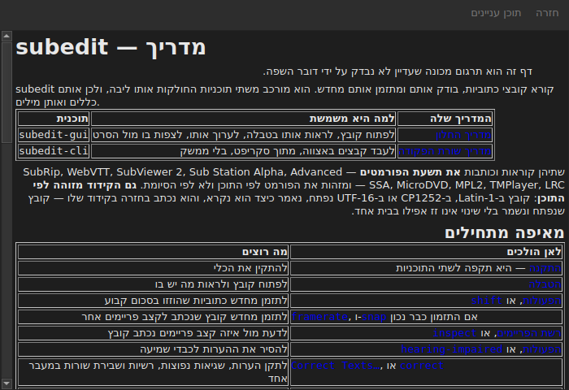

# המדריך בתוך החלון

<!-- machine-translated -->
> דף זה הוא תרגום מכונה שעדיין לא נבדק על ידי דובר השפה.

`עזרה ▸ מדריך`, או `F1`, פותח **את המדריך הזה עצמו** בחלון משלו.




## מה הוא פותח, ולמה לא כתובת

**המדריך המותקן לצד התוכנית**, ולא דף באינטרנט.

כתובת הייתה מתארת את הגרסה שבפיתוח, לא את זו שבידי המשתמש.
משתמש שקורא את המדריך של גרסה שאין לו משרת פחות טוב ממשתמש
בלי מדריך כלל — ולכן החלון קורא את הקבצים שההתקנה הניחה,
תחת `<prefix>/share/subedit/manual`. ראו
[התקנה](../subedit-cli/installation.md).

הוא נפתח ב[דף הבית](../index.md), זה שאומר מאיפה להתחיל.

## באיזו שפה

**בשפת החלון.** המדריך נפתח בשפה שהממשק מדבר:
זו שנבחרה ב-`עריכה ▸ העדפות…`, ואחרת זו של
הסביבה — ראו
[שפת הממשק](preferences.md#שפת-הממשק).

| החלון מדבר | המדריך נפתח ב |
| :---------------- | :------------------ |
| אנגלית | אנגלית |
| שפה שהמדריך שלה מותקן — קטלאנית, צ'כית, גרמנית, ספרדית, פינית, צרפתית, גליסית, עברית, הונגרית, אינטרלינגואה, איסלנדית, איטלקית, הולנדית | אותה שפה |
| שפה שהמדריך שלה אינו מותקן | אנגלית |

**דף אחר דף, לא הכול או כלום**: דף שאין בתרגום
נפתח באנגלית, וכל שאר הדפים נשארים בשפת החלון. קישור
עובר מאחד לאחר באותה דרך.

התרגומים מותקנים לצד המדריך האנגלי, כל אחד בתיקייה
על שם השפה שלו: `<prefix>/share/subedit/manual/fr` לצרפתית. השפה
היא זו שבה החלון הופעל, ולכן שפה שנבחרה בהעדפות חלה גם על המדריך, בהפעלה הבאה.

## ניווט

| מה עושים | מה קורה |
| :---------- | :----------- |
| לחיצה על קישור במדריך | הדף נפתח באותו חלון |
| לחיצה על קישור שמכוון לסעיף | הדף נפתח, והחלון גולל אליו |
| לחיצה על קישור שמכוון רק לסעיף | החלון גולל אליו, בלי להחליף דף |
| `Back` | חוזר לדף הקודם; מושבת בדף הראשון |
| `Contents` | חוזר לדף הבית; מושבת כשנמצאים בו |

החלון **אינו מודאלי**: הוא נשאר פתוח בזמן העבודה, וזו כל
הנקודה של מדריך בהישג יד. בחירה חוזרת בפריט אינה יוצרת
חלון שני, היא מעלה את הקיים לחזית.

## מה הוא אינו יכול לפתוח, והוא אומר זאת

המדריך מפנה לפעמים אל **מפת הדרכים** או אל **החלטת
ארכיטקטורה**. אלה מסמכים של המאגר, לא של החבילה: הם
אינם מותקנים, והחלון אומר זאת במילים פשוטות במקום להשאיר את
הלחיצה בלי תוצאה.

```
../../feuille-de-route.md is not part of the installed manual;
it lives in the project's repository.
```

אפשר לקרוא אותם במאגר, שכתובתו נמצאת ב-`עזרה ▸ אודות subedit`.

## כשהפריט מושבת

**`עזרה ▸ מדריך` מושבת כשאין מדריך לצד התוכנית.** שני
מקרים, ואף אחד מהם אינו תקלה:

| מקרה | למה |
| :--- | :-- |
| הקובץ הבינארי מורץ מעץ הבנייה שלו | שם דבר לא הותקן, ולכן אין מה לקרוא |
| ההתקנה חלקית | המדריך הוסר, או שמעולם לא הועתק |

ריחוף מעל הפריט אומר מי משני המקרים: „לא מותקן מדריך לצד התוכנית הזו”.

דף חסר כשהמדריך נמצא — קובץ שנמחק ביד — אינו
סוגר את החלון: הוא נוקב בשם הקובץ שלא ניתן היה לקרוא ומשאיר על המסך את מה
שהציג.

## איפה מחפשים את המדריך

**לצד קובץ ההפעלה**, ב-`../share/subedit/manual` — המבנה שכל
התקנה מייצרת, תהא התחילית אשר תהיה. כך התקנה
תחת `~/.local` מוצאת את המדריך שלה כמו חבילה שהותקנה תחת `/usr`.
