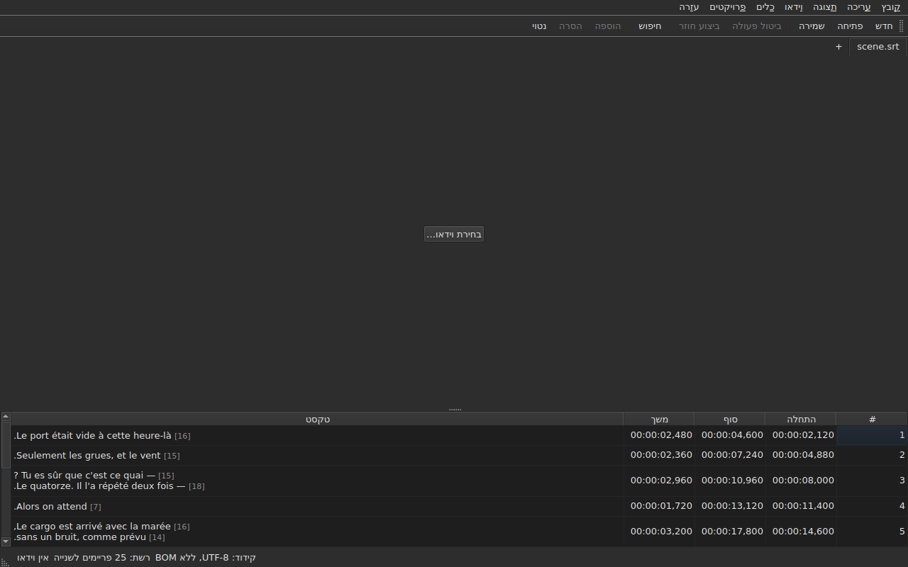

# subedit-gui — מדריך

<!-- machine-translated -->
> דף זה הוא תרגום מכונה שעדיין לא נבדק על ידי דובר השפה.

החלון של subedit: פותחים קובץ כתוביות ורואים אותו בטבלה. לתוכנית האחרת ולנקודת
ההתחלה ראו [המדריך](../index.md).

> **המצב הנוכחי.** החלון **פותח כמה קבצים, כל אחד בלשונית משלו**, יהא הקידוד שלהם
> אשר יהיה — דרך `Open…` או בגרירתם אליו —, **מציג אותם**,
> **עורך את התאים שלהם**, **מוסיף שורות ומסיר אותן**,
> **מבטל פעולות**, **שומר — בבחירת הקידוד, סוף השורה
> וסימן סדר הבתים** — ו**מסמן את הכתוביות שהמיקומים שלהן
> אינם עולים בקנה אחד**. הוא **ממזג ומפצל** שורות, **גוזר,
> מעתיק ומדביק** טקסטים, ו**מחפש ומחליף** בטקסט הגלוי
> בלי לשבור את התגיות, בפרויקט אחד או בכולם. הוא **פותח תרגום
> לצד הקובץ הראשי**, מותאם לפי מיקום או לפי מספר, בעמודה נוספת,
> ושומר אותו בנפרד. התפריט `Tools` כולל שש עשרה פעולות ושני פריטי איות —
> הזזה, המרה לפי שתי נקודות, המרת קצב הפריימים, התאמת משכים,
> **צירוף קובץ, פיצול הפרויקט לשניים**, הדגשה
> בנטוי, הוספת מקפי דו־שיח, שינוי הרישיות בארבע דרכים,
> הסרת אזכורים לכבדי שמיעה, **תיקון טקסטים באמצעות אשף
> רב־עמודי**, **בדיקת איות מילה אחר מילה**, יישור לקצב פריימים, החזרה אל
> הרשת — וניתוח הרשת, שאינו משנה דבר. התפריט `Projects`
> **שומר וסוגר הכול** במחווה אחת. הוא **משייך וידאו
> למסמך**, שנבחר או שנוחש, ו**מנגן אותו בחלון**, כשהשורה הנוכחית
> מצוירת על התמונה; הוא **קובע התחלה, סוף או
> כתובית ממיקום הסרט**, **מתקדם פריים אחר פריים** ו**מזיז קצה בפריים אחד**. סרגל הניגון **מדלג, קובע את
> עוצמת הקול ואת המיקום**, הטבלה **עוקבת אחר הניגון** בלי לבטל גלילה ידנית, אפשר להציג
> מיקומים **בפריימים**, והתפריט `Video` **בוחר את רצועת השמע**. שני זיהויים
> **מציעים בלי להחיל לעולם**: תרגום שהוזז בסכום קבוע, שאפשר **לפתוח מחדש
> מוזז**, והמרת קצב הפריימים שמחזירה קובץ אל הרשת. הוא **זוכר את הגיאומטריה שלו, את הסדר, הרוחב והנוכחות של
> העמודות, ואת ההגדרות שלו** מהפעלה
> אחת לאחרת, ומופיע **בהיר או כהה** לפי הבחירה. `עזרה ▸ מדריך`
> פותח **את המדריך הזה** בחלון. המדריך הזה מתאר את הקיים, לעולם לא
> את המתוכנן; מה שיבוא אחר כך נמצא ב
> [מפת הדרכים](../../../../feuille-de-route.md).

> **התמונות במדריך הזה נוצרות אוטומטית, הטקסט לא.** הדוגמאות של
> `subedit-cli` נוצרות בהרצת הפקודה; צילומי המסך
> נוצרים בבניית החלון האמיתי ובצילומו — `make
> manual` עושה את שני הדברים. תמונה לא יכולה אפוא לתאר ממשק
> שאינו קיים עוד, וממשק שמשתנה נראה ב-diff
> של המאגר. מה שנשאר בלי רשת ביטחון הוא הטקסט שסביבן, שדיוקו
> נשען על סקירה.

**כל מסך מוצג פעמיים, תחת שתי הפלטות שהיישום
קובע** — `Light` ו-`Dark`, אלה ש
[ההעדפות](preferences.md#ערכת-הנושא) מציעות. בשולחן עבודה שערכת הנושא שלו
קובעת, `System` נותנת אחת מהן לפי מה שבחר שולחן העבודה.

## התפריטים

`File`, `Edit`, `View`, `Video`, `Tools`, `Projects`, `Help` — בסדר
שבו משתמשים בהם: המסמך, מה שעושים בו, איך מסתכלים עליו, מה
שנלווה אליו, מה שבודק אותו, מה שחל על כל הפרויקטים הפתוחים, מה
שמסביר אותו.

ב-`View` יש תת־תפריט, `Columns`, עם פריט סימון אחד לכל עמודה מלבד `Text`
— ראו [הטבלה](table.md#הסתרת-עמודות-והזזתן) — והגדרה, `Positions in Frames`, שמציגה את
`Start` ו-`End` כמספרי פריימים — ראו [מיקומים בפריימים](table.md#מיקומים-בפריימים).

ב-`Projects` יש שני פריטים, `Save All` ו-`Close All` — ראו
[תפריט המיזמים](files.md#תפריט-המיזמים).

ב-`Edit` יש חמישה גושים, כל אחד מתחת למפריד: ביטול פעולות;
לוח ההעתקה — גזירה, העתקה והדבקה של טקסטים; `Find and Replace…`;
הוספה, הסרה, מיזוג ופיצול של שורות; ולבסוף
`Preferences…`. ביטול הוא מה שעושים *לעריכה*, הזזת טקסט
אינה מוסיפה שורה ואינה מסירה אותה, ארבעת הפריטים של הגוש הבא משנים את מספר
השורות, וקביעת ערכת הנושא אינה עריכה כלל.

**מקשים נקראים בשם שהתפריט מציג**, באנגלית כמו שאר
הממשק: `Ins`, `Del`, `Ctrl+Shift+Z`. מקש שלוחצים עליו
ושום תפריט אינו נוקב בשמו שומר על שמו באנגלית: `Enter`, `Esc`, `Shift`.

ב-`Help` יש שני פריטים, בסדר שבו התפריט מציג אותם. `Manual`, או
`F1`, פותח את המדריך הזה בחלון — ראו
[המדריך בתוך החלון](help.md). `About subedit` מציג את הגרסה, את
הרישיון ואת הספריות שהחלון רץ מולן עם גרסאותיהן — ראו
[`--version`](invocation.md#--version).

## סרגל הכלים

מתחת לתפריטים, סרגל מכיל **את המחוות השכיחות ביותר**, בקבוצות.
כל לחצן נושא מילה קצרה; התפריט שומר את הפריט המלא, וקיצור
הדרך זהה.

| לחצן | פריט בתפריט | קיצור דרך |
| :----- | :--------- | :------- |
| חדש | קובץ ▸ פרויקט חדש | `Ctrl+N` |
| פתיחה | קובץ ▸ פתיחה… | `Ctrl+O` |
| שמירה | קובץ ▸ שמירה | `Ctrl+S` |
| ביטול פעולה | עריכה ▸ ביטול פעולה | `Ctrl+Z` |
| ביצוע חוזר | עריכה ▸ ביצוע חוזר | `Ctrl+Shift+Z` |
| חיפוש | עריכה ▸ חיפוש והחלפה… | `Ctrl+F` |
| הוספה | עריכה ▸ הוספת כתוביות… | `Ins` |
| הסרה | עריכה ▸ הסרת כתוביות | `Del` |
| נטוי | כלים ▸ נטוי | `Ctrl+I` |

**לחצן מושבת מושבת מאותה סיבה כמו הפריט שלו**: `Undo` כשאין
מה לבטל, `Remove` כשלא נבחרה שורה. הפריטים של התרגום
והפעולות של התפריט `Tools`, מלבד `Italic`, נשארים
בתפריטים שלהם: משתמשים בהם פחות, או לא כולם משתמשים בהם.

## סעיפים

| סעיף | תוכן |
| :------ | :------- |
| [התקנה](../subedit-cli/installation.md) | בנייה והתקנה — הדף חל על שתי התוכניות |
| [הפעלה](invocation.md) | הפעלת החלון, ארגומנטים, קודי יציאה |
| [פתיחה ושמירה](files.md) | הפקודות, הלשוניות, התפריט `Projects`, גרירת קבצים, התרגום ופתיחתו מחדש מוזז, האבחונים, הקידוד בשורת המצב, הלוך ושוב, סגירה |
| [הטבלה](table.md) | מה כל עמודה מציגה, הסתרתן והזזתן, מיקומים בפריימים, עמודת התרגום והטקסט שהפעולות מכוונות אליו |
| [עריכת תא](editing.md) | אילו תאים אפשר לערוך, ואיך |
| [גזירה, העתקה והדבקה של טקסטים](clipboard.md) | שלושת הפריטים, מה עובר, השורות שנוספו, התגיות המתורגמות |
| [חיפוש והחלפה](find-and-replace.md) | תיבת הדו־שיח, ארבע המחוות, שתי האפשרויות, מה החיפוש כולל, בכל הפרויקטים הפתוחים |
| [הוספה, הסרה, מיזוג ופיצול של שורות](lines.md) | ארבעת הפריטים, קיצורי הדרך שלהם, לאן הולכות השורות החדשות |
| [ביטול וביצוע חוזר](undo.md) | ההיסטוריה, שתי הפעולות, סימן השינוי |
| [רשת הפריימים](frame-grid.md) | קצב הפריימים שנגזר מהמיקומים, הניתוח, וההמרה שמחזירה קובץ אל רשת |
| [הפעולות](operations.md) | הזזה, המרה לפי שתי נקודות, המרה, התאמת משכים, צירוף קובץ, פיצול הפרויקט, הדגשה בנטוי, הרישיות, המקפים, הסרת אזכורים, יישור, החזרה אל הרשת, ומה שחורג מסוף הסרט |
| [תיקון הטקסטים…](correct-texts.md) | אשף התיקון: היעד והמשימות, הדף של כל משימה, ההתקדמות, האישור |
| [בדיקת איות…](check-spelling.md) | בדיקת האיות: ההגדרות שלה, המעבר, סגירה באמצע, היעדר מילון |
| [הווידאו המשויך](video.md) | בחירת וידאו, ההצעה האוטומטית, רצועת השמע, שורת המצב, `ffmpeg` |
| [הנגן](player.md) | תצוגת הווידאו, סרגל הניגון, ניגון, ניווט, עוצמת הקול, הטבלה העוקבת, הקו המצויר |
| [תזמון לפי הווידאו](timing.md) | קביעת ההתחלה או הסוף של כתובית, הוספה, בחירה ממיקום הסרט, התקדמות פריים אחר פריים, הזזת קצה |
| [ההעדפות](preferences.md) | ערכת הנושא, קובץ ההעדפות, האפשרויות שלו, ומה קורה לערך שאינו קריא |
| [המדריך בתוך החלון](help.md) | `עזרה ▸ מדריך`, מה הוא פותח ואיך מנווטים בו |
