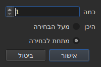

# הוספה, הסרה, מיזוג, פיצול ומיון של שורות, והפיכת הטווחים לזרים

<!-- machine-translated -->
> דף זה הוא תרגום מכונה שעדיין לא נבדק על ידי דובר השפה.

שמונה פריטים בתפריט `Edit`, מתחת למפריד שמבדיל אותם מ-`Find and Replace…`. לארבעה מהם משותף שהם משנים את מספר
השורות, בעוד גזירה, העתקה והדבקה, שלמעלה, מזיזות טקסטים; `Sort Subtitles` משנה רק **את הסדר** של השורות,
`Join Repeated Subtitles` הופך שוב לכתובית אחת את החלקים הרצופים של אותו טקסט, ו-`Make Ranges Disjoint…`
חותך מחדש את הכתוביות במקומות שבהם הן חופפות.

| פריט | קיצור דרך | מה הוא עושה |
| :---- | :------- | :----------- |
| הוספת כתוביות… | `Ins` | פותח תיבת דו-שיח ואז מוסיף שורות ריקות |
| הסרת כתוביות | `Del` | מסיר את הבחירה, בלי לשאול דבר |
| מיזוג כתוביות | אין | הופך גוש של שורות סמוכות לשורה אחת |
| פיצול כתובית | אין | חותך שורה לשניים באמצע משכה |
| איחוד כתוביות חוזרות | אין | הופך לכתובית אחת את החלקים הרצופים של אותו טקסט |
| מיון כתוביות | אין | מחזיר את השורות לסדר ההתחלות שלהן, בכל המיזם |
| הפיכת הטווחים לזרים… | אין | חותך את השורות החופפות כך שאף טווח כבר לא חופף לטווח אחר |
| תיקון כתוביות… | אין | משרשר את שלושת הפריטים הקודמים — איחוד החזרות, מיון, חיתוך הטווחים — בבת אחת |

שמונתם נכנסים להיסטוריה: `Ctrl+Z` מבטל אותם כמו את כל השאר.

## הוספה

| שדה | מה הוא מכיל | ברירת מחדל |
| :---- | :------------ | :------ |
| `How many` | מספר שלם מ-1 עד 99,999 | `1` |
| `Where` | `Above the selection` או `Below the selection` | הבחירה האחרונה, `Below` בהפעלה הראשונה |

`OK` מוסיף את השורות, `Cancel` אינו מוסיף דבר.

### לאן הן מגיעות

**אל השורה האחרונה שנבחרה**, לא הראשונה. בחירת שורות 1 ו-3 והוספה מתחת מציבה את השורה החדשה במקום 4 — לא במקום 2.
כך Gaupol נוהג כבר עשרים שנה, וזה מה שהיד מצפה לו אחרי שסרקה מלמעלה למטה.

`Above the selection` מציב אותה ממש לפני אותה שורה.

### כמה זמן הן נמשכות

לשורה ריקה אין טקסט, אבל יש לה מיקומים. הם נגזרים מהמקום הפנוי:

| מצב | התחלה | משך |
| :-------- | :---- | :------- |
| בין שתי כתוביות | סוף הקודמת | המרווח עד הבאה, מחולק שווה בשווה |
| אחרי האחרונה | סוף האחרונה | שלוש שניות לכל אחת |
| בראש קובץ | נקודת האפס | המרווח עד הראשונה, מחולק |
| בקובץ ריק | נקודת האפס | שלוש שניות לכל אחת |

כשהקובץ חופף במקום שנבחר, **אין מרווח לחלק**: השורות מקבלות משך אפס, והטבלה מציגה אותו, במקום משך מומצא שחורג אל
השכנה.

### המסמך הריק

**אין צורך בבחירה**, וזו הדרך היחידה להתחיל קובץ חדש: השורות מגיעות לאינדקס אפס. בחירת הצד מושבתת אז בתיבה — אין
בחירה שאפשר למקם את השורות ביחס אליה.

ברגע שבמסמך יש שורה, הפריט `Insert Subtitles…` **מושבת כל עוד שום דבר לא נבחר**: בלי בחירה, האינדקס היה נוחש.

### לאחר מכן

השורות שנוספו **נבחרות**, והטבלה מגיעה אליהן. לחיצה שנייה על `Ins` מוסיפה אפוא אחריהן, בלי צורך ללחוץ בין השתיים.

### הצד נשמר

`Above` או `Below` נשמר **מהוספה אחת לבאה, ומהפעלה להפעלה**: זו האפשרות `edit.insert-placement` של
[קובץ ההעדפות](preferences.md#הקובץ). לא מוסיפים פעם אחת, מוסיפים עשר שורות ברצף, תמיד באותו צד.

## הסרה

`Remove Subtitles`, או `Del`, מסיר את השורות שנבחרו — גם בחירה לא רציפה, וכל שורה חוזרת למקומה אם מבטלים.

**לא מתבקש אישור**, וזו לא החמצה: הפעולה מתבטלת באמצעות `Ctrl+Z`. חלון מודלי לפני פעולה שאפשר לבטל היה עולה בלחיצה
בכל פעם כדי לחסוך `Ctrl+Z` מדי פעם.

**הפריט מושבת כשדבר אינו נבחר.** במקומות אחרים בחלון, "שום דבר לא נבחר" פירושו "כל הקובץ" — וזה מה שמאפשר להזיז
בלי לבחור ארבעת אלפים שורות. כאן קריאה כזאת הייתה מרוקנת מסמך בגלל `Del` שנלחץ בטעות, ולכן היא אינה מוצעת.

אחרי ההסרה, **נבחרת השורה שתפסה את מקומה של הראשונה שהוסרה** — או האחרונה שנותרה, אם ההסרה לקחה את סוף הקובץ.
לחיצות חוזרות על `Del` מסירות אפוא את השורות אחת אחת.

קובץ שרוקן לגמרי משאיר את החלון שמיש: `Insert Subtitles…` חוזר להיות פעיל, שכן מוסיפים למסמך ריק בלי בחירה.

## מיזוג

`Merge Subtitles` הופך את השורות שנבחרו ל**שורה אחת**:

| מה השורה הממוזגת מקבלת | מאיפה זה בא |
| :---------------------------- | :------------------ |
| ההתחלה שלה | ההתחלה של הראשונה |
| הסוף שלה | הסוף של האחרונה |
| הטקסט שלה | הטקסטים של כולן, לפי הסדר, ובין שניים מעבר שורה |
| התרגום שלה | התרגומים, מחוברים באותה דרך |
| מה שהפורמט נושא בנוסף — סגנון, שכבה, קואורדינטות | של הראשונה |

**טקסט ריק אינו משאיר שורה ריקה**: מיזוג של `Un.`, שורה ללא טקסט ו-`Trois.` נותן שתי שורות טקסט, לא שלוש.

השורות הממוזגות נעלמות, והשורה שמחליפה אותן תופסת את מקומה של הראשונה.

**הפריט מושבת** כל עוד הבחירה אינה **גוש של שתי שורות סמוכות לפחות**. לשורה בודדת אין עם מי להתמזג; גם לשורות
1 ו-3 בלי 2 אין, שכן התוצאה הייתה חורגת אל 2 ומכסה אותה.

אחרי המיזוג, **השורה הממוזגת נבחרת**: `Split Subtitle` מוכן לחתוך אותה שוב.

## פיצול

`Split Subtitle` חותך את השורה שנבחרה **באמצע משכה**, עד אלפית השנייה:

| חצי | התחלה | סוף | טקסט |
| :--- | :---- | :-- | :--- |
| הראשון | ההתחלה המקורית | האמצע | **כל** הטקסט, והתרגום |
| השני | האמצע | הסוף המקורי | ריק |

**הטקסט אינו נחתך במעבר השורה שלו.** זה היה נכון לכתובית של שתי שורות ושגוי לכתובית של שורה אחת או של שלוש;
כל הטקסט נשאר בחצי הראשון, ומה שצריך לעבור לשני מעבירים בעצמם.

החצי הראשון שומר את מה שהפורמט נשא מלבד הטקסט; השני נולד כמו שורה שהוספה, בלי דבר.

**הפריט מושבת** כל עוד הבחירה אינה כוללת **שורה אחת בדיוק**. כאן "שום דבר לא נבחר" אינו אומר "כל הקובץ".

אחרי הפיצול, **שני החצאים נבחרים** — כך Gaupol נוהג אחרי כל הוספה, ו-`Merge Subtitles` מוכן אז לבטל את הפעולה.

## מיון

`Sort Subtitles` מחזיר **את כל המיזם** לסדר ההתחלות. אף פעם לא את הבחירה: סדר הוא תכונה של המסמך, ומיון של חצי
קובץ אינו אומר דבר. המיון **יציב**: שתי כתוביות שמתחילות יחד שומרות על הסדר שהקובץ נתן להן.

**סרגל רץ בשורת המצב בזמן המיון, והסמן הופך לשעון חול**: בקובץ ארוך החלון אינו מגיב זמן מה — הטבלה נבנית מחדש
שורה אחר שורה —, ובלי זה אי אפשר לדעת אם משהו מתבצע. הסרגל אינו מציג שבר, המיון אינו מדווח כזה, והסרגל נעלם יחד
איתו.

שורת המצב אומרת כמה שורות החליפו מקום — `3 subtitles moved` — או, כשהכול היה מסודר, `already in order`. **מיזם שכבר
מסודר אינו נכנס להיסטוריה**: פעולה שאינה משנה דבר אינה פעולה לבטל. הפריט מושבת במיזם של כתובית אחת.

קובץ **שיש בו מה לתקן בפתיחה** מציע זאת מעצמו, [בתיבה אחת](#בפתיחה-תיבה-אחת): ראו להלן. כתוביות שאינן במקומן
גם [נספרות באבחונים](files.md#אבחוני-הקריאה), כך שאפשר למצוא אותן בלי לגלול בטבלה.

בשורת הפקודה, [`sort`](../subedit-cli/sort.md) עושה את אותו הדבר על קבצים, ו-`--sort` עושה זאת בדרך אגב ב-
[`convert`](../subedit-cli/convert.md#מיון-בעת-הכתיבה),
[`append`](../subedit-cli/append.md#מיון-התוצאה) וב-
[`split-file`](../subedit-cli/split-file.md#חיתוך-לפי-סדר-הזמן).

## מיזוג כתוביות חוזרות

`Join Repeated Subtitles` הופך ל**כתובית אחת** כתוביות שמציגות את אותו הדבר ברצף: טקסט שנחתך לחלקים רצופים, כפי
שכמה כלי פילוח משאירים אותו. הפעולה חלה על **כל המיזם**.

**חזרה** היא כתובית שיש לה אותו טקסט, אותו תרגום ואותן הגדרות פורמט (סגנון, מיקום, הגדרות ציטוט) כמו אחרת, **והיא
מתחילה לכל המאוחר כשזו מסתיימת**. רצף של חזרות הופך לזו שמתחילה ראשונה, עם הסוף הגדול ביותר ברצף; האחרות נעלמות.
`Alpha [1, 2]`, `Alpha [2, 4]` ו-`Alpha [4, 6]` נותנות `Alpha [1, 6]`.

- **סדר הקובץ אינו משנה דבר בכך, והפעולה אינה משנה אותו**: הכתובית שנשארת היא זו שמתחילה ראשונה, בכל מקום שבו
  האחרות נמצאות.
- **דבר אינו מצורף בטעות**: טקסט אחר, הגדרות אחרות, רווח בין שני חלקים, כתובית ללא טקסט או שסופה קודם להתחלתה —
  כולם נשארים נפרדים.
- שורת המצב אומרת מה נעשה — `2 repeated subtitles joined`, או `no repeated subtitles`.

**כדאי לעשות זאת לפני המיון והחיתוך**, שקוראים ביתר נקיות רצף מנוקה: טקסט בשלושה חלקים, בתוספת טקסט אחר על פני כל
הטווח, שניתנו שלא לפי הסדר, ממוינים ונחתכים לשורות שעוברות מחלק לחלק; אם מאחדים אותם קודם, הם נכנסים לסדר
וממוזגים כראוי. תיבת הפתיחה, להלן, עושה את שלושתם לפי הסדר הזה.

## הפיכת הטווחים לזרים

`Make Ranges Disjoint…` חותך את הכתוביות החופפות כך ש**אף טווח `[start, end]` כבר לא חופף לטווח אחר**. הפעולה חלה על
**כל המיזם**, אף פעם לא על הבחירה: קבוצת כתוביות חופפות נחתכת במקומות החפיפה, וחצי קבוצה אינה אומרת דבר.

**דבר אינו מקוצר או מוארך.** בכל רגע, החלון מציג את אותם טקסטים כמו קודם. מה שמשתנה הוא אופן חיתוך ציר הזמן:
הוא נחתך בכל התחלה ובכל סוף של קבוצה; מקטע שמכוסה בכתובית אחת נשאר אותה כתובית; מקטע שמכוסה בכמה כתוביות הופך
ל**כתובית אחת** ששורותיה הן שורותיהן, **המוקדמת ביותר בשורה 1**.
`A [0, 5]` ו-`B [3, 8]` נותנות `[0, 3] A`, `[3, 5] A / B`, `[5, 8] B`.

התיבה מבקשת שלוש הגדרות, הנשמרות מפעם לפעם:

| שדה | מה הוא מכיל | ברירת מחדל |
| :---- | :------------ | :------ |
| `Shortest interval kept` | מ-0 עד 10,000 אלפיות שנייה: מקטע קצר יותר נבלע בשכן | `80 ms` (בערך שני פריימים) |
| `Most lines in a subtitle` | מ-0 עד 10; `No limit` ב-0 | `2` |
| `Put a dash before each subtitle's text` | מקף לפני מה שכל כתובית תורמת לכתובית ממוזגת | לא מסומן |

`OK` חותך, `Cancel` אינו עושה דבר. **השורות שנכתבו נבחרות** לאחר מכן, ושורת המצב אומרת מה נעשה:
`2 subtitles split, 1 merged`. מעבר שני אינו משנה דבר ואומר זאת: `already disjoint`.

- **שורה לעולם אינה משוכפלת.** שתי כתוביות עם אותו טקסט נותנות שורה אחת במקום שבו הן חופפות, ושני חלקים סמוכים
  שמציגים את אותו הדבר יוצרים כתובית אחת בלבד. הטקסט של כתובית שנחתכה לכמה חלקים חוזר בכל אחד מהם, אחרת: זה מה
  שמופיע על המסך באותו רגע.
- **מקטע קצר מאוד נבלע בשכן**: זה ששורותיו כבר מכילות את שורותיו של המקטע, ואחרת הארוך ביותר, מרחיב את הטווח שלו
  כדי לכסות אותו. כתובית שלמה הקצרה מהסף אינה נבלעת לעולם.
- **יותר שורות מהגבול: חלונות.** שלוש שורות על פני שלוש שניות הופכות לשני חצאים, שתי השורות הראשונות ואז שתי
  האחרונות; ארבע שורות, שלישים, וכן הלאה. דבר אינו נקטע.
- התרגום עוקב אחר אותם חיתוכים; הסגנון והמיקום של הכתובית המכסה הראשונה נשמרים.

**מה שלא ניתן היה לעשות במלואו נאמר בתיבה שיש לסגור**, לא בשורת המצב: חלונות, מקטעים שנבלעו, כתוביות קצרות מדי
שנשארו שלמות, סגנונות שונים, כתוביות שסופן קודם להתחלתן (נשארות במקומן).

**הפריט נדחה, עם הסיבה, כשהכתוביות אינן בסדר ההתחלות שלהן**: הקבוצות הן רצפים של שכנות, והליבה לעולם אינה ממיינת
בעצמה. קודם `Sort Subtitles` — או תיבת הפתיחה, שעושה את שניהם לפי הסדר הזה.

### הכול בבת אחת: `Repair Subtitles…`

`Repair Subtitles…` מבצע את שלושת הפריטים הקודמים **בזה אחר זה**, בסדר היחיד שעובד: החזרות מאוחדות, הכתוביות
ממוינות לפי ההתחלות, ואז הטווחים הופכים לזרים. זה הפריט לקובץ שמפולח רע, מסודר רע וחופף, כשיודעים שרוצים את
שלושתם. התיבה מבקשת את הגדרות החיתוך (אותן של `Make Ranges Disjoint…`, הנשמרות מפעם לפעם) ואומרת שהיא מאחדת וממיינת
קודם. שורת המצב — או התיבה שיש לסגור, כשמשהו לא ניתן היה לעשות במלואו — נותנת **דיווח אחד** על שלושתם:
`2 repeated subtitles joined; already in order; 2 subtitles split, 1 merged`. כל תיקון הוא פריט היסטוריה בפני עצמו:
`Ctrl+Z` מבטל אותם אחד אחד. בשורת הפקודה: [`repair`](../subedit-cli/repair.md).

### בפתיחה, תיבה אחת

קובץ שנפתח כשיש בו משהו שאנו יודעים לתקן **מציע זאת בתיבה אחת**, `Problems found in this file`, במקום לפתוח אחת לכל
בעיה. כל בעיה שנמצאה היא שורה עם תיבת הסימון שלה, מסומנת:

- `Join the repeated subtitles` — כתוביות החוזרות על אחרת שהן נוגעות בה, עם מספרן;
- `Sort the subtitles` — הכתוביות אינן בסדר ההתחלות שלהן, עם מספרן;
- `Make the ranges disjoint` — כתוביות שמתחילות לפני סוף הקודמת, נספרות **אחרי שהקובץ מסודר**, שכן שם הן מתוקנות.

**כל בעיה נספרת במקום שבו היא מתוקנת**, על עותק שכבר בוצעו בו התיקונים שקודמים לה: טקסט שנחתך לחלקים הוא הסיבה
לחלק מאי-הסדר, ואיחודו קודם עשוי שלא להשאיר דבר — התיבה אז אינה מציעה את המיון.

לבעיה שלא נמצאה אין שורה. ביטול הסימון של המיון **מאפור ומבטל את סימון** התיבה האחרת: טווחים הופכים לזרים רק
בסדר. `Fix` מחיל את מה שמסומן — האיחוד, ואז המיון, ואז החיתוך, עם ההגדרות של `Make Ranges Disjoint…` האחרון — ונותן
**דיווח אחד** על כך; `Keep as is` אינו נוגע בדבר. **דבר אינו נעשה בלי הסכמה**, כל תיקון הוא פריט היסטוריה, וקובץ
שאין בו מה לתקן אינו נושא של שום שאלה.

בשורת הפקודה, [`disjoint`](../subedit-cli/disjoint.md) עושה את אותו הדבר על קבצים, ו-`--disjoint` עושה זאת בדרך אגב
ב-[`convert`](../subedit-cli/convert.md#הפיכת-הטווחים-לזרים),
[`append`](../subedit-cli/append.md#הפיכת-הטווחים-לזרים) וב-
[`split-file`](../subedit-cli/split-file.md#הפיכת-הטווחים-לזרים).

### למה לא הקיצורים של Gaupol

Gaupol ממזג באמצעות `M` ומפצל באמצעות `S`. אות חשופה הייתה נתפסת בידי הטבלה לפני שהיא מגיעה לתא שנמצא בעריכה,
ו-`Ctrl+S` כבר שומר: שני הפריטים נגישים דרך התפריט.

## מה פעולת הביטול אומרת על כך

**פריט היסטוריה אחד לכל פעולה.** מיזוג של חמש שורות מתבטל ב-`Ctrl+Z` אחד, ומחזיר את חמש השורות כפי שהיו — מיקומים,
טקסטים וכל מה שהפורמט נשא.

| פעולה | מה `Undo` קורא |
| :-------- | :---------------- |
| הוספה | `Undo: inserting` |
| הסרה | `Undo: removing` |
| מיזוג | `Undo: merging` |
| פיצול | `Undo: splitting` |
| איחוד של חזרות | `Undo: joining repeated subtitles` |
| חיתוך של הטווחים | `Undo: making the ranges disjoint` |

תיקון שמוצע בפתיחה הוא פריט היסטוריה אחד לכל תיקון: האיחוד, המיון ואז החיתוך מתבטלים בזה אחר זה.

ראו [ביטול וביצוע חוזר](undo.md).

## קיצורי דרך בזמן שתא פתוח

`Ins` ו-`Del` שייכים לשדה הקלט כל עוד עורך של תא פתוח: מקש המחיקה מוחק שם תו, לא כתובית. סגירת העורך — `Enter` או
`Esc` — מחזירה להם את משמעותם. כשמפעילים אותו מהתפריט, `Remove Subtitles` מאשר קודם את הקלט, כמו שאר הפעולות של
[עריכת תא](editing.md).

מדריך זה מציין את המקשים כפי שהתפריט מציג אותם — ראו [התפריטים](index.md#התפריטים).
