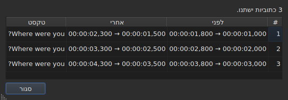
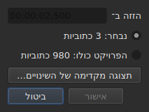
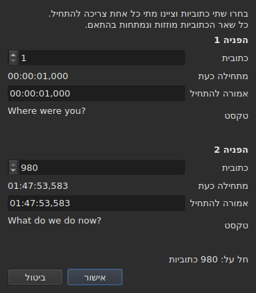
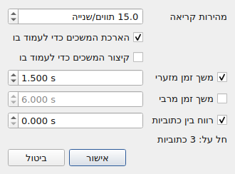
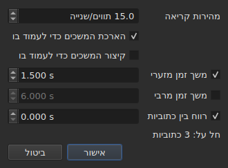
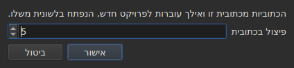

# הפעולות

<!-- machine-translated -->
> דף זה הוא תרגום מכונה שעדיין לא נבדק על ידי דובר השפה.

התפריט **כלים** כולל שש עשרה פעולות, ניתוח ושני פריטי איות. כל אחת מהשש
עשרה מבוטלת ב-`Ctrl+Z`; הניתוח אינו משנה דבר. גם `Check Spelling…` מבוטל, ו-`Spell-Check Settings…` אינו נוגע באף טקסט.

| פריט | תיבת דו־שיח | מה הוא עושה |
| :---- | :----- | :----------- |
| `Shift Positions…` | כן | מזיז את היעד במשך זמן |
| `Transform Positions…` | כן | מתקן את היעד לפי שתי נקודות ייחוס |
| `Convert Frame Rate…` | כן | מתזמן מחדש את היעד מקצב פריימים אחד לאחר |
| `Adjust Durations…` | כן | מזיז את הסופים כדי לעמוד במהירות קריאה, במשכים וברווח |
| `Append File…` | בוחר קבצים | מוסיף קובץ בסוף הפרויקט |
| `Split Project…` | כן | חותך את הפרויקט לשניים, והשאר עובר ללשונית חדשה |
| `Italic` | **לא** | מעביר את היעד לנטוי, או מוציא אותו ממנו |
| `Dialogue` | **לא** | שם מקף דו־שיח בראש כל שורה, או מסיר אותו |
| `Case ▸ Title Case` | **לא** | כל מילה מקבלת אות גדולה |
| `Case ▸ Sentence case` | **לא** | האות הראשונה של הטקסט, והיא בלבד |
| `Case ▸ UPPER CASE` | **לא** | הכול באותיות רישיות |
| `Case ▸ lower case` | **לא** | הכול באותיות קטנות |
| `Remove Hearing-Impaired Mentions…` | כן, בלי הגדרות | מסיר אזכורים לכבדי שמיעה |
| `Correct Texts…` | כן, אשף רב־עמודי | מציע תיקונים — אזכורים, צירוף ופיצול מילים, טעויות נפוצות, אותיות רישיות, שבירת שורות — ומחיל אותם לאחר שאושרו, ראו [תיקון הטקסטים…](correct-texts.md) |
| `Check Spelling…` | כן, מעבר מילה אחר מילה | עובר על המילים שהמילון אינו מכיר ומחיל את מה שתוקן, ראו [בדיקת איות…](check-spelling.md) |
| `Spell-Check Settings…` | כן | בוחר את השפה, היעד והמסמך של הבדיקה, ואת הקו התחתון בזמן ההקלדה, ראו [בדיקת איות…](check-spelling.md#הגדרות-בדיקת-האיות) |
| `Snap to Frame Rate…` | כן | מחזיר כל חותמת זמן אל הפריים הקרוב ביותר |
| `Shift Whole File onto Grid (…)` | **לא** | מחזיר את הקובץ כולו אל הרשת שלו |
| `Frame Rate Analysis…` | כן, בלי הגדרות | **אינו משנה דבר** — ראו [רשת הפריימים](frame-grid.md) |

**מה שפעולה עשתה נאמר בתיבת מידע שיש לסגור, פרט
ל-`Italic`, ל-`Case` ול-`Dialogue`**: שלושתם אינם פותחים תיבת דו־שיח, והדוח שלהם — „אין מה לשנות” בכלל — מוצג
בשורת המצב, בלי דבר לסגור. גם `Split Project…` נותן את שלו
בשורת המצב: התוצאה שלו כבר לפניכם, בלשונית החדשה. ההודעות מצוטטות בסעיף
של כל פעולה.

הוספה, הסרה, מיזוג ופיצול של שורות אינם כאן אלא בתפריט
`Edit`, כי הם משנים את מספר השורות. ראו
[הוספה, הסרה, מיזוג ופיצול של שורות](lines.md).

## על מה הן פועלות

**על השורות הנבחרות, או על כל הקובץ אם לא נבחרה אף אחת.** זה אותו
כלל לכולן, ותיבות הדו־שיח, כשיש כזו, מזכירות אותו במילים
פשוטות:

```
Applies to: 4 subtitles
```

בחירת כל השורות שקולה לאי־בחירה.

**כשנבחר רק חלק מהשורות, תיבת הדו־שיח שואלת על מה
לפעול.** שתי אפשרויות מוצגות, עם הספירה שלהן, ו**הבחירה
היא המסומנת**:

```
(•) Selected: 2 subtitles
( ) Whole project: 4 subtitles
```

סימון `Whole project` מרחיב את הפעולה לכל הקובץ בלי שיהיה צורך קודם
לשנות את הבחירה. כשאין מה לבחור — לא נבחר דבר,
או שנבחר הכול —, השורה `Applies to:` שלמעלה נשארת לבדה.

תיבות הדו־שיח של `Shift Positions…`, `Transform Positions…`,
`Convert Frame Rate…`, `Adjust Durations…`, `Snap to Frame Rate…` ו-
`Remove Hearing-Impaired Mentions…` מציעות את הבחירה הזו.

### לראות לפני שמחילים

`Shift Positions…`, `Transform Positions…`, `Convert Frame Rate…`,
`Adjust Durations…` ו-`Snap to Frame Rate…` נושאים לחצן **`Preview changes…`**.
הוא פותח חלון קטן שאומר כמה כתוביות הפעולה
הייתה משנה **עם מה שהוקלד באותו רגע, על היעד המסומן**, ו
מונה את שתים עשרה הראשונות: המספר שלהן, המיקום שלהן לפני, המיקום שלהן
אחרי, והשורה הראשונה של הטקסט שלהן. **דבר אינו מוחל**: סגירת
החלון חוזרת לתיבת הדו־שיח, שבה אפשר לשנות ערך ולהסתכל
שוב.




הוא נפתח גדול דיו להראות את כל העמודות, וניתן לשנות את גודלו
ביד.

אם הפעולה לא הייתה משנה דבר, החלון אומר זאת (`Nothing would change.`).
כל עוד מה שהוקלד אינו מגדיר פעולה — משך שאינו קריא, שתי
נקודות ייחוס על אותה כתובית —, התצוגה המקדימה ריקה מאותה סיבה שבגללה הלחצן
`OK` מוחלש. ל-`Remove Hearing-Impaired Mentions…` אין תצוגה מקדימה: מה
ששונה בו הוא טקסט, והדוח שהוא נותן אחר כך
אומר זאת.

**עם תרגום, איזה טקסט?** פעולות מיקום ומבנה
פועלות על הכתובית כולה — שני הטקסטים שלה עוקבים. אלה
שכותבות מחדש טקסט — `Italic`, `Case`, `Dialogue`,
`Remove Hearing-Impaired Mentions…` — מכוונות אל **הטקסט של עמודת התא הנוכחי**: התרגום
בעמודה שלו, הטקסט הראשי במקומות אחרים. האחר נשאר שלם, ושורת
המצב אומרת מי מכוון. ראו [הטבלה](table.md#הטקסט-שהפעולות-מכוונות-אליו).

**יוצא מן הכלל אחד, והשם שלו נושא אותו**: `Shift Whole File onto Grid`
מתעלם מהבחירה. רשת היא תכונה של המסמך, ולחצי מסמך
אין רשת משלו; הפריט לכן אומר זאת בשמו ולא
במדריך הזה בלבד.

**גם `Append File…` מתעלם מהבחירה**, מסיבה אחרת: הוא
אינו כותב מחדש יעד, הוא דוחק סוף. ראו
[הסעיף שלו](#append-file). **וכך גם `Split Project…`**: הוא חותך היכן שאומרים
לו. ראו [שלו](#split-project).

**`Correct Texts…` בוחר את היעד שלו בדף שלו**, במקום לעקוב אחר
הבחירה הנוכחית: הבחירה, הפרויקט הנוכחי או כל הפרויקטים
הפתוחים. ראו [תיקון הטקסטים…](correct-texts.md). **`Check Spelling…` בוחר אותו ב-
`Spell-Check Settings…`**, וזוכר אותו: ראו [בדיקת איות…](check-spelling.md).

**שתי פעולות הרשת אינן מדברות על אותו דבר כמו הרשת.**
פעולה פועלת על הבחירה; הניתוח ושורת המצב מדברים על
**המסמך כולו**. יישור חמש שורות מתוך מאה שבעים ושש אכן משנה את אותן
חמש — הטבלה מראה זאת — בלי ששום דבר מהם יזוז, מה
שנראה כרענון שהוחמץ. זה לא כך: אין להם מה
לומר. ראו [`Snap to Frame Rate…`](#snap-to-frame-rate) ו
[רשת הפריימים](frame-grid.md).

### מה פירוש „לא נבחר דבר”, פריט אחר פריט

הכלל חל על התפריט `Tools` ועל החיפוש. הפריטים של התפריט
`Edit` שנוגעים בשורות או מרוקנים אותן קוראים אותו אחרת — אחרת
`Del` או `Ctrl+X` שנלחצו בטעות היו מרוקנים את המסמך.

| פריט | בלי בחירה | מה הוא דורש |
| :---- | :------------------ | :--------------- |
| פעולות התפריט `Tools` | הקובץ כולו | מסמך לא ריק |
| `Shift Whole File onto Grid` | הקובץ כולו, **תמיד** | רשת שנמצאה |
| `Find and Replace…` | הקובץ כולו | מסמך לא ריק |
| `Cut Texts`, `Copy Texts`, `Paste Texts` | **מושבתים** | לפחות שורה אחת נבחרה |
| `Remove Subtitles` | **מושבת** | לפחות שורה אחת נבחרה |
| `Merge Subtitles` | **מושבת** | גוש של לפחות שתי שורות סמוכות |
| `Split Subtitle` | **מושבת** | שורה אחת בדיוק |
| `Insert Subtitles…` | מושבת, פרט למסמך ריק | שורה שאפשר למקם מולה |

כל דף נותן את הסיבה: [לוח ההעתקה](clipboard.md#על-מה-הן-פועלות),
[השורות](lines.md), [החיפוש](find-and-replace.md#מה-החיפוש-כולל).

הפריטים **מושבתים בקובץ ריק**: לא היה מה
להזיז. ל-`Italic` יש תנאי שני, שהסעיף שלו מתאר: הפורמט
הפתוח חייב להיות מסוגל לכתוב סגנון. לרישיות ולמקפים אין כזה — טקסט
הוא טקסט בכל תשעת הפורמטים.

## `Shift Positions…`

מזיז את היעד במשך זמן, קדימה או אחורה. שני הגבולות של
כל כתובית זזים באותו סכום: אף אחת אינה נשארת על המסך זמן ארוך או קצר
יותר מקודם.

המשך נכתב **כמו חותמת זמן, כולל הסימן** — `00:00:02,500` מזיז קדימה,
`-0:01,250` מזיז אחורה. הצורות המתקבלות הן אלה של תא מיקום.




| סירוב | למה |
| :------ | :-- |
| משך שאינו קריא | הלחצן נשאר מושבת; דבר אינו מוזז באקראי |
| הזזה של אפס | אין פעולה לרשום |
| כתובית הייתה עוברת לפני תחילת הווידאו | **שום קובץ אינו יכול לשאת מיקום כזה** |

המקרה השלישי נוקב באשם — „כתובית 1 הייתה מתחילה לפני נקודת המוצא” —
והוא זה שכדאי להסתכל בו כדי לראות בכמה טעיתם. דבר
אינו מוחל.

## `Transform Positions…`

תיקון של קובץ שתוזמן מול גרסת עריכה אחרת. אומרים היכן **שתי**
כתוביות מתחילות באמת, וכל השאר עוקב, באופן פרופורציונלי.

תיבת הדו־שיח שואלת פעמיים את אותו דבר: מספר כתובית, ואת
המיקום שההתחלה שלה אמורה להיות בו. לכל נקודת ייחוס היא מראה **למה המספר
הזה מתייחס** — הטקסט שלה (`Text`) והזמן שבו היא מתחילה
**עכשיו** (`Now starts`), כתוויות פשוטות — והן עוקבות אחר המספר
כשמשנים אותו. הטקסט שומר **מקום לשלוש שורות** יהא תוכן
הכתובית אשר יהיה: טקסט ארוך יותר, או כתובת ארוכה, גולל בתוכו, ו
התיבה שומרת על גודלה כשנקודת הייחוס משתנה. **שדה אחד בלבד מוקלד לכל נקודת ייחוס:
`Should start`**, הזמן שבו הכתובית הזו צריכה להתחיל. אין צורך לחפש בטבלה איזו שורה היא `980`.

`Should start` **מוצע בערך הנוכחי**: כל עוד לא נוגעים בו, נקודת הייחוס
אומרת „הכתובית הזו כבר במקום שבו היא צריכה להיות”. משנים רק
מה שרוצים לשנות. נקודת הייחוס השנייה ממולאת מראש בכתובית
האחרונה של הקובץ — שתי נקודות ייחוס רחוקות נותנות תיקון בטוח יותר
משתי נקודות סמוכות.




**שתי נקודות הייחוס נוחתות בדיוק היכן שנדרש.** זה אינו
קירוב: החישוב נעשה כך שזה יתקיים.

| סירוב | למה |
| :------ | :-- |
| שתי נקודות ייחוס על אותה כתובית | הן אינן מגדירות תיקון |
| מיקום שאינו קריא | אותה סיבה כמו בהזזה |

מספר מחוץ לקובץ אינו ניתן להקלדה: השדה תחום במספר
הכתוביות.

## `Convert Frame Rate…`

מתזמן מחדש את היעד כשהמיקומים חושבו מול קצב פריימים
אחד וצריכים להיות מול אחר.

שתי הרשימות מציעות את שמונת קצבי הפריימים הסטנדרטיים.

> **טעות בקצב הפריימים של הקלט מזיזה את הקובץ כולו בלי לדווח
> על דבר.** זהו אופן הכשל החמור ביותר של הפעולה הזו, ולכן
> התיבה אומרת מניין באים הערכים שהיא מציעה במקום
> לקבוע אותם בשתיקה.

### שני המקורות, ומה הם עונים

התיבה נושאת עד שתי שורות נוספות, כל אחת מופיעה כשיש לה
מה לומר:

| שורה | מה היא אומרת | מה היא ממלאת מראש |
| :--- | :----------- | :---------------- |
| `The positions say` | [רשת הפריימים](frame-grid.md) שנגזרה מהמיקומים של הקובץ | `Timed against` |
| `The video declares` | קצב הפריימים שהמיכל מכריז עליו, למשל `24000/1001` | `Should play at` |
| `The file was read at` | קצב הפריימים שבו נקרא קובץ **הנספר בפריימים** | `Timed against` |

**כל הצעה הולכת לשדה שהיא עונה עליו.** הרשת אומרת מול מה
הקובץ *נכתב* — זו הרשימה העליונה. מה שהמיכל מכריז הוא
קצב הפריימים שבו הסרט *רץ*, ולכן זה שבו הכתוביות
צריכות להגיע — זו הרשימה התחתונה.

**רק רשת נקייה ממלאת מראש את הקלט.** רשת חלקית היא
רמז שהגזירה עצמה מגדירה כחלקי, והשדה הזה מכריע
פעולה על הקובץ כולו. [שורת המצב](frame-grid.md) והניתוח
נושאים את המקרה הזה; הוא אינו נושא.

**קובץ הנספר בפריימים מחליף את הרשת במקום להוסיף עליה.**
MicroDVD נושא מספרי פריימים, ומיקומי המסמך
חושבו מהם בקצב פריימים הקריאה: רשת שנגזרה מהמיקומים האלה
יכולה רק למצוא שוב את המספר הזה. `The positions say` לכן נעלם, ו-
`The file was read at` תופס את מקומו — זו אותה בחירה ש
[שורת המצב](frame-grid.md#למסמך-הנספר-בפריימים-אין-רשת-יש-לו-קצב-פריימים) עושה.

**כך משנים את קצב הפריימים של MicroDVD.** קביעת קצב הפריימים שנקרא
כקלט ושל האמיתי כפלט מחשבת מחדש כל מיקום מהפריימים של
הקובץ — בלי לקרוא דבר שוב, והפעולה מבוטלת כמו
האחרות.

### אי-הסכמה אינה סתירה

שתי השורות יכולות להיות מוצגות יחד ולהכריז על מספרים שונים.
**זו אינה שגיאה שיש להכריע בה**: הסרט רץ בקצב פריימים אחד, הקובץ
נכתב על רשת אחרת. קובץ ב-24 לסרט ב-25 הוא
בדיוק המקרה שיישור — `snap` בשורת הפקודה — קיים כדי
לטפל בו.

דבר אינו נבחר אפוא במקום המשתמש: שתי הרשימות נשארות
ניתנות לעריכה, וזה מכוון. מקור שכופה את עצמו אוסר על בדיקה צולבת.

השורות אינן מופיעות כשאין מה לומר: אין וידאו
משויך, אין `ffprobe`, או אין רשת נקייה. התיבה היא אז זו
שתוארה למעלה, ו**אף פעולה אינה מסרבת בשל כך** — קצב
הפריימים בא מהמשתמש. ראו
[הווידאו המשויך](video.md#ffmpeg-אינו-חובה).

קצב פריימים שהסרט מכריז עליו אך אינו אחד משמונת הסטנדרטיים
**מוצג בלי להיבחר**: הידיעה שהסרט רץ בקצב פריימים
יוצא דופן היא המידע, ואין כאן לאן להמיר אותו.

המרת קצב פריימים לעצמו אינה משנה דבר: הלחצן נשאר מושבת.

## `Adjust Durations…`

מאריך או מקצר את משך הכתוביות של היעד **בהזזת
הסוף שלהן, לעולם לא ההתחלה**. הזזת ההתחלה הייתה מזיזה את הכתובית, וזו
עבודתו של [`Shift Positions…`](#shift-positions).





### ארבעת האילוצים

| שדה | על מה הוא שואל | ערכים | ברירת מחדל |
| :---- | :--------------- | :----- | :------ |
| `Reading speed` | הזמן הנדרש לקריאת הטקסט | מ-1 עד 99 תווים לשנייה, עד עשירית | 15 תווים לשנייה |
| `Lengthen durations to match it` | הארכת מה שקצר מכדי להיקרא | מסומן או לא | מסומן |
| `Shorten durations to match it` | קיצור מה שנשאר מוצג זמן ארוך מהנדרש | מסומן או לא | לא מסומן |
| `Minimum duration` | משך רצפה | מ-0 עד 99 שניות, עד אלפית שנייה | מסומן, 1.5 שניות |
| `Maximum duration` | משך תקרה | מ-0 עד 99 שניות, עד אלפית שנייה | לא מסומן, 6 שניות |
| `Gap between subtitles` | הרווח להשאיר לפני הכתובית הבאה | מ-0 עד 99 שניות, עד אלפית שנייה | מסומן, 0 שניות |

אלה ערכי ברירת המחדל של Gaupol.

**אילוץ שאינו מסומן נעדר**: השדה שלו מוחלש ואינו נקרא. אילוץ
שמסומן באפס שווה אפס — רווח של 0 שניות אוסר על כתובית
לחפוף את הבאה. מהירות הקריאה נקראת רק אם
`Lengthen` או `Shorten` מסומן.

**כשהכול אינו מסומן, `OK` מושבת**: אין על מה לבקש.

התיבה נפתחת מחדש בערכי ההתאמה האחרונה, **ושומרת אותם מהפעלה
להפעלה** — כמו שתי אפשרויות החיפוש. **תיבה שאינה מסומנת
שומרת את הערך שלה**: ביטול הסימון של `Minimum duration` אחרי קביעת 2 שניות אינו מחזיר
1.5, וסימון חוזר מוצא 2 שניות. תשע ההגדרות נמצאות ב
[קובץ ההעדפות](preferences.md#הקובץ), תחת `duration-adjust.`.

**שורת הפקודה חולקת אותן.** [`subedit-cli adjust`](../subedit-cli/adjust.md) קורא את אותן
תשע הגדרות כברירת מחדל, ולכן מהירות שנקבעה כאן היא המהירות שהוא משתמש בה, אלא אם האפשרויות שלו
אומרות אחרת; [`subedit-cli config`](../subedit-cli/config.md) מציג ומשנה אותן. ראו
[שני חלקים, אחד מהם משותף עם שורת הפקודה](preferences.md#שני-חלקים-אחד-מהם-משותף-עם-שורת-הפקודה).

### באיזה סדר, ומי מנצח

כל כתובית של היעד עוברת את ארבעת האילוצים **בסדר הזה**, וכל
אחד קובע את הסוף בתורו:

| דירוג | אילוץ | מה הוא קובע |
| ---: | :--------- | :----------- |
| 1 | מהירות קריאה | `end = start + length ÷ speed`, אם הכתובית קצרה מדי (`Lengthen`) או ארוכה מדי (`Shorten`) |
| 2 | משך מינימלי | `end = start + minimum`, אם המשך קצר יותר |
| 3 | משך מרבי | `end = start + maximum`, אם המשך ארוך יותר |
| 4 | רווח | `end = next start − gap`, אם הסוף קרוב מדי אליו — לעולם לא לפני ההתחלה |

**האחרון שהוחל מנצח.** הרווח בא אחרון ויכול להחזיר
משך מתחת למינימום שנקבע הרגע: שתי כתוביות על המסך באותו
זמן הן פגם שהצופה רואה, כתובית קצרה במעט
אינה כזו.

**אורך הטקסט נספר בלי תגיות**, בתווים, כולל
שבירות שורה: `<i>été</i>` סופר שלושה תווים. מהירות הקריאה מדברת על
מה שהצופה קורא.

**הבאה היא הכתובית הבאה בקובץ**, בין אם היא ביעד ובין אם
לא. **לכתובית האחרונה של הקובץ אין הבאה**: הרווח אינו
מגביל אותה.

### מה שאף סוף אינו יכול לספק נאמר

כשההתאמה נעשתה, החלון אומר כמה סופים זזו, ו**מה
לא ניתן היה לשמור** — אילוץ מופיע רק אם
הוקרב לפחות לכתובית אחת:

```text
adjusted the durations of 12 subtitles; could not satisfy the reading speed in 9 subtitles, the minimum duration in 4 subtitles
```

שלוש ההזכרות האפשריות הן `the reading speed`, `the minimum duration` ו-
`the gap`. **המשך המרבי נשמר תמיד**: הוא בא אחרי המהירות
והמינימום, ורק הרווח בא אחריו, והוא יכול רק לקצר. מינימום
גדול מהמרבי נכנע לו, והמינימום הוא שנספר. הרווח
מוקרב רק כשהבאה מתחילה לפני ההתחלה של הכתובית
עצמה.

הספירה מכסה את היעד כולו, **כולל הכתוביות שהסוף שלהן לא
זז**: כתובית שכבר צמודה לבאה אחריה וקצרה מדי למינימום
נספרת. כשאף סוף אינו זז, החלון אומר זאת —
`no duration to adjust` — ושום דבר אינו נכנס להיסטוריה.

## `Append File…`

מוסיף קובץ בסוף הפרויקט הפתוח. **דבר אינו מוכנס בין
השניים**: הקובץ שנבחר מוזז בסוף הכתובית האחרונה של
הפרויקט, בדיוק כפי ש-Gaupol עושה.

**מושבת במסמך ריק**: לא היה סוף להזיז ממנו. בוחר
קבצים נפתח, בלי קידוד לבחור — כמו `Open…`.

**הקובץ המצורף עובר המרה**, במילים של `Save As…` ושל
[הדבקה מפורמט אחר](clipboard.md#תגיות-של-פורמט-אחר-מתורגמות):
התגיות שלו מתורגמות לפורמט הפרויקט, ומה שהפורמט הזה אינו יכול
לכתוב נאמר:

```text
appended 12 subtitles; Advanced SSA into SubRip: 1 tag dropped
```

**מה שהקובץ המצורף נשא אינו שורד שלם.** המיקומים שלו
עוקבים, יחד עם התגיות; הכותרת שלו, השדות הייחודיים לפורמט שלו — שם
סגנון, שוליים — ומה שתגית אינה יכולה להפוך להיות בפורמט הפרויקט
אינם עוקבים, ואומרים זאת. **אין לו תרגום**: תרגום נשאר
ייחודי למסמך שקיבל אותו, והקובץ המצורף מגיע לבדו.

**נבחר אחר כך**, כמו השורות שהדבקה כתבה מעבר
לסוף. כשדבר אינו הולך לאיבוד, הספירה מוצגת בשורת המצב ולא
בתיבה לסגירה — אותו כלל כמו
[פתיחת תרגום](files.md#פתיחת-תרגום).

**פריט אחד בהיסטוריה**, יהא מספר הכתוביות
המצורפות אשר יהיה: `Ctrl+Z` מסיר את כולן בבת אחת.

**אפשר לצרף קובץ שכבר פתוח לעצמו**: דבר אינו אוסר זאת, כמו
ב-Gaupol.

**בשורת הפקודה**, [`append`](../subedit-cli/append.md) עושה אותו דבר לכמה קבצים בבת
אחת, בתוצאה אחת.

## `Split Project…`

חותך את הפרויקט לשניים: **ההפך המדויק של `Append File…`**. תיבה
שואלת מאיזו כתובית לחתוך — מהשנייה עד האחרונה, ממוספרות
כמו בטבלה — ונפתחת על השורה הנוכחית.

**הטבלה מראה היכן חותכים לפני שחותכים**: כל מספר שהתיבה
מקבלת בוחר את השורה שלו. `Cancel` מחזיר את הבחירה הקודמת.




**מושבת מתחת לשתי כתוביות**: חיתוך דורש כתובית בכל
צד.

**השאר מועתק לפרויקט חדש, הנפתח בלשונית חדשה, ומוסר
מהפרויקט המקורי.** הפרויקט החדש **מוזז בפחות הסוף של
הכתובית האחרונה שנשארה**: פיצול ואז צירוף מחזירים את פרויקט המוצא.
שני הטקסטים שלו, הראשי והתרגום, עוקבים אחר הכתוביות שלהם, והוא
שומר על הפורמט והקידוד של המקורי — **בלי נתיב**: אין עדיין קובץ
שמחזיק אותו. הלשונית שלו לכן נכתבת `untitled*` מלידתה, וסגירתו
בלי שמירה שואלת את השאלה שנשאלת על כל מה שאינו
כתוב.

**שורת המצב אומרת כמה כתוביות עזבו**, בלי תיבה
לסגירה — הלשונית החדשה כבר מראה את התוצאה:

```text
split 12 subtitles into a new project
```

**פריט אחד בהיסטוריה**, בפרויקט המקורי:
`Undo: splitting the project` מחזיר לו את השאר. לפרויקט החדש יש היסטוריה
משלו, ריקה; הביטול אינו נוגע בו, והוא נשאר פתוח.

**נדחה כשאף קובץ לא היה יכול לכתוב את התוצאה.** אם שני
החצאים חופפים בחיתוך, ההזזה הייתה מביאה כתובית לפני
תחילת הווידאו — מיקום שלילי, שאף פורמט אינו כותב. התיבה
שדוחה **נוקבת בכתובית** ומציעה לחתוך במקום אחר:

```text
Cannot split at subtitle 3: subtitle 3 would fall before the start of the video. Cut somewhere else.
```

הגעה בדיוק לתחילה מותרת: אפס הוא מיקום.

**בשורת הפקודה**, [`split-file`](../subedit-cli/split-file.md) חותך קובץ באותה דרך, לשני
קבצים בעלי שם.

## `Snap to Frame Rate…`

מחזיר **כל חותמת זמן** — התחלה וסוף — אל הפריים הקרוב ביותר של
קצב הפריימים שנבחר. רשימה אחת, וזה כל ההבדל מול
המרה: המרה צריכה שני קצבי פריימים כי היא מותחת את
הקובץ מאחד לשני; יישור צריך רק את
הרשת לנחות עליה.

| | `Convert Frame Rate…` | `Snap to Frame Rate…` |
| :--- | :-------------------- | :-------------------- |
| תנועה | פרופורציונלית לזמן — **כמה שניות** בסרט באורך מלא | חצי פריים לכל היותר, **בכל מקום** |
| לאיזה קובץ | קובץ ש**התזמון שלו שגוי** | קובץ שהתזמון שלו **נכון** והרשת שלו שגויה |

**מקרה השימוש**, מפורש: סרט ב-25 פריימים לשנייה,
כתוביות שנכתבו על רשת של 24, שורות שכבר פחות או יותר במקומן
עד כמה אלפיות שנייה. אין מה לתזמן מחדש — רק להחזיר
את חותמות הזמן אל הפריימים הנכונים.

הרשימה **נפתחת על מה שהווידאו מכריז**, ולא על מה שהמיקומים
אומרים: הכוונה היא להצטרף לרשת של הסרט, והגזירה
נוקבת ברשת שעוזבים. בלי וידאו או בלי `ffprobe`, היא נפתחת
על קצב הפריימים של הפרויקט.

יישור קובץ על הרשת שהוא כבר תופס אינו משנה אותו, ואינו
שגיאה: הפעולה מוחלת, אינה מזיזה דבר, ומבוטלת כמו
כל אחרת.

**יישור חלק מהקובץ אומר זאת, כשנעשה.** הודעה מוצגת
כשהבחירה אינה מכסה הכול והמסמך עדיין נקרא על רשת
אחרת:

```
5 of 176 subtitles aligned to 25 fps; the document is still read on a 24 fps grid
```

היא מקשרת את המחווה להשפעתה, ומסבירה מדוע שורת המצב והניתוח
לא זזו: הם מדברים על המסמך, הפעולה פעלה על
חמש שורות. דבר אינו נמנע — יישור חלק מקובץ יכול להיות
מכוון.

**זה כמעט תמיד לא מכוון, וזה נמדד.** בשמונת
קובצי הרשת של המאגר, יישור הקובץ כולו מביא את קצב הפריימים הנגזר אל
היעד ואת הריכוז שלו ל-100%; יישור חמש שורות אינו מזיז לעולם את קצב
הפריימים הנגזר ו**מנמיך** את הריכוז בשבעה מקרים מתוך שמונה — השורות
המיושרות עזבו את הרשת שהשאר של הקובץ חי עליה. השמיני הוא
50 ל-25, שבו רשת היעד מחלקת את זו של הקובץ והמיקומים כבר
היו עליה.

ההודעה אינה מוצגת כשהבחירה מכסה את הקובץ כולו, כשאין
רשת נגזרת, או כשהמסמך נקרא עתה על קצב
הפריימים המבוקש — כלומר כשהיישור עשה מה שנתבקש.

## `Shift Whole File onto Grid`

מזיז **את הקובץ כולו** בסכום שמחזיר את המיקומים שלו אל הרשת
שהם עזבו. קובץ שהמיקומים שלו על רשת עד כדי
קבוע הוזז, והקבוע הזה ניתן למדידה.

**פריט התפריט נושא את הסכום ואת התחום** —
`Shift Whole File onto Grid (+0.001 s)`. אין תיבת דו־שיח:
הפעולה אינה לוקחת אפשרות, ופריט שעומד להזיז קובץ
שלם חייב לומר בכמה, ושיעשה זאת במלואו, לפני שנבחר.
זו הפעולה היחידה בתפריט שמתעלמת מהבחירה.

**הוא מושבת כשלא נמצאה רשת.** אין אז מה
להצטרף אליו, ופאזה שנמדדה על רעש הייתה מזיזה את הקובץ באקראי.
„אין למה להצטרף” ו„הצטרפות באפס” אינם אומרים אותו דבר: השני
נשאר מוצע, כי קובץ שכבר על הרשת שלו הוא מקרה
רגיל שלו.

**זה אינו `Snap to Frame Rate…`.** הפריט הזה מזיז הכול באותו סכום
ושומר על התזמון היחסי **בדיוק**; יישור מזיז כל
מיקום בנפרד ובדרך סופג את אלה שתוקנו
ביד. בקובץ נקי שניהם נותנים אותה תוצאה; בקובץ
חלקי לא — ו[פירוט הניתוח](frame-grid.md) אומר איזה משני
המקרים לפניכם.

## `Italic`

מעביר את היעד לנטוי בכתיבת התגיות של **הפורמט הפתוח**, או
מסיר אותן אם הוא כבר בנטוי. בלי תיבת דו־שיח: לפעולה אין הגדרה, והיא
מבוטלת ב-`Ctrl+Z` כמו האחרות.

| פעולה | קיצור דרך | היכן |
| :----- | :------- | :---- |
| נטוי | `Ctrl+I` | התפריט **כלים**, סרגל הכלים |

זו הפעולה היחידה בתפריט `Tools` שיש לה לחצן ב
[סרגל הכלים](index.md#סרגל-הכלים).

### מה הוא כותב, פורמט אחר פורמט

הטקסט של כתובית הוא זה של הקובץ שלה, כולל תגיות — ראו
[עריכת תא](editing.md). לכל פורמט יש את שלו, וזה מה
שהפריט הזה חוסך לכם מלדעת:

| פורמט | מה נכתב |
| :----- | :-------------- |
| SubRip, WebVTT, SubViewer 2 | `<i>text</i>` |
| Sub Station Alpha, Advanced SSA | `{\i1}text{\i0}` |
| MicroDVD | `{Y:i}text` — התגית נמשכת עד סוף הכתובית, אין מה לסגור |
| MPL2 | `/` בראש **כל** שורה, הסימן חל רק על שורתו |
| TMPlayer, LRC | דבר: שני הפורמטים האלה אינם כותבים סגנון |

**הפריט מושבת ב-TMPlayer וב-LRC, לא מוסתר.** פריט נעדר
אינו מלמד דבר; פריט מוחלש עונה על „למה אי
אפשר?”.

**הפורמט הנקרא הוא זה של הטקסט המכוון.** עם תרגום, הטקסט הראשי
יכול להיות ב-SubRip והתרגום ב-Advanced SSA: `Italic` כותב `<i>` ב
הראשון ו-`{\i1}` בשני. הפריט מושבת גם כשהטקסט
המכוון בפורמט שאינו כותב סגנון, אף אם האחר כותב.

### לאיזה כיוון הוא הולך

פריט אחד לשני הכיוונים, והיעד הוא שמכריע:

- **די בכתובית אחת שאינה בנטוי** כדי שהיעד כולו יעבור לנטוי;
- היעד יוצא מהם רק כשהוא **כולו** בהם.

זה הכלל של Gaupol, והוא היחיד שהופך לחצן אחד
לשמיש: בחירה מעורבת הולכת כגוש אחד במקום להתהפך
שורה אחר שורה, ולחיצה כפולה מחזירה אותה כפי שהייתה.

הדוח אומר מה נעשה, בכיוון שבו נעשה:

```
2 subtitles put in italics
2 subtitles taken out of italics
```

**שורה ריקה אינה מקבלת תגיות לעולם** — `<i></i>` סביב כלום היה
נראה בטבלה. יעד שמכיל רק שורות כאלה לכן אינו משתנה, ו
אומר זאת: „אין מה לשנות”. אף פריט אינו נכנס אז להיסטוריה.

### במה הוא אינו נוגע

**שאר התגיות נשארות בדיוק היכן שהן**: צבע,
גופן, `{\pos(x,y)}` של Advanced SSA עוברים את הפעולה בלי לזוז.
רק תגיות נטוי נקבעות ומוסרות.

תגית שאומרת כמה דברים בבת אחת אינה מוסרת כולה:
`{\b1\i1}` הופך ל-`{\b1}`, ו-`{Y:bi}` הופך ל-`{Y:b}`. ההדגשה נשארת, והטקסט
באמת יוצא מהנטוי.

## `Case` ו-`Dialogue`

שתי המרות של **הטקסט הגלוי**, והתגיות אינן נוגעות: כתובית
שהועברה לאותיות קטנות שומרת על ה-`<I>` שלה כמות שהוא, ומקף מוצב
לפני הטקסט, לא לפני תגית פותחת. **שום תגית אינה משנה
מקום**: `<i>bon</i>jour` באותיות רישיות נותן `<i>BON</i>JOUR`, ואילו
[החלפה](find-and-replace.md#הטקסט-שמחפשים-הוא-הטקסט-הגלוי) הייתה
מרחיבה את הנטוי למילה כולה.

| פריט | קיצור דרך | מה הוא עושה |
| :---- | :------- | :----------- |
| רישיות/קטנות ▸ אותיות כותרת | — | `bonjour marie` הופך ל-`Bonjour Marie` |
| רישיות/קטנות ▸ אותיות משפט | — | `BONJOUR MARIE` הופך ל-`Bonjour marie` |
| רישיות/קטנות ▸ אותיות רישיות | — | הכול באותיות רישיות |
| רישיות/קטנות ▸ אותיות קטנות | — | הכול באותיות קטנות |
| דו־שיח | — | מוסיף או מסיר את המקפים |

### במה הרישיות אינה נוגעת

**מה שקודם לאות הראשונה או לספרה הראשונה נשאר כמות שהוא.**
מקף דו־שיח, מרכאה פותחת, סוגריים שורדים:
`- bonjour` שהועבר לאותיות משפט נותן `- Bonjour`, ולא `- bonjour` עם
מקף באות גדולה, מה שלא היה הגיוני.

**אותיות משפט מחזירות את השאר לאותיות קטנות.** `BONJOUR MARIE` הופך ל-
`Bonjour marie`: כך Gaupol עושה, וכך אפשר להנמיך
כתובית שהוקלדה באותיות רישיות.

**מבטאים ואלפבתים לא לטיניים מטופלים כראוי.** `éléonore`
נותן `ÉLÉONORE`, ואפוסטרוף אינו חותך מילה: `l'été` שהועבר לאותיות
כותרת נותן `L'été` ולא `L'Été`. אות שמשנה אורך שומרת על
התגיות שסביבה: `fi <i>x</i>` באותיות רישיות נותן `FI <i>X</i>`.

**הרישיות אינה תלויה בשפת המערכת.** היא עוקבת אחר הכללים המשותפים
לכל השפות: `istanbul` באותיות רישיות נותן `ISTANBUL`, בין אם המחשב
מוגדר לצרפתית ובין אם לטורקית.

### לאיזה כיוון `Dialogue` הולך

פריט אחד לשני הכיוונים, והיעד הוא שמכריע:

- **די בשורה אחת בלי מקף** כדי שהיעד כולו יקבל אחד;
- היעד מאבד אותם רק כש**כל** השורות שלו נושאות כזה.

לחיצה כפולה מחזירה את היעד כפי שהיה. זה הכלל של
[`Italic`](#italic), והיחיד שהופך לחצן אחד לשמיש.

**שלושה מקפים מזוהים** — מקף המקלדת ושני
המקפים של הסדר, `–` ו-`—` — והמקף הוא שנכתב.
רווחים מיותרים אחרי המקף נעלמים. שורה ריקה אינה מקבלת
דבר.

### מה הן אומרות

```
2 subtitles recased
2 subtitles dashed
2 subtitles undashed
```

וכשדבר אינו משתנה — יעד שכבר ברישיות המבוקשת — „אין מה
לשנות”, בלי להכניס דבר להיסטוריה.

## `Remove Hearing-Impaired Mentions…`

מסיר את האזכורים המיועדים לצופים חירשים או כבדי שמיעה —
תיאורי הצלילים בסוגריים מרובעים. **סוגריים עגולים נשארים**: הם משמשים גם
לשורות הנלחשות, ו-`Correct Texts…` הוא שמסיר אותם, דרך תיבת הסימון `Sound in parentheses` שלו.
**שום דבר אחר**: מילות שירים
בין סולמיות ושם הדובר לפני נקודתיים מוסרים רק דרך
[`Correct Texts…`](correct-texts.md), הדף `Mentions`.

תיבת הדו־שיח אינה שואלת דבר: לפעולה אין הגדרה, והתיבה משמשת רק
לאישור ולהזכרת מה שהפעולה פועלת עליו.

**זו היחידה בתפריט `Tools` שגורמת לשורות להיעלם**, והיחידה
בכל התוכנית שגורמת להן להיעלם בלי שביקשו זאת. כתובית
שהייתה *רק* אזכור נשארת בלי טקסט אחרי הניקוי, וכתובית
בלי טקסט אין סיבה שתהיה: היא מוסרת מהקובץ. האחרות
נכתבות מחדש בלי האזכור שלהן.

**תגיות הפורמט אינן נחשבות טקסט**: `<i>[SOUPIR]</i>` של
SubRip ו-`{\i1}[SOUPIR]{\i0}` של Advanced SSA מוסרים באותה מידה.
`<i>` ב-TMPlayer או ב-LRC, שאינם כותבים תגית, הוא טקסט.

**כשהיעד הוא התרגום, היא אינה מסירה שורה.** תרגום שהכלל
מרוקן — טקסט שהיה רק אזכור — **מרוקן** והכתובית
נשארת: יש לה טקסט ראשי, שהפעולה לא כיוונה אליו, והסרתה הייתה
משמידה אותו. הדוח סופר אותה כמנוקה:

```text
1 subtitle cleaned, 0 removed
```

התגיות הנקראות הן אלה של פורמט התרגום, שאינו בהכרח זה
של הקובץ הראשי.

הדוח אומר את שניהם:

```
1 subtitle cleaned, 1 removed
```

**כשדבר אינו נתפס, דבר אינו קורה** — והתיבה אומרת זאת: „אין אזכור
להסרה”. אף פריט אינו נכנס להיסטוריה, כי פעולה ש
אינה משנה דבר אינה פעולה לביטול.

**הביטול מחזיר הכול**, את הכתוביות שהוסרו וגם את הטקסטים
שנכתבו מחדש, כל אחד עם הטקסט שהיה לו. כתובית שהכלל רוקן
אינה נכתבת מחדש לפני שהיא מוסרת, בדיוק כדי שתחזור
שלמה.

> **הבחירה אובדת בהזדמנות זו**: הסרת שורות משנה את
> מבנה הטבלה, שנבנית מחדש. כל שאר הפעולות של התפריט
> `Tools` שומרות עליה, `Italic`, `Case` ו-`Dialogue` בכלל זה. ארבעת
> פריטי המבנה של התפריט `Edit` — הוספה, הסרה, מיזוג, פיצול —
> משנים גם הם את המבנה, ומחזירים בחירה במקום זו
> שלקחו — ראו
> [הוספה, הסרה, מיזוג ופיצול של שורות](lines.md).

הפניה מספרית טהורה — „ראו [1] את ההערה” — אינה אזכור
ונשארת כמות שהיא.

## מעבר לסוף הסרט

כשוידאו פתוח, פעולה ש**דוחפת כתוביות אל מעבר לסוף
הסרט** מדווחת על כך, כשנעשתה:

```
shifting leaves 3 subtitles past the end of the video, by 4.200 s at most
```

המשפט נוקב בפעולה — `shifting`, `transforming`,
`converting the frame rate`, `adjusting durations`,
`aligning on the frame rate` —, בכמה כתוביות חורגות, ובכמה
חורגת הרחוקה ביותר. `Shift Whole File onto Grid` היא הזזה, ונקראת
`shifting`.

| מה נספר | מה לא |
| :-------------- | :---------- |
| מה שהפעולה נגעה בו הרגע, כלומר היעד | כתובית שאיש לא הזיז |
| כתובית שמסתיימת **אחרי** הסוף | כתובית שמסתיימת בדיוק איתו |

**זו אזהרה, ותו לא.** דבר אינו נדחה, דבר אינו
מתוקן: כתובית שנופלת אחרי קרדיטי הסיום עשויה להיות
בדיוק מה שרצית, וסירוב שגוי עולה יותר מאזהרה
שמתעלמים ממנה. הפעולה בהיסטוריה, ו-`Undo`
מבטל אותה כמו כל אחרת.

**תיבה אחת לכל פעולה.** ל-`Adjust Durations…` ול-`Align` כבר יש
מה לומר — מה שהתאמה לא הצליחה לשמור, מה שיישור
חלקי השאיר בצד. כשהם גם דוחפים כתובית אל מעבר לסוף,
התיבה נושאת את שני המשפטים, זה מתחת לזה, זה של הפעולה
ראשון:

```
adjusted the durations of 2 subtitles
adjusting durations leaves 1 subtitle past the end of the video, by 1.000 s at most
```

ההודעה אינה מופיעה אם אין וידאו פתוח: המשך בא מהנגן, ובלי
סרט אין סוף לחרוג ממנו. רק חמש הפעולות
שנזכרו למעלה נוגעות בדבר — `Adjust Durations…` בכלל זה, שיכול
להאריך סוף מעבר לסרט. כל האחרות אינן: אלה של התפריט
`Tools` שכותבות מחדש טקסט, ובתפריט `Edit` הוספה,
מיזוג, פיצול, הדבקה, החלפה ותאים שנערכו — סוף
שהוקלד ביד מעבר לסרט אינו מדווח.
