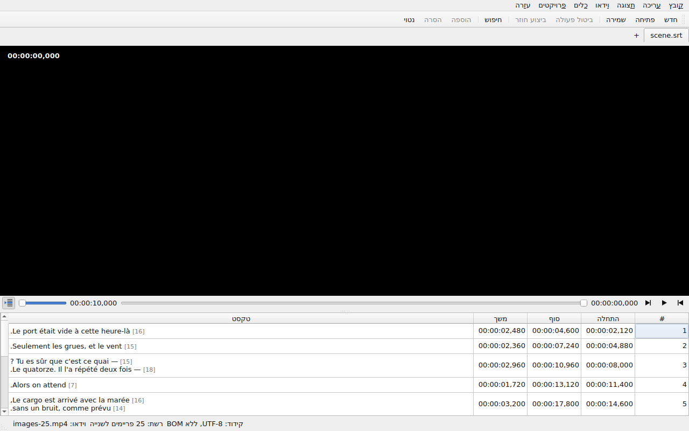
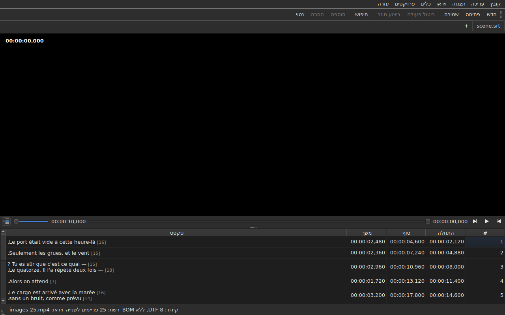

# הנגן

<!-- machine-translated -->
> דף זה הוא תרגום מכונה שעדיין לא נבדק על ידי דובר השפה.

הווידאו המשויך נצפה **בתוך החלון**, כשהשורה הנוכחית מצוירת מעליו. כך אפשר לבדוק על הסרט את תוצאת ההזזה, ההמרה או
המרת קצב הפריימים.

על הדרך לשייך סרט ראו [הווידאו המשויך](video.md); דף זה מתאר מה קורה משעה שהוא משויך.

## תצוגת הווידאו

| מצב | מה החלון מציג |
| :-------- | :-------------------- |
| וידאו משויך ונפתח | התמונה תופסת את החלק העליון, הטבלה מתחתיה |
| אין וידאו משויך | אין תמונה, הטבלה תופסת את כל החלון |
| הווידאו אינו נפתח | אין תמונה, יש הודעה, והחלון נשאר שמיש |

החלוקה בין התמונה לטבלה **זזה עם העכבר**. התמונה אינה יורדת מתחת ל-180 פיקסלים בגובהה. הגדלת החלון נותנת את המקום
שנוסף לטבלה, לא לתמונה: מה שחסר בעת עריכה הוא שורות.

מתחת לתמונה, **סרגל ניגון**: היכן הסרט נמצא, כמה זמן הוא נמשך, ניגון והשהיה, ועוצמת הקול. ראו
[סרגל הניגון](#סרגל-הניגון).

## ניגון ועצירה

| פקודה | קיצור דרך | מה היא עושה |
| :------ | :------- | :----------- |
| וידאו ▸ הפעלה / השהיה | `Ctrl+P` | מנגנת אם הניגון עצור, ועוצרת אותו אחרת |

הפקודה **מושבתת כל עוד אין וידאו פתוח**. וידאו ששויך זה עתה נפתח **עצור**: פתיחת סרט אינה צפייה בו.

`Ctrl+P` במקום שבו ל-Gaupol יש `P` פשוט: קיצור של אות אחת בהיקף החלון נתפס לפני שהרכיב שבמוקד רואה אותו, ולכן `P`
היה נבלע בדרכו אל עורך תא. דבר אינו מודפס כאן, והצירוף פנוי.

## סרגל הניגון

מתחת לתמונה, לפי סדר הופעתם — שלושת הכפתורים הם **סמלים**, אלה של ערכת הנושא של שולחן העבודה כשיש בה כאלה, ושל
הסגנון של Qt אחרת:

| רכיב | מה הוא עושה |
| :------ | :----------- |
| שני כפתורי הצעד | מזיזים את הסרט אחורה וקדימה **בצעד פריים אחד** — ראו [פריים אחר פריים](timing.md#פריים-אחר-פריים) |
| ניגון / השהיה | מנגן או עוצר, כמו `Ctrl+P` — הכפתור מראה **מה יעשה**: משולש כשהניגון עצור, שני פסים כשהוא מנגן; הסבר הכלי אומר זאת במילים פשוטות |
| המיקום | `HH:MM:SS,mmm`, כתוב כפי שהטבלה כותבת מיקום — **כמספר פריים** כש-[`תצוגה ▸ מיקומים בפריימים`](table.md#מיקומים-בפריימים) מסומן |
| המחוון | **קורא וזז**: גוררים את הידית, לוחצים בחריץ, משתמשים בחצים |
| משך הסרט | זה שהווידאו מצהיר עליו, כתוב כמו המיקום |
| עוצמת הקול | מ-0 עד 100, ראו [עוצמת הקול](#עוצמת-הקול) |
| מעקב הטבלה | לחוץ כל עוד הטבלה עוקבת אחר הניגון, ומחזיר אותה לשורה המנגנת כשלוחצים עליו — ראו [הטבלה עוקבת אחר הניגון](#הטבלה-עוקבת-אחר-הניגון) |

**המחוון אינו מוסר ערך בכל פיקסל.** גרירת הידית מבקשת עשרות מיקומים בשנייה, וכל אחד עולה בפריים מפוענח: המיקום
הראשון יוצא מיד, הבאים ממתינים חלק מעשרים של שנייה, ו**המיקום האחרון שנתבקש הוא תמיד זה שמגיעים אליו** — לכל
המאוחר כשמשחררים את הידית. התמונה אפוא אינה מפגרת אחרי היד, ואינה מתחילה לצייר מסלול שאיש אינו מביט בו.

**המחוון זז מעצמו בזמן הניגון**, וזה אינו נחשב מחווה: רק מה שעושים בעצמכם מזיז את הסרט. כל עוד אוחזים בידית, הניגון
אינו לוקח אותה בחזרה.

## קוד הזמן

**המיקום כתוב על התמונה**, בפינה העליונה, על רקע שקוף למחצה שהופך אותו לקריא בכל סצנה. החלון מצייר אותו, בגופן שלו,
והוא אינו מבקש מהנגן דבר מלבד המיקום שהנגן כבר נותן; הוא מתעדכן בכל מחווה, בלי להמתין לסבב המעקב הבא.

## ניווט בסרט

בתפריט **Video**, **המחוות של Gaupol**, בשמותיהן. כולן **מושבתות בלי וידאו**, כמו הניגון; שלוש הפועלות על הבחירה
מושבתות גם כל עוד דבר אינו נבחר.

| פקודה | קיצור דרך | מה היא עושה |
| :------ | :------- | :----------- |
| וידאו ▸ השמעת הבחירה | `Ctrl+Shift+P` | מנגנת מ**מעט לפני ההתחלה** של הבחירה **עד סוף הכתובית האחרונה שלה**, ועוצרת על התמונה |
| וידאו ▸ דילוג לקודם | `Ctrl+Left` | מציבה את הניגון בתחילת הכתובית האחרונה ש**הסתיימה** לפני המיקום |
| וידאו ▸ דילוג להבא | `Ctrl+Right` | מציבה את הניגון בתחילת הכתובית הראשונה ש**מתחילה** אחרי המיקום |
| וידאו ▸ דילוג אחורה | `Ctrl+Shift+Left` | חוזרת אחורה בקפיצה אחת — שלושים שניות כברירת מחדל |
| וידאו ▸ דילוג קדימה | `Ctrl+Shift+Right` | מתקדמת בקפיצה אחת |
| וידאו ▸ דילוג לתחילת הבחירה | `Ctrl+Up` | מציבה את הניגון בתחילת הבחירה, **במרחק ההקדמה לפניה** |
| וידאו ▸ דילוג לסוף הבחירה | `Ctrl+Down` | מציבה את הניגון בסוף הבחירה, **במרחק ההקדמה לפניו** |

**הקיצורים הם של Gaupol**, חוץ מאחד: ב-`Play Selection` זה שם `O`, ואות חשופה נתפסת בידי החלון לפני שהתא שבעריכה
רואה אותה — הקלדת `o` בטקסט הייתה מפעילה את הסרט. `Ctrl+P` הוא התשובה של הניגון, `Ctrl+Shift+P` זו של הבחירה. חצי
המקלדת נשארים בידי עורך התא כשהוא פתוח: `Ctrl+Left` מזיז שם את הסמן במילה אחת, לא את הניגון.

- **הקפיצה** היא 30 שניות, וניתן להגדיר אותה משנייה אחת עד שעה — ראו [ההעדפות](preferences.md#הנגן). היא אינה חורגת
  לא מתחילת הסרט ולא מסופו.
- **ההקדמה** היא שנייה אחת: צופים מעט **לפני** הכתובית, כדי לראות אותה מגיעה. ניתן להגדיר אותה מ-0 עד 60 שניות,
  והניגון אינו יורד מתחת לאפס.
- **שכנה שאינה קיימת** — דבר לפני הכתובית הראשונה, דבר אחרי האחרונה — אינה עושה דבר, ואינה אומרת דבר: הניגון נשאר
  במקומו.
- **כל מחווה מופיעה מיד**: הסרגל, קוד הזמן והקו המצויר מעודכנים כשהיא מסתיימת, בלי להמתין לסבב הבא.

## עוצמת הקול

עוצמת הקול היא זו של **הנגן**, מ-0 עד 100, ולא זו של המערכת. היא נקבעת באמצעות המחוון של הסרגל, או בשתי מחוות,
בתת-התפריט `וידאו ▸ שמע`, בצעדים של חמש:

| פקודה | קיצור דרך | מה היא עושה |
| :------ | :------- | :----------- |
| וידאו ▸ שמע ▸ הנמכת עוצמת שמע | `Ctrl+-` | מנמיכה את העוצמה בחמש |
| וידאו ▸ שמע ▸ הגברת עוצמת שמע | `Ctrl++` או `Ctrl+=` | מגבירה אותה בחמש — השני למקלדות שבהן הפלוס דורש את מקש ה-Shift |

**היא זכורה מהפעלה להפעלה**, ונמסרת לכל וידאו שפותחים. ערך מחוץ ל-0 עד 100 בקובץ ההגדרות אינו שובר את הפתיחה: הוא
מתעלמים ממנו, והחלון אומר זאת. **רצועת השמע, לעומת זאת, אינה זכורה** — מספר רצועה הוא של הקובץ שלה; ראו
[רצועת השמע](video.md#רצועת-השמע).

## בחירה וניגון

שניהם פועלים בשני הכיוונים.

| מה עושים | מה קורה |
| :---------- | :----------- |
| בוחרים שורה | הניגון עובר **לתחילת הכתובית הזאת** |
| מרחיבים את הבחירה כלפי מטה | שום דבר נוסף: השורה הראשונה של הבחירה היא שנחשבת |
| הניגון מתקדם | **השורה הנוכחית** עוקבת אחר הכתובית שעל המסך, **בגוון**, והטבלה **ממקמת** אותה במרכז — ראו [הטבלה עוקבת אחר הניגון](#הטבלה-עוקבת-אחר-הניגון) |

השורה הנוכחית והבחירה הן שני דברים נפרדים. הניגון מזיז את הראשונה ו**לעולם אינו נוגע בשנייה**: הבחירה היא מה שפעולה
חלה עליו, וסרט שמנגן בפינה אינו רשאי לכתוב מחדש את יעד המשתמש שורה אחר שורה.

הגוון נשמע לאותו כלל: הוא סימון, לא בחירה. **חריגה גוברת עליו** — שורה שנושאת את שניהם שומרת על צבע התקלה שלה,
שכן תקלה קיימת כדי לתקן אותה ואילו שורה מוצגת היא כזאת רק למשך שורת דיאלוג אחת. ראו [הטבלה](table.md).

### הטבלה עוקבת אחר הניגון

**הטבלה ממקמת את השורה המנגנת במרכז** — באמצע מה שהיא מציגה, לא בשוליים שבהם די היה לה להיראות. היא עושה זאת
**כשהשורה משתנה**, לא בכל תקתוק של המעקב: שורת דיאלוג נמשכת שניות, וצנטור מחדש כל עשירית שנייה היה גלילה לשווא.

**גלילה ידנית משעה את המעקב.** הגלגלת, סרגל הגלילה ולחיצה בטבלה משעים אותו: הטבלה נשארת במקום שבו הנחתם אותה,
בעוד השורה הנוכחית, הקו המצויר והסרגל ממשיכים לעקוב אחר הסרט. כפתור המעקב — **סמל השורות של טבלה, אחת מהן מסומנת
בחץ**, בצד הסרגל של הניגון; הסבר הכלי שלו אומר „מעקב אחר ההשמעה” — **לחוץ כל עוד הטבלה עוקבת** ואז קופץ.

**המעקב חוזר במחוות נגן**: ניגון שהותחל, קפיצה, צעד, סימן שנקבע, הוספה במיקום, או הזזה של הסרגל — הטבלה ממקמת אז
מיד במרכז את השורה המנגנת, גם אם זו כבר אותה שורה. **או לפי דרישה**: לחיצה על הכפתור מחזירה אותו, ושחרורו משעה
אותו. אין מתזמן: מה שמחדש את המעקב הוא תמיד מחווה.

מעבר ללשונית אחרת מחדש את המעקב על הסרט של אותה לשונית.

**עריכה בעיצומה אינה מופרעת.** כל עוד עורך של תא פתוח, השורה הנוכחית נשארת במקומה; הקו המצויר על התמונה, מצדו,
ממשיך לעקוב, שכן הוא אינו מפריע לאיש.

## הקו המצויר

מה שמוצג על התמונה בא מה**מסמך הפתוח**, לעולם לא מקובץ: **מה שרואים על התמונה הוא מה שהוקלד זה עתה**, בלי לעבור
דרך הדיסק. הטקסט מופיע במרכז, בתחתית התמונה, ונעלם בין שתי כתוביות.

**עם תרגום, השורה היא זו של הטקסט המיועד**: התרגום כשהתא הנוכחי בעמודה `Translation`, הטקסט הראשי בכל מקום אחר.
זה הכלל של כל פעולות הטקסט — ראו [הטקסט
שהפעולות מכוונות אליו](table.md#הטקסט-שהפעולות-מכוונות-אליו) —
ו**אין הגדרה**: מעבר מעמודה לעמודה משנה את מה שהתמונה מציגה, לכל היותר עשירית שנייה מאוחר יותר. בלי תרגום, או
כשהעמודה הוסרה, דבר אינו משתנה: זה הטקסט הראשי.

כתובית שהתרגום עוד לא הדביק אותה מציגה **דבר** כל עוד העמודה הנוכחית היא התרגום: אין הטקסט הראשי תופס את מקומה.

**התגיות של הפורמט מובנות, ולעולם לא מצוירות כמות שהן.** המודל נושא את הטקסט כפי שהקובץ כותב אותו, וציר התגיות —
זה של המרת הפורמט — הוא שקורא אותו לפני שהוא נותן אותו לתמונה:

| בקובץ | על התמונה |
| :---------- | :------------- |
| מודגש, נטוי, קו תחתון | מוחל: `<i>no</i>` מוצג כ-*no*, בלי התגיות שלו |
| צבע | מוחל |
| גופן, גודל | מוסר, הטקסט נשאר |
| מיקום, יישור, דובר, כל דבר שאין לו מקביל על המסך | מוסר, הטקסט נשאר |
| `{` ו-`}` בטקסט | מצוירים: „{laughs}” מוצג כ-„{laughs}” |

קובץ Advanced SSA נקרא באותו אופן: ה-`{\i1}` שלו חלים, וה-`{\an8}` שלו מוסר — השורה נשארת בתחתית התמונה. כל טקסט נקרא
**בפורמט של הקובץ שלו**, התרגום כמו הטקסט הראשי.

**קובץ הכתוביות השכן אינו נטען** בידי הנגן, גם אם הוא נושא את שם הסרט. הוא היה זה שנמצא בעריכה, והתמונה הייתה מציגה
אז את מצב הדיסק בזמן שהטבלה מציגה משהו אחר.

## תצוגה מקדימה של שינוי

**אין צורך לעשות שום דבר מיוחד**: מחילים את הפעולה, צופים בסרט, ובוחרים `Undo: shifting` — או בפעולה הנוגעת בדבר —
אם התוצאה אינה מתאימה. ראו [ביטול וביצוע חוזר](undo.md).

אין מצב תצוגה מקדימה נפרד, וזה מכוון: מה שצופים בו הוא המסמך כמות שהוא, לא מצב זמני בלתי נראה.

## כשהתמונה אינה מופיעה

שתי הודעות אפשריות, שתיהן מתחילות בנתיב הקובץ:

| הודעה | מה קרה |
| :------ | :------------ |
| `<file>: <reason>` | הנגן סירב לקובץ — פורמט לא מוכר, קובץ חסר, תיקייה |
| `<file>: no video player is available` | לא ניתן היה לבנות נגן |

בשני המקרים **הווידאו נשאר משויך** — חייבים לראות איזה קובץ הוא כדי לבחור אחר — ו**החלון נשאר שמיש**: המסמך פתוח,
הפעולות עובדות, וגם השמירה.

**התמונה מצוירת בתוך החלון עצמו**: `libmpv` ממלא חוצץ בגודל התצוגה, בפיקסלים אמיתיים, והחלון צובע אותו. דבר ממנה אינו
תלוי בפלטפורמה הגרפית — אותה תמונה תחת X11, תחת Wayland ובלי תצוגה — והיא עוקבת אחר שינוי הגודל: יחס הצורה של הסרט
נשמר, ושאר התצוגה שחור.

ההודעה השנייה מופיעה אפוא רק אם הספרייה `libmpv` מסרבת לעלות, אף על פי שהיא נדרשת בזמן הבנייה.

הצביעה עוברת דרך המעבד, אבל **הפענוח יכול להיעשות בכרטיס המסך**: הוא מפענח, התמונה מועתקת בחזרה לזיכרון, ואז מצוירת
כמקודם. מכונה בלי כרטיס שמיש מפענחת במעבד, בלי הודעה. בסרט 1080p ב-H.264 הניגון עומד בקצב זמן אמת בהפרש נוח. **סרט
4K ב-HEVC כבד עלול שלא לעמוד בו**: נמדד על שני ליבות, הוא מפוענח ב-0.6 מזמן אמת בלי הכרטיס, וצעד של פריים אחד שם לוקח
כמה שניות כשפריים המפתח רחוק. הכרטיס מקצר את הזמן הזה — בשליש עד בשני שלישים, לפי הסרט — בלי להעלים אותו. **הוא אינו
משנה את התמונה המוצגת**: צעד או דילוג נוחתים על אותו פריים עם הכרטיס ובלעדיו. כדי לכבות אותו, מבטלים את הסימון של
`Decode on the graphics card` ב-[`Preferences…`](preferences.md#הנגן).

## מה שאין

**קביעת סימן, צעד פריים אחר פריים והזזת קצה בפריים אחד** נמצאים ב-[תזמון לפי הווידאו](timing.md), לא כאן. מה שאינו
קיים, ואין טעם לחפש אותו:

- צורת גל;
- ניגון אוטומטי כשסרט נפתח;
- סגנון הקו המצויר (גופן, צבע, מיקום, רקע): הוא שומר על זה של החלון;
- פענוח חומרתי בלי העתקה: ראו „כשהתמונה אינה מופיעה” לעיל.

מדריך זה מתאר מה שקיים: מה שיבוא, ובאיזה סדר, נמצא ב[מפת הדרכים](../../../../feuille-de-route.md).
