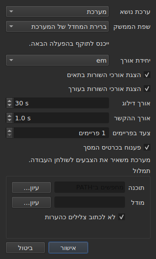

# ההעדפות

<!-- machine-translated -->
> דף זה הוא תרגום מכונה שעדיין לא נבדק על ידי דובר השפה.

החלון זוכר את מה שקבעתם בעכבר — **היכן הוא היה**, **אם
הוא היה מוגדל**, **רוחב העמודות שלו**, **מיקום
הידית** בין הסרט לטבלה — ו**היכן עובדים**, כך
ש-`Open…` נפתח במקום הנכון. דבר מזה אינו נקבע דרך תיבת דו־שיח:
מזיזים, גוררים, וזוכרים.

**לשש העדפות יש תיבת דו־שיח משלהן**, `עריכה ▸ העדפות…`, וזה
הקריטריון: להעדפה שכבר יש לה מחווה אין צורך בשדה. לערכת
הנושא אין כזו, וגם לא ליחידת אורכי השורה, ולא לשתי תיבות הסימון ש
מציגות אותם, ולא לדילוג ולהקשר של הנגן. ראו [ערכת הנושא](#ערכת-הנושא),
[אורכי שורה](#אורכי-שורה) ו[הנגן](#הנגן).

**שפת הממשק נמצאת באותה תיבה, והיא זו שממתינה**: היא חלה בהפעלה
הבאה, לא מיד. ראו [שפת הממשק](#שפת-הממשק).

**לעוצמת הקול אין כזו**: הסרגל שמתחת לתמונה ושתי מחוות קובעים אותה, והיא נזכרת.

**אחרת נקבעת במקום שבו משתמשים בה**: הצד שבו `Insert Subtitles…` מניח את
השורות שלו הוא שדה של אותה תיבה, והבחירה האחרונה נזכרת. ראו
[הוספה, הסרה, מיזוג ופיצול של שורות](lines.md#הצד-נשמר).

**כך גם שתי אפשרויות החיפוש**: `Regular expression` ו-
`Ignore case` נשארות מסומנות או לא מסומנות מפתיחה אחת של התיבה
לבאה, ומהפעלה להפעלה. ראו
[חיפוש והחלפה](find-and-replace.md#שתי-האפשרויות).

**כך גם ההגדרות של `Adjust Durations…`**: מהירות הקריאה, שני
הכיוונים שלה, ושלושת המשכים עם תיבות הסימון שלהם — כל אחד שומר על ערכו, מסומן
או לא. ראו [`Adjust Durations…`](operations.md#adjust-durations).

**וכך גם הקידוד האחרון שנבחר ב-`Save As…`**, עם סימן סדר
הבתים. ראו [הקובץ](#הקובץ).

**וכך גם מה ש-`Correct Texts…` ו-`Spell-Check Settings…` קובעים**: המשימות
המסומנות והקוד שלהן, תיבות הסימון של התבניות, הגדרות שבירת השורות, השפה,
יעד הבדיקה והקו התחתון בזמן ההקלדה. ראו [תיקון הטקסטים…](correct-texts.md) ו
[בדיקת איות…](check-spelling.md#הגדרות-בדיקת-האיות). **היעד והמסמך
של `Correct Texts…` אינם נזכרים.**

**מה שאינו נזכר:** הקובץ האחרון שנפתח — ראו
[התיקייה הזכורה](#התיקייה-הזכורה).

## הנגן

ארבעה שדות. **Seek length** ו-**Context length** הם של Gaupol ובעלי הערכים שלו; **Frame step** ו-**Decode on the graphics card** הם של subedit עצמה:

| שדה | מה הוא קובע | ברירת מחדל | גבולות |
| :---- | :----------- | ------: | :----- |
| `Seek length` | הדילוג של `Seek Backward` ו-`Seek Forward` | 30 שניות | מ-1 שנייה עד שעה |
| `Context length` | ההקדמה לפני הבחירה, עבור `Seek Selection Start`, `Seek Selection End` ו-`Play Selection` | שנייה אחת | מ-0 עד 60 שניות, עד עשירית |
| `Frame step` | הצעד, **בפריימים**, של `Step Backward` ו-`Step Forward`, ושל הזזת קצה | פריים אחד | מ-1 עד 1000 פריימים |
| `Decode on the graphics card` | מאפשר לכרטיס המסך לפענח את הסרט כשיש כזה במחשב; בלי כרטיס, דבר אינו משתנה | מסומן | מסומן או לא |

הם חלים **מיד**, בלי להמתין להפעלה מחדש, ונזכרים מהפעלה להפעלה
תחת `video.seek-length` (בשניות), `video.context-length-ms` (באלפיות שנייה) `video.step-frames` (בפריימים) ו-`video.hardware-decoding` (`true` או `false`).
**ערך מחוץ לגבולות, או שאינו מספר**, אינו מונע מהחלון להיפתח: הוא
מתעלמים ממנו, ברירת המחדל נשארת, והחלון אומר זאת בפתיחה. **צעד הפריים אינו לעולם באלפיות שנייה**: צעד של N פריימים הוא תמיד N פריימים, יהא קצב הפריימים של הסרט אשר יהיה — ראו [תזמון לפי הווידאו](timing.md#פריים-אחר-פריים). עוצמת הקול נזכרת ב-`video.volume`,
מ-0 עד 100, באותה סובלנות.

## הקובץ

```
~/.config/subedit/settings.conf
```

ליתר דיוק `$XDG_CONFIG_HOME/subedit/settings.conf` כשהמשתנה הזה
מוגדר. הוא נכתב **כשהחלון נסגר**, ונקרא כשהוא נפתח.
תוכנית שהופסקה — נהרגה, או נעצרה בקריסה — אינה כותבת דבר, וההפעלה
הבאה מוצאת את מה שהקודמת השאירה.

הקובץ הוא טקסט, וניתן לערוך אותו ביד. זו תכונה ולא
תופעת לוואי: היא מה שהופך הגדרה לניתנת לתיקון כשהממשק
שקובע אותה הוא בדיוק זה שמקולקל.

### שני חלקים, אחד מהם משותף עם שורת הפקודה

הקובץ נכתב ב**שני חלקים**, כל אחד תחת הערת כותרת:

| חלק | מפתחות | נקרא על ידי |
| :---- | :--- | :------ |
| `# Operation settings: shared by the window and the command line` | המפתחות `duration-adjust.*` ו-`correction.*` | החלון **וגם** `subedit-cli` |
| `# Display preferences: the window's own` | כל מפתח אחר — גיאומטריה, עמודות, ערכת נושא, שפת ממשק, חיפוש, בדיקת איות, עורך, וידאו, תיקייה אחרונה, קידוד כתיבה | החלון בלבד |

**`subedit-cli` קורא את חלק הפעולות כברירת מחדל**: מה ש-`Adjust Durations…` ו-
`Correct Texts…` זוכרים כאן הוא גם מה ש-[`subedit-cli adjust`](../subedit-cli/adjust.md)
וחלק מ-[`subedit-cli correct`](../subedit-cli/correct.md) מתחילים ממנו, אלא אם אפשרות של
שורת הפקודה אומרת אחרת. **הוא לעולם אינו קורא את העדפות התצוגה.** הפקודה
[`config`](../subedit-cli/config.md) שלו מונה את מפתחות הפעולות, מציגה את ערכיהם ו
משנה אותם — `subedit-cli config set duration-adjust.speed 12` — והחלון רואה את השינוי
בפתיחה הבאה שלו. **שינוי שנעשה בזמן שהחלון פתוח אינו שורד את סגירתו**: החלון
כותב מחדש את הקובץ כולו עם מה שהוא מחזיק. `--no-config` גורם לשורת פקודה להתעלם מהקובץ. ראו
[קובץ ההגדרות](../subedit-cli/invocation.md#קובץ-ההגדרות).

הקורא לוקח את המפתחות בכל סדר, עם הכותרות או בלעדיהן: קובץ שנכתב לפני
שני החלקים נקרא כמות שהוא, ונכתב מחדש בשני חלקים בסגירה הבאה.

| אפשרות | מה היא מחזיקה | ברירת מחדל |
| :----- | :------------ | :------ |
| `window.geometry` | `x,y,width,height`, בפיקסלים; רוחב וגובה שאינם אפס | החלון קובע את גודלו |
| `window.maximised` | `true` או `false` | `false` |
| `table.columns` | ארבעה רוחבים בפיקסלים, מופרדים בפסיקים — `#`, `Start`, `End`, `Duration`, גם מוסתרים | הטבלה קובעת את גודלה |
| `table.order` | שש העמודות, **כל אחת פעם אחת**, בסדר שהטבלה מציגה אותן: `number`, `start`, `end`, `duration`, `text`, `translation` | `number,start,end,duration,text,translation` |
| `table.hidden` | העמודות שהוסרו, מבין `number`, `start`, `end` ו-`duration`; ריק, אין | אין |
| `window.table-share` | החלק מהגובה שניתן לטבלה, באחוזים, מ-1 עד 99 | החלון מחלק כפי שחילק תמיד |
| `file.directory` | נתיב תיקייה **מוחלט** | אין: `Open…` נפתח היכן שהתוכנית הופעלה |
| `general.theme` | `system`, `light` או `dark` | `system` |
| `interface.language` | `system`, או שם של שפה כפי שהקטלוג שלה נקרא: שתיים או שלוש אותיות קטנות, ואז אפשר `_` ושתי אותיות גדולות — `fr`, `pt_BR`; `en` לאנגלית | `system` |
| `edit.insert-placement` | `above` או `below` | `below` |
| `file.write-encoding` | שם של קידוד ש-ICU יכול לכתוב, והממיר שלו אינו כותב סימן משלו | אין |
| `file.write-bom` | `true` או `false` | `false` |
| `search.regex` | `true` או `false` — התבנית היא ביטוי רגולרי | `false` |
| `search.ignore-case` | `true` או `false` — מתעלמים מרישיות | `true` |
| `duration-adjust.speed` | מהירות הקריאה, בתווים לשנייה, חיובית בהחלט; מספר עשרוני נכתב קצר ככל האפשר (`15`, `12.5`) | `15` |
| `duration-adjust.lengthen` | `true` או `false` — הארכת מה שקצר מכדי להיקרא | `true` |
| `duration-adjust.shorten` | `true` או `false` — קיצור מה שנשאר מוצג זמן ארוך מהנדרש | `false` |
| `duration-adjust.minimum-enabled` | `true` או `false` — המשך המינימלי מבוקש | `true` |
| `duration-adjust.minimum-ms` | המשך המינימלי, באלפיות שנייה, שלם ולא שלילי | `1500` |
| `duration-adjust.maximum-enabled` | `true` או `false` — המשך המרבי מבוקש | `false` |
| `duration-adjust.maximum-ms` | המשך המרבי, באלפיות שנייה, שלם ולא שלילי | `6000` |
| `duration-adjust.gap-enabled` | `true` או `false` — הרווח עד הכתובית הבאה מבוקש | `true` |
| `duration-adjust.gap-ms` | הרווח, באלפיות שנייה, שלם ולא שלילי | `0` |
| `correction.mentions.enabled`, `correction.common-errors.enabled`, `correction.capitalization.enabled`, `correction.line-break.enabled` | `true` או `false` — המשימה מסומנת בדף הראשון של `Correct Texts…` | `false`, `true`, `true`, `false` |
| `correction.mentions.code`, `correction.common-errors.code`, `correction.capitalization.code`, `correction.line-break.code` | קוד התבניות של המשימה: `Zyyy`, או `Script[-language[-COUNTRY]]` — `Latn-en-US`; לא ריק | `Zyyy` |
| `correction.human`, `correction.ocr` | `true` או `false` — מחלקות הטעויות הנפוצות | `true`, `true` |
| `correction.sound-in-brackets`, `correction.sound-in-parentheses` | `true` או `false` — שתי תיבות הסימון של הדף `Mentions` | `false`, `false` |
| `correction.line-break.max-length` | אורך השורה המרבי, עשרוני; התיבה תוחמת אותו מ-1 עד 1000 | `24` |
| `correction.line-break.max-lines` | מספר השורות המרבי, שלם; התיבה תוחמת אותו מ-1 עד 100 | `3` |
| `correction.line-break.in-ems` | `true`: האורך נמדד ב*אמים*; `false`: בתווים | `true` |
| `correction.line-break.skip-on-length`, `correction.line-break.skip-on-lines` | `true` או `false` — שני תנאי הדילוג מבוקשים | `true`, `true` |
| `correction.line-break.skip-max-length`, `correction.line-break.skip-max-lines` | שני ספי הדילוג, ביחידה שנבחרה | `24`, `3` |
| `correction.join-split.enabled` | `true` או `false` — המשימה `Join or Split Words` מסומנת | `false` |
| `correction.join-split.join`, `correction.join-split.split` | `true` או `false` — צירוף, פיצול | `true`, `false` |
| `correction.join-split.language` | קוד לוקאל — `fr`, `en_US`, `sr@Latn` —; ריק: שפת המערכת | ריק |
| `correction.remove-blank` | `true` או `false` — `Remove all blank subtitles` | `true` |
| `transcription.engine` | שם המנוע: אותיות קטנות, ספרות, `.`, `-` ו-`_` | `whisper.cpp` |
| `transcription.executable`, `transcription.model` | נתיב מוחלט; ריק: המנוע נחפש ב-`PATH`, ולא נקבע מודל | ריק |
| `transcription.language` | שתי אותיות קטנות, קוד ISO 639-1; ריק: השפה מזוהה אוטומטית | ריק |
| `transcription.merge-gap-ms` | חלקים של אותו משפט שקרובים זה לזה מערך זה מחוברים, באלפיות שנייה, מספר שלם לא שלילי | `400` |
| `transcription.max-duration-ms` | משך ההצגה המרבי של כתובית מתומללת על המסך, באלפיות שנייה, מ-1 עד 3600000 | `7000` |
| `transcription.max-characters` | מספר התווים המרבי בכתובית מתומללת, מ-1 עד 1000 | `84` |
| `correction.activations` | תיבות הסימון של התבניות שהמשתמש שינה, `<type>:<code>:<name>:<0\|1>`, מופרדות בפסיקים; **פסיק או לוכסן הפוך בשם נכתבים עם לוכסן הפוך לפניהם** (`\,` ו-`\\`), ופריט שאינו קריא מאבד רק את ההגדרה שלו — הוא מדווח, האחרים נשמרים | ריק |
| `spell-check.language` | קוד לוקאל, כמו `fr_FR`; ריק: שפת המערכת | ריק |
| `spell-check.target` | `selection`, `current-project` או `all-projects` | `current-project` |
| `spell-check.document` | `main` או `translation` | `main` |
| `spell-check.inline` | `true` או `false` — קו תחתון למילים לא מוכרות בזמן הקלדה בעורך של תא | `false` |
| `editor.length-unit` | `em` או `characters` — יחידת אורכי השורה שהטבלה והעורך מציגים | `em` |
| `editor.show-lengths-cell` | `true` או `false` — אחרי כל שורה של תא טקסט בא האורך שלה | `true` |
| `editor.show-lengths-edit` | `true` או `false` — העורך של תא מציג את אורך כל שורה בשוליים | `true` |

**הקובץ מקבל יותר מהתיבה.** הקורא מקבל כל מהירות חיובית
בהחלט וכל משך לא שלילי; תיבת `Adjust
Durations…`, מצדה, תוחמת את המהירות מ-1 עד 99 תווים לשנייה ואת כל
משך מ-0 עד 99 שניות. ערך בקובץ מחוץ לגבולות האלה מוחזר אל
הגבול כשהתיבה נפתחת, והקובץ שומר אותו כך אחרי שהתיבה
אושרה והחלון נסגר. תיבה שבוטלה אינה משנה דבר במה
שנזכר.

**`file.write-encoding` זוכר את הקידוד האחרון שנבחר ב-`Save As…`, ו
לעולם אינו כופה את עצמו על קובץ.** מסמך פתוח נושא את הקידוד שלו,
וזה שהתיבה מציעה: כתיבתו מחדש בקידוד אחר רק משום
שהגדרה בת שלושה שבועות אומרת כך הייתה מאבדת את מה שהקריאה שמרה.
מה שההגדרה הזו זוכרת משרת את המסמך שאין לו קובץ — זה
שנוצר הרגע.

**זהו „לא” מכוון ולא השמטה.** מי שמספק תמיד באותו
קידוד ופותח קבצים שירש בקידוד אחר בוחר אותו שוב לכל
קובץ; התיבה מציעה לו אותו, והאחריות להלוך ושוב מתקיימת
לכולם.

**`file.write-bom` נושא את הסימן של אותו קידוד**, ושתי
שורות אכן נחוצות: שם של קידוד אינו אומר אם קודם לו הסימן שלו, כשם
ש-`--encoding` אינו אומר מה ש-`--bom` אומר. שניהם נקראים יחד, בכל
סדר, ו-`file.write-bom` בלי קידוד זכור אינו קובע דבר.

**חלק ולא גבהים לידית**, וזה מה שהופך אותו
לשימושי: שלושה גבהים בפיקסלים כבר אינם אומרים דבר ברגע שהחלון
נפתח בגודל אחר, וחלון נפתח לעיתים קרובות בגודל אחר.
החלק חוזר בכל מקום. הוא **מוחזר למה שהחלון מקבל** אם
הוא קטן מדי — לרצועה של הסרט יש גובה מינימלי.

**ארבעה רוחבים לשש עמודות**, וזו אינה השמטה: הם אלה
של `#`, `Start`, `End` ו-`Duration`, בסדר הזה יהא סדר
הטבלה אשר יהיה, ו**עמודה מוסתרת שומרת על שלה** — היא מוצאת אותו שוב כשהיא
מוצגת שוב. העמודה האחרונה המוצגת לוקחת את מה שהאחרות משאירות, ומתן
רוחב לה לא היה עושה דבר; אלה של הטקסט והתרגום לכן
אינם נזכרים.

## מה קורה כשהקובץ אינו אומר את הצפוי

תצורה היא נוחות. **מחיר הכשל שלה הוא הנוחות,
ותו לא**: החלון נפתח בכל מקרה.

| מקרה | מה קורה |
| :--- | :----------- |
| הקובץ אינו קיים | כל ברירות המחדל, ושום דבר אינו נאמר — זו ההפעלה הראשונה |
| הקובץ קיים ואינו ניתן לקריאה | כל ברירות המחדל, והסיבה נכתבת בזרם השגיאות |
| אפשרות נעדרת | ברירת המחדל שלה |
| מפתח לא מוכר | מתעלמים ממנו, בלי מילה, והוא נעדר מהקובץ שנכתב מחדש |
| ערך שאינו ניתן לקריאה | ברירת המחדל שלו נשמרת, והאפשרות נקובה בשמה בזרם השגיאות |

```console
$ subedit-gui film.srt
subedit-gui: /home/vous/.config/subedit/settings.conf: window.geometry: "plus tard" cannot be read, keeping the default
```

**ההודעה הולכת לזרם השגיאות ולשום מקום אחר.** חלון מודאלי
בהפעלה בשל העדפה שאינה קריאה היה עוצר את המשתמש בשל
פגם שאינו מונע ממנו דבר, ועוד לפני שביקש משהו.

## האפשרויות המוערות

הקובץ שנכתב מחדש מכיל **את כל** האפשרויות המוכרות, ואלה שנשארו
בברירת המחדל שלהן נכתבות כהערות:

```
#window.geometry = 0,0,1280,800
#window.maximised = false
#table.columns = 60,110,110,110
#table.order = number,start,end,duration,text,translation
#table.hidden = start,end
```

זו אינה התייפיפות. בלעדיה, אפשרות שמעולם לא נגעו בה הייתה נשארת
קפואה על הערך של היום שבו נכתבה, ו**ברירת מחדל משופרת
לא הייתה מגיעה לאיש**. איתה, שינוי ברירת מחדל משנה את
ההתנהגות של כל מי שלא דרס אותה — וזה בדיוק
מה שברירת מחדל צריכה לעשות.

כדי לדרוס אפשרות: מסירים את ה-`#` ומשנים את הערך. כדי לחזור
לברירת המחדל: מוחקים את השורה, או הופכים אותה שוב להערה.

הגיאומטריה, הרוחבים והעמודות שהוסרו מראים **צורה** ולא
ערך בתוקף: ברירת המחדל של הגיאומטריה וזו של הרוחבים הן
„מה שהחלון בוחר”, שאינו נכתב במספרים, וזו של
`table.hidden` היא „אין”, שאינה ניתנת לקריאה. כותרת הקובץ אומרת זאת
גם היא. `table.order`, מצדו, כן מראה את סדר ברירת המחדל.

## התיקייה הזכורה

`Open…` נפתח בתיקייה של **הקובץ האחרון שנפתח או נשמר**,
ולא בזו של תיבה שביטלתם: מה שקובע הוא היכן
עובדים, לא היכן הסתכלתם.

**הקובץ האחרון, מצדו, אינו נזכר.** זכירתו הייתה פירושה
פתיחה מחדש בהפעלה של מסמך שאיש לא ביקש. זכירת תיקייה
*מכוונת* תיבת דו־שיח; זכירת קובץ הייתה פותחת אחד.

## ערכת הנושא

`עריכה ▸ העדפות…` נפתח עם ערכת הנושא, העדפה בלי מחווה, מעל
[אורכי השורה](#אורכי-שורה).

| ערך | מה הוא עושה |
| :---- | :----------- |
| `System` | **דבר** — הצבעים נשארים אלה של שולחן העבודה |
| `Light` | קובע פלטה בהירה |
| `Dark` | קובע פלטה כהה |

ערכת הנושא שנבחרה חלה **מיד**, בלי הפעלה מחדש.

**„System” אינו עושה דבר, וזה לא חוסר.** לגרסת Qt שעליה
subedit בנויה אין דרך לשאול את שולחן העבודה אם הוא רוצה להיות
בהיר או כהה, ולא לקבל הודעה כשהוא משנה את דעתו. במקום
להמציא קריאה שאיננו יודעים לעשות, הכלי מספק את שתי הערכות
שאפשר לבקש ומניח לערכת הכלים להכריע בשלישית —
וכך Gaupol עושה בתנאים זהים.

בשולחן עבודה שערכת הנושא שלו כבר כהה, `System` לכן נותן חלון
כהה; בשולחן עבודה בהיר, חלון בהיר. `Light` ו-`Dark` דורסים
אותו, יהא שולחן העבודה אשר יהיה.

**גווני החריגות נשארים קריאים בשתי הפלטות** — ראו
[הטבלה](table.md#החריגות). זו אינה הנחה: הניגודיות
של הטקסט על כל אחד מהגוונים נבדקת בבדיקה, על שני הרקעים.

## שפת הממשק

`עריכה ▸ העדפות…` בוחר את שפת החלון, מתחת לערכת הנושא.

| שדה | ערכים | ברירת מחדל |
| :---- | :----- | :------ |
| `Interface language` | `System default`; `English`; ואז כל שפה שהותקנה עם התוכנית, בשמה שלה — `Français` | `System default` |

**זה נכנס לתוקף בהפעלה הבאה**, והתיבה אומרת זאת מתחת לשדה: החלון
מתורגם בעת בנייתו, וחלון רץ שומר על השפה שבה הופעל. הבחירה
נשמרת בקובץ ההגדרות, תחת `interface.language`, ונקראת כשהחלון נפתח הבא.

| בחירה | החלון מתחיל ב |
| :----- | :------------------- |
| `System default` | שפת הסביבה, כמו לפני כל בחירה — `LANGUAGE`, `LC_ALL`, `LC_MESSAGES`, `LANG`; ראו [שפה](invocation.md#שפה) |
| `English` | אנגלית, יהא מה שהסביבה אומרת אשר יהיה |
| שפה מותקנת | אותה שפה, **יהא מה שהסביבה אומרת אשר יהיה**, גם `LC_ALL=C`: בחירה שנעשתה כאן היא בחירה מפורשת |

הרשימה מחזיקה את השפות שהקטלוג שלהן מותקן תחת `<prefix>/share/subedit/locale`;
האנגלית תמיד שם, שכן זו השפה שבה התוכנית נכתבת. שפה מוצגת
בשמה שלה, שאף קטלוג אינו מתרגם, כדי שקורא ימצא את זו שהוא קורא.

**ערך שהתוכנית אינה יכולה לכבד עולה רק בבחירה:**

| מה הקובץ אומר | מה קורה |
| :----------------- | :----------- |
| שם של שפה בלי קטלוג מותקן — קובץ שהובא ממחשב אחר | החלון עוקב אחר הסביבה, בלי מילה; `Preferences…` מראה את השפה הזו, בשמה או בקוד שלה, ושומר אותה אלא אם נבחרה אחרת |
| דבר שאינו שם של שפה — `French`, `fr_FR.UTF-8` | `system`, ברירת המחדל, והאפשרות נקובה בשמה בזרם השגיאות, כמו כל ערך שאינו קריא |

```console
$ subedit-gui film.srt
subedit-gui: /home/vous/.config/subedit/settings.conf: interface.language: "French" cannot be read, keeping the default
```

**שורת הפקודה לעולם אינה קוראת אותה**: `subedit-cli` בוחר את שפתו מהסביבה
בלבד, ו-`subedit-cli config set interface.language fr` נדחה כהעדפת תצוגה.

## אורכי שורה




`עריכה ▸ העדפות…` קובע גם **מה הטבלה והעורך מראים מאורך
השורות** — הסרגל והשוליים של Gaupol.

| שדה | מה הוא עושה | ברירת מחדל |
| :---- | :----------- | :------ |
| `Length unit` | יחידת האורכים: `Ems` או `Characters` | `Ems` |
| `Show line lengths in cells` | אחרי כל שורה של תא טקסט בא האורך שלה | מסומן |
| `Show line lengths in the editor` | העורך של תא מציג את אורך כל שורה בשוליים מימין | מסומן |

**`Length unit` מוחלש כששתי תיבות הסימון אינן מסומנות**: כשאין
אורך להציג, היחידה אינה קובעת דבר. הבחירה חלה **מיד** על
הטבלה, והעורכים שנפתחים אחר כך עוקבים אחריה. שלושת הערכים
נזכרים מהפעלה להפעלה: `editor.length-unit`, `editor.show-lengths-cell`
ו-`editor.show-lengths-edit`, בטבלה [של הקובץ](#הקובץ). ראו
[אורך השורות](table.md#אורך-השורות) ו
[בעורך](editing.md#אורך-השורות).

**זה אינו הגבול של האשף.** היחידה של `Correct Texts…` — האורך
שבו הוא שובר שורות — היא הגדרה נפרדת, באשף
שלו: אפשר לקרוא אמים בטבלה ולשבור בתווים.

## מה שאי אפשר לקבוע

**תשע הגדרות זכורות נבחרות בתיבת דו־שיח** — לא כולל אלה של
אשף התיקון ושל בדיקת האיות, שלכל אחד מהם יש
שלו —, וכל אחת באחת שבה משתמשים בה: ערכת הנושא ושלוש הגדרות אורך השורה, כאן; הצד של הוספה, בתיבת ההוספה;
שתי אפשרויות החיפוש, בתיבת החיפוש; הקידוד וסימן
סדר הבתים, ב-`Save As…`; מהירות הקריאה, המשכים
והרווח של התאמת המשכים, בתיבה שלה. אין
אחרת: דבר אינו ניתן לקביעה עבור האבחונים, עוצמת הקול של הנגן,
או פורמט השמירה כברירת מחדל — זה בא מהקובץ הפתוח.

ו**שום מספר ששייך למסמך אינו נשמר מהפעלה
להפעלה**: סכום הזזה, שתי נקודות ייחוס של המרה נכונים לגבי קובץ אחד
ושגויים לגבי הבא. התיבות שואלות אותם שוב בכל הפעלה,
במכוון. ההגדרות של `Adjust Durations…` הן יוצא מן הכלל באותו אופן כמו
שתי אפשרויות החיפוש: מהירות קריאה, משך מינימלי או
רווח הם בחירות של שיטה ולא מדידות של קובץ, ו
נשמרים מהפעלה להפעלה מסיבה זו.

המדריך הזה מתאר את הקיים: מה שיבוא נמצא ב
[מפת הדרכים](../../../../feuille-de-route.md).
