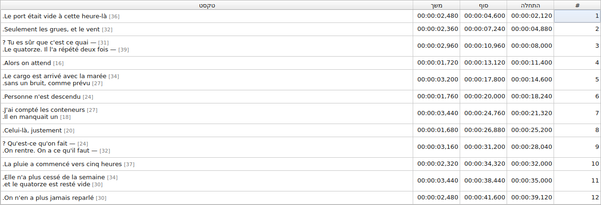
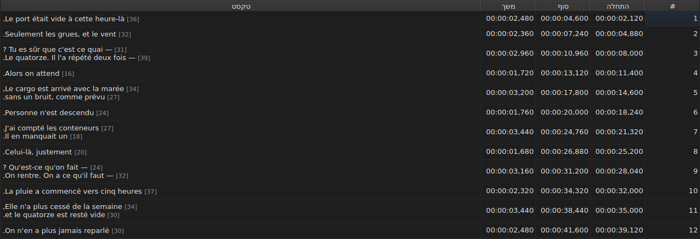
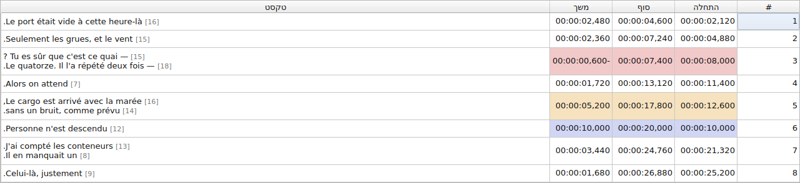
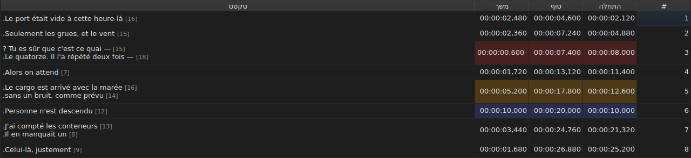
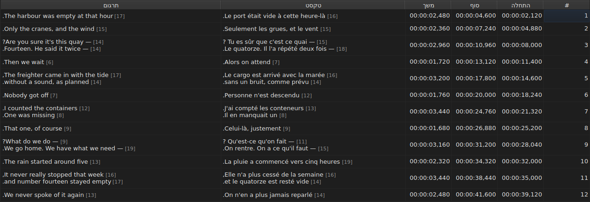
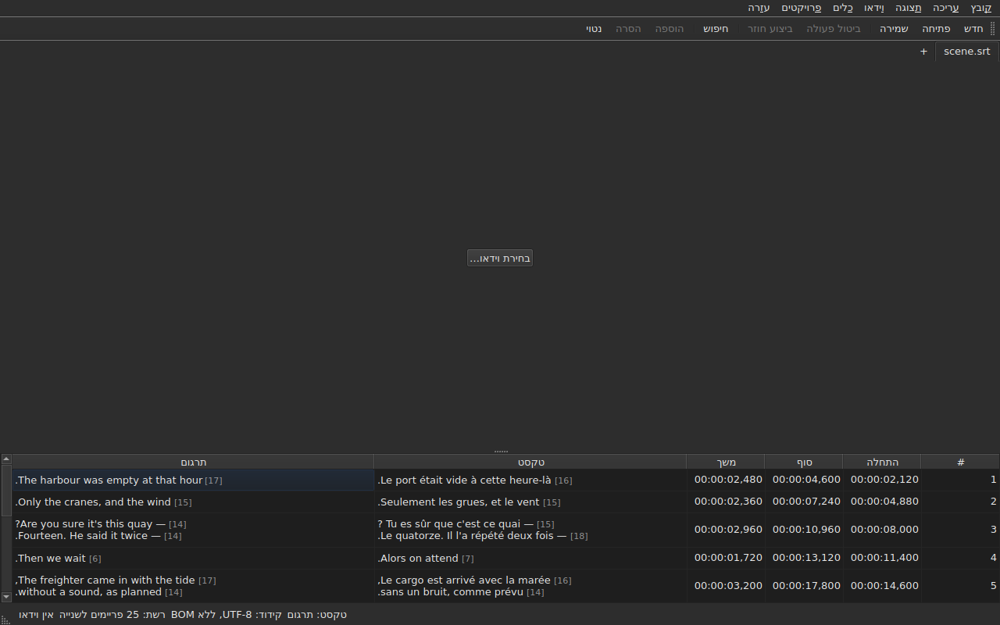

# הטבלה

<!-- machine-translated -->
> דף זה הוא תרגום מכונה שעדיין לא נבדק על ידי דובר השפה.

החלון מציג את הכתוביות של הקובץ הפתוח, אחת בכל שורה, בחמש עמודות — שש כשהמיזם נושא תרגום.

**מדריך זה מצטט את כותרות החלון כפי שהחלון האנגלי מציג אותן**, כפי שהוא עושה בשורת הפקודה; חלון מתורגם מציג אותן
בשפתו.

| עמודה | מה היא מציגה |
| :----- | :------------ |
| `#` | המספר הסידורי של הכתובית, מ-1 |
| `Start` | המיקום שבו היא מופיעה, `HH:MM:SS,mmm` |
| `End` | המיקום שבו היא נעלמת |
| `Duration` | `End − Start` |
| `Text` | הטקסט של הכתובית |
| `Translation` | התרגום של הכתובית — **חסרה כל עוד אין למיזם תרגום** |


## אורך השורות





**אחרי כל שורה בתא טקסט בא אורכה**, `[N]`, קטן ובהיר יותר — בעמודה `Text` כמו בעמודה `Translation`. כך Gaupol
עושה.

| מה נספר | מה הטבלה עושה |
| :---------- | :------------------ |
| **תגיות** | אינן נספרות: `<i>Bonjour</i>` נותן `[7]`, כמו `Bonjour` |
| **עיגול** | כלפי מטה: שורה של 12.9 אמים מוצגת `[12]` |
| **שורה ריקה** | אין לה אורך; וגם לא לטקסט ריק |
| **היחידה** | *אמים* כברירת מחדל, או תווים — `עריכה ▸ העדפות…` |
| **שורה ארוכה מדי לעמודה** | נחתכת ב-`…` **לפני** המספר, שנשאר גלוי |

**ה-*אם* הוא של Gaupol, לא של הטיפוגרפיה**: האלף-בית הקטן שווה 0.55 אם לכל אות, בגופן של הטבלה. אורך באמים תלוי
אפוא בגופן; אורך בתווים סופר נקודות קוד, ותו מוטעם אחד.

**הטבלה אינה מסמנת שורה ארוכה מדי.** היא מציגה את המספר, ובידי העין להשוות אותו לגבול שקבעתם בעצמכם — כמו Gaupol. זה
אינו הגבול של האשף `Correct Texts…`, שיש לו הגדרה משלו.

**כדי לא לראות אותם:** מבטלים את הסימון של `Show line lengths in cells` ב-`עריכה ▸ העדפות…`. ראו
[אורכי שורה](preferences.md#אורכי-שורה).

## הסתרת עמודות והזזתן

**`תצוגה ▸ עמודות`** נושא פריט אחד לסימון לכל עמודה, **חוץ מ-`Text`**: בלי הטקסט הראשי לא יישאר מה לערוך.

| פריט | עמודה |
| :---- | :----- |
| `תצוגה ▸ עמודות ▸ מס׳` | `#` |
| `תצוגה ▸ עמודות ▸ התחלה` | `Start` |
| `תצוגה ▸ עמודות ▸ סוף` | `End` |
| `תצוגה ▸ עמודות ▸ משך` | `Duration` |
| `תצוגה ▸ עמודות ▸ תרגום` | `Translation` — ראו [עמודת התרגום](#עמודת-התרגום) |

ביטול הסימון של פריט מסיר את העמודה שלו, וסימון חוזר מחזיר אותה, ברוחב שהיה לה. **ההגדרה חלה על כל החלון**, כל
הלשוניות בכלל זה: יש טבלה אחת, והמיזם שלה משתנה עם הלשונית.

**התא הנוכחי עוזב את העמודה שמוסרת**: הוא עובר אל `Text`, באותה שורה, והבחירה אינה זזה. תא נוכחי בעמודה שאיש אינו
רואה היה תא שהקשה על מקש תערוך אותו בעיניים עצומות.

**מזיזים עמודות בגרירת הכותרת שלהן**, כל אחת מהן, `Text` בכלל זה. העמודה האחרונה שמוצגת תופסת את המקום שהאחרות
משאירות.

**הסדר והעמודות שהוסרו זכורים מהפעלה להפעלה**, יחד עם הרוחבים, ב[קובץ ההעדפות](preferences.md) — `table.order`
ו-`table.hidden`. עמודת התרגום אינה שם: היא נשמעת לכלל משלה, וחוזרת עם כל תרגום שנפתח.

**המספר אינו נתון של הקובץ** אלא המספר הסידורי של השורה. הוספה או הסרה ממספרות אפוא מחדש כל מה שבא אחריהן, בלי
שדבר ייכתב מחדש.

**מפריד העשרוניים עוקב אחר הפורמט של הקובץ**: פסיק ב-SubRip, נקודה בשמונה האחרים. SubRip הוא היחיד מבין התשעה
שכותב פסיק.

**המפריד הוא שעוקב, לא האיות כולו.** הטבלה כותבת תמיד את השעות ותמיד שלוש ספרות אחרי המפריד; קובץ WebVTT משמיט את
השעות מתחת לשעה, SubViewer 2 ושני ה-Sub Station Alpha סופרים במאיות, MPL2 בעשיריות, TMPlayer בשניות, MicroDVD בפריימים.
עמודה שרוחבה עוקב אחר הפורמט הייתה מייגעת לקריאה יותר מעמודה שפשוט אינה האיות המדויק של הקובץ.

מה שהטבלה מבטיחה הוא אפוא **הערך והמפריד**, לא מספר הספרות אחרי המפריד. מה שפורמט יעד יעגל נאמר ברגע השמירה — ראו
[מה שפורמט לא ישמור, נאמר לפני הכתיבה](files.md#מה-שפורמט-לא-ישמור-נאמר-לפני-הכתיבה).

**המשך (`Duration`) מחושב**, לעולם לא נשמר: הקלדתו מזיזה את הסוף. כתובית שסופה קודם להתחלתה מציגה משך שלילי ולא
אפס: זו חריגה של הקובץ, והסתרתה הייתה מונעת למצוא אותה.

**ההתחלה, הסוף, המשך, הטקסט והתרגום נערכים במקום**; המספר אינו. ראו [עריכת תא](editing.md).

**הבחירה מייעדת את מה שפעולה חלה עליו** — ראו [הפעולות](operations.md).

**גובה השורה עוקב אחר הכתובית שהיא נושאת**: כתובית של שתי שורות תופסת שתיים, של שלוש תופסת שלוש. הטקסט מוצג במלואו,
כפי שייכתב.

**מה שנשאר חתוך הוא שורה ארוכה מדי לעמודה שלה**, והיא מסתיימת אז בשלוש נקודות. הרחבת העמודה `Text`, או החלון,
מציגה אותה במלואה; וכך גם פתיחת התא. שורות הטקסט לעולם אינן עוטפות: רק מעבר שורה אמיתי יוצר שורה, כך שגובה שורת
הטבלה אינו משתנה כשגוררים את קצה העמודה.

## מיקומים בפריימים

**`תצוגה ▸ מיקומים בפריימים`** — פריט לסימון, הגדרה אחת לחלון — מציג את העמודות `Start` ו-`End` **כמספרי פריימים**
במקום חותמות זמן, ו**מקבל מספר פריים כקלט**. הכותרות אומרות זאת: `Start (frames)` ו-`End (frames)`.

| מה משתנה | מה אינו משתנה |
| :----------- | :------------------- |
| מה ש-`Start` ו-`End` כותבים, ומה שהם מקבלים | העמודה `Duration`, שנשארת זמן |
| כותרות שתי העמודות האלה | המסמך: דבר אינו משתנה, להיסטוריה אין פריט חדש, ו**מה שהקובץ כותב הוא מה שכתב** |

**קצב הפריימים שסופר את הפריימים** הוא, לפי הסדר הזה:

1. **זה של הקובץ**, כשהוא נספר בפריימים — MicroDVD, שנושא מספרים ואין בו קצב פריימים: **החלון מציג אז את
   המספרים של הקובץ שלו**, יהא הווידאו אשר יהא;
2. **זה שהווידאו המשויך מצהיר עליו**;
3. **הרשת שהמיקומים משרטטים**, כשהם משרטטים אחת.

הסבר הכלי של הפריט אומר איזה מהם נבחר: *המיקומים הם מספרי פריימים, הנספרים ב-25 פריימים לשנייה, הקצב שהווידאו
מצהיר עליו*. **כשאין אף אחד משלושתם, הפריט מושבת, והסבר הכלי שלו אומר מדוע**: הקובץ אינו נספר בפריימים, הווידאו
אינו מצהיר על קצב פריימים, והמיקומים אינם נופלים על שום רשת.

- **מספר הוא מספר הפריים שהמיקום נופל בו**, מעוגל לפריים הקרוב ביותר. **כשמקלידים אותו, הוא נותן את הרגע שבו אותו
  פריים מתחיל**, מעוגל **פעם אחת בלבד** מהיחס המדויק ([ADR 0013](../../../../adr/0013-mise-a-l-echelle-exacte-des-positions.md)):
  פריים 37 ב-23.976 פריימים לשנייה מתחיל ב-1543.04 אלפיות שנייה, כלומר `00:00:01,543`.
- **מתקבלים רק מספרים שלמים** — עם סימן המינוס, שכן התחלה יכולה להקדים את הסרט. חותמת זמן שהוקלדה במצב פריימים, או
  מספר שאינו כזה, משאירה את התא כפי שהיה.
- **סרגל הניגון עוקב אחר אותה הגדרה**: המיקום והמשך משני צדי המחוון כתובים כמספרי פריימים כמו `Start` ו-`End`, באותו
  רגע — ראו [סרגל הניגון](player.md#סרגל-הניגון). השעון המצויר בראש התמונה נשאר חותמת זמן.
- **הגדרה זו אינה זכורה** מהפעלה להפעלה: זו הגדרה של החלון, לא של מסמך, מחזירים אותה בפעולה אחת.

## החריגות

כתובית שהמיקומים שלה אינם מתיישבים **צבועה בעמודות הזמן שלה**, וריחוף מעליה אומר מה לא בסדר.

| גוון | מה הוא מדווח | מה לעשות |
| :--- | :-------------- | :--------- |
| אדום | `ends before it starts` | לתקן את הסוף שלה, או את ההתחלה |
| כחול | `starts before the previous one starts` | להחזיר אותה למקומה בסדר |
| ענבר | `starts before the previous one ends` | להתאים את התזמון שלה |





רק העמודות `Start`, `End` ו-`Duration` צבועות: חריגה מדברת רק על זמן, וצביעת הטקסט הייתה מרמזת שיש לו קשר לכך.

**כתובית יכולה לשאת כמה חריגות**, והסבר הכלי נוקב בכולן. הגוון הוא של הראשונה שיש לתקן: כתובית שבורה בתוך עצמה
שבורה יהא מה שיהא שכנותיה עושות; כתובית שאינה במקומה מוחזרת למקומה, והחפיפה שלה נעלמת איתה.

> אין זו מקריות שאי-סדר כמעט תמיד גובר על חפיפה: להתחיל לפני שהקודמת מתחילה פירושו להתחיל לפני שהיא מסתיימת — אלא
> אם הקודמת עצמה שבורה.

**הסימון מחושב מחדש אחרי כל שינוי מיקום**, בין שהוא בא מתא שנערך, מפעולה או מביטול. הוא אומר מה הקובץ עכשיו, לא מה
היה בפתיחה.

הוא אינו נשען על שום רשת פריימים: ברגע שמיקום מתוקן ביד, הוא עוזב אותה, וסימון שנשען עליה היה מדווח על עבודת
המשתמש.

## עמודת התרגום

כתובית נושאת **שני טקסטים וזוג מיקומים אחד**: לתרגום אין תזמון משלו, הוא מחובר לזה של הכתובית. הטבלה מציגה אותו
בעמודה שישית, `Translation`, אחרי `Text`.




**העמודה קיימת רק אם למיזם יש תרגום.** בלעדיו הטבלה שומרת על חמש עמודותיה, והחלון מתנהג כאילו התרגום אינו קיים —
דבר אינו מאופר או מתווסף. `קובץ ▸ פתיחת תרגום…` פותח אחד: ראו [פתיחת תרגום](files.md#פתיחת-תרגום).

**פריט בתפריט `View` מציג אותה או מסיר אותה**:

| פריט | מה הוא עושה |
| :---- | :----------- |
| `תצוגה ▸ עמודות ▸ תרגום` | מסומן: העמודה מוצגת; לא מסומן: היא מוסרת |

הפריט **מושבת כשאין תרגום למיזם** — אין מה להציג — ומסומן בעת ההפעלה. **ההחלטה להסיר אותה היא של המשתמש**: היא
נשארת מקובץ לקובץ, עד שמסמנים שוב. הסרת העמודה אינה מסירה את התרגום: הוא נשאר במיזם, וחוזר עם הפריט. פתיחת קובץ
שאין בו תרגום מסירה את העמודה.

**מקלידים בתאי התרגום כמו בתאי הטקסט** — ראו [עריכת תא](editing.md).

### הטקסט שהפעולות מכוונות אליו

כשבשורה שני טקסטים, פעולות טקסט צריכות לדעת איזה מהם הן משכתבות. **זה של העמודה של התא הנוכחי**: התרגום אם התא
הנוכחי בעמודה `Translation`, הטקסט הראשי בכל מקום אחר — בעמודת זמן כמו ב-`Text`.

| פעולה | למה היא מכוונת |
| :-------- | :-------------- |
| `Italic`, `Case`, `Dialogue`, `Remove Hearing-Impaired Mentions…` | הטקסט של העמודה הנוכחית |
| `Cut Texts`, `Copy Texts`, `Paste Texts` | הטקסט של העמודה הנוכחית |
| `Find and Replace…` | הטקסט של העמודה הנוכחית — ראו [חיפוש והחלפה](find-and-replace.md#באיזה-טקסט) |
| פעולות המיקום, הוספה, הסרה, מיזוג, פיצול | **שני הטקסטים**: כתובית היא שלם |

**שורת המצב אומרת זאת כששני טקסטים קיימים**, לפני שאר הסימנים:

```text
Text: Translation
```

או `Text: Main` לטקסט הראשי. היא שותקת כשהעמודה אינה מוצגת: יש אז טקסט אחד בלבד, ואין טעם לומר זאת.




**הקו המצויר על התמונה עוקב אחר אותו כלל**: זה הטקסט של העמודה הנוכחית. ראו [הנגן](player.md#הקו-המצויר).

**דבר אינו מאופר.** פעולות טקסט נשארות זמינות בכל עמודה נוכחית, ובלי עמודת תרגום הן מכוונות אל הטקסט הראשי, כמקודם.

## הוספה והסרה של שורות

`עריכה ▸ הוספת כתוביות…` ו-`עריכה ▸ הסרת כתוביות` מוסיפים ומסירים שורות, `עריכה ▸ מיזוג כתוביות` ו-`עריכה ▸ פיצול כתובית`
ממזגים ומפצלים אותן; הטבלה ממספרת את עצמה מחדש. ראו
[הוספה, הסרה, מיזוג ופיצול של שורות](lines.md).

## מה שהטבלה אינה עושה

**מיון לפי עמודה אינו קיים.** הסדר המוצג הוא זה של הקובץ, והוא היחיד שהגיוני לכתוביות: המספר הסידורי של שורה *הוא*
מקומה בזמן.
