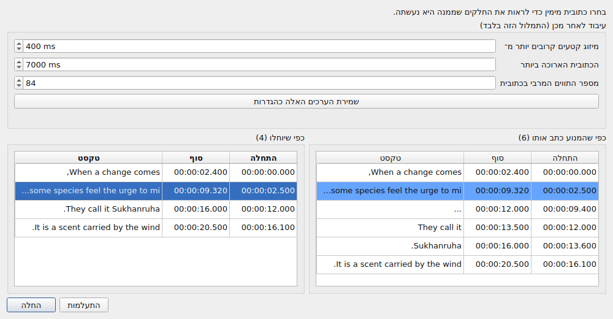
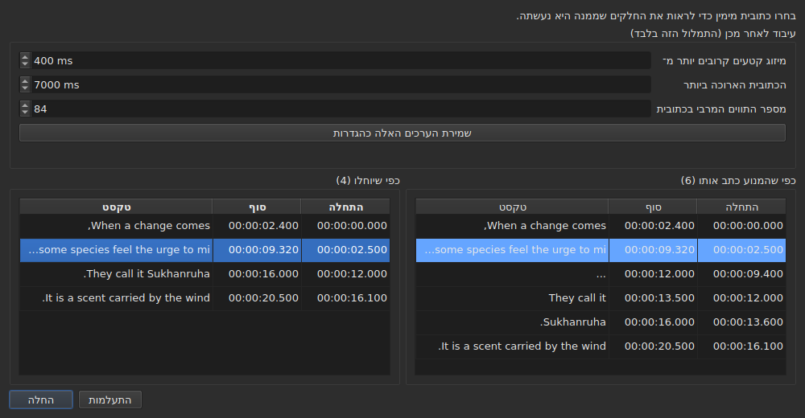

# הווידאו המשויך

<!-- machine-translated -->
> דף זה הוא תרגום מכונה שעדיין לא נבדק על ידי דובר השפה.

בתפריט **וידאו** יש תחילה שלוש פקודות, ואחריהן המחוות שמניעות את הסרט
— ראו [הנגן](player.md#ניווט-בסרט).

| פקודה | קיצור דרך | מה היא עושה |
| :------ | :------- | :----------- |
| בחירת וידאו… | אין | בוחרת את קובץ הווידאו שהמסמך שייך לו |
| תמלול שמע… | אין | מתמללת את השמע של הסרט לכתוביות שמחליפות את אלה של הפרויקט — ראו [תמלול השמע](#תמלול-השמע) |
| סנכרון עם שמע… | אין | מזיזה את הכתוביות של הפרויקט למקום שבו המילים שלהן נאמרות בשמע של הסרט — ראו [סנכרון עם השמע](#סנכרון-עם-השמע) |
| הפעלה / השהיה | `Ctrl+P` | מנגנת את הווידאו או עוצרת אותו — ראו [הנגן](player.md#ניגון-ועצירה) |

הווידאו המשויך הוא **תכונה של המסמך הפתוח**, לא הגדרה של
היישום: פתיחת קובץ כתוביות אחר מתחילה מאפס. הוא
אינו נכתב לשום קובץ ונעלם עם החלון.

## רצועת השמע

סרט יכול לשאת כמה רצועות קול — הגרסה המקורית, דיבוב, פרשנות. תת־התפריט
**`וידאו ▸ שמע ▸ שפה`** מונה אותן, **פריט לכל רצועה**, ו**מסמן את זו שמנגנת**:

| מה הקובץ נותן | מה הפריט אומר |
| :------------------ | :------------------ |
| שפה וכותרת | `1: fra — Original` |
| שפה בלבד | `2: eng` |
| כותרת בלבד | `3: Commentary` |
| אף אחת מהן | `1` |

המספר הוא **מקומה של הרצועה בסרט**, אחת אחת, לפי סדר הקובץ: שתי רצועות
יכולות לומר `eng`, וקובץ ששותק על התוויות שלו עדיין יש בו רצועה ראשונה ושנייה.

**בחירה בפריט מנגנת את הרצועה הזו.** הסימן הוא תשובת הנגן, לא הלחיצה: הוא אומר איזו
רצועה מנגנת.

- **תת־התפריט מושבת** כשאין וידאו או כשאין רצועת שמע. ברצועה אחת הוא נשאר פעיל
  ומציג אותה, מסומנת: הוא מספר את שפת הסרט. שתי מחוות עוצמת הקול, שלידו, נשארות
  פעילות בכל מקרה: ראו [עוצמת הקול](player.md#עוצמת-הקול).
- **הרצועה אינה זכורה** מווידאו אחד לבא אחריו, ולא מהפעלה אחת לבאה אחריה: מספר רצועה הוא
  זה של הקובץ שלו, והעברתו לסרט הבא הייתה בוחרת את מה שנושא את המספר הזה שם.
  חזרה ללשונית פותחת מחדש את הסרט שלה ברצועה שהנגן בוחר מעצמו.
- אין קיצור דרך: מחליפים שפה לעתים רחוקות, והתפריט מספיק.

## בחירת וידאו

תיבת הדו־שיח נפתחת בתיקייה של קובץ הכתוביות ומסננת לפי
סיומות הווידאו המוכרות:

    .avi .flv .m2ts .mkv .mov .mp4 .ogg .ogv .vob .webm

היא מציעה גם להציג את כל הקבצים. ביטול תיבת הדו־שיח אינו משנה
דבר.

הקובץ שנבחר **נפתח מיד**: התמונה מופיעה בחלון,
מושהית ברגע הראשון שלה. ראו [הנגן](player.md).

**גרירת קובץ וידאו אל החלון עושה אותו דבר** — ראו
[גרירת קבצים אל החלון](files.md#גרירת-קבצים-אל-החלון).

**הווידאו הוא זה של הפרויקט של הלשונית הנוכחית.** כל לשונית שומרת
על שלה; החלפת לשונית מחליפה את הסרט. **חזרה ללשונית ממשיכה את
הסרט שלה מהמקום שבו עזבתם אותו**, מושהה, כמו בכל פתיחה. סרט אחר
שנבחר בינתיים לאותו פרויקט מתחיל, מצדו, מההתחלה.

## ההצעה האוטומטית

כשנפתח קובץ כתוביות, **אם לא נבחר וידאו**,
החלון מחפש אחד באותה תיקייה: קובץ וידאו ששמו
בלי הסיומת הוא תחילית של שמנו, עד נקודה.

| קובץ כתוביות | וידאו שנמצא | למה |
| :------------ | :---------- | :-- |
| `film.fr.srt` | `film.mkv` | `film` היא תחילית של `film.fr` |
| `film.en.forced.srt` | `film.mkv` | כך גם, ויהא מספר המקטעים אשר יהא |
| `film.fr.srt` | `film.fr.mkv` ולא `film.mkv` | השם הארוך ביותר מנצח |
| `film.fr.srt` | אין, אם `film.mkv` **וגם** `film.mp4` קיימים | אי אפשר להבחין בין שני מועמדים |
| `film.fr.srt` | אין, אם קיים רק `fil.mkv` | `fil` אינה נעצרת בנקודה |

**הצעה אינה בחירה.** היא מניחה להחליף אותה בהצעה אחרת
— פתיחת קובץ אחר, שמירה בשם אחר. לעומת זאת בחירה מפורשת לעולם אינה נדרסת: מרגע שנעשה שימוש ב-`Select Video…`,
ההצעה האוטומטית אינה חוזרת אחריה.

זה מה שהופך את הניחוש לסביר: אפשר לתקן אותו, והתיקון שלו מחזיק.

## מה שורת המצב מציגה

בצד ימין של שורת המצב, שורה אומרת למה המסמך שייך. היא
השלישית מבין שלוש: ה[קידוד](files.md#הקידוד-בשורת-המצב)
של הקובץ שנקרא בא ראשון, [רשת הפריימים](frame-grid.md) שנגזרה מהמיקומים
אחריו.

| מצב | מה כתוב |
| :-------- | :-------------- |
| וידאו משויך | `Video: film.mkv` |
| … ו-`ffprobe` נותן את קצב הפריימים שלו | `Video: film.mkv, 24000/1001 fps` |
| אין | `No video` |

**קצב הפריימים הולך עם הסרט ולא לצדו.** הם עובדה אחת — למה
המסמך הזה שייך — ואזכור שלישי היה מעמיד אותו באותה דרגה כמו
[הרשת שנגזרה מהמיקומים](frame-grid.md), שהיא עובדה אחרת.

## תמלול השמע

**`Transcribe Audio…`** כותבת את הדיבור של הסרט ככתוביות. היא מושבתת עד שנפתח סרט: זהו
השמע של **הסרט של הפרויקט**, ולעולם לא קובץ שתבחרו — כדי לתמלל קובץ
שמע, השתמשו ב-[`transcribe`](../subedit-cli/transcribe.md) בשורת הפקודה.

תיבת הדו־שיח מבקשת ארבעה דברים, ואומרת אם היא יכולה להתחיל:

- **רצועת השמע**, ברשימה כפי שהתפריט [`Audio`](#רצועת-השמע) מונה אותן, עם השפה
  והכותרת שהקובץ מצהיר עליהן;
- **השפה**, נבחרת ב**רשימה**: קודם ערך שמזהה אותה, “זיהוי לפי 30 השניות הראשונות של הצליל”, ואחריו השפות
  שהמנוע מציע עבור המודל, לפי שמן בשפת החלון ואחריהן הקוד שלהן — “צרפתית (fr)”. הרשימה היא של המנוע עצמו: כמאה
  עם מודל רב־לשוני; עם מודל לאנגלית בלבד יש בה ערך אחד, אנגלית, ואי אפשר לשנותה,
  ושורה אומרת שהסרט יצא באנגלית לא משנה באיזו שפה הוא מדבר. הרשימה מתחילה בשפה של הרצועה שנבחרה כשהקובץ
  מצהיר עליה והמנוע מציע אותה, עוקבת אחרי הרצועה כל עוד לא בחרתם שפה, ו**שורה מתחתיה אומרת מאיפה היא באה**.
  כשהקובץ אינו מצהיר על שפה עבור הרצועה, השורה אומרת זאת, ומזהירה: המודל יזהה אותה אז מתוך שלושים השניות הראשונות של הצליל,
  ו**סרט שנפתח במוזיקה או בשקט עלול להיחשב לשפה אחרת והדיבור שלו יתורגם אליה**. בחרו את השפה אם אתם יודעים אותה;
- **צלילים שנכתבים כהערות**: תיבה, “לא לכתוב צלילים כהערות”, מסומנת כברירת מחדל. המנוע מקבל אז הוראה שלא לכתוב צלילים כהערות,
  כמו `(phone ringing)` או `[MUSIC PLAYING]`; היכן שאין לו דיבור לכתוב הוא כותב `...`, והחלקים שאין בהם אות ולא ספרה
  מושמטים בעיבוד שלאחר מכן. בטלו את הסימון כדי לשמור את ההערות, עבור כתוביות לכבדי שמיעה. התיבה אפורה, עם הסיבה,
  עבור מנוע שאי אפשר לומר לו זאת. זוהי ההגדרה `transcription.suppress-notes`, שגם [ההעדפות](preferences.md#תמלול)
  מחזיקות;
- **החלק מהסרט**, מזמן אחד לאחר — ראו [לנסות חלק קודם](#לנסות-חלק-קודם). שני השדות
  ריקים פירושם הסרט כולו.

**היא אומרת גם מה חסר.** שלוש שורות אומרות אם המנוע, `ffmpeg` והמודל נמצאים, ואיפה;
כשאחד מהם אינו נמצא, `OK` נשאר כבוי, ותיבת הדו־שיח אומרת זאת עם ההפניה אל
[התקנת כלי התמלול](../subedit-cli/install-transcription.md). לחצן `Preferences…` פותח
את [ההעדפות](preferences.md#תמלול), שבהן נקבעים התוכנה והמודל — אלה עובדות
על המכונה, לא בחירות לעשות מחדש בכל תמלול — ותיבת הדו־שיח בודקת שוב כשהן נסגרות.

השפה נשמרת לפעם הבאה. המנוע עצמו והמגבלות של הכתוביות הם
[הגדרות](preferences.md) (`transcription.*`).

**כשהפרויקט כבר מכיל כתוביות, החלון שואל לפני שהוא מחליף אותן**, ואומר
כמה מהן יוחלפו. הוא שואל לפני העבודה, כך שסירוב לא עולה דבר. כשהפרויקט ריק אין
מה לשאול.

העבודה רצה **ברקע**, עם תיבה ולחצן `Cancel`; החלון נשאר שמיש סביבה. **התיבה
אומרת איפה העבודה עומדת**, כדי שתדעו שהיא חיה וכמה זמן היא תיקח:

- **השלב**: קודם “מחלץ את השמע…” — התיבה אז עסוקה, בלי מספר, כי החילוץ אינו אומר דבר על כמה הושלם —,
  ואחר כך “מתמלל את השמע…”, עם פס התקדמות;
- **הזמן שנותר**, “נותרו כ-38 דקות”: נעדר בהתחלה, ומוצג כשהמנוע דיווח על מספיק התקדמות כדי להסיק ממנה, ומחושב לפי מהירותו מההתחלה ועד הדקה האחרונה; זהו דיוק של כמה דקות, לא הבטחה;
- **הזמן שחלף**, “חלף: 0:05:12”, שמתקדם גם כשדבר אחר אינו זז;
- **המקום**, “0:12:30 מתוך 0:50:00”: עד לאן בסרט המנוע הגיע, ברגע שהפיק את הטקסט הראשון שלו, מוצג **ממש מעל הטקסט האחרון** שהוא מתאים לו;
- **הטקסט האחרון** שהתקבל, כדי שתראו שהעבודה הגיונית.

בסרט ארוך עם מודל גדול על מעבד, הדקות הראשונות יכולות להיות ארוכות: המנוע טוען ועובד על
החלונות הראשונים שלו של שלושים שניות. המקום והטקסט האחרון זזים לפני האחוז של המנוע עצמו, שמגיע רק בצעדים
של 5% מהסרט.

### התצוגה המקדימה

**דבר אינו מחליף את כתוביות הפרויקט עד שראיתם אותן.** כשהעבודה מסתיימת — וגם כשאתם מבטלים אותה, או שהיא נכשלת
אחרי שהפיקה משהו — חלון מראה את התוצאה בשתי טבלאות זו לצד זו, ולכל אחת **התחלה וסוף משלה**:

- **משמאל, “כפי שהמנוע כתב אותו”**: כל מה שהמנוע החזיר, כפי שחתך אותו, בלי שום עיבוד לאחר מכן — מה ש-
  [`--raw`](../subedit-cli/transcribe.md) הייתה כותבת —, כולל מציני המקום (`...`);
- **מימין, “כפי שיוחלו”**: הכתוביות אחרי העיבוד, בדיוק מה שייכנס לפרויקט. הוא נעשה בשלושה שלבים, כל אחד על כל התמלול לפני שהבא מתחיל: חלקים בלי אות ובלי ספרה (`...`) מושמטים; חלקים קרובים של משפט אחד ממוזגים; ארוכים מדי נחתכים — **קודם בסוף משפט (`. ? ! …`), אחר כך בפסיק, בנקודה־פסיק או בנקודתיים, ובאמצע משפט רק כשאין סימן פיסוק שאפשר לחתוך בו**. חיתוך שישאיר כתובית קטנה מדי לקריאה (כמה תווים, חלק משנייה) נמנע כשיש אחר. כתובית שפותחת חלק שומרת על תחילתו, וכתובית שסוגרת אותו שומרת על סופו: זמני המילים משמשים רק לחיתוכים בתוך חלק.

מעל הטבלאות, **“עיבוד לאחר מכן (התמלול הזה בלבד)”** מכיל את שלוש המגבלות של העיבוד: “מיזוג קטעים קרובים יותר מ־”, “הכתובית הארוכה ביותר” ו“מספר התווים המרבי בכתובית” — ההגדרות `transcription.merge-gap-ms`, `transcription.max-duration-ms` ו־`transcription.max-characters`. **שינוי של אחת מהן בונה מחדש מיד את הטבלה הימנית**, בלי המנוע, והכתובית שבחרתם נשארת נבחרת. הערכים שתזינו תקפים רק ל**תמלול הזה**: בין שתחילו אותו ובין שתתעלמו ממנו, הגדרות היישום נשארות כפי שהיו. **“שמירת הערכים האלה כהגדרות”** מעביר את שלושת הערכים להגדרות היישום — אלה שב[ההעדפות](preferences.md#תמלול), ונשמרים איתן —, והחלון אומר זאת; סגירת החלון אינה עושה זאת מעצמה.

השתיים אינן מתיישרות שורה מול שורה, ולכן לכל אחת זמנים משלה. **בחירת כתובית מימין מדגישה, משמאל, את החלקים שממנה
היא נעשתה**, וגוללת את הצד השמאלי אליהם; כתובית אחת בכל פעם, ובכיוון הזה בלבד. אי אפשר לערוך אף אחת מהטבלאות: את מה שאף הגדרה לא מתקנת עורכים אחר כך, בטבלת הפרויקט, כמו כל כתובית.

שני לחצנים סוגרים את החלון. **“החלה”** מחליפה את כתוביות הפרויקט **בפעולה אחת**: `Undo` אחד מחזיר את מה שהיה, כולל טקסטי
התרגום. **“התעלמות”** משליכה את התוצאה, והיא אובדת. “החלה” כבויה כשאין
מה להחיל.

**כשהריצה נעצרה**, החלון אומר זאת — “תוצאה חלקית: העבודה נעצרה ב-…” — ומציע את מה שהתקבל עד אז, להחלה
או להתעלמות, כך שריצה ארוכה שנעצרה מאוחר לא תאבד את עבודתה בלי שביקשתם. לחלקים האלה אין מילים עם זמנים (המנוע כותב אותן בסוף), והעיבוד
שלאחר מכן חותך בגבולות החלקים עצמם. כשל נאמר קודם בתיבה, כמו כל כשל; ביטול אינו אומר דבר כזה.

### לנסות חלק קודם

טווח מאפשר **לשפוט מודל או שפה על שתי דקות לפני שמתחייבים לשעתיים**.
השדות “חלק מהסרט” מקבלים התחלה וסוף, כל אחד כתוב `HH:MM:SS` ומקלידים מעליו ספרה אחר ספרה, כמו ב[תיבת ההזזה](operations.md#shift-positions) (זמן שהודבק כ-`2:00` מובא לצורה); מותר רק אחד (משם עד הסוף, או מההתחלה עד שם). `OK` נשאר כבוי כל עוד שדה
אינו זמן או שהסוף אינו אחרי ההתחלה, ושורה מתחת לשדות אומרת איזה.

- **הכתוביות שומרות על זמן הסרט**: מה שנאמר ב-2:10 נמצא ב-`0:02:10` בתוצאה.
- **הוא עובר דרך התצוגה המקדימה כמו כל תמלול**, ומחליף את כתוביות הפרויקט לאחר ההחלה; `Undo` אחד מחזיר אותן.
  כדי לנסות טווח בלי לגעת בעבודתכם, התעלמו מהתצוגה המקדימה, או שמרו קודם.

**מה שהוא צריך אינו מצורף**: מנוע (whisper.cpp), מודל, ו-`ffmpeg` לחילוץ השמע.
ראו [התקנת כלי התמלול](../subedit-cli/install-transcription.md).

## סנכרון עם השמע

**`Synchronize with Audio…`** מתזמנת מחדש את הכתוביות של הפרויקט לפי השמע של הסרט. זהו המקרה של קובץ `.srt`
שהורד מהרשת, מוזז בהתחלה ובסוף, ושהזזה אחת אינה מחזירה למקומו: כל כתובית מחפשים בתוך מה
שנאמר, ותופסת את המקום שבו היא נאמרת. **רק ההתחלות והסופות משתנות** — לעולם לא הטקסט, הסגנון, מספר
הכתוביות או סדרן. כמו `Transcribe Audio…` היא מושבתת עד שנפתח סרט, וזהו השמע של **הסרט של הפרויקט**; אותה
פקודה בשורת הפקודה היא [`sync`](../subedit-cli/sync.md).

הכתוביות חייבות להיות בשפה שמדוברת: דבר אינו מתורגם. העבודה נעשית על ידי המנוע שמתמלל — זה של
[ההעדפות](preferences.md#תמלול), עם אותה תוכנה, אותו `ffmpeg` ואותו מודל — ו**תיבת הדו־שיח אומרת מה חסר** בדיוק כמו זו של התמלול,
עם ההפניה אל [התקנת כלי התמלול](../subedit-cli/install-transcription.md) ולחצן
`Preferences…`.

תיבת הדו־שיח מבקשת:

- **את רצועת השמע** ו**את השפה**, כמו בתמלול;
- **את החלק מהסרט**, מזמן אחד לאחר, שניהם ריקים פירושם הסרט כולו: רק הכתוביות ש**מתחילות** בטווח
  מחפשים ומזיזים;
- **“רק הכתוביות הנבחרות”**: תיבה, מושבתת כשדבר אינו נבחר. היא מחפשת את הכתוביות הנבחרות בלבד, בחלק
  הסרט שמתחיל דקה לפני הראשונה מהן ומסתיים דקה אחרי האחרונה, כך שקובץ מאחר או מקדים
  עדיין נמצא בתוך מה שמושמע;
- **“מילים לשמיעה”**, באחוזים: חלק המילים של כתובית שחייב להישמע כדי שהכתובית תימצא, 50% כברירת מחדל — ההגדרה
  `alignment.min-match`;
- **“הזזה לבדיקה”**, באלפיות שנייה: עד כמה כתובית רשאית לסטות מההזזה של שכנותיה לפני שהיא מסומנת, 2000 ms כברירת מחדל —
  ההגדרה `alignment.doubt-gap`.

שלושת האחרונים נשמרים לפעם הבאה. העבודה רצה **ברקע**, עם אותה תיבה ולחצן `Cancel` כמו בתמלול;
ריצה שנכשלת או שעצרתם אינה משנה דבר.

### התוצאה

**דבר אינו זז עד שראיתם לאן הכתוביות ילכו.** כשהעבודה מסתיימת חלון מראה, עבור כל כתובית שחיפשו,
את מספרה, את הטקסט שלה, **ההתחלה שהייתה לה, ההתחלה שהיא תקבל, ההזזה בין השתיים**, ומה יש **לבדוק**, במילים:

- **“לא נמצאה בשמע, נשארה כפי שהייתה”**: נשמעו פחות מילים ממה שהתיבה דורשת. הכתובית שומרת על הזמנים שלה — **אף מיקום אינו
  מומצא, ואף אחד אינו מנוחש משכנותיה**;
- **“נשמעה בחלקה בלבד”**: נמצאה, אך נשמעו פחות מ־80% ממילותיה;
- **“הוזזה אחרת משכנותיה”**: נמצאה, אך ההזזה שלה סוטה מההזזה החציונית של שתי הכתוביות מכל צד ביותר
  מ“הזזה לבדיקה”;
- **“נחתכה עד תחילת הכתובית הבאה”** ו**“עדיין חופפת את הכתובית הבאה”**: כתובית שהייתה נכנסת בבאה נחתכת עד
  למקום שבו הבאה מתחילה; כזו שעדיין חופפת אותה, שחיתוך אינו מרפא, נשארת ונאמרת.

שורה מעל הטבלה אומרת מה יצא — כמה כתוביות מוקמו, כמה לבדיקה, ההזזה החציונית והסחיפה —, ו
**“רק הכתוביות לבדיקה”** מראה אותן בלבד. את הטבלה אי אפשר לערוך.

שני לחצנים סוגרים אותה. **“החלה”** מזיזה את ההתחלות והסופות **כפעולה אחת**: `Undo` אחד מחזיר את הזמנים שהיו. “ביטול”
משאיר את הפרויקט כפי שהוא. “החלה” מושבתת כשדבר לא יזוז. כשאף כתובית לא נמצאה כלל, החלון אומר זאת בתיבה
ואינו מראה דבר להחלה: כמעט בוודאות זה השמע הלא נכון או השפה הלא נכונה.

## כשאין סרט

החלון מראה לחצן **`Select Video…`** במקום שבו התמונה תהיה, ולא
כלום. זו אותה פקודה כמו זו של התפריט `Video`, בהישג
של העכבר: היעדר שאי אפשר לפעול עליו קשה להבחין בינו לבין
תקלה.

הלחצן נעלם מרגע שסרט נפתח, והתמונה תופסת את **כל** מקומו: הגובה
שהטבלה משאירה מעליה — זה ש-[`window.table-share`](preferences.md) זכר
מהפעלה אחת לבאה אחריה —, ולא פחות מהגובה המזערי של התמונה, שהטבלה מוותרת עליו אם צריך.
כשהסרט הולך, הלחצן חוזר לאותו מקום.

**שם הקובץ, לעולם לא הנתיב שלו.** נתיב של מאתיים תווים
היה דוחף את כל השאר אל מחוץ לשורה; הנתיב המלא הוא זה שתיבת
הדו־שיח הראתה.

## `ffmpeg` אינו חובה

`subedit-gui` שואלת את `ffprobe` — שמגיע עם `ffmpeg` — דבר אחד
ויחיד: **קצב הפריימים שהמכל מצהיר עליו**. הוא נקרא פעם אחת
לכל סרט, כשהוא משויך.

| עם `ffprobe` | בלעדיו |
| :------------- | :------ |
| שורת המצב כותבת את קצב הפריימים לצד שם הסרט | היא כותבת את השם בלבד |
| תיבת ההמרה מציעה את קצב הפריימים של הסרט בשדה התחתון | היא אינה מציעה דבר, ונפתחת כמקודם |
| תיבת היישור נפתחת עליו | היא נפתחת על קצב הפריימים של הפרויקט |

**שום דבר אחר אינו תלוי בו, ושום פעולה אינה מסרבת.** הנגן, מצדו,
אינו זקוק כלל ל-`ffprobe`: הוא נשען על `libmpv`, שהיא תלות
בבנייה. משך הסרט, זה ששימש לדווח על מה
שחורג מעבר לסוף, בא מהנגן ולא מ-`ffprobe`.

**התמלול הוא הדבר היחיד שכן זקוק ל-`ffmpeg`**: הוא מחלץ את השמע של הסרט. ראו
[התקנת כלי התמלול](../subedit-cli/install-transcription.md).

זו אפוא אינה צורת עבודה מופחתת אלא **הפעלה רגילה** של מכונה
שמעולם לא התקינה את `ffmpeg`: הנתון בא מהמשתמש, ו-`ffprobe`
מציע אותו כשהוא שם.

קצב פריימים שנקרא הוא **שבר מדויק** — `24000/1001`, לא `23.976`.
זו הסיבה ש-`ffprobe` נשמר בשביל התשובה הזו: הנגן
יודע את אותו דבר כמספר בנקודה צפה, וקצב פריימים מקורב
היה מתזמן מחדש את הקובץ כולו מעט בטעות.
