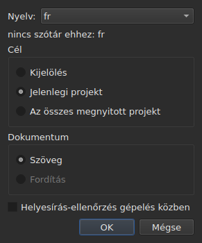
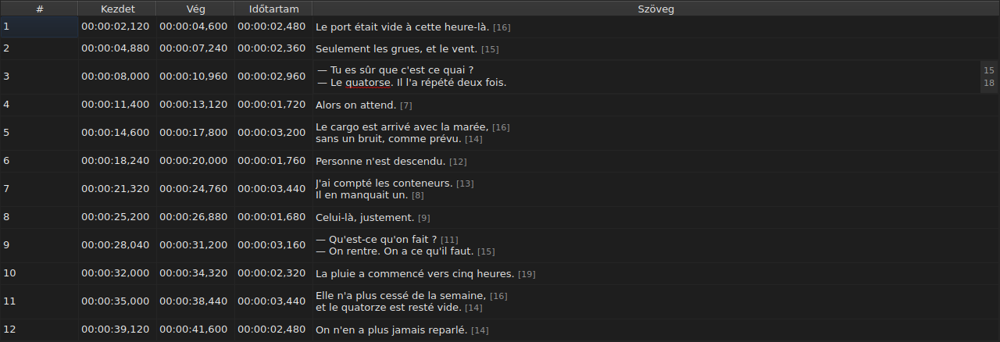
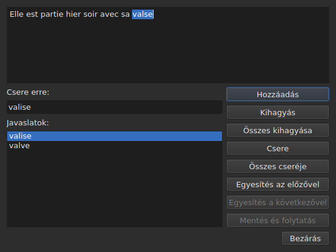

# Helyesírás-ellenőrzés…

<!-- machine-translated -->
> Ez az oldal gépi fordítás, amelyet a nyelv egyik olvasója még nem nézett át.

Az `Eszközök ▸ Helyesírás-ellenőrzés…` végigmegy a szótár számára ismeretlen szavakon,
egyesével, a Gaupol helyesírás-ellenőrzőjének mintájára. Társa az
`Eszközök ▸ Helyesírás-ellenőrzés beállításai…`, amely a nyelvet, a célt és a dokumentumot állítja be, valamint az aláhúzást gépelés közben.
Mindkettő a rendszer szótáraira támaszkodik, az Enchanton keresztül.

Az első címkéje az angol forrásban `Chec&k Spelling…` alakban íródik: a `C` már
a `Correct Texts…` gyorsítóbetűje, a `k` pedig szabad a `Tools` menüben.
Egyiküknek sincs gyorsbillentyűje.

**Mindkettő le van tiltva olyan dokumentumnál, amelyben nincs feliratsor**, ahogy a
[`Correct Texts…`](correct-texts.md) is: nincs mit ellenőrizni. A `Check Spelling…`
akkor is le van tiltva, ha a beállított nyelvhez nincs szótár, lásd:
[Szótár nélkül](#szótár-nélkül).

## Helyesírás-ellenőrzési beállítások…




| Csoport | Választható értékek | Alapértelmezés |
| :------ | :------------------ | :------------- |
| `Language` | a rendszer által kínált nyelvkódok és a már kiválasztott | a rendszer nyelve, ha szerepel köztük |
| `Target` | `Selection`, `Current Project`, `All Open Projects` | `Current Project` |
| `Document` | `Text`, `Translation` | `Text` |
| `Check spelling while editing` | jelölőnégyzet, lásd: [Aláhúzás gépelés közben](#aláhúzás-gépelés-közben) | nincs bejelölve |

A `Selection` le van tiltva, ha a megjelenített lapon nincs kijelölt sor; a `Translation`
le van tiltva, amíg egyetlen megnyitott projektnek sincs fordítása. Az a megjegyzett
beállítás, amely már nem érhető el — üres kijelölés, hiányzó fordítás —,
a `Current Project` vagy a `Text` értékkel nyílik meg. Az `OK` megtartja a beállításokat, a `Cancel` nem
módosít semmit.

**Ez az ablak nem függ a szótártól**: addig marad engedélyezve, amíg a
dokumentumban vannak feliratsorok, a beállított nyelvhez tartozó szótár hiányában is, és ez az,
amelyikkel el lehet hagyni egy szótár nélküli nyelvet. A nyelv, amelyhez nincs
szótár, szerkeszthető marad, és megjelenik a listában, alatta pedig a
`no dictionary for` mondat áll, majd a kódja.

**A négy beállítás megmarad** egyik munkamenetről a másikra, a
`subedit` beállításfájljában — a helyét lásd: [A beállítások](preferences.md):

| Kulcs | Értékek | Alapértelmezés |
| :---- | :------ | :------------- |
| `spell-check.language` | nyelvkód, például `fr_FR`; üres: a rendszer nyelve | üres |
| `spell-check.target` | `selection`, `current-project`, `all-projects` | `current-project` |
| `spell-check.document` | `main`, `translation` | `main` |
| `spell-check.inline` | `true` vagy `false` — az ismeretlen szavak aláhúzása egy cella szerkesztőjében | `false` |

A kulcs által el nem fogadott érték figyelmen kívül marad, az alapértelmezés érvényes, és a
kulcs neve a hibakimeneten jelenik meg az ablak megnyitásakor — lásd:
[A beállítások](preferences.md#mi-történik-ha-a-fájl-nem-azt-mondja-amit-várnak-tőle).

## Aláhúzás gépelés közben




A `Spell-Check Settings…` párbeszédablak `Check spelling while editing` jelölőnégyzete
**piros hullámvonallal és gépelés közben** aláhúz minden ismeretlen szót egy
szövegcella szerkesztőjében — a `Text` oszlopéban éppúgy, mint a
`Translation` oszlopéban. Az aláhúzás követi a gépelést: megjelenik, vándorol és
eltűnik a szóval együtt. **Alapértelmezés szerint nincs bejelölve**, mint a Gaupolban: nélküle
a szerkesztőben semmi sem változik.

**A nyelv a `Language:` mezőé**, ugyanabban az ablakban, az ismeretlen szavak pedig
azok, amelyeket a `Check Spelling…` találna: a köznyelvi angol ugyanazon esetei
(`goin'`, `we'd`, `1st`), ugyanaz a szavakra bontás. Az aláhúzott szót nem lehet menüből
kijavítani: a jelölőnégyzet csak megmutatja.

**Ha a beállított nyelvhez nincs szótár, a szerkesztő hallgat**: semmi sem
kap aláhúzást, és semmi sem hibázik; az ablak `no dictionary for` mondata megmondja
az okát. A jelölőnégyzet a bejelölése után megnyitott szerkesztőkre érvényes; a már
megnyitott szerkesztő megtartja, amije volt.

## A végigjárás




Az ablak megmutatja a feliratsor szövegét ott, ahol megállt, benne az ismeretlen szóval
kijelölve. **Minden ismeretlen szónál visszatér a projekt lapja, és a
feliratsor sora ki van jelölve a táblázatban.** A végigjárás feliratsoronként
halad, majd projektenként, ha a cél több projektet jelöl ki.

A szöveg alatt: a `Replace with:` mező, kitöltve az első javaslattal, és a
`Suggestions:` lista. Egy javaslat kiválasztása beírja a mezőbe; a mezőbe gépelés
megújítja a listát.

| Gomb | Mit csinál |
| :--- | :--------- |
| `Add` | hozzáadja a szót a felhasználó személyes szótárához, és továbblép a következőre |
| `Ignore` | otthagyja ezt a szót, és továbblép a következőre |
| `Ignore All` | otthagyja ezt a szót és az összes többi előfordulását is ebben a végigjárásban |
| `Replace` | kicseréli a szót a `Replace with:` tartalmára; le van tiltva, amíg a mező üres |
| `Replace All` | ugyanezt teszi a szó többi előfordulásával; le van tiltva, amíg a mező üres |
| `Join with Previous` | egyesíti a szót az előtte állóval; le van tiltva, ha nincs ilyen, vagy ha szóköz nem választja el őket |
| `Join with Next` | egyesíti a szót az utána állóval, ugyanilyen feltételekkel |
| `Save and Resume` | megtartja a szöveget úgy, ahogy a szövegterület tartalmazza, és **az elejétől** folytatja ennek a szövegnek az olvasását |
| `Close` | bezárja az ablakot |

**A szövegterület szerkeszthető.** Amint beleírnak, már csak a `Save and Resume`
marad engedélyezve: a többi művelet a kiválasztott szóra hat, amely már
nem a szövegben álló szó.

**A végigjárás magától véget ér**, ha nincs több ismeretlen szó: a
gombok le vannak tiltva, a szöveg kiürül. Ha a célban egyetlen ismeretlen szó sincs,
nem jelenik meg ablak.

### Bezárás a közepén

A `Close` vagy az ablak keresztje **érvényesíti, ami megtörtént**, akárcsak a
végigjárás vége: a már elhagyott szövegeket, **és** a jelenlegi szövegen már elvégzett
műveleteket — csere, összes cseréje, egyesítés. Ez eltér a
Gaupoltól, amely elveszti a jelenlegi szöveget. Nem számít bele a végigjárás hátralévő része, sem a
szövegterületbe gépelt utólagos javítások, amelyeket a `Save and Resume` nem
hagyott jóvá.

**Projektenként egyetlen előzménybejegyzés** keletkezik, bármennyi is a
csere: az `Undo` egyszerre visszavonja a projekt összes javítását.
A menü `Undo: correcting texts` néven nevezi. Az állapotsor ezután megadja az
összesítést:

```text
Edited 2 and removed 0 subtitles
```

**A cserék listája** — hogy a felhasználó mit cserélt, és mire —
záráskor a `spell-check/<language>.repl` fájlba íródik a `subedit` beállítási
könyvtárában, nem a Gaupoléban, amelyet a program sosem olvas.
Ezután a helyesírás-ellenőrző javaslatai közé számít, itt éppúgy, mint a
[`Correct Texts…`](correct-texts.md#szavak-egyesítése-vagy-szétválasztása--egyesítés-és-szétválasztás-a-helyesírás-ellenőrző-szerint) esetében.
Ha nem írható ki, hibaüzenet-ablak jelzi: `Could not save the
replacements for`, utána a nyelv és az ok, a javítások megszakítása nélkül.

## Szótár nélkül

Ha a beállított nyelvhez — a rendszeréhez, ha nem választottak mást — nincs
szótár, **a `Check Spelling…` le van tiltva**, és az eszköztipp, valamint az állapotsor,
ha a menüpont fölé visznek, megmondja az okát:

```text
no dictionary for fr
```

A `Spell-Check Settings…` megmarad, hogy lehessen választani olyan nyelvet, amelyhez van szótár. Az
olyan ablak, amely szótárszolgáltató nélkül készült, ugyanezt mondja, és semmit
sem ellenőriz.

## Az üzenetek

| Üzenet | Hol | Mi váltja ki |
| :----- | :-- | :----------- |
| `no dictionary for fr` | eszköztipp és állapotsor | a beállított nyelvhez nincs szótár |
| `Nothing to check.` | állapotsor | a cél nem jelöl ki szöveget — például üres kijelölés |
| `Edited N and removed M subtitles` | állapotsor | a végén vagy záráskor; az `M` `0` marad |
| `Could not save the replacements for fr: …` | hibaüzenet-ablak | a cserék listája nem íródott ki |

## Egy példa

Egy megnyitott fájl tartalmazza: `Elle est partie hier soir avec sa valse`. A francia
szótár megvan: az `Eszközök ▸ Helyesírás-ellenőrzés…` a `valse` szónál megáll, kijelöli a
sort a táblázatban, és a `valise` javaslatot kínálja, amely már a `Replace with:` mezőben áll. A `Replace`,
majd a `Close`: a sor `Elle est partie hier soir avec sa valise` lesz, és az
állapotsor ezt mondja:

```text
Edited 1 and removed 0 subtitles
```
