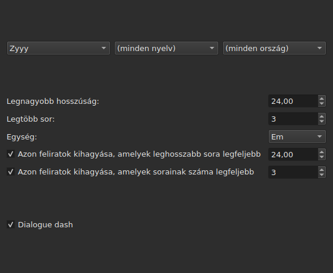
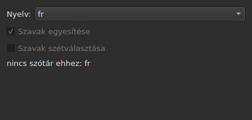
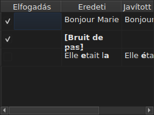

# Szövegek javítása…

<!-- machine-translated -->
> Ez az oldal gépi fordítás, amelyet a nyelv egyik olvasója még nem nézett át.

Az `Eszközök ▸ Szövegek javítása…` többoldalas segédet nyit, a Gaupoléhoz
hasonlót: egy cél- és feladatoldalt, bejelölt feladatonként egy oldalt,
egy folyamatoldalt és egy megerősítő oldalt, amely a módosításokat
javasolja, de sosem kényszeríti rá.

**Üres dokumentumnál le van tiltva**: nincs mit javítani.

**A parancssor ugyanezt teszi** az összes feladattal: [`subedit-cli correct`](../subedit-cli/correct.md), ugyanazokkal a
mintákkal és ugyanazokkal az összesítésekkel — és karakterekben, ahol az ablak emben mér.
**A segéd megjegyzett beállításai közül négyet alapértelmezés szerint beolvas** — a gyakori hibák két osztályát
(`Human`, `OCR`), a `Remove all blank subtitles` jelölőnégyzetet és a `Line Break` legnagyobb
sorszámát —, minden mást (a feladatokat, a kódjukat, a sorhosszat, a nyelvet,
a mintamezőket) a saját parancssorából vesz. Lásd:
[Két blokk, az egyik a parancssorral közös](preferences.md#két-blokk-az-egyik-a-parancssorral-közös)
és [`subedit-cli config`](../subedit-cli/config.md).

## Feladatok és cél — az első oldal

| Csoport | Választható értékek | Alapértelmezés |
| :------ | :------------------ | :------------- |
| `Target` | `Selection`, `Current Project`, `All Open Projects` | `Current Project` |
| `Document` | `Text`, `Translation` | `Text` |
| `Tasks` | `Mentions`, `Join or Split Words`, `Common Errors`, `Capitalization`, `Line Break` — egy vagy több jelölendő | a `Common Errors` és a `Capitalization` be van jelölve, a másik három nem |

A `Selection` le van tiltva, ha a megjelenített lapon nincs kijelölt sor; a `Translation`
le van tiltva, amíg egyetlen megnyitott projektnek sincs fordítása.

**A célt és a dokumentumot a program nem jegyzi meg**: a segéd mindig a
`Current Project` és a `Text` értékkel nyílik meg. A bejelölt feladatok viszont megmaradnak.

**Mit jelöl ki az egyes cél**:

| Cél | Mire hat |
| :-- | :------- |
| `Selection` | a megjelenített lapon kijelölt sorokra |
| `Current Project` | a megjelenített lap teljes fájljára |
| `All Open Projects` | az összes megnyitott lap teljes fájljára |

**Az `All Open Projects` a `Translation` értéken átugorja a fordítás nélküli projekteket**:
annak a projektnek, amelynek nincs fordítása, nincs mit javasolnia egy üres oszlopban, és
a segéd nem számolja.

**A feladatoldalak a Gaupol sorrendjében követik egymást — `Mentions`,
`Join or Split Words`, `Common Errors`, `Capitalization`, `Line Break` — sosem abban, ahogy a jelölőnégyzeteket
bejelölték.** A bejelöletlen feladatnak nincs oldala; a megjegyzett
beállításai ettől még nem változnak. **Egyik feladatoldalnak sincs saját
„aktív” jelölőnégyzete**: az első oldalé számít, és csak az dönti el,
fut-e a feladat.

## A feladatoldalak

A négy mintaoldal — a `Join or Split Words` kivételével, amelynek nincs — mindegyike ugyanazt az alapot hordozza: három egymásra épülő
legördülő menüt — írásrendszer, nyelv, ország — az alkalmazandó minták kódjának kiválasztásához,
majd az adott kód mintáinak listáját, névenként egy jelölőnégyzettel. **A
három menü csak azt kínálja, amit a mintakatalógus ténylegesen
tartalmaz** — a programmal szállítottakat és azokat, amelyeket a felhasználó
a könyvtárba helyezett (lásd: [A könyvtárba helyezett minták](#a-könyvtárba-helyezett-minták)) — sosem egy máshonnan olvasott
nyelv- vagy országlistát. A `Zyyy` („bármely írásrendszer”) a `Common Errors` kiinduló
kódja, amely a mindenhol érvényes mintákat adja. **A másik három
típusnak csak írásrendszer alatt vannak mintái**: az oldaluk a katalógus által kínált
elsővel nyílik, a szállított mintáknál a `Latn` kóddal, nem a `Zyyy` kóddal.

**Minden minta leírása a jelölőnégyzetének eszköztippje.** A nevek és leírások a programmal szállított mintáknál
az ablak nyelvét követik; a saját minta úgy jelenik meg,
ahogy a fájlja írja ([Nyelv](invocation.md#nyelv)).

**A bejelöletlen minta bejelöletlen marad, amíg újra be nem jelölik**, akkor is, ha
kódot váltanak, majd visszatérnek rá, és ez a választás megmarad a segéd egyik megnyitásáról
a másikra. Újra bejelölve egyszerűen megtalálja az eredeti
beállítást, és a megjegyzett választás eltűnik.

| Oldal | Mivel egészíti ki az alapot |
| :---- | :-------------------------- |
| `Mentions` | két jelölőnégyzet, a `Sound in brackets` és a `Sound in parentheses`, alapértelmezés szerint bejelöletlenek |
| `Common Errors` | két jelölőnégyzet, a `Human` és az `OCR`, alapértelmezés szerint bejelölve |
| `Capitalization` | semmivel |
| `Line Break` | legnagyobb hossz (alapértelmezés szerint `24`), legnagyobb sorszám (`3`), mértékegység — `Characters` vagy `Ems`, alapértelmezés szerint `Ems` —, és két kihagyási feltétel, lejjebb leírva |

**A `Mentions` két jelölőnégyzete nem nevez meg lefordított mintát**: a
magban lévő szövegvizsgálatot vezérlik, azt, amelyet a
[`Remove Hearing-Impaired Mentions…`](operations.md#remove-hearing-impaired-mentions)
már közvetlen mozdulatban elvégez. Az egyik **vagy** a másik bejelölése elég az indításhoz. **Az oldal mintalistája nem ismétli meg őket**: ez a két név csak egyszer szerepel ott, jelölőnégyzetként.

**A `Common Errors` osztály szerint szűr**: az a minta, amely mindkét osztályt hordozza,
alkalmazódik, amint a két jelölőnégyzet egyike be van jelölve; a másik három oldal nem
ismeri ezt a megkülönböztetést.

### Sortörés — a mértékegység és a kihagyás




| Beállítás | Mit csinál | Alapértelmezés |
| :-------- | :--------- | :------------- |
| `Maximum length` | egy sor hossza a választott mértékegységben; `1` és `1000` között | `24` |
| `Maximum lines` | a célzott sorszám; `1` és `100` között | `3` |
| `Unit` | a `Characters` karaktereket számol; az `Ems` az ablak betűtípusával méri a szélességet, ahol egy átlagos kisbetű `0.55` értékű — a Gaupol mértékegysége | `Ems` |
| `Skip subtitles with maximum line length of` | változatlanul hagyja azt a feliratsort, amelynek leghosszabb sora belefér ebbe a hosszba, a választott mértékegységben | bejelölve, `24` |
| `Skip subtitles with maximum line amount of` | változatlanul hagyja azt a feliratsort, amelynek sorszáma belefér ebbe a számba | bejelölve, `3` |

**A kihagyásnak saját küszöbei vannak**, a célzott határoktól eltérőek: ez
a Gaupol szabálya. A feliratsor változatlan marad, ha belefér az **összes olyan
küszöbbe, amelynek jelölőnégyzete be van jelölve**; különben tördelve lesz, és a tördelés
csak akkor marad meg, ha közelebb viszi a feliratsort egy túllépett küszöbhöz — kisebb
hosszal vagy kevesebb sorral. Ha egyik jelölőnégyzet sincs bejelölve: minden feliratsort tördel a program,
akár belefér már, akár nem.

**A mértékegység váltása megváltoztatja, mit javasol a program**: minden sor hosszát
minden számításkor az oldal akkori mértékegységében méri, és semmi sem
marad egy korábbi mérésből. Egy huszonkilenc karakteres szöveg, amelynek fele
keskeny betű, `Characters` mértékegységben meghaladja a `24` értéket, `Ems` mértékegységben pedig
könnyedén belefér.

**A hét beállítás megmarad** egyik munkamenetről a másikra, a mértékegységgel együtt.

### Szavak egyesítése vagy szétválasztása — egyesítés és szétválasztás a helyesírás-ellenőrző szerint




Külön oldal a `Mentions` és a `Common Errors` között, hogy kijavítsa, amit a
szövegfelismerő szoftverek a szóközökkel tesznek. Nincs mintalistája: a
rendszer szótáraira támaszkodik, az Enchanton keresztül.

| Beállítás | Mit csinál | Alapértelmezés |
| :-------- | :--------- | :------------- |
| `Language` | a szótár nyelve; a rendszer által kínált kódok és a már kiválasztott | a rendszer nyelve, ha szerepel köztük |
| `Join words` | a rosszul írt szót egyesíti a szomszédos szóval | bejelölve |
| `Split words` | a rosszul írt szót kettévágja | bejelöletlen |

**Egyesítés**: a rosszul írt szót az előtte vagy az utána álló szóval egyesíti a program,
**ha és csak ha a két irány közül csak az egyik ad helyesen
írt szót**. Ha mindkettő ad, vagy egyik sem, nem történik semmi.
A `bon jour` `bonjour` lesz; az egymás utáni két szóközt előbb eggyé
csökkenti, de az a szöveg, amelyben semmi sem egyesül, úgy adódik vissza, ahogy volt, a szóközökkel
együtt.

**Szétválasztás**: a rosszul írt szót akkor vágja ketté a program, ha a helyesírás-ellenőrző
javaslatai közül **csak egy** az a szó egy szóközzel — ugyanazok a
betűk, ugyanabban a sorrendben. Két ilyen javaslat vagy egy sem: nem történik
semmi. Az a szó, amelynek csak a kezdőbetűje nagybetű (`Bonjourtous`), sosem
lesz szétválasztva: gyakran név, és a szótárak nem tartalmaznak ilyeneket.

**A felhasználó cserelistája** (`spell-check/<language>.repl`,
a program beállítási könyvtárában) a helyesírás-ellenőrző
javaslatai közé számít; a segéd olvassa, de nem írja.

**Ha a választott nyelvhez nincs szótár, az oldal megmarad, de szürke**: a
két jelölőnégyzet le van tiltva, és az oldal azt mondja: `no dictionary for`, utána a
nyelv kódja. A nyelv szerkeszthető marad — lehet, hogy egy másikhoz van
szótár —, a feladat pedig, bejelölve vagy sem az első oldalon, ekkor nem csinál semmit, és
nem jelent hibát.

**A nyelv, a két jelölőnégyzet és az első oldal jelölőnégyzete megmarad** a segéd egyik
megnyitásáról a másikra.

### A könyvtárba helyezett minták

Az a minta, amelyet a felhasználó a saját mintakönyvtárába helyezett,
hozzáadódik a programmal szállítottakhoz, ugyanabban a katalógusban és ugyanazok alatt a
menük alatt — betöltés után semmi sem különbözteti meg őket.

| Minták | Hol |
| :----- | :-- |
| szállított | `<prefix>/share/subedit/patterns`, a `<prefix>/bin` mellett |
| a felhasználóé | `$XDG_DATA_HOME/subedit/patterns`, vagy `~/.local/share/subedit/patterns`, ha a változó nincs beállítva vagy nem abszolút elérési út |

**A formátum a Gaupolé, változtatás nélkül olvasva**: írásrendszerenként, nyelvenként és országonként egy `<Code>.<type>` fájl — `Latn-en.common-error` —, mellette az aktiválását megadó `.conf`. A típusok:
`common-error`, `capitalization`, `hearing-impaired` és `line-break`. A szállított
fájlok mintaként szolgálnak. **A mintákat egyszer olvassa be a program, induláskor**: az ablak
nyitva létekor beledobott fájlt csak a következő indításkor látja.

## Folyamat

Miután a `Next` gombot megnyomták az utolsó bejelölt feladatoldalról (vagy az
első oldalról, ha nincs bejelölt feladat), a segéd a javasolt
javításokat egy háttérszálon számolja ki, a képernyőn határozatlan folyamatsávval. A
számítás befejezése után a megerősítő oldal magától megnyílik.

**A `Cancel` ebben a lépésben elveti a számítást, de nem szakítja meg**: semmi
sem alkalmazódik, de a segéd bezárás előtt megvárja, hogy a folyamatban lévő
számítás befejeződjön — a várakozást az az időkorlát korlátozza, amelyet a mintamotor
minden keresésre előír.

**A `Back` ebben a lépésben várakozás nélkül visszalép az előző oldalra**: a számítás
a háttérben befejeződik, az eredményét pedig eldobják — a segéd nem ugrik magától
a megerősítésre. A `Next` új számítást indít.

## Megerősítés — az utolsó oldal




Minden szövegről egy sor, amelyet a segéd megváltoztatna — olyan szövegről
sosem, amelyet egy feladat változatlanul hagyott.

| Oszlop | Mit mutat |
| :----- | :-------- |
| `Accept` | jelölőnégyzet, alapértelmezés szerint bejelölve: a javítás alkalmazódik vagy sem |
| `Original` | a szöveg ahogy van, a megváltozó rész **félkövéren** |
| `Corrected Text` | a javasolt szöveg, a megváltozott rész félkövéren, **szerkeszthető** — az utólagos javítása megváltoztatja, mi fog íródni, az `Accept` jelölőnégyzet megváltoztatása nélkül |

**A változást félkövér betű jelöli, sosem szín**: ugyanaz a különbség
mindkét palettán olvasható, bármilyen árnyalattól függetlenül.

**Az a sor, amelynek a javaslata eltávolítás** — a feliratsorban nem maradna
szöveg — üresen mutatja a `Corrected Text` oszlopot, az egész `Original` pedig
félkövér.

| Gomb | Mit csinál |
| :--- | :--------- |
| `Mark All` | bejelöli az `Accept` jelölőnégyzetet az összes soron |
| `Unmark All` | törli az `Accept` jelölését az összes soron |
| `Preview` | a beépített lejátszót a kiválasztott sor feliratsorára viszi, ha a projektnek van filmje — ha nincs, nem tesz semmit |
| `Finish` | alkalmazza a bejelölt sorokat, és bezárja a segédet |

A `Remove all blank subtitles`, alapértelmezés szerint bejelölve, eltávolítja azokat a feliratsorokat,
amelyeket egy javítás szöveg nélkül hagyna, ahelyett, hogy üresen megtartaná őket.

**Azt a mintát, amelyet a számítás nem tudott alkalmazni, a táblázat alatt nevezi meg a program**, az
okkal együtt:

```text
Not applied: some pattern (will not compile)
```

Az így megnevezett mintát **okonként egyszer** nevezi meg a program, bármennyi
szövegen vagy projekten hibázott: a képernyő nem mondja meg, melyiken.

| Ok | Mi váltja ki |
| :- | :----------- |
| `cannot be translated` | a kifejezés olyat használ, amit a Python szintaxis lefordítása visszautasít |
| `will not compile` | a motor visszautasítja a kifejezést |
| `has an invalid replacement` | a csere nem úgy olvasható, ahogy a Python olvassa |
| `timed out` | egy keresés túllépte a motor által egy szövegre engedélyezett időt |
| `never settled` | a `Repeat` száz menet után még mindig változtatta a szöveget |
| `grew the text too long` | a szöveg meghaladta a 16 384 bájtot, miközben a minta dolgozott rajta |

**Az a minta, amely egy szövegen hibázik, úgy hagyja azt, ahogy előtte volt**: a félig
elvégzett csere kevesebbet ér, mint a csere hiánya. A többi minta alkalmazódik.

**Az olvashatatlan mintafájlsort ugyanazon a helyen nevezi meg a program**,
a fájljával, a sorával és az okkal — a segéd minden megnyitásakor,
mivel a mintákat csak egyszer, induláskor olvassa be:

```text
Could not be read: Zyyy.common-error, line 8 (malformed line)
```

| Ok | Mi váltja ki |
| :- | :----------- |
| `directory cannot be read` | a szállított minták könyvtárát nem lehetett bejárni |
| `file cannot be read` | egy mintafájlt nem lehetett beolvasni |
| `malformed line` | olyan sor, amely se fejléc, se megjegyzés, se `Key=Value` |
| `field outside any pattern` | egy `Key=Value` az első mintafejléc előtt |
| `unknown field` | olyan kulcs, amelyet ennek a mintatípusnak nincs mire használnia — a minta megmarad |
| `missing field` | olyan kulcs, amely nélkül ez a mintatípus nem tud semmit tenni — a minta elvetve |
| `invalid value` | olyan érték, amelyet a kulcs nem fogad el — a minta elvetve |
| `malformed activation` | egy `.conf` `<pattern>` eleme, amely semmit sem nevez meg |

A többi minta, amelyet helyesen beolvastak és alkalmaztak, nem
érintett.

## Amit a visszavonás mond, és amit a `Cancel` soha nem tesz

**A `Finish` érintett projektenként egy előzménybejegyzést hoz létre**, sosem
javításonként egyet: az `Undo` egyszerre visszavonja az adott projekten elfogadott összes javítást,
mindegyiket azzal a szöveggel, amelyet addig viselt. A menü
`Undo: correcting texts` néven nevezi.

Az állapotsor megadja az összesítést, előbb a megváltozott szövegeket, majd az
eltávolított feliratsorokat:

```text
Edited 3 and removed 1 subtitles
```

**A `Cancel` bármely oldalon semmit sem alkalmaz, és semmit sem jegyez meg** — sem
a megnyitás alatt választott beállításokat, sem a legkisebb javítást. A
segéd következő megnyitása a korábbi beállításokról indul újra.

## Egy példa

Egy megnyitott fájl egy sorában két szó között két szóköz áll, és van benne egy
zárójeles utalás más szöveg nélkül. `Eszközök ▸ Szövegek javítása…`,
a `Common Errors` már be van jelölve, `Next` a megerősítésig: a két szóközös sor
balra `Bonjour  Marie`, jobbra `Bonjour Marie` szöveget mutat, a javítás
félkövéren és már elfogadva. A `Finish` alkalmazza, és az állapotsor ezt mondja:

```text
Edited 1 and removed 0 subtitles
```
