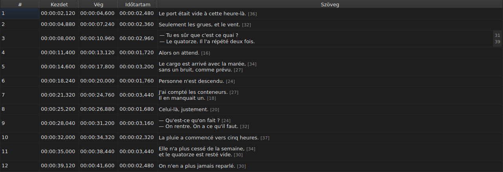

# Cella szerkesztése

<!-- machine-translated -->
> Ez az oldal gépi fordítás, amelyet a nyelv egyik olvasója még nem nézett át.

Négy oszlop szerkeszthető helyben: `Start`, `End`, `Duration` és `Text` — öt, ha
a projektnek van fordítása, a `Translation` oszloppal együtt. A `#` nem
szerkeszthető — a szám a sor sorrendi helye, nem a fájl adata.

**Egy cella szerkesztőjének megnyitása:** dupla kattintás rá, vagy kijelölés
és az `F2` megnyomása.

## A szöveg

**A fordítás ugyanúgy szerkeszthető, mint a szöveg**, ugyanazzal a többsoros mezővel és
ugyanazokkal a szabályokkal; csak a cella változik, a fő szöveg úgy marad,
ahogy volt. Az a jóváhagyás, amely nem változtat semmin, nem csinál semmit, az
egyiknél sem — lásd [lejjebb](#a-semmit-sem-módosító-jóváhagyás-nem-csinál-semmit).

A szerkesztő **többsoros** mező, és a feliratsor magasságában nyílik meg:
egy kétsoros feliratsor benne úgy gépelhető, ahogy ki lesz írva, a két sora
olvasható, és nincs görgetősáv. Egy `Shift+Enter`, amely újat ad hozzá, megnöveli
a szerkesztőt; a táblázat sora a jóváhagyáskor igazodik.

| Billentyű | Hatás |
| :-------- | :---- |
| `Enter` | jóváhagyja és bezárja a szerkesztőt |
| `Shift+Enter` | sortörést szúr be a szövegbe |
| `Esc` | bezárja a szerkesztőt; a cella megtartja, ami volt benne |
| `Tab` | jóváhagyja, és a következő cellára lép |

Máshová kattintva is jóváhagyódik: a fókusz elvesztése egy `Enter`-rel ér fel.

**Tizenegy párbeszédablak nélküli mozdulat ugyanígy jóváhagy**, mielőtt kiszámítaná a célját:
`Italic`, `Case ▸ …`, `Dialogue`, `Merge Subtitles`, `Split Subtitle`,
`Cut Texts`, `Paste Texts`, `Copy Texts`, `Remove Subtitles`, `Undo` és `Redo`.
A menüből, az eszköztárról vagy egy ablakbeli gyorsbillentyűvel indítva a szöveget
úgy veszik, ahogy a szerkesztő az imént jóváhagyta, mint egy máshová kattintás
után. A `Ctrl+X`, a `Ctrl+C` és a `Ctrl+V` mégis a szerkesztőnél marad, amíg az
nyitva van — lásd [Szövegek kivágása, másolása és beillesztése](clipboard.md): ekkor
a menü indítja a `Cut Texts`, a `Copy Texts` és a `Paste Texts` műveletet.

Az `Undo` és a `Redo` az előzményeket olvassa, nem a dokumentumot: lásd
[Visszavonás és újra](undo.md). A párbeszédablakot megnyitó mozdulatnak
nincs szüksége erre a szabályra, mivel a párbeszédablak megnyíltakor megkapja a fókuszt, ami
már jóváhagyja a bevitelt.

### A címkék a fájl címkéi

A megjelenített és begépelt szöveg **a fájl szövege, a címkékkel együtt**: egy
SubRip `<i>…</i>` címkéje így van leírva, egy Advanced SSA `{\i1}…{\i0}`
címkéje is. Megjelenítéskor semmi sem alakul át — a
[`Italic`](operations.md#italic) táblázata megmondja, mit ír az egyes formátum.

A dőlt betűnél ezért nincs mit tudni: a `Ctrl+I` a megnyitott dokumentumnak megfelelő
címkét teszi ki, és az a formátum, amely egyet sem hordoz — TMPlayer, LRC —,
letiltja az elemet, ahelyett hogy keresgélni kellene. A félkövér és az aláhúzott
betű begépelendő, mint a Gaupolban.

**A címkék pedig nem követik a szövegműveleteket**: egy feliratsor kisbetűssé tétele
nem alakítja át az `<I>` címkéjét `<i>` címkévé, és a párbeszéd-kötőjel a szöveg elé
kerül, nem egy nyitó címke elé. Lásd
[`Case` és `Dialogue`](operations.md#case-és-dialogue).

## A sorok hossza

**A szövegszerkesztő a jobb oldali margón mutatja az egyes sorok hosszát**, a sor
első sorával egy vonalban. A margó olyan széles, mint a legnagyobb szám,
**gépelés közben** frissül, és követi a görgetést.
Üres szövegnél nem mutat semmit. A hosszak a táblázatéi — a címkék
nélkül, lefelé kerekítve, a beállított mértékegységben —, és a
`Show line lengths in the editor` jelölőnégyzettel kapcsolhatók ki a `Szerkesztés ▸ Beállítások…`
ablakban. Lásd
[Sorhosszak](preferences.md#sorhosszak).

## A kezdet és a vég

A szerkesztő egysoros mező, **az időbélyeg alakjára korlátozva**:
gépelés közben elutasítja azt, ami sosem lehetne az.

Az elfogadott alakok azok, amelyeket a fájl olvasása is elfogad:

| Elem | Ami érvényes |
| :--- | :----------- |
| mezők | `MM:SS` vagy `HH:MM:SS`, egyenként egy vagy két számjegy |
| tizedesek | egytől háromig, vessző vagy pont után, vagy egy sem |
| előjel | egy bevezető `-`, a videó kezdete előtti pozícióhoz |
| határok | a percek és a másodpercek 60 alatt |

A `00:01:02,500`, az `1:02.5` és a `-0:01,000` tehát három érvényes bevitel.

**Az a bevitel, amelyet az olvasás elutasít, változatlanul hagyja a cellát.** Ez a helyzet
a `00:70:00,000` esetében, amelynek az alakja helyes, de a percei kívül esnek a
határokon: a szerkesztő bezárul, és semmi sem mozdult. Pozíció nem találtatik ki
— egy pozíció elvétése néma, a képernyőn semmi sem különbözteti meg a
rosszul időzített feliratsort a jól időzítettől.

A kezdet vagy a vég módosítása azonnal frissíti az `Duration` oszlopot.

## Az időtartam

**Az időtartam begépelése a véget mozdítja, sosem a kezdetet**: a vég
`Start + Duration` lesz. A kezdet mozdítása az egész feliratsort mozdítaná, ami
a [`Shift Positions…`](operations.md) dolga, a `Start` oszlopba pedig
már lehet gépelni.

Az időtartam **az időbélyeg alakjában** gépelendő, abban, amelyet az oszlop
megjelenít, és a fenti táblázat alakjai érvényesek — egy különbséggel:

| Elem | Kezdet, vég | Időtartam |
| :--- | :---------- | :-------- |
| alak | az időbélyegé | ugyanaz |
| bevezető `-` előjel | elfogadott | **gépelés közben elutasított** |

A `0:02.5` és a `00:00:02,500` tehát két érvényes bevitel egy két és fél másodperces
időtartamhoz; a `-0:01,000` nem gépelhető be. A nulla időtartam elfogadott:
a feliratsor ekkor abban a pillanatban tűnik el, amikor megjelenik.

**A következő feliratsoron túlnyúló vég megengedett.** Az
átfedés színezve látszik a táblázatban, a súgószövegével — lásd
[A táblázat](table.md#az-anomáliák) — ez figyelmeztetés, nem elutasítás: lehet, hogy
ez volt a szándék. A [diagnosztikák listája](files.md#az-olvasás-diagnosztikája)
is tartalmazza, és eltávolítja, ha kijavították.

**A film vége utánra gépelt véget nem jelzi a program**, ellentétben a
`Tools` menü egy olyan műveletével, amely odatolná — lásd
[A műveletek](operations.md#a-film-vége-után). A cella már megmutatja
az imént begépelt értéket.

Az olvashatatlan bevitel változatlanul hagyja a cellát, mint egy pozíciónál, és
a megjelenítettel azonos időtartam nem kerül be az előzményekbe.

## A semmit sem módosító jóváhagyás nem csinál semmit

Egy cella megnyitása, semmi begépelése, az `Enter` megnyomása: nem történik semmi.
Módosítás nem kerül rögzítésre, és a fájl továbbra is azonosnak számít a
lemezen lévővel.

Az összehasonlítás a **pozícióra** vonatkozik, nem a karakterláncra: a `0:01.0` begépelése
egy olyan cellában, amely `00:00:01,000` értéket mutat, ugyanazt a pillanatot jelöli,
ezért az sem változtat semmin.

## Mi lesz egy szerkesztett cellából

**Visszavonható** — egy cella, egy bejegyzés. Lásd
[Visszavonás és újra](undo.md).

**Mentésre kerül**, és az ablak bezárása mentés nélkül megerősítést
kér. Lásd [Megnyitás és mentés](files.md).
