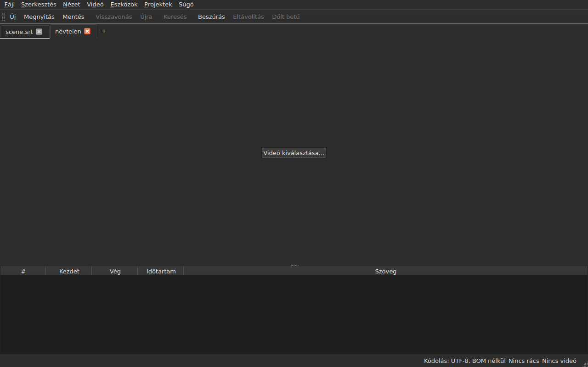
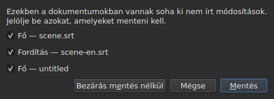
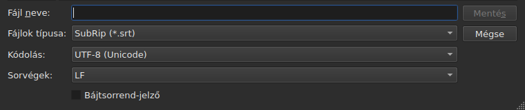
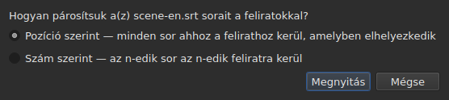
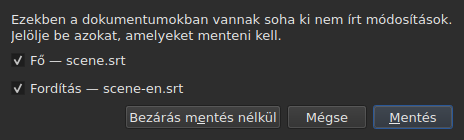

# Megnyitás és mentés

<!-- machine-translated -->
> Ez az oldal gépi fordítás, amelyet a nyelv egyik olvasója még nem nézett át.

A **Fájl** menü három parancsot tartalmaz, kettőt a lapokhoz és még hármat
a fordításhoz; a **Projektek** menü az összes lapon egyszerre hat.

| Parancs | Gyorsbillentyű | Mit csinál |
| :------ | :------- | :----------- |
| Új projekt | `Ctrl+N` | üres projekt új lapon — ugyanezt teszi az utolsó lap után álló `+` gomb is |
| Megnyitás… | `Ctrl+O` | kiválaszt egy fájlt, és új lapon nyitja meg — vagy egy üres projekt helyén |
| Fordítás megnyitása… | — | kiválaszt egy fordításfájlt, és igazítja az aktuális lap főfájljához |
| Mentés | `Ctrl+S` | újraírja a megnyitott fájlt |
| Mentés másként… | `Ctrl+Shift+S` | kiválaszt egy útvonalat és egy formátumot, majd ír |
| Fordítás mentése | — | újraírja a fordítás fájlját |
| Fordítás mentése másként… | — | kiválaszt egy útvonalat és egy formátumot a fordításnak, majd ír |
| Bezárás | `Ctrl+W` | bezárja az aktuális lapot — letiltva, ha csak egy lap van |

A `New Project`, az `Open…` és a `Save` az
[eszköztárban](index.md#az-eszköztár) is megtalálható, a `New`, az `Open` és a
`Save` szó alatt. **A fordítás három menüpontja
nincs az eszköztáron**: csak azoknak kellenek, akiknek van
fordításuk, az eszköztár pedig mindenkié.

## Több projekt, lapokon

**Minden megnyitott projektnek saját lapja van**, a kép és a táblázat fölött:
a címkéje a fájl neve, vagy `untitled`, ha a projektnek még nincs
fájlja. A lapra kattintva át lehet váltani rá; a `Ctrl+PageDown` és a `Ctrl+PageUp`
ugyanezt teszi egér nélkül, és az utolsó lap után az elsőre lép vissza.
**Az utolsó lap után közvetlenül álló `+` gomb** üres projektet nyit
új lapon, ahogy a `New Project` is.




**Az `Open…` sosem nyúl hozzájuk.** Egy fájl megnyitása már nem váltja le azt, amit az
ablak mutatott: új lapon érkezik, mellette, a korábban nézett lap pedig
mindenét megtartja — az előzményeit, a kijelölését, a társított
videóját. Ezért nem kérdez már semmit a megnyitás sem: nincs
mit elveszíteni, hiszen nincs mit felváltani.

**Egy kivétel: az üres projekt átadja a helyét.** Fájl nélkül indítva, vagy
a `New Project` után az ablak egy `untitled` projektet mutat, amelyben nincs semmi.
A megnyitott fájl — az `Open…` útján éppúgy, mint húzással — **ennek a lapját veszi át,
ugyanazon a helyen a sávban**, ahelyett hogy egy használhatatlan projekt mellett nyitna
másikat. A projekt akkor üres, ha **nincs fájlja, nincs benne felirat,
nincs mit visszavonni vagy újra végrehajtani, nincs filmje, és soha nem módosították**: ezek
bármelyike elég ahhoz, hogy megtartsa a lapját. Az üres projektet, amely nem
az aktuális lap, nem bántja a program.

**Az már megnyitott fájlt nem nyitja meg másodszor.** Az `Open…` egy olyan
fájlon, amelyet egy másik lap már tart, a fókuszt visszaadja annak a lapnak, és ezt
az állapotsorban közli:

```text
premier.srt: already open
```

**Minden lap teljes projekt, a többitől független**: az
előzményei, a kijelölése, a társított videója és az, amivel legutóbbi olvasása
találkozott, csak akkor látszik, ha az a lap az aktuális, és nem
változik, amíg egy másik az. **Egy kivétel, és az ADR 0033-ban
van**: a videólejátszó az egész ablakra egyetlen — egyetlen mpv
folyamat —, és a filmje a lappal együtt változik; **minden lap megjegyzi, hol tartott a
filmje**, és oda tér vissza, megállítva, amikor visszalépnek rá. A vágólap az ablaké: ha az
egyik lapon másolnak, a másikon beillesztenek, ahhoz két lapot kell nyitni.

**A `Close` az aktuális lapot zárja be**, szükség esetén megkérdezve
[a nem mentett módosítások kérdését](#nem-mentett-módosítások) —
csak erre a lapra vonatkozóan, a többit ez nem érinti. **Letiltva, ha
csak egy lap van**: az ablak mindig megtart legalább egyet, és ennek
bezárása az ablak bezárása volna — amit a rendszer gombja már megtesz.

**Minden lapon van egy kereszt is**, amely **a saját** projektjét zárja be, ugyanazzal a
kérdéssel. Az olyan lap keresztje, amely nem az aktuális, azt a lapot zárja be, és
az éppen nézett lap marad kijelezve; ha annak a projektnek vannak módosításai, a
lapja a kérdés idejére előtérbe kerül. **Nincs kereszt, ha csak egy
lap maradt**, ugyanazért, amiért a `Close` le van tiltva.

**A lap jelzi, hogy módosított**: a neve után csillag áll, `premier.srt*`,
ameddig valamelyik dokumentuma eltér a fájljától — ahogy az ablak címe is
jelzi az éppen nézett projektről. Mentéskor eltűnik.

## A Projektek menü

Két parancs hat az összes projektre egyszerre.

| Parancs | Gyorsbillentyű | Mit csinál |
| :------ | :------- | :----------- |
| Összes mentése | `Ctrl+Shift+L` | kiírja az összes módosított dokumentumot, lapról lapra |
| Összes bezárása | `Ctrl+Shift+W` | bezárja az összes projektet — vagyis az ablakot |

**A `Save All` a lapok sorrendjében halad**, előbb a főfájl, utána a fordítás.
Azt a dokumentumot, amelynek van fájlja, ott írja újra, **anélkül hogy a lapja előtérbe kerülne**;
**amelynek nincs, annak a `Save As…` ablakát nyitja meg, egyenként**, a lapján —
ez az egyetlen eset, amikor a `Save All` lapot vált, hogy az ablakból látszódjon, melyik
projektről van szó. **A `Save As…` megszakítása vagy egy
sikertelen mentés megállítja a többit**: a következő projekteket
nem érinti, és egy ablak közli, mi íródott ki.

```text
Save All stopped: 1 of 3 documents saved
```

Ha minden kiíródott, az állapotsor ezt közli — `2 documents saved`, vagy
`Nothing to save`, ha semmi sem volt módosítva. Ha egy `Save As…` egy lapot
előtérbe hozott, az ablak ezután visszatér ahhoz, amelyiken a parancsot
elindították.

**A `Close All` és az ablak keresztje egy és ugyanaz**: az ablak
mindig megtart egy projektet, és mindet bezárni annyi, mint az ablakot bezárni. Ezért
**egyetlen kérdést tesznek fel az összes projektre**, ugyanazt, mint
[két módosított dokumentum](#bezárás-két-módosított-dokumentummal) esetén, minden lap minden módosított dokumentumához egy-egy
jelölőnégyzettel:




**A `Cancel` semmit nem zár be**, és semmit nem ír ki. A `Save` a
bejelölt dokumentumokat írja ki, mint a `Save All`: a lapjuk mögött, kivéve a név nélküli
dokumentumot, amelynek lapja előtérbe kerül a `Save As…` miatt. Ha az összes projekt között csak egyetlen dokumentum
módosított, az az egyszerű kérdés jelenik meg, amelyet mindig is
feltettek, a saját lapján. A `Save All As…` nem létezik: ez a
`Save As…` sorozata volna, amit a `Save All` már megkérdez, egyenként, a név nélküli dokumentumokra.

## Megnyitás

A párbeszédablak **a kilenc olvasott formátumot** szűri, mindegyik külön elemmel, és
egy első elemmel, amely mindet mutatja. A formátumot ezután **a tartalom alapján ismeri fel a program, nem
a kiterjesztés alapján**: a SubRipet tartalmazó `.txt` megnyílik, a szűrő pedig
semmit sem dönt el — csak elrejt fájlokat.

| Szűrőelem | Kiterjesztés |
| :----------- | :-------- |
| `SubRip` | `.srt` |
| `WebVTT` | `.vtt` |
| `SubViewer 2` | `.sub` |
| `Sub Station Alpha` | `.ssa` |
| `Advanced SSA` | `.ass` |
| `MicroDVD` | `.sub` |
| `MPL2` | `.txt` |
| `TMPlayer` | `.txt` |
| `LRC` | `.lrc` |

**Két kiterjesztés két-két formátumot jelöl** — a `.sub` a SubViewer 2 és a
MicroDVD, a `.txt` az MPL2 és a TMPlayer. Ennek nincs következménye megnyitáskor,
hiszen a tartalom dönt; mentéskor a formátumot a kiválasztott elem
**neve** adja, sosem a mintája.

**Az olvashatatlan fájl semmit sem nyit meg.** Hiányzik, a rendszer megtagadta,
olyan kódolásban íródott, amelyben a bájtjai nem fejthetők vissza, vagy egyetlen ismert
formátumú sem: egy modális ablak **megnevezi az okot**, nem nyílik lap, és a már
meglévők nem mozdulnak.

| Üzenet | Mi történt |
| :------ | :------------ |
| `does not exist` | az útvonal nem jelöl ki fájlt |
| `cannot be opened: permission denied` | a rendszer megtagadja a megnyitást |
| `cannot be read` | a rendszer más okból tagadta meg |
| `cannot be decoded in the chosen encoding` | a bájtok nem olvashatók a kiválasztott kódolásban |
| `is in no format this tool knows` | egyetlen formátum sem ismeri fel a tartalmat |
| `holds nothing recognisable as a subtitle` | a formátum felismerhető, de nincs benne egyetlen felirat sem |

Az üzenetet az útvonal előzi meg: `notes.txt: is in no format this tool knows`.
Ezek a parancssor szavai, és ez nem véletlen — a két
felület ugyanazzal a recepttel olvas fájlt.

### Fájlok ejtése az ablakra

**A fájlok bárhová ejtése az ablakon megnyitja őket**, a
fájlkezelőből: a táblázatra, a lapsávra, a
`Select Video…` gombra és **magára a film képére**, lejátszás közben és megállítva egyaránt.
A kép a lejátszó által rajzolt különálló ablak, és semmi sem garantálta,
hogy az ejtést továbbadja; ezt kézzel ellenőrizték egy valódi asztalon,
egy Wayland-munkamenetben. A `subedit-gui` ott X11 alatt indul, hogy
meg tudja jeleníteni a filmet, így az ejtés az X11 protokollon megy át — egy
X11-munkameneté, ahol külön nem próbálták ki.

- **Minden feliratfájl a saját lapját nyitja**, abban a sorrendben, ahogy
  ejtették őket — pontosan úgy, mint az `Open…`. Az **már megnyitott** fájlt
  nem olvassa újra: a lapja előtérbe kerül, és az állapotsor ezt közli
  (`premier.srt: already open`).
- **Az ejtett videót az aktuális laphoz társítja a program**, ahogy a
  `Select Video…`. Ha feliratokkal együtt ejtették, az utolsó lapra kerül, amelyet
  azok megnyitottak, az ejtés sorrendjétől függetlenül. A videót a
  kiterjesztése alapján ismeri fel a program — ugyanabból a listából, amely a fájl mellett
  filmet javasol.
- **Két vagy több videót egyszerre nem nyit meg**: a projekt egyetlen
  filmet figyel. Ugyanazon ejtés feliratait viszont megnyitja.
- **Az a fájl, amely nem nyílik meg, nem állítja meg a többit.** Egyetlen ablak közli,
  mit nem sikerült megtenni, fájlonként egy sorban, az `Open…` szavaival:

  ```text
  /films/notes.txt: is in no format this tool knows
  /films/absent.srt: does not exist
  ```

Csak a helyi fájlokat veszi át: a böngészőből húzott hivatkozás
nem jelöl ki semmit, amit az ablak olvasni tudna.

A megnyitás a parancssorból továbbra is működik: `subedit-gui film.srt`.
Ott ugyanazt az okot a hibakimenetre írja a program, az ablak pedig üresen nyílik meg
— lásd: [Indítás](invocation.md#ha-a-megnyitás-sikertelen).

## Az olvasás diagnosztikája

A valódi fájl ritkán tökéletes, és az olvasás helyreállít, ahelyett hogy
feladná: hiányzó sorszám, sor, amely sehová sem tartozik, vegyes
sorvégek. **Amivel találkozott, az elfér az állapotsor egyik gombján**
— `2 diagnostics`, annak bal oldalán, amit az állapotsor a dokumentumról már mond —, és **a lista egy kattintásra nyílik meg
egy lebegő ablakban** a gomb fölött. Az ablak egyetlen sora sem megy rá erre:
a táblázat megtartja a teljes magasságát, akár volt mondanivalója az olvasásnak, akár nem. A lista
egy másutt való kattintásra vagy az `Esc` billentyűre záródik.

```
a SubRip block without its number, settled by the reader: 5
```

**Minden sor számol**: mivel találkozott a program, mit tett vele, és
hányszor. A rosszul elkészített fájl százszor találkozik ilyennel, és ha tudható,
melyikből mennyi, abból lehet cselekedni; az egyes előfordulások sorszáma a
fájlban viszont a parancssoron olvasható, a `-vvv` bőbeszédűségi szinten. A
gomb ezeket a sorokat számolja — fajtánként egyet —, nem az előfordulásokat.

**A kitalált kódolás is megjelenik itt**, egyszer: a bájtok mérlegelésével javasolták,
még mielőtt a fájlnak egyetlen sora is létezett volna.

```
an encoding nothing declared, settled by the reader: 1
```

Csak akkor jelenik meg, ha a kódolást **kitalálták, és az nem
UTF-8** — az UTF-8-ként olvasott UTF-8 fájl nem esemény, és ha ezt minden
megnyitáskor kimondanák, gombot tennének minden átlagos
dokumentum állapotsorába. A bájtsorrend-jelölőt hordozó fájl sem váltja ki:
kinyilvánította a kódolását, nem kellett találgatni.

**Ugyanez a lista azt is megszámolja, ami a feliratokban magukban hibás**: az a
felirat, amely az előző vége előtt kezdődik, a vég a kezdete előtt, a kezdet a fölötte álló felirat
kezdete előtt. A táblázat színezi őket, de
a színezést görgetve találják meg, és kétezer soros fájlban
könnyű elnézni egyet; itt a fajták mind együtt vannak, **soronként egy,
a számukkal**, az `inspect` jelentés szavaival:

```
subtitle starts before the previous one ends: 12
subtitle starts before the previous one starts: 3
```

**Az egyikre kattintva az első érintett feliratra ugrik a program**, kijelölve a
táblázatban. Ezek a sorok **követik a javításokat** — rendezéssel vagy az időtartam javításával
néhány eltűnik, vagy csökken a számuk —, anélkül hogy bezárnák az éppen
olvasott listát. Egy felirat kétszer is számolható: az, hogy az
előző vége előtt kezdődik, és hogy az előző kezdete előtt, két megállapítás, két
módon javítva. Egyenként megnevezésükhöz: `subedit-cli inspect --detail`.

A gomb **nem jelenik meg**, ha nincs mit jelenteni, sem az olvasásban, sem
a feliratokban, és **követi a lapot**: minden projekt a saját
olvasásának diagnosztikáját tartja, a gomb pedig a megjelenített projektét mutatja.

## A kódolás az állapotsorban

**Az állapotsor mindig megadja a megnyitott dokumentum kódolását**, annak bal oldalán, amit
a [képkockarácsról](frame-grid.md) és a
[társított videóról](video.md) mond:

| Helyzet | Mi áll ott |
| :-------- | :-------------- |
| a fájlt UTF-8-ként olvasták, jelölő nélkül | `Encoding: UTF-8, no BOM` |
| … jelölővel | `Encoding: UTF-8, BOM` |
| Latin-1 fájl | `Encoding: ISO-8859-1, no BOM` |

**A diagnosztika és ez a sor nem ugyanarra a kérdésre válaszol**, és
ezért van mindkettő. A diagnosztika azt mondja meg, mit **tett** az olvasás — 
találgatott, és érdemes lehet ellenőrizni; ezért csak akkor jelenik meg, ha
találgatás volt. Az állapotsor azt mondja meg, mi **a** dokumentum,
tartósan, azt a fájlt is beleértve, amely maga nyilvánítja ki a kódolását, és
amelyről az olvasásnak nincs mit mondania.

**Hogy honnan jön a válasz, az ott nem látszik.** Az `inspect` megadja — `detected`,
`from its byte order mark`, `as asked for` —, mert a jelentésben van hely
kimondani; az állapotsor egy sorában nincs, a diagnosztikai lista pedig már tartalmazza, ha
számít.

## Mentés

A `Save` **az eredeti alakjában** írja újra a megnyitott fájlt: a formátumát, a
kódolását, a sorvégeit, a bájtsorrend-jelölőjét és a fejlécét. A
megnyitott, majd módosítás nélkül mentett fájl egyetlen bájtot sem változik — lásd
lejjebb a pontos garanciát.

Az írás **atomi**: ideiglenes fájlon keresztül megy, amelyet a célfájl fölé neveznek át.
A bármely pillanatban megszakadt mentés érintetlenül hagyja az előző
változatot.

A soha lemezen nem járt dokumentum mentése a `Save As…` parancsot jelenti.

**A sikertelen írás ezt közli, és semmit nem veszít**: tele lemez,
csak olvasható fájl, hiányzó könyvtár — vagy **olyan karakter, amelyet a fájl kódolása
nem tud kiírni**, egy `ł` egy Latin-1 fájlban. Az üzenet ilyenkor
`holds a character the chosen encoding cannot write`, és semmi nem
íródik ki: a karakter `?` jelre cserélése szöveget veszítene el annak szeme láttára, aki
az imént gépelte be. Az üzenet megnevezi a fájlt és az okot, az ablak megtartja
a módosításait, és a cím jelölése megmarad.

## Mentés másként

A `Save As…` útvonalat, formátumot **és a kiírt bájtok alakját** kéri:
a kódolást, a sorvégeket, a bájtsorrend-jelölőt. A dokumentum **ezután ott
él**: a cím megváltozik, a `Save` az új fájlt célozza, és a
kiválasztott alakban ír, az eredeti fájl pedig úgy marad, ahogy volt.

**A kilenc formátumot kínálja a program**, és az ablak megnyitásakor kiválasztott elem
**a dokumentumé**. Más néven mentés a
szűrő érintése nélkül ezért nem változtat a formátumon.




**A képek csak az ablak alját mutatják**, a fenti fájllistát nem:
az a géptől függ — a könyvtáraitól, a dátumaitól, az oldalsó
gyorsparancsaitól —, így a fényképe sosem lenne kétszer ugyanaz.
Ez a sáv az, és itt történik minden.

| Mező | Mit kínál | Alapértelmezés |
| :---- | :------------- | :------ |
| `Encoding` | tizennégy kódolás, amelyet a feliratfájl a gyakorlatban hordoz, valamint az `Other…` | **az olvasott fájlé** |
| `Other…` | mező, amelybe bármely, az ICU által írható kódolás beírható, **kiegészítéssel** — `cp1257`, `EUC-KR` | — |
| `Line endings` | `LF`, `CRLF` vagy `CR` | az olvasott fájlé |
| `Byte order mark` | a jelölő, **letiltva az olyan kódolásnál, amely nem hordoz ilyet** | az olvasott fájlé |

**Az alapértelmezések az olvasott fájlé, és ez garancia, nem
kényelmi szolgáltatás**: az a fájl, amelyet megnyitottak, majd e három
mező érintése nélkül újra mentettek, ugyanazokat a bájtokat adja vissza.

**A lista rövid, és nem plafon.** Az ICU kétszázhuszonegyet ismer; a menü azt kínálja, amit a feliratfájl
a gyakorlatban hordoz, mert a kétszáz elemű menü senkinek sem segít. Az `Other…`
megnyitja a többit.

**A mező a kétszázhuszonegyen át kiegészít**, így nem kell
tudni a pontos nevet: az `1252` beírása a `windows-1252` nevet javasolja, a `koi`
a `KOI8-R` és a `KOI8-U` nevet. A kiegészítés arra működik, amit a név **tartalmaz**,
nem arra, amivel kezdődik — a Windows Western kanonikus neve
`windows-1252`, és a `cp1252` az, amelyre az emberek gondolnak. Mindkettő
kiegészítés nélkül, teljes egészében is beírható: az ICU elfogadja a saját aliasait.

**A senki által nem ismert név nem ír semmit.** A `klingon-1` beírása nem
tér vissza UTF-8-ra: semmi nem íródik ki, és az üzenet ezt közli.

**Az sem, amelyik nem mondja ki a bájtsorrendet.** Az `UTF-16` és az `UTF-32` olyan
nevek, amelyeket az ICU ismer, és amelyek átalakítója **a saját jelölőjét** írja:
a `Byte order mark` jelölőnégyzet ekkor már nem döntene el semmit. Mindkettőt
visszautasítja a program, és az üzenet az `UTF-16LE` vagy az `UTF-16BE` nevet ajánlja, amelyek
ugyanazokat a bájtokat írják a jelölőnégyzet irányítása alatt. Ez ugyanaz a visszautasítás,
ugyanazokkal a szavakkal, mint a parancssoré.

**Az a karakter, amelyet a kiválasztott kódolás nem tud kiírni, megállítja a mentést**
— egy `ł` Latin-1 kódolásban. Az üzenet
`holds a character the chosen encoding cannot write`, az ablak megtartja a
módosításait, és a célfájlhoz nem nyúl a program.

**A dokumentum sem mozdul**: a fájlján marad, a
formátumában és a kódolásában, a következő `Save` pedig azt írja újra, amelyet megnyitottak.
A meg nem történt mentés semmin nem változtat — sem a lemezen,
sem az ablakban.

A formátum változtatása megváltoztatja, amit a táblázat mutat — a tizedesjel követi a
formátumot, vessző a SubRipnél, pont a WebVTT-nél, és **a címkéket átírja a program
a célformátum szókincsére**: az `<i>` a Sub Station Alphában `{\i1}`, a MicroDVD-ben `{Y:i}`,
az MPL2-ben pedig a sor élén álló `/` lesz. A dokumentum
az a fájl **lett**, így a táblázat azt mutatja, amit a fájl hordoz.

**Ez nem parancs, és a `Ctrl+Z` nem vonja vissza.** Az a dokumentum, amelynek
formátuma LRC, szövegei pedig még `<i>` jelölést mondanak, következetlen
dokumentum volna; nincs fél, amit vissza lehetne vonni.

## Amit egy formátum nem őriz meg, írás előtt kimondva

**Egy modális ablak figyelmeztet, és nemmel is lehet válaszolni.** Felsorolja, amit a
célformátum nem fog tartani, tételenként, azokkal a szavakkal, amelyeket a parancssor
utólag ír:

```
ends are not carried by LRC, line breaks were joined in 2 subtitles, 1 tag dropped
```

| Gomb | Hatás |
| :----- | :----- |
| `Save` | mégis ír, a veszteséget elfogadva |
| `Cancel` | nem ír semmit; a dokumentum nem mozdul, sem a fájl, sem a formátum |

A `Cancel` az alapértelmezett gomb: az olvasatlanul lenyomott Enter billentyű a
fájlt úgy hagyja, ahogy van.

**Semmit sem kérdez, ha nincs veszteség.** Az az ablak, amely azt közölné, hogy „semmi
nem vész el”, arra tanítana, hogy félrelegyintsék azt, amelyik számít.

Amit közölhet:

| Tétel | Mikor |
| :--- | :--- |
| a végek | a célformátum nem hordoz ilyet — TMPlayer, LRC |
| a sortörések | a célformátum nem hordoz ilyet — LRC |
| a címkék | a forrás egy címkéjének nincs megfelelője a célban, vagy a közvetítő formátum nem ismeri |
| a fejléc | az olvasott fájl hordozott ilyet, és az nem kerül át |
| a deklarált mezők | az SSA oszlopainak sorrendje, a TMPlayer időpontjának alakja |
| a pontosság | a célformátum durvábban számol — az MPL2 tizede, a TMPlayer másodperce |

**Ami a másik formátumhoz tartozik, az félre marad téve.** A WebVTT fájl
hordoz cue-azonosítókat és elhelyezési beállításokat; a SubRip megjelenítési
koordinátákat. A másik formátumban való írás figyelmen kívül hagyja őket, ahelyett hogy
találomra lefordítaná — attól még nem vesznek el, egyszerűen
nem íródnak ki.

## Az oda-vissza garancia

Két fele van, és mindkettő kell:

- **bájtra hű** az olyan fájlnál, amely már abban az elrendezésben van, amelyet a
  `subedit` ír — a Gaupol-éban, a záró üres sorral együtt —, és **a kódolásától
  függetlenül**: a CP1252 vagy UTF-16 kódolású fájl a sajátjában íródik újra,
  a jelölővel együtt;
- **idempotens** egyébként: az első mentés normalizálja az elrendezést,
  az utána következők már semmihez nem nyúlnak.

Konkrétan: az a fájl, amelynek utolsó blokkját nem követi üres sor,
egyet kap, egyszer. Ez az egyetlen változás, amelyet a módosítás nélküli mentés
előidézhet.

## Fordítás megnyitása

A `Fájl ▸ Fordítás megnyitása…` **második fájlt** állít a főfájl mellé.
A menüpont le van tiltva, amíg nincs felirat, amelynek a fordítás sorait
oda lehetne adni.

**Két kérdés, egymás után.** A fájlválasztó, az `Open…` választója —
ugyanaz a szűrő, ugyanaz a kiinduló mappa, a kódolás felismerése ugyanúgy, mint a
főfájlnál —, majd **az igazítás módszere**:




| Módszer | Mit csinál |
| :----- | :----------- |
| `By position` (alapértelmezés) | minden sor ahhoz a felirathoz kerül, amelyen a közepe esik |
| `By number` | az n-edik sor az n-edik felirathoz kerül, a pozíciókat nem nézve |

**A pozíció az alapértelmezés**, mert egyetlen hiányzó sor a közepén
*az összes* következőt elcsúsztatja sorszám szerint, pozíció szerint viszont egyetlen
felirat marad fordítás nélkül.

**Mi történik, mi íródik ki:**

- a hozzákapcsolt sorok szövegei a `Translation` oszlopba kerülnek, amely
  megjelenik;
- **az a sor, amely nem talál feliratot, egyet szül**, **annak a sornak a
  pozícióival** — bármelyik módszernél;
- **semmi sem rendeződik**, sem a fájl, sem a dokumentum: a sorokat időrendben
  járja végig a program, és megadja azok számát, amelyek nem voltak abban a sorrendben;
- **a már megnyitott fordítást felváltja az új**, minden szövegét előbb törölve.

**Ami történt, azt kimondja.** Ha minden sor megtalálta a feliratát, és
egy sem maradt magára, az állapotsor ezt írja; egyébként **bezárandó ablak**,
mint minden gesztusnál, amelynek van mondanivalója:

```text
translation: 3 lines attached
translation: 2 lines attached; 1 subtitle left without a translation
translation: 3 lines attached; 1 subtitle born of a line; 2 lines out of order
```

A tételek csak akkor íródnak ki, ha nem nullák: a hozzákapcsolt sorok,
a sorból született feliratok, azok, amelyeket egy sor sem ért el, a sorrenden
kívüli sorok. Az a fájl, amelyben egyetlen sor sincs, ezt mondja
(`translation: the file holds no line`), ahelyett hogy a
feliratokat hibáztatná érte.

**Az eltolódott fordítást felismeri a program, és eltolva nyitja újra.** A két
másodperccel későbbre időzített fordítás rossz feliratokra igazodik, anélkül hogy bármi megkülönböztetné a
helyes hozzákapcsolástól. Ha a **pozíció szerinti** megnyitás nem tiszta, az ablak
**állandó eltolást** keres: az egyes sorok kezdete és a körülöttük lévő feliratok kezdete közötti eltérések
jelölteket adnak, tíz ezredmásodpercre csoportosítva, és **mindegyiket
maga a megnyitás hozzákapcsolása ítéli meg**. Ha egyetlen eltolás tiszta
megnyitást eredményez, az ablak ezt a számlálás után közli, és **felajánlja az eltolt újranyitást**:

```text
translation: 4 subtitles born of a line; 4 subtitles left without a translation
the lines sit 2.000 s later than the subtitles; moved back, 4 lines would attach instead of 0
```

A `Yes` visszavonja a megnyitást, és újra végrehajtja az eltolással visszahozott sorokkal; a `No`, az
alapértelmezett válasz, úgy hagyja a megnyitást, ahogy van. **Az eredmény egyetlen előzménybejegyzés**:
visszavonva mindent visszaad, mint bármely megnyitás.

**Nem javasol semmit, ha az eltolás nem állandó** — sodródás, az eltolás, amely a
fájlnak csak egy részét érinti —, ha két eltolás egyformán tiszta
megnyitást adna, vagy ha egy sem ad tisztát: a mondat ilyenkor nem állítja, hogy van ilyen. Szám szerinti
megnyitásnál sem, ahol a pozíciókat nem nézi. Ehhez **nincs parancssor**.

**A fordítás megnyitása egyetlen előzménybejegyzés**, `Undo: opening a translation`,
és visszavonása mindent visszaad: a szövegeket, a megszületett feliratok eltávolítását,
a fordítás fájljának leválasztását — vele együtt az oszlop is eltűnik. Hogy a másik
módszerrel nyissák meg, előbb vissza kell vonni.

**Az éppen megnyitott fordítás nem módosított**: semmit nem gépeltek be, és
bezárása nem ajánl mentést. Ha születtek feliratok, a
főfájl az, amely módosított.

**A módosított fordítást felajánlja mentésre, mielőtt
felváltaná**, a [nem mentett módosítások](#nem-mentett-módosítások) szakasz
három kimenetével.

| Üzenet | Mi történt |
| :------ | :------------ |
| `the file is already open as the main document` | a kiválasztott fájl maga a főfájl, bárhogy írják is az útvonalát |
| `does not exist`, `cannot be decoded in the chosen encoding`, … | ugyanazok az okok, mint az `Open…` esetében |

Az üzenetet az útvonal előzi meg, és **semmi nem változik**: az ablak megtartja az
előzményeit és a módosításait.

**Azok a problémák, amelyekkel az olvasás találkozott**, ha vannak — javított sor,
figyelmen kívül hagyott mező —, a diagnosztikai listába kerülnek, az
[utolsó olvasás](#az-olvasás-diagnosztikája) listájába.

**Amit a fordítás nem őriz meg**: a fájlja **feliratonkénti** beállításait
— az SSA stílusát, a WebVTT felirat helyzetét. A felirat
csak egy készletet hordoz, a főfájlét; ezeket sem nem olvassa vissza, sem nem írja újra.

## A fordítás mentése

**Mindegyik dokumentum külön mentődik**, a saját fájljába, a saját formátumában, a saját
kódolásával és sorvégeivel: a `.srt` főfájl alatti `.ass` fordítás, az UTF-8 főfájl alatti
Windows-1252 fordítás úgy tér vissza, ahogy volt.

| Menüpont | Mit csinál |
| :---- | :----------- |
| `Save Translation` | újraírja a fordítás fájlját — azt, amelyből jött |
| `Save Translation As…` | a `Save As…` választója, **a fordítás** fájljára nyitva, a formátumával és a kódolásával |

Mindkettő **le van tiltva, amíg a projektnek nincs fordítása**.
A `Save Translation As…` a `Save As…` a másik dokumentumon: ugyanazok a mezők, ugyanaz a
[veszteségre figyelmeztetés](#amit-egy-formátum-nem-őriz-meg-írás-előtt-kimondva), amely
megszámolja, **mit veszítene a kiírt fájl** — a főszöveg címkéi
nem a fordításéi, és az a formátum, amely nem ír dőlt betűt,
csak akkor panaszkodik emiatt, ha a fordításban van.

**Mindegyik dokumentumnak saját módosított állapota van.** A főfájl mentése módosítottnak hagyja a
fordítást, és fordítva; **az ablak címe módosított, ha a kettő közül bármelyik az**,
és csak egy csillaga van.

**Az egyik semmije sem érinti a másikat**: a fordítás mentése nem írja ki a
főfájlt, és nem változtatja meg sem a fájlját, sem a formátumát, sem a szövegeit.

## Bezárás két módosított dokumentummal

Az aktuális lap vagy az ablak bezárása, miközben **két vagy több dokumentum**
eltér a fájljától, **egyetlen kérdést** tesz fel, dokumentumonként egy
jelölőnégyzettel:




| Gomb | Mi történik |
| :----- | :----------- |
| `Save` | kiírja azokat a dokumentumokat, amelyek jelölőnégyzete be van jelölve, majd folytatja — letiltva, ha egy sincs bejelölve |
| `Close Without Saving` | mindkettőt elveszíti, a jelölőnégyzetektől függetlenül |
| `Cancel` | semmi nem történik; az ablak úgy marad, ahogy volt |

**A dokumentum bejelölésének törlése annyi, mint elveszíteni**: a `Save` a többit írja ki, és
folytatja. **Ha egy mentés sikertelen, a művelet nem folytatódik.** Az ablak
válasz nélküli bezárása a `Cancel` értékű.

**Egyetlen módosított dokumentumnál a kérdés az, amelyet mindig is feltettek**,
lásd alább, a mondat pedig megmondja, melyikről van szó: `The translation has changes that were never written.`
vagy `The document has …`.

**A lemezről eltűnt fájl módosítottnak számít**, és a lista ezt közli —
`(file is gone from the disk)`: amit az ablak tart, az ekkor **az egyetlen
példány**, és az írás nélküli bezárás elpusztítaná. Egyetlen ilyen dokumentumnál
a mondat: `The document is no longer where it was read from.`

## Nem mentett módosítások

Az ablak, az aktuális lap bezárása, vagy olyan fordítás megnyitása, amely felváltaná
a már meglévőt, miközben a dokumentum eltér a lemezen lévőtől, **megerősítést
kér**, három kimenettel:

| Válasz | Mi történik |
| :----- | :----------- |
| `Save` | a dokumentum kiíródik, majd a művelet folytatódik |
| `Discard` | a módosítások elvesznek, és a művelet folytatódik |
| `Cancel` | semmi nem történik; az ablak úgy marad, ahogy volt |

A válasz nélküli bezárás a `Cancel` értékű.

**Ha a mentés sikertelen**, a művelet nem folytatódik: a munka sem
íródik ki, sem el nem vész.
