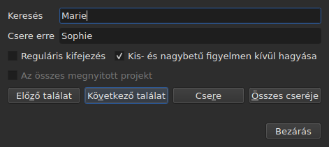
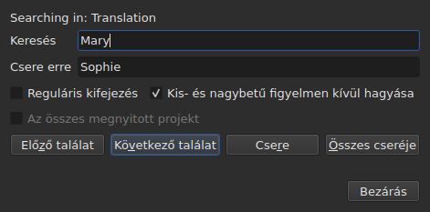

# Keresés és csere

<!-- machine-translated -->
> Ez az oldal gépi fordítás, amelyet a nyelv egyik olvasója még nem nézett át.

A `Szerkesztés ▸ Keresés és csere…` vagy a `Ctrl+F` megnyitja a keresőablakot.




**Az ablak nem modális**: nyitva marad, miközben a táblázatot nézik,
egy cellát szerkesztenek, újra keresnek. A `Close` bezárja; újranyitáskor
úgy kapják vissza, ahogy hagyták, a mintával és a cserével együtt.

| Mező | Mit tartalmaz |
| :--- | :------------ |
| `Find` | a keresett minta |
| `Replace with` | ami a helyére kerül |
| `Regular expression` | a minta sima szöveg helyett reguláris kifejezés |
| `Ignore case` | a „marie” megtalálja a „Marie” szöveget |
| `All open projects` | a keresés az összes lapon végigmegy — [lásd lejjebb](#az-összes-megnyitott-projektben) |

A menüpont üres dokumentumnál le van tiltva: nincs mit keresni.

## A négy művelet

| Gomb | Mit csinál |
| :--- | :--------- |
| `Find Previous` | megkeresi az előző találatot, és a táblázat odaugrik |
| `Find Next` | megkeresi a következőt — ezt a gombot nyomja meg az `Enter` |
| `Replace` | kicseréli a megtalált találatot, majd megkeresi a következőt |
| `Replace All` | kicseréli a cél összes találatát |

Mind a négy le van tiltva, amíg a `Find` üres.

**A táblázat a találathoz ugrik** azáltal, hogy kijelöli a sorát. Az
utolsó elérése után a `Find Next` újra az elsőtől kezd; a `Find Previous` ugyanezt teszi
a másik irányban.

**A `Replace` találat nélkül először keres**: az első megnyomás
megmutatja, mi fog kicserélődni, a következő kicseréli. A Gaupol is
így csinálja.

## Amire a keresés kiterjed

**A kijelölésre, vagy az egész dokumentumra, ha nincs kijelölés** — a
`Tools` menü szabálya. Lásd: [A műveletek](operations.md#amire-hatnak).

**A célt az első művelet rögzíti, és megmarad**, amíg a keresés
tart: a `Find Next` kijelöli egy találat sorát, és ez a
kijelölés nem szűkíti a célt. **Más sorok kézi kijelölése
megváltoztatja a célt** a következő művelethez.

A keresés a feliratsorok szövegére terjed ki; sem a pozíciókat, sem a sorszámot
nem keresi.

### Az összes megnyitott projektben

Az **`All open projects`** jelölőnégyzet minden lapra kiterjeszti a keresést. **Egyetlen
megnyitott projektnél le van tiltva** — nincs mit kiterjeszteni —, a második lap
megnyílásától engedélyezett lesz, és magától kikapcsol, ha már csak egy marad.

**Bejelölve a kijelölés már nem számít**: minden projektben teljes egészében keres a program
**a megcélzott dokumentumban** — az aktuális oszlopéban, a főszövegében vagy a
fordításéban, egyetlen projekthez hasonlóan.

- **A `Find Next` és a `Find Previous` lapról lapra lép, a
  lapok sorrendjében.** Először a megjelenített projekt; ha abban nincs több találat, a
  következő, amelynek lapját az ablak megjeleníti, és amelynek sorát kijelöli.
- **A kör ott ér véget, ahol elkezdődött**: ha a keresés az utolsó
  lapon túl visszatér az elsőre — vagy fordítva, felfelé haladva —, az ablak
  sora ezt jelzi ahelyett, hogy szó nélkül újrakezdené:

  ```text
  Search wrapped around
  ```

  A rá következő lépés közönséges lépés, és a sor kiürül.
- **A `Replace` ott cserél, ahol a keresés tart**, majd továbblép a következő
  találatra, amely lehet másik lapon.
- **A `Replace All` az összes projekten végigmegy**, és **projektenként egy
  előzménybejegyzést hoz létre**: egy lapon visszavonva csak az vonódik vissza, amit az a lap
  kapott. Az összesítés azt mondja meg, hány projekt változott, nem csak hány
  csere történt:

  ```text
  replaced 4 matches in 3 projects
  ```

  Az a projekt, amelyben a minta nincs jelen, érintetlen marad, és nincs mit visszavonni rajta.
  **Egyetlen lap sem kerül előtérbe**: minden projekt a saját lapja
  mögött kapja a cseréit, a lap pedig megkapja a csillagját, és az a lap, ahonnan a művelet
  indult, látható marad, a filmjével együtt.

### Melyik szövegben

**Ha van fordítás, a keresés a két szöveg közül csak az egyikre terjed ki: az
aktuális cella oszlopáéra** — a fordításra, ha az aktuális cella a
`Translation` oszlopban van, máshol a főszövegre. Ez az
összes szövegművelet szabálya, és nincs külön beállítás:
lásd: [A szöveg, amelyre a műveletek vonatkoznak](table.md#a-szöveg-amelyre-a-műveletek-vonatkoznak).

**Az ablak megmondja, melyik szövegben keres**, a
`Find` fölötti sorban, és megváltoztatja, ha az aktuális oszlop változik — nyitott állapotban is:




| Az aktuális cella itt van | A sor ezt mondja |
| :------------------------ | :--------------- |
| a `Translation` oszlopban | `Searching in: Translation` |
| bármely más oszlopban | `Searching in: Main` |
| — a projektnek nincs fordítása, vagy az oszlop el van távolítva | semmit: a sor nincs ott |

**A csere abba a szövegbe ír, és csak abba.** A `Replace` és a `Replace
All` a fordításon nem érinti a főszöveget, és
fordítva; az `Undo` visszaadja, amit írtak. **A címkék annak a szövegnek a
fájlformátumáé**: az Advanced SSA formátumú fordítást a `{\i1}`
címkéivel olvassa a program akkor is, ha a főszöveg SubRip. A `Replace with` ott
ugyanazokkal a címkékkel íródik.

**A táblázat abban az oszlopban marad, ahol volt.** A `Find Next` kijelöli egy találat
sorát anélkül, hogy az aktuális cellát az egyik oszlopból a másikba mozdítaná:
a fordításban elkezdett keresés a fordításban folytatódik.

**A két szövegben egyszerre keresés nem létezik**: minden találat
egy (feliratsor, szöveg) pár volna, és a táblázatnak, amely odaugrik, nem
lenne egyértelmű helye, ahová menjen. Az egyikben keresnek, aztán oszlopot váltanak.

**Ami elölről kezdődik**:

| Művelet | Mi felejtődik el |
| :------ | :--------------- |
| a `Find`, a `Replace with` vagy egy beállítás módosítása | az aktuális találat és az állapotsor |
| más sorok kézi kijelölése | a cél és a találat |
| az aktuális cella mozgatása az egyik szövegből a másikba — a `Text` oszlopból a `Translation` oszlopba vagy fordítva | a találat: ez egy szövegben lévő hely |
| másik fájl megnyitása | a cél és a találat; az ablak nyitva marad, a mintával együtt |

## A keresett szöveg a látható szöveg

**A címkék nem szöveg.** A `<i>` keresése nem talál semmit, a
`Bonjour` keresése viszont megtalálja a címkével kettévágott `<i>Bon</i>jour` szót.

**A csere a fájl szövegében történik, a címkék megtörése nélkül**:

| Szöveg | Keresett → a helyére kerülő | Ami íródik |
| :----- | :-------------------------- | :--------- |
| `<i>Bonjour</i>` | `Bonjour` → `Salut` | `<i>Salut</i>` |
| `<i>Bon</i>jour` | `Bonjour` → `Salut` | `<i>Salut</i>` |
| `<i>Bonjour</i> Marie` | `Bonjour Marie` → `Salut Sophie` | `<i>Salut Sophie</i>` |

A szót kettévágó címke az egész szót körbefogja, és minden stílus, amely érinti a
találatot, a cserét is lefedi. **Azok a címkék, amelyeket a találat nem
érint, a helyükön maradnak**, még az is, amelyik ugyanannak a feliratsornak egy másik szavát vágja ketté:
a `Marie` cseréje a `<i>Bon</i>jour Marie` szövegben ezt adja:
`<i>Bon</i>jour Sophie`. Egy szó betűkből és számjegyekből áll — a nem törhető
szóköz vagy az idézőjel nem része. **A `Replace with` a megcélzott szöveg
címkéi szerint értelmeződik**: ha SubRip fájlban oda `<b>Salut</b>` kerül, a szó félkövér lesz.

## A két lehetőség

| Lehetőség | Alapértelmezés | Mit változtat |
| :-------- | :------------- | :------------ |
| `Regular expression` | nincs bejelölve | a `.` már nem pontot keres, hanem bármely karaktert |
| `Ignore case` | be van jelölve | a kis- és nagybetű nem számít, az ékezetes betűk sem: az `élise` megtalálja az `Élise` szót |

Ezek a Gaupol alapértelmezései. **Mindkettő megmarad** egyik megnyitásról a
másikra és egyik munkamenetről a másikra, a `search.regex` és a
`search.ignore-case` kulcsban, a [beállításfájlban](preferences.md#a-fájl).

### Reguláris kifejezés

A mintát az ICU olvassa. A Gaupolhoz hasonlóan a `.` átlépi a sortörést, a `^`
és a `$` pedig egy feliratsor **minden sorának** elejére és végére vonatkozik:
a `^` cseréje `- ` szövegre kötőjelet tesz minden sor elé.

A `Replace with` mezőben, és csak reguláris kifejezésnél:

| Beírt | Mit tesz be |
| :---- | :---------- |
| `$1` – `$9` | az adott számú csoportot; a hiányzó csoport semmit sem tesz be |
| `$0` | a teljes találatot |
| `\n` | sortörést |
| `\$`, `\\` | egy `$` jelet, egy fordított törtvonalat |
| `\` és utána bármely más karakter | azt a karaktert: a `\t` egy `t` betűt tesz be |

**A `\1` jelölés nem csoport**, és `1` számjegyet tesz be. Ez a Gaupol szintaxisa, amely
a kifejezéseit Pythonban olvassa; az itteni az ICU-é, amely a mintát olvassa.

## Amit az ablak mond

A gombok alatt egy sor megmondja, mit nem tudott a keresés megtenni, vagy mit tett egy
`Replace All`:

| Helyzet | Ami megjelenik |
| :------ | :------------- |
| nincs találat a célban | `"Sophie" not found` |
| nem olvasható reguláris kifejezés | `not a regular expression (U_REGEX_MISMATCHED_PAREN)` |
| a `Replace All` cserélt | `replaced 3 matches` |
| a `Replace All` megtalálta a mintát, de a csere egyetlen szöveget sem változtat | `nothing to change` |

**A találat nélküli keresés semmihez sem nyúl**: a kijelölés ott marad, ahol
volt, és semmi sem kerül az előzményekbe.

**A `not found` és a `nothing to change` nem ugyanazt jelenti.** A `not found`
azt mondja, hogy a minta sehol sincs a célban. A `nothing to change` azt mondja, hogy
megvan, de a csere minden szöveget úgy hagy, ahogy volt — például a
`Marie` cseréje `Marie` szövegre. Mindkét esetben semmi sem kerül
az előzményekbe. A `replaced N matches` száma azoknak a feliratsoroknak a találatait számolja, amelyeknek
a szövege megváltozott.

## Amit a visszavonás művelete mond erről

| Művelet | Amit az `Undo` kiír |
| :------ | :------------------ |
| `Replace` | `Undo: replacing` — egy-egy minden cseréhez |
| `Replace All` | `Undo: replacing all` — **egyetlen bejegyzés**, bármennyi is a találat |

Lásd: [Visszavonás és újra](undo.md).
